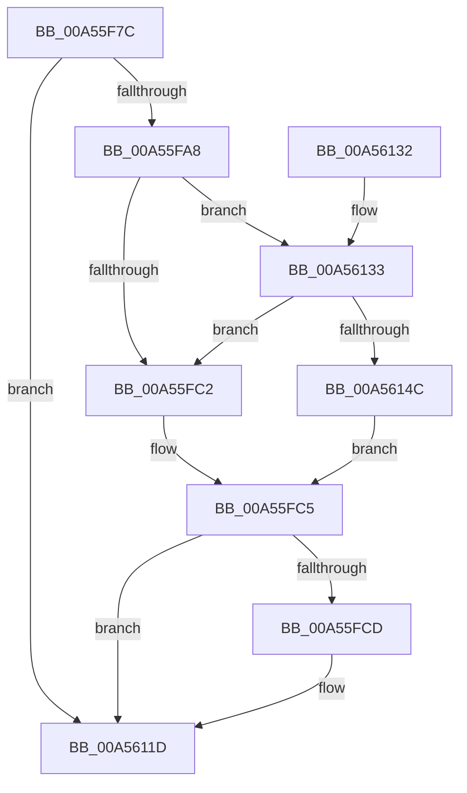

# EtwpWriteAppStateChangeWithStats

- RVA: `0x00A55F7C`–`0x00A56151` (길이 `469` bytes)
- VA: `0x0000000140A55F7C`
- 실행 섹션: `PAGE`
- PDB 이름 있음: `예`; PDB Function 태그: `예`
- unwind 정보 RVA: `0x0009EB18`
- 디코드: `95`개 명령, `469/469` bytes 표시
- 미해석 바이트: `0` (있으면 어셈블리에 `.byte`로 보존)

> 이 문서는 커널 이미지의 기계어와 PDB 기호를 분석해 생성했습니다. 4번과 5번은 함수 원형과 자료형을 바이너리 사용 방식에서 추정한 C 해석이며 원본 소스 복구 결과는 아닙니다.

## 1. Dependencies

- 직접 호출 지점: **3**; 고유 호출 대상: **3**
- 직접 호출자로 확인된 함수: **1**
- RIP 상대 이미지 참조: **5**

### Outgoing calls
- `0x00A55FFA` → [EtwpGetProcessStartKey](../../text/45/EtwpGetProcessStartKey_function_00459180.md) (function, `0x00459180`)
- `0x00A56118` → [tlgWriteTransfer_EtwWriteTransfer](../../text/42/tlgWriteTransfer_EtwWriteTransfer_function_004260E0.md) (function, `0x004260E0`)
- `0x00A56124` → [_security_check_cookie](../../text/6A/_security_check_cookie_function_006AC640.md) (function, `0x006AC640`)

### Direct callers
- [EtwTraceAppStateChange](../8A/EtwTraceAppStateChange_function_008A452C.md) at `0x008A485C`

### Static image references
- `0x00A55F8A` → RVA `0x00E0A740` (`.data`; read)
- `0x00A55F98` → RVA `0x00E091A0` (`.data`; read)
- `0x00A55FB5` → RVA `0x00E091B0` (`.data`; read)
- `0x00A56006` → RVA `0x000546AF` (`.rdata`; read)
- `0x00A56133` → RVA `0x00E091B8` (`.data`; read)

## 2. Other-region calls and transfers

- 다른 실행 섹션으로 향하는 call: **3**
  - `0x00A55FFA` → [EtwpGetProcessStartKey](../../text/45/EtwpGetProcessStartKey_function_00459180.md) (`PAGE` → `.text`)
  - `0x00A56118` → [tlgWriteTransfer_EtwWriteTransfer](../../text/42/tlgWriteTransfer_EtwWriteTransfer_function_004260E0.md) (`PAGE` → `.text`)
  - `0x00A56124` → [_security_check_cookie](../../text/6A/_security_check_cookie_function_006AC640.md) (`PAGE` → `.text`)
- 별도 외부 분기/꼬리 이동을 확인하지 못했습니다.

## 3. Assembly (complete function range)

```asm
00A55F7C  40 55                           push rbp
00A55F7E  48 8D 6C 24 D0                  lea rbp, [rsp - 0x30]
00A55F83  48 81 EC 30 01 00 00            sub rsp, 0x130
00A55F8A  48 8B 05 AF 47 3B 00            mov rax, qword ptr [rip + 0x3b47af]
00A55F91  48 33 C4                        xor rax, rsp
00A55F94  48 89 45 20                     mov qword ptr [rbp + 0x20], rax
00A55F98  83 3D 01 32 3B 00 05            cmp dword ptr [rip + 0x3b3201], 5
00A55F9F  4C 8B C9                        mov r9, rcx
00A55FA2  0F 86 75 01 00 00               jbe 0x140a5611d
00A55FA8  48 B9 03 00 00 00 00 20 00 00   movabs rcx, 0x200000000003
00A55FB2  45 33 DB                        xor r11d, r11d
00A55FB5  48 85 0D F4 31 3B 00            test qword ptr [rip + 0x3b31f4], rcx
00A55FBC  0F 85 71 01 00 00               jne 0x140a56133
00A55FC2  41 8A C3                        mov al, r11b
00A55FC5  84 C0                           test al, al
00A55FC7  0F 84 50 01 00 00               je 0x140a5611d
00A55FCD  41 8B 81 D0 01 00 00            mov eax, dword ptr [r9 + 0x1d0]
00A55FD4  49 8B C9                        mov rcx, r9
00A55FD7  89 44 24 34                     mov dword ptr [rsp + 0x34], eax
00A55FDB  48 8D 44 24 34                  lea rax, [rsp + 0x34]
00A55FE0  48 89 45 80                     mov qword ptr [rbp - 0x80], rax
00A55FE4  48 89 54 24 70                  mov qword ptr [rsp + 0x70], rdx
00A55FE9  48 C7 44 24 78 62 00 00 00      mov qword ptr [rsp + 0x78], 0x62
00A55FF2  48 C7 45 88 04 00 00 00         mov qword ptr [rbp - 0x78], 4
00A55FFA  E8 81 31 A0 FF                  call 0x140459180
00A55FFF  41 8A 89 FB 05 00 00            mov cl, byte ptr [r9 + 0x5fb]
00A56006  48 8D 15 A2 E6 5F FF            lea rdx, [rip - 0xa0195e]
00A5600D  48 89 44 24 40                  mov qword ptr [rsp + 0x40], rax
00A56012  48 8D 44 24 40                  lea rax, [rsp + 0x40]
00A56017  48 89 45 90                     mov qword ptr [rbp - 0x70], rax
00A5601B  41 8B 81 54 05 00 00            mov eax, dword ptr [r9 + 0x554]
00A56022  89 44 24 38                     mov dword ptr [rsp + 0x38], eax
00A56026  48 8D 44 24 38                  lea rax, [rsp + 0x38]
00A5602B  48 89 45 A0                     mov qword ptr [rbp - 0x60], rax
00A5602F  41 8B 81 FC 05 00 00            mov eax, dword ptr [r9 + 0x5fc]
00A56036  C1 E8 02                        shr eax, 2
00A56039  24 01                           and al, 1
00A5603B  4C 89 45 F0                     mov qword ptr [rbp - 0x10], r8
00A5603F  88 44 24 30                     mov byte ptr [rsp + 0x30], al
00A56043  45 33 C0                        xor r8d, r8d
00A56046  48 8D 44 24 30                  lea rax, [rsp + 0x30]
00A5604B  48 C7 45 98 08 00 00 00         mov qword ptr [rbp - 0x68], 8
00A56053  48 89 45 B0                     mov qword ptr [rbp - 0x50], rax
00A56057  8A C1                           mov al, cl
00A56059  24 07                           and al, 7
00A5605B  48 C7 45 A8 04 00 00 00         mov qword ptr [rbp - 0x58], 4
00A56063  88 44 24 31                     mov byte ptr [rsp + 0x31], al
00A56067  48 8D 44 24 31                  lea rax, [rsp + 0x31]
00A5606C  48 89 45 C0                     mov qword ptr [rbp - 0x40], rax
00A56070  8A C1                           mov al, cl
00A56072  C0 E8 03                        shr al, 3
00A56075  24 07                           and al, 7
00A56077  C0 E9 06                        shr cl, 6
00A5607A  88 44 24 32                     mov byte ptr [rsp + 0x32], al
00A5607E  80 E1 01                        and cl, 1
00A56081  48 8D 44 24 32                  lea rax, [rsp + 0x32]
00A56086  88 4C 24 33                     mov byte ptr [rsp + 0x33], cl
00A5608A  48 89 45 D0                     mov qword ptr [rbp - 0x30], rax
00A5608E  48 8D 0D 0B 31 3B 00            lea rcx, [rip + 0x3b310b]
00A56095  48 8D 44 24 33                  lea rax, [rsp + 0x33]
00A5609A  48 C7 45 B8 01 00 00 00         mov qword ptr [rbp - 0x48], 1
00A560A2  48 89 45 E0                     mov qword ptr [rbp - 0x20], rax
00A560A6  41 8B 81 A8 04 00 00            mov eax, dword ptr [r9 + 0x4a8]
00A560AD  89 44 24 3C                     mov dword ptr [rsp + 0x3c], eax
00A560B1  48 8D 44 24 3C                  lea rax, [rsp + 0x3c]
00A560B6  48 89 45 00                     mov qword ptr [rbp], rax
00A560BA  49 8B 81 A8 06 00 00            mov rax, qword ptr [r9 + 0x6a8]
00A560C1  45 33 C9                        xor r9d, r9d
00A560C4  48 C1 E0 0C                     shl rax, 0xc
00A560C8  48 89 44 24 48                  mov qword ptr [rsp + 0x48], rax
00A560CD  48 8D 44 24 48                  lea rax, [rsp + 0x48]
00A560D2  48 89 45 10                     mov qword ptr [rbp + 0x10], rax
00A560D6  48 8D 44 24 50                  lea rax, [rsp + 0x50]
00A560DB  48 89 44 24 28                  mov qword ptr [rsp + 0x28], rax
00A560E0  C7 44 24 20 0D 00 00 00         mov dword ptr [rsp + 0x20], 0xd
00A560E8  48 C7 45 C8 01 00 00 00         mov qword ptr [rbp - 0x38], 1
00A560F0  48 C7 45 D8 01 00 00 00         mov qword ptr [rbp - 0x28], 1
00A560F8  48 C7 45 E8 01 00 00 00         mov qword ptr [rbp - 0x18], 1
00A56100  48 C7 45 F8 2C 00 00 00         mov qword ptr [rbp - 8], 0x2c
00A56108  48 C7 45 08 04 00 00 00         mov qword ptr [rbp + 8], 4
00A56110  48 C7 45 18 08 00 00 00         mov qword ptr [rbp + 0x18], 8
00A56118  E8 C3 FF 9C FF                  call 0x1404260e0
00A5611D  48 8B 4D 20                     mov rcx, qword ptr [rbp + 0x20]
00A56121  48 33 CC                        xor rcx, rsp
00A56124  E8 17 65 C5 FF                  call 0x1406ac640
00A56129  48 81 C4 30 01 00 00            add rsp, 0x130
00A56130  5D                              pop rbp
00A56131  C3                              ret
00A56132  CC                              int3
00A56133  48 8B 05 7E 30 3B 00            mov rax, qword ptr [rip + 0x3b307e]
00A5613A  48 23 C1                        and rax, rcx
00A5613D  48 3B 05 74 30 3B 00            cmp rax, qword ptr [rip + 0x3b3074]
00A56144  B0 01                           mov al, 1
00A56146  0F 85 76 FE FF FF               jne 0x140a55fc2
00A5614C  E9 74 FE FF FF                  jmp 0x140a55fc5
```

## 4. C-style interpretation (structured pseudocode)

```c
__int64 __fastcall EtwpWriteAppStateChangeWithStats(__int64 a1, __int64 a2, __int64 a3)
{
    __int64 result;
    __int64 v_r11;
    __int64 v_rsp;
    unsigned int v_stack_m100;
    unsigned int v_stack_m104;
    unsigned __int8 v_stack_m105;
    unsigned __int8 v_stack_m106;
    unsigned __int8 v_stack_m107;
    unsigned __int8 v_stack_m108;
    unsigned __int64 v_stack_m110;
    unsigned int v_stack_m118;
    unsigned __int64 v_stack_m18;
    unsigned __int64 v_stack_m20;
    unsigned __int64 v_stack_m28;
    unsigned __int64 v_stack_m30;
    unsigned __int64 v_stack_m38;
    unsigned __int64 v_stack_m40;
    unsigned __int64 v_stack_m48;
    unsigned __int64 v_stack_m50;
    unsigned __int64 v_stack_m58;
    unsigned __int64 v_stack_m60;
    unsigned __int64 v_stack_m68;
    unsigned __int64 v_stack_m70;
    unsigned __int64 v_stack_m78;
    unsigned __int64 v_stack_m80;
    unsigned __int64 v_stack_m88;
    unsigned __int64 v_stack_m90;
    unsigned __int64 v_stack_m98;
    unsigned __int64 v_stack_mA0;
    unsigned __int64 v_stack_mA8;
    unsigned __int64 v_stack_mB0;
    unsigned __int64 v_stack_mB8;
    unsigned __int64 v_stack_mC0;
    unsigned __int64 v_stack_mC8;
    unsigned __int64 v_stack_mE8;
    unsigned __int64 v_stack_mF0;
    unsigned __int64 v_stack_mF8;
    unsigned int v_stack_mFC;

    v_rsp = (v_rsp) - (304);
    result = (*(unsigned __int64 *)(v_rip + 3884975)) ^ (v_rsp);
    v_stack_m18 = result;
    if ((*(unsigned int *)(v_rip + 3879425)) <= 5) goto loc_00A5611D;
    v_r11 = 0;
    if (((*(unsigned __int64 *)(v_rip + 3879412)) & (a1)) != 0) goto loc_00A56133;
loc_00A55FC2:
loc_00A55FC5:
    result = 0;
    if (0 != 0) {
        result = *(unsigned int *)(a1 + 464);
        a1 = a1;
        v_stack_m104 = (unsigned int)(result);
        result = v_stack_m104;
        v_stack_mB8 = result;
        v_stack_mC8 = a2;
        v_stack_mC0 = 98;
        v_stack_mB0 = 4;
        result = EtwpGetProcessStartKey(a1, a2, a3, a1);
        a1 = *(unsigned __int8 *)(a1 + 1531);
        a2 = v_rip - 10492254;
        v_stack_mF8 = result;
        result = v_stack_mF8;
        v_stack_mA8 = result;
        result = *(unsigned int *)(a1 + 1364);
        v_stack_m100 = (unsigned int)(result);
        result = v_stack_m100;
        v_stack_m98 = result;
        result = *(unsigned int *)(a1 + 1532);
        result = (unsigned int)((result) >> (2));
        result = (unsigned __int8)((result) & (1));
        v_stack_m48 = a3;
        v_stack_m108 = (unsigned __int8)(result);
        a3 = 0;
        result = v_stack_m108;
        v_stack_mA0 = 8;
        v_stack_m88 = result;
        result = (unsigned __int8)(a1);
        result = (unsigned __int8)((result) & (7));
        v_stack_m90 = 4;
        v_stack_m107 = (unsigned __int8)(result);
        result = v_stack_m107;
        v_stack_m78 = result;
        result = (unsigned __int8)(a1);
        result = (unsigned __int8)((result) >> (3));
        result = (unsigned __int8)((result) & (7));
        a1 = (unsigned __int8)((a1) >> (6));
        v_stack_m106 = (unsigned __int8)(result);
        a1 = (unsigned __int8)((a1) & (1));
        result = v_stack_m106;
        v_stack_m105 = (unsigned __int8)(a1);
        v_stack_m68 = result;
        a1 = v_rip + 3879179;
        result = v_stack_m105;
        v_stack_m80 = 1;
        v_stack_m58 = result;
        result = *(unsigned int *)(a1 + 1192);
        v_stack_mFC = (unsigned int)(result);
        result = v_stack_mFC;
        v_stack_m38 = result;
        result = *(unsigned __int64 *)(a1 + 1704);
        a4 = 0;
        result = (result) << (12);
        v_stack_mF0 = result;
        result = v_stack_mF0;
        v_stack_m28 = result;
        result = v_stack_mE8;
        v_stack_m110 = result;
        v_stack_m118 = 13;
        v_stack_m70 = 1;
        v_stack_m60 = 1;
        v_stack_m50 = 1;
        v_stack_m40 = 44;
        v_stack_m30 = 4;
        v_stack_m20 = 8;
        result = tlgWriteTransfer_EtwWriteTransfer(a1, a2, a3, a4);
    }
    a1 = (v_stack_m18) ^ (v_rsp);
    result = _security_check_cookie(a1, a2, a3, a4);
    v_rsp = (v_rsp) + (304);
    return result;
loc_00A56133:
    result = (*(unsigned __int64 *)(v_rip + 3879038)) & (a1);
    if (result != (*(unsigned __int64 *)(v_rip + 3879028))) goto loc_00A55FC2;
    goto loc_00A55FC5;
}
```

## 5. (Beta) C Style

```c
int64_t EtwpWriteAppStateChangeWithStats(void *Arg1, int64_t Arg2, int64_t Arg3)
{
    uint8_t *arg1 = (uint8_t *)Arg1;

    int64_t result;
    int64_t local_r11;
    int64_t local_rsp;
    uint32_t v_stack_m100;
    uint32_t v_stack_m104;
    uint8_t v_stack_m105;
    uint8_t v_stack_m106;
    uint8_t v_stack_m107;
    uint8_t v_stack_m108;
    uint64_t v_stack_m110;
    uint32_t v_stack_m118;
    uint64_t v_stack_m18;
    uint64_t v_stack_m20;
    uint64_t v_stack_m28;
    uint64_t v_stack_m30;
    uint64_t v_stack_m38;
    uint64_t v_stack_m40;
    uint64_t v_stack_m48;
    uint64_t v_stack_m50;
    uint64_t v_stack_m58;
    uint64_t v_stack_m60;
    uint64_t v_stack_m68;
    uint64_t v_stack_m70;
    uint64_t v_stack_m78;
    uint64_t v_stack_m80;
    uint64_t v_stack_m88;
    uint64_t v_stack_m90;
    uint64_t v_stack_m98;
    uint64_t v_stack_mA0;
    uint64_t v_stack_mA8;
    uint64_t v_stack_mB0;
    uint64_t v_stack_mB8;
    uint64_t v_stack_mC0;
    uint64_t v_stack_mC8;
    uint64_t v_stack_mE8;
    uint64_t v_stack_mF0;
    uint64_t v_stack_mF8;
    uint32_t v_stack_mFC;

    local_rsp = (local_rsp) - (304);
    result = (*(uint64_t *)(v_rip + 0x3B47AF)) ^ (local_rsp);
    v_stack_m18 = result;
    if ((*(uint32_t *)(v_rip + 0x3B3201)) <= 5) goto loc_00A5611D;
    local_r11 = 0;
    if (((*(uint64_t *)(v_rip + 0x3B31F4)) & (Arg1)) != 0) goto loc_00A56133;
loc_00A55FC2:
loc_00A55FC5:
    result = 0;
    if (0 != 0) {
        result = *(uint32_t *)(arg1 + 0x1D0);
        Arg1 = Arg1;
        v_stack_m104 = (uint32_t)(result);
        result = v_stack_m104;
        v_stack_mB8 = result;
        v_stack_mC8 = Arg2;
        v_stack_mC0 = 98;
        v_stack_mB0 = 4;
        result = EtwpGetProcessStartKey(Arg1, Arg2, Arg3, Arg1);
        Arg1 = *(uint8_t *)(arg1 + 0x5FB);
        Arg2 = v_rip - 10492254;
        v_stack_mF8 = result;
        result = v_stack_mF8;
        v_stack_mA8 = result;
        result = *(uint32_t *)(arg1 + 0x554);
        v_stack_m100 = (uint32_t)(result);
        result = v_stack_m100;
        v_stack_m98 = result;
        result = *(uint32_t *)(arg1 + 0x5FC);
        result = (uint32_t)((result) >> (2));
        result = (uint8_t)((result) & (1));
        v_stack_m48 = Arg3;
        v_stack_m108 = (uint8_t)(result);
        Arg3 = 0;
        result = v_stack_m108;
        v_stack_mA0 = 8;
        v_stack_m88 = result;
        result = (uint8_t)(Arg1);
        result = (uint8_t)((result) & (7));
        v_stack_m90 = 4;
        v_stack_m107 = (uint8_t)(result);
        result = v_stack_m107;
        v_stack_m78 = result;
        result = (uint8_t)(Arg1);
        result = (uint8_t)((result) >> (3));
        result = (uint8_t)((result) & (7));
        Arg1 = (uint8_t)((Arg1) >> (6));
        v_stack_m106 = (uint8_t)(result);
        Arg1 = (uint8_t)((Arg1) & (1));
        result = v_stack_m106;
        v_stack_m105 = (uint8_t)(Arg1);
        v_stack_m68 = result;
        Arg1 = v_rip + 3879179;
        result = v_stack_m105;
        v_stack_m80 = 1;
        v_stack_m58 = result;
        result = *(uint32_t *)(arg1 + 0x4A8);
        v_stack_mFC = (uint32_t)(result);
        result = v_stack_mFC;
        v_stack_m38 = result;
        result = *(uint64_t *)(arg1 + 0x6A8);
        a4 = 0;
        result = (result) << (12);
        v_stack_mF0 = result;
        result = v_stack_mF0;
        v_stack_m28 = result;
        result = v_stack_mE8;
        v_stack_m110 = result;
        v_stack_m118 = 13;
        v_stack_m70 = 1;
        v_stack_m60 = 1;
        v_stack_m50 = 1;
        v_stack_m40 = 44;
        v_stack_m30 = 4;
        v_stack_m20 = 8;
        result = tlgWriteTransfer_EtwWriteTransfer(Arg1, Arg2, Arg3, a4);
    }
    Arg1 = (v_stack_m18) ^ (local_rsp);
    result = _security_check_cookie(Arg1, Arg2, Arg3, a4);
    local_rsp = (local_rsp) + (304);
    return result;
loc_00A56133:
    result = (*(uint64_t *)(v_rip + 0x3B307E)) & (Arg1);
    if (result != (*(uint64_t *)(v_rip + 0x3B3074))) goto loc_00A55FC2;
    goto loc_00A55FC5;
}
```

### 관측된 메모리 오프셋

구조체 형식이 확인되지 않은 접근은 인자 기준의 오프셋으로만 기록했습니다.

| 기준 인자 | 오프셋 표현 | 폭 (bit) | 접근 |
|---|---:|---:|---|
| `Arg1` | `+ 0x1D0` | `32` | `R` |

## 6. Execution-region graph

[열기: 2D/3D 그래프와 함수 탐색 컨트롤 패널](../../../control-panel.html?section=page&rva=0x00A55F7C&view=graph)

- 2D 그래프는 위에서 아래로 흐르고, 3D 그래프는 빈 공간을 드래그해 회전합니다. Shift+드래그는 이동, 휠은 확대·축소, 함수 노드 선택은 대상 보고서 이동입니다.

### Static fallback


