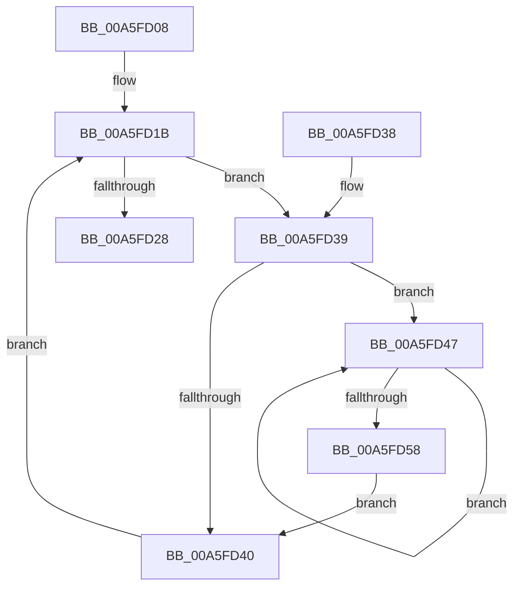

# ExpCompactPrivatePools

- RVA: `0x00A5FD08`–`0x00A5FD5A` (길이 `82` bytes)
- VA: `0x0000000140A5FD08`
- 실행 섹션: `PAGE`
- PDB 이름 있음: `예`; PDB Function 태그: `아니요`
- unwind 정보 RVA: `0x0008E15C`
- 디코드: `28`개 명령, `82/82` bytes 표시
- 미해석 바이트: `0` (있으면 어셈블리에 `.byte`로 보존)

> 이 문서는 커널 이미지의 기계어와 PDB 기호를 분석해 생성했습니다. 4번과 5번은 함수 원형과 자료형을 바이너리 사용 방식에서 추정한 C 해석이며 원본 소스 복구 결과는 아닙니다.

## 1. Dependencies

- 직접 호출 지점: **2**; 고유 호출 대상: **2**
- 직접 호출자로 확인된 함수: **1**
- RIP 상대 이미지 참조: **0**

### Outgoing calls
- `0x00A5FD1B` → [ExpPrivatePoolGetNext](ExpPrivatePoolGetNext_function_00A5FD60.md) (function, `0x00A5FD60`)
- `0x00A5FD4C` → [RtlpHpHeapCompact](../../text/2E/RtlpHpHeapCompact_function_002E7654.md) (function, `0x002E7654`)

### Direct callers
- [ExpHpCompactionRoutine](../../text/49/ExpHpCompactionRoutine_function_00491150.md) at `0x00491167`

### Static image references
- 디코드된 RIP-relative 메모리 참조가 없습니다.

## 2. Other-region calls and transfers

- 다른 실행 섹션으로 향하는 call: **1**
  - `0x00A5FD4C` → [RtlpHpHeapCompact](../../text/2E/RtlpHpHeapCompact_function_002E7654.md) (`PAGE` → `.text`)
- 별도 외부 분기/꼬리 이동을 확인하지 못했습니다.

## 3. Assembly (complete function range)

```asm
00A5FD08  48 89 5C 24 08                  mov qword ptr [rsp + 8], rbx
00A5FD0D  48 89 74 24 10                  mov qword ptr [rsp + 0x10], rsi
00A5FD12  57                              push rdi
00A5FD13  48 83 EC 20                     sub rsp, 0x20
00A5FD17  8B F1                           mov esi, ecx
00A5FD19  33 D2                           xor edx, edx
00A5FD1B  E8 40 00 00 00                  call 0x140a5fd60
00A5FD20  48 8B D8                        mov rbx, rax
00A5FD23  48 85 C0                        test rax, rax
00A5FD26  75 11                           jne 0x140a5fd39
00A5FD28  48 8B 5C 24 30                  mov rbx, qword ptr [rsp + 0x30]
00A5FD2D  48 8B 74 24 38                  mov rsi, qword ptr [rsp + 0x38]
00A5FD32  48 83 C4 20                     add rsp, 0x20
00A5FD36  5F                              pop rdi
00A5FD37  C3                              ret
00A5FD38  CC                              int3
00A5FD39  33 FF                           xor edi, edi
00A5FD3B  39 7B 48                        cmp dword ptr [rbx + 0x48], edi
00A5FD3E  77 07                           ja 0x140a5fd47
00A5FD40  48 8B D3                        mov rdx, rbx
00A5FD43  8B CE                           mov ecx, esi
00A5FD45  EB D4                           jmp 0x140a5fd1b
00A5FD47  48 8B 4C FB 50                  mov rcx, qword ptr [rbx + rdi*8 + 0x50]
00A5FD4C  E8 03 79 88 FF                  call 0x1402e7654
00A5FD51  FF C7                           inc edi
00A5FD53  3B 7B 48                        cmp edi, dword ptr [rbx + 0x48]
00A5FD56  72 EF                           jb 0x140a5fd47
00A5FD58  EB E6                           jmp 0x140a5fd40
```

## 4. C-style interpretation (structured pseudocode)

```c
__int64 __fastcall ExpCompactPrivatePools(int a1, int a2)
{
    __int64 result;
    __int64 v_rdi;
    __int64 v_rsp;
    unsigned __int64 v_stack_p10;
    unsigned __int64 v_stack_p8;

    v_stack_p8 = v_rbx;
    v_stack_p10 = v_rsi;
    v_rsp = (v_rsp) - (32);
    a2 = 0;
loc_00A5FD1B:
    result = ExpPrivatePoolGetNext(a1, a2, a3, a4);
    if (result != 0) goto loc_00A5FD39;
    v_rsp = (v_rsp) + (32);
    return result;
loc_00A5FD39:
    v_rdi = 0;
    if ((*(unsigned int *)(v_stack_p8 + 72)) > 0) goto loc_00A5FD47;
loc_00A5FD40:
    goto loc_00A5FD1B;
loc_00A5FD47:
    result = RtlpHpHeapCompact(*(unsigned __int64 *)(v_stack_p8 + v_rdi * 8 + 80), v_stack_p8, a3, a4);
    v_rdi = (unsigned int)((v_rdi) + 1);
    if (((unsigned int)(v_rdi)) < (*(unsigned int *)(v_stack_p8 + 72))) goto loc_00A5FD47;
    goto loc_00A5FD40;
}
```

## 5. (Beta) C Style

```c
int64_t ExpCompactPrivatePools(int32_t Arg1, int32_t Arg2)
{
    int64_t result;
    int64_t local_rdi;
    int64_t local_rsp;
    uint64_t v_stack_p10;
    uint64_t v_stack_p8;

    v_stack_p8 = local_rbx;
    v_stack_p10 = local_rsi;
    local_rsp = (local_rsp) - (32);
    Arg2 = 0;
loc_00A5FD1B:
    result = ExpPrivatePoolGetNext(Arg1, Arg2, a3, a4);
    if (result != 0) goto loc_00A5FD39;
    local_rsp = (local_rsp) + (32);
    return result;
loc_00A5FD39:
    local_rdi = 0;
    if ((*(uint32_t *)(v_stack_p8 + 0x48)) > 0) goto loc_00A5FD47;
loc_00A5FD40:
    goto loc_00A5FD1B;
loc_00A5FD47:
    result = RtlpHpHeapCompact(*(uint64_t *)(v_stack_p8 + local_rdi * 8 + 0x50), v_stack_p8, a3, a4);
    local_rdi = (uint32_t)((local_rdi) + 1);
    if (((uint32_t)(local_rdi)) < (*(uint32_t *)(v_stack_p8 + 0x48))) goto loc_00A5FD47;
    goto loc_00A5FD40;
}
```

## 6. Execution-region graph

[열기: 2D/3D 그래프와 함수 탐색 컨트롤 패널](../../../control-panel.html?section=page&rva=0x00A5FD08&view=graph)

- 2D 그래프는 위에서 아래로 흐르고, 3D 그래프는 빈 공간을 드래그해 회전합니다. Shift+드래그는 이동, 휠은 확대·축소, 함수 노드 선택은 대상 보고서 이동입니다.

### Static fallback


