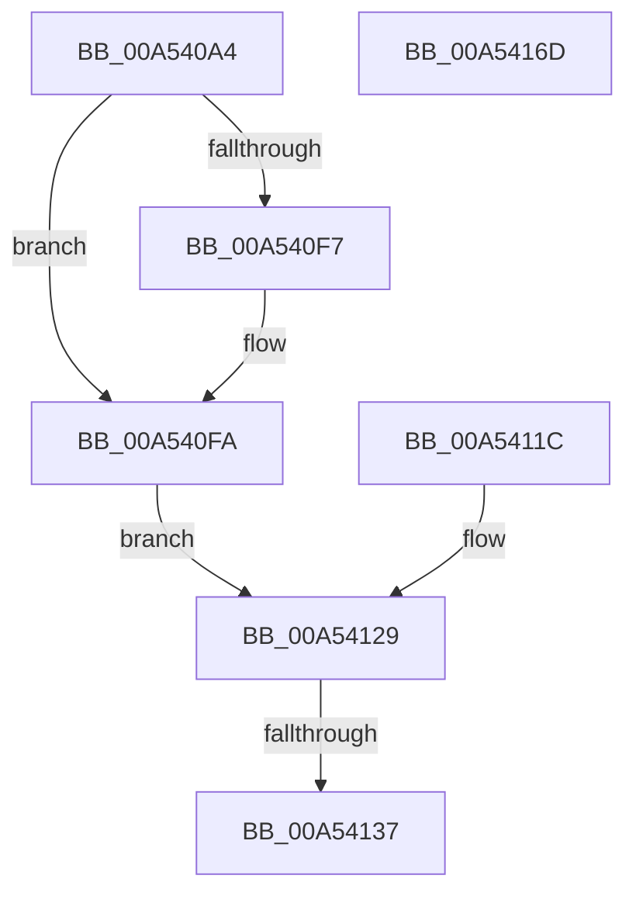

# ExpGetSystemFlushInformation

- RVA: `0x00A540A4`–`0x00A5416E` (길이 `202` bytes)
- VA: `0x0000000140A540A4`
- 실행 섹션: `PAGE`
- PDB 이름 있음: `예`; PDB Function 태그: `예`
- unwind 정보 RVA: `0x000B1044`
- 디코드: `53`개 명령, `202/202` bytes 표시
- 미해석 바이트: `0` (있으면 어셈블리에 `.byte`로 보존)

> 이 문서는 커널 이미지의 기계어와 PDB 기호를 분석해 생성했습니다. 4번과 5번은 함수 원형과 자료형을 바이너리 사용 방식에서 추정한 C 해석이며 원본 소스 복구 결과는 아닙니다.

## 1. Dependencies

- 직접 호출 지점: **1**; 고유 호출 대상: **1**
- 직접 호출자로 확인된 함수: **1**
- RIP 상대 이미지 참조: **4**

### Outgoing calls
- `0x00A5414D` → [_security_check_cookie](../../text/6A/_security_check_cookie_function_006AC640.md) (function, `0x006AC640`)

### Direct callers
- [ExpQuerySystemInformation](ExpQuerySystemInformation_function_00A57858.md) at `0x00A5ADCD`

### Static image references
- `0x00A540BD` → RVA `0x00E0A740` (`.data`; read)
- `0x00A540D9` → RVA `0x00FC6B30` (`ALMOSTRO`; read)
- `0x00A54129` → RVA `0x00E68540` (`.data`; read)
- `0x00A54137` → RVA `0x00E68538` (`.data`; read)

## 2. Other-region calls and transfers

- 다른 실행 섹션으로 향하는 call: **1**
  - `0x00A5414D` → [_security_check_cookie](../../text/6A/_security_check_cookie_function_006AC640.md) (`PAGE` → `.text`)
- call이 아닌 외부 분기/꼬리 이동: **1**
  - `0x00A54131` → [sub_00B3D4BC](../B3/Unknown_function_00B3D4BC.md) (`tail-transfer`)

## 3. Assembly (complete function range)

```asm
00A540A4  48 89 5C 24 10                  mov qword ptr [rsp + 0x10], rbx
00A540A9  48 89 74 24 18                  mov qword ptr [rsp + 0x18], rsi
00A540AE  48 89 7C 24 20                  mov qword ptr [rsp + 0x20], rdi
00A540B3  41 55                           push r13
00A540B5  41 56                           push r14
00A540B7  41 57                           push r15
00A540B9  48 83 EC 60                     sub rsp, 0x60
00A540BD  48 8B 05 7C 66 3B 00            mov rax, qword ptr [rip + 0x3b667c]
00A540C4  48 33 C4                        xor rax, rsp
00A540C7  48 89 44 24 50                  mov qword ptr [rsp + 0x50], rax
00A540CC  48 8B F9                        mov rdi, rcx
00A540CF  48 89 4C 24 28                  mov qword ptr [rsp + 0x28], rcx
00A540D4  33 DB                           xor ebx, ebx
00A540D6  44 8B C3                        mov r8d, ebx
00A540D9  48 8B 15 50 2A 57 00            mov rdx, qword ptr [rip + 0x572a50]
00A540E0  48 C1 EA 22                     shr rdx, 0x22
00A540E4  83 E2 04                        and edx, 4
00A540E7  8D 73 01                        lea esi, [rbx + 1]
00A540EA  0B D6                           or edx, esi
00A540EC  48 0F BA 25 3B 2A 57 00 23      bt qword ptr [rip + 0x572a3b], 0x23
00A540F5  73 03                           jae 0x140a540fa
00A540F7  83 CA 02                        or edx, 2
00A540FA  89 11                           mov dword ptr [rcx], edx
00A540FC  65 48 8B 04 25 20 00 00 00      mov rax, qword ptr gs:[0x20]
00A54105  8B 88 E8 00 00 00               mov ecx, dword ptr [rax + 0xe8]
00A5410B  89 4F 04                        mov dword ptr [rdi + 4], ecx
00A5410E  48 89 5F 08                     mov qword ptr [rdi + 8], rbx
00A54112  48 89 5F 10                     mov qword ptr [rdi + 0x10], rbx
00A54116  48 89 5F 18                     mov qword ptr [rdi + 0x18], rbx
00A5411A  EB 0D                           jmp 0x140a54129
00A5411C  44 8B C0                        mov r8d, eax
00A5411F  33 DB                           xor ebx, ebx
00A54121  8D 73 01                        lea esi, [rbx + 1]
00A54124  48 8B 7C 24 28                  mov rdi, qword ptr [rsp + 0x28]
00A54129  8A 05 11 44 41 00               mov al, byte ptr [rip + 0x414411]
00A5412F  84 C0                           test al, al
00A54131  0F 84 85 93 0E 00               je 0x140b3d4bc
00A54137  48 8B 0D FA 43 41 00            mov rcx, qword ptr [rip + 0x4143fa]
00A5413E  48 89 4F 08                     mov qword ptr [rdi + 8], rcx
00A54142  41 8B C0                        mov eax, r8d
00A54145  48 8B 4C 24 50                  mov rcx, qword ptr [rsp + 0x50]
00A5414A  48 33 CC                        xor rcx, rsp
00A5414D  E8 EE 84 C5 FF                  call 0x1406ac640
00A54152  4C 8D 5C 24 60                  lea r11, [rsp + 0x60]
00A54157  49 8B 5B 28                     mov rbx, qword ptr [r11 + 0x28]
00A5415B  49 8B 73 30                     mov rsi, qword ptr [r11 + 0x30]
00A5415F  49 8B 7B 38                     mov rdi, qword ptr [r11 + 0x38]
00A54163  49 8B E3                        mov rsp, r11
00A54166  41 5F                           pop r15
00A54168  41 5E                           pop r14
00A5416A  41 5D                           pop r13
00A5416C  C3                              ret
00A5416D  CC                              int3
```

## 4. C-style interpretation (structured pseudocode)

```c
__int64 __fastcall ExpGetSystemFlushInformation(__int64 a1)
{
    __int64 result;
    __int64 v_rbx;
    __int64 v_rsp;
    unsigned __int64 v_stack_m18;
    unsigned __int64 v_stack_m28;
    unsigned __int64 v_stack_m50;
    unsigned __int64 v_stack_p10;
    unsigned __int64 v_stack_p18;
    unsigned __int64 v_stack_p20;

    v_stack_p10 = v_rbx;
    v_stack_p18 = v_rsi;
    v_stack_p20 = v_rdi;
    v_rsp = (v_rsp) - (96);
    result = (*(unsigned __int64 *)(v_rip + 3892860)) ^ (v_rsp);
    v_stack_m28 = result;
    v_stack_m50 = a1;
    v_rbx = 0;
    a2 = (*(unsigned __int64 *)(v_rip + 5712464)) >> (34);
    a2 = (unsigned int)((a2) & (4));
    a2 = (unsigned int)((a2) | ((unsigned int)(v_rbx + 1)));
    if (!(condition_is_above_or_equal)) {
        a2 = (unsigned int)((a2) | (2));
    }
    *(unsigned int *)(a1) = (unsigned int)(a2);
    *(unsigned int *)(a1 + 4) = (unsigned int)((unsigned int)(*(unsigned int *)(*(unsigned __int64 *)(gs_base + (0 + 32)) + 232)));
    *(unsigned __int64 *)(a1 + 8) = 0;
    *(unsigned __int64 *)(a1 + 16) = 0;
    *(unsigned __int64 *)(a1 + 24) = 0;
    goto loc_00A54129;
loc_00A54129:
    *(unsigned __int64 *)(a1 + 8) = *(unsigned __int64 *)(v_rip + 4277242);
    a1 = (v_stack_m28) ^ (v_rsp);
    result = _security_check_cookie(a1, a2, 0, a4);
    return result;
}
```

## 5. (Beta) C Style

```c
int64_t ExpGetSystemFlushInformation(void *Arg1)
{
    uint8_t *arg1 = (uint8_t *)Arg1;

    int64_t result;
    int64_t local_rbx;
    int64_t local_rsp;
    uint64_t v_stack_m18;
    uint64_t v_stack_m28;
    uint64_t v_stack_m50;
    uint64_t v_stack_p10;
    uint64_t v_stack_p18;
    uint64_t v_stack_p20;

    v_stack_p10 = local_rbx;
    v_stack_p18 = local_rsi;
    v_stack_p20 = local_rdi;
    local_rsp = (local_rsp) - (96);
    result = (*(uint64_t *)(v_rip + 0x3B667C)) ^ (local_rsp);
    v_stack_m28 = result;
    v_stack_m50 = Arg1;
    local_rbx = 0;
    a2 = (*(uint64_t *)(v_rip + 0x572A50)) >> (34);
    a2 = (uint32_t)((a2) & (4));
    a2 = (uint32_t)((a2) | ((uint32_t)(local_rbx + 1)));
    if (!(condition_is_above_or_equal)) {
        a2 = (uint32_t)((a2) | (2));
    }
    *(uint32_t *)(arg1) = (uint32_t)(a2);
    *(uint32_t *)(arg1 + 0x4) = (uint32_t)((uint32_t)(*(uint32_t *)(*(uint64_t *)(gs_base + (0 + 0x20)) + 0xE8)));
    *(uint64_t *)(arg1 + 0x8) = 0;
    *(uint64_t *)(arg1 + 0x10) = 0;
    *(uint64_t *)(arg1 + 0x18) = 0;
    goto loc_00A54129;
loc_00A54129:
    *(uint64_t *)(arg1 + 0x8) = *(uint64_t *)(v_rip + 0x4143FA);
    Arg1 = (v_stack_m28) ^ (local_rsp);
    result = _security_check_cookie(Arg1, a2, 0, a4);
    return result;
}
```

### 관측된 메모리 오프셋

구조체 형식이 확인되지 않은 접근은 인자 기준의 오프셋으로만 기록했습니다.

| 기준 인자 | 오프셋 표현 | 폭 (bit) | 접근 |
|---|---:|---:|---|
| `Arg1` | `+ 0x0` | `32` | `W` |
| `Arg1` | `+ 0x4` | `32` | `W` |
| `Arg1` | `+ 0x8` | `64` | `W` |
| `Arg1` | `+ 0x10` | `64` | `W` |
| `Arg1` | `+ 0x18` | `64` | `W` |

## 6. Execution-region graph

[열기: 2D/3D 그래프와 함수 탐색 컨트롤 패널](../../../control-panel.html?section=page&rva=0x00A540A4&view=graph)

- 2D 그래프는 위에서 아래로 흐르고, 3D 그래프는 빈 공간을 드래그해 회전합니다. Shift+드래그는 이동, 휠은 확대·축소, 함수 노드 선택은 대상 보고서 이동입니다.

### Static fallback


