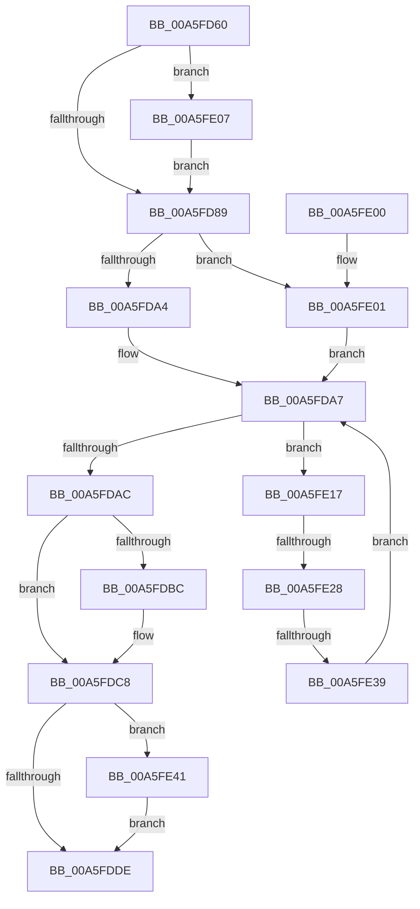

# ExpPrivatePoolGetNext

- RVA: `0x00A5FD60`–`0x00A5FE4C` (길이 `236` bytes)
- VA: `0x0000000140A5FD60`
- 실행 섹션: `PAGE`
- PDB 이름 있음: `예`; PDB Function 태그: `예`
- unwind 정보 RVA: `0x000B2E54`
- 디코드: `63`개 명령, `236/236` bytes 표시
- 미해석 바이트: `0` (있으면 어셈블리에 `.byte`로 보존)

> 이 문서는 커널 이미지의 기계어와 PDB 기호를 분석해 생성했습니다. 4번과 5번은 함수 원형과 자료형을 바이너리 사용 방식에서 추정한 C 해석이며 원본 소스 복구 결과는 아닙니다.

## 1. Dependencies

- 직접 호출 지점: **6**; 고유 호출 대상: **6**
- 직접 호출자로 확인된 함수: **1**
- RIP 상대 이미지 참조: **2**

### Outgoing calls
- `0x00A5FD9A` → [ExpAcquirePoolListLockShared](../../text/49/ExpAcquirePoolListLockShared_function_0049C5D8.md) (function, `0x0049C5D8`)
- `0x00A5FDC3` → [ExfReleasePushLockShared](../../text/26/ExfReleasePushLockShared_function_00263440.md) (function, `0x00263440`)
- `0x00A5FDCF` → [KeAbPostRelease](../../text/2E/KeAbPostRelease_function_002E1600.md) (function, `0x002E1600`)
- `0x00A5FDD4` → [KeLeaveCriticalRegion](../../text/25/KeLeaveCriticalRegion_function_0025D8B0.md) (function, `0x0025D8B0`)
- `0x00A5FE2C` → [ExAcquireRundownProtection](../../text/21/ExAcquireRundownProtection_function_00216620.md) (function, `0x00216620`)
- `0x00A5FE45` → [ExReleaseRundownProtection](../../text/34/ExReleaseRundownProtection_function_00349E80.md) (function, `0x00349E80`)

### Direct callers
- [ExpCompactPrivatePools](ExpCompactPrivatePools_function_00A5FD08.md) at `0x00A5FD1B`

### Static image references
- `0x00A5FD8C` → RVA `0x00E6BEE8` (`.data`; read)
- `0x00A5FDB1` → RVA `0x00E6BEE0` (`.data`; read)

## 2. Other-region calls and transfers

- 다른 실행 섹션으로 향하는 call: **6**
  - `0x00A5FD9A` → [ExpAcquirePoolListLockShared](../../text/49/ExpAcquirePoolListLockShared_function_0049C5D8.md) (`PAGE` → `.text`)
  - `0x00A5FDC3` → [ExfReleasePushLockShared](../../text/26/ExfReleasePushLockShared_function_00263440.md) (`PAGE` → `.text`)
  - `0x00A5FDCF` → [KeAbPostRelease](../../text/2E/KeAbPostRelease_function_002E1600.md) (`PAGE` → `.text`)
  - `0x00A5FDD4` → [KeLeaveCriticalRegion](../../text/25/KeLeaveCriticalRegion_function_0025D8B0.md) (`PAGE` → `.text`)
  - `0x00A5FE2C` → [ExAcquireRundownProtection](../../text/21/ExAcquireRundownProtection_function_00216620.md) (`PAGE` → `.text`)
  - `0x00A5FE45` → [ExReleaseRundownProtection](../../text/34/ExReleaseRundownProtection_function_00349E80.md) (`PAGE` → `.text`)
- call이 아닌 외부 분기/꼬리 이동: **2**
  - `0x00A5FE22` → [sub_00B3E22E + 0x8](../B3/Unknown_function_00B3E22E.md) (`tail-transfer`)
  - `0x00A5FE33` → [sub_00B3E22E](../B3/Unknown_function_00B3E22E.md) (`tail-transfer`)

## 3. Assembly (complete function range)

```asm
00A5FD60  48 89 5C 24 08                  mov qword ptr [rsp + 8], rbx
00A5FD65  48 89 6C 24 18                  mov qword ptr [rsp + 0x18], rbp
00A5FD6A  48 89 74 24 20                  mov qword ptr [rsp + 0x20], rsi
00A5FD6F  57                              push rdi
00A5FD70  41 56                           push r14
00A5FD72  41 57                           push r15
00A5FD74  48 83 EC 20                     sub rsp, 0x20
00A5FD78  45 33 FF                        xor r15d, r15d
00A5FD7B  48 8B FA                        mov rdi, rdx
00A5FD7E  41 8B EF                        mov ebp, r15d
00A5FD81  45 8A F7                        mov r14b, r15b
00A5FD84  48 85 D2                        test rdx, rdx
00A5FD87  75 7E                           jne 0x140a5fe07
00A5FD89  48 63 F1                        movsxd rsi, ecx
00A5FD8C  48 8D 05 55 C1 40 00            lea rax, [rip + 0x40c155]
00A5FD93  48 C1 E6 04                     shl rsi, 4
00A5FD97  48 03 F0                        add rsi, rax
00A5FD9A  E8 39 C8 A3 FF                  call 0x14049c5d8
00A5FD9F  48 85 FF                        test rdi, rdi
00A5FDA2  75 5D                           jne 0x140a5fe01
00A5FDA4  48 8B 1E                        mov rbx, qword ptr [rsi]
00A5FDA7  48 3B DE                        cmp rbx, rsi
00A5FDAA  75 6B                           jne 0x140a5fe17
00A5FDAC  B8 11 00 00 00                  mov eax, 0x11
00A5FDB1  F0 4C 0F B1 3D 26 C1 40 00      lock cmpxchg qword ptr [rip + 0x40c126], r15
00A5FDBA  74 0C                           je 0x140a5fdc8
00A5FDBC  48 8D 0D 1D C1 40 00            lea rcx, [rip + 0x40c11d]
00A5FDC3  E8 78 36 80 FF                  call 0x140263440
00A5FDC8  48 8D 0D 11 C1 40 00            lea rcx, [rip + 0x40c111]
00A5FDCF  E8 2C 18 88 FF                  call 0x1402e1600
00A5FDD4  E8 D7 DA 7F FF                  call 0x14025d8b0
00A5FDD9  48 85 FF                        test rdi, rdi
00A5FDDC  75 63                           jne 0x140a5fe41
00A5FDDE  48 8B 5C 24 40                  mov rbx, qword ptr [rsp + 0x40]
00A5FDE3  41 F6 DE                        neg r14b
00A5FDE6  48 8B 74 24 58                  mov rsi, qword ptr [rsp + 0x58]
00A5FDEB  48 1B C0                        sbb rax, rax
00A5FDEE  48 23 C5                        and rax, rbp
00A5FDF1  48 8B 6C 24 50                  mov rbp, qword ptr [rsp + 0x50]
00A5FDF6  48 83 C4 20                     add rsp, 0x20
00A5FDFA  41 5F                           pop r15
00A5FDFC  41 5E                           pop r14
00A5FDFE  5F                              pop rdi
00A5FDFF  C3                              ret
00A5FE00  CC                              int3
00A5FE01  48 8B 5F 20                     mov rbx, qword ptr [rdi + 0x20]
00A5FE05  EB A0                           jmp 0x140a5fda7
00A5FE07  48 8B 42 08                     mov rax, qword ptr [rdx + 8]
00A5FE0B  48 C1 E8 08                     shr rax, 8
00A5FE0F  0F B6 C8                        movzx ecx, al
00A5FE12  E9 72 FF FF FF                  jmp 0x140a5fd89
00A5FE17  48 8D 6B E0                     lea rbp, [rbx - 0x20]
00A5FE1B  81 7D 00 BD BD AF AF            cmp dword ptr [rbp], 0xafafbdbd
00A5FE22  0F 85 0E E4 0D 00               jne 0x140b3e236
00A5FE28  48 8D 4D 18                     lea rcx, [rbp + 0x18]
00A5FE2C  E8 EF 67 7B FF                  call 0x140216620
00A5FE31  84 C0                           test al, al
00A5FE33  0F 85 F5 E3 0D 00               jne 0x140b3e22e
00A5FE39  48 8B 1B                        mov rbx, qword ptr [rbx]
00A5FE3C  E9 66 FF FF FF                  jmp 0x140a5fda7
00A5FE41  48 8D 4F 18                     lea rcx, [rdi + 0x18]
00A5FE45  E8 36 A0 8E FF                  call 0x140349e80
00A5FE4A  EB 92                           jmp 0x140a5fdde
```

## 4. C-style interpretation (structured pseudocode)

```c
__int64 __fastcall ExpPrivatePoolGetNext(int a1, __int64 a2)
{
    __int64 result;
    __int64 v_r14;
    __int64 v_r15;
    __int64 v_rsi;
    __int64 v_rsp;
    unsigned __int64 v_stack_p18;
    unsigned __int64 v_stack_p20;
    unsigned __int64 v_stack_p8;

    v_stack_p8 = v_rbx;
    v_stack_p18 = v_rbp;
    v_stack_p20 = v_rsi;
    v_rsp = (v_rsp) - (32);
    v_r15 = 0;
    if (a2 != 0) goto loc_00A5FE07;
loc_00A5FD89:
    v_rsi = ((int)(a1)) << (4);
    v_rsi = (v_rsi) + (v_rip + 4243797);
    result = ExpAcquirePoolListLockShared(a1, a2, a3, a4);
    if (a2 != 0) goto loc_00A5FE01;
loc_00A5FDA7:
    if ((*(unsigned __int64 *)(v_rsi)) != v_rsi) goto loc_00A5FE17;
    result = 17;
    if ((*(unsigned __int64 *)(v_rsi)) != v_rsi) {
        a1 = v_rip + 4243741;
        result = ExfReleasePushLockShared(a1, a2, a3, a4);
    }
    result = KeAbPostRelease(v_rip + 4243729, a2, a3, a4);
    result = KeLeaveCriticalRegion(v_rip + 4243729, a2, a3, a4);
    if (a2 != 0) goto loc_00A5FE41;
loc_00A5FDDE:
    v_r14 = (unsigned __int8)(-(0));
    result = (result) & (0);
    v_rsp = (v_rsp) + (32);
    return result;
loc_00A5FE01:
    goto loc_00A5FDA7;
loc_00A5FE07:
    result = (*(unsigned __int64 *)(a2 + 8)) >> (8);
    goto loc_00A5FD89;
loc_00A5FE17:
    result = ExAcquireRundownProtection(*(unsigned __int64 *)(a2 + 32) - 32 + 24, a2, a3, a4);
    goto loc_00A5FDA7;
loc_00A5FE41:
    result = ExReleaseRundownProtection(a2 + 24, a2, a3, a4);
    goto loc_00A5FDDE;
}
```

## 5. (Beta) C Style

```c
int64_t ExpPrivatePoolGetNext(int32_t Arg1, int64_t Arg2)
{
    int64_t result;
    int64_t local_r14;
    int64_t local_r15;
    int64_t local_rsi;
    int64_t local_rsp;
    uint64_t v_stack_p18;
    uint64_t v_stack_p20;
    uint64_t v_stack_p8;

    v_stack_p8 = local_rbx;
    v_stack_p18 = local_rbp;
    v_stack_p20 = local_rsi;
    local_rsp = (local_rsp) - (32);
    local_r15 = 0;
    if (Arg2 != 0) goto loc_00A5FE07;
loc_00A5FD89:
    local_rsi = ((int32_t)(Arg1)) << (4);
    local_rsi = (local_rsi) + (v_rip + 4243797);
    result = ExpAcquirePoolListLockShared(Arg1, Arg2, a3, a4);
    if (Arg2 != 0) goto loc_00A5FE01;
loc_00A5FDA7:
    if ((*(uint64_t *)(local_rsi)) != local_rsi) goto loc_00A5FE17;
    result = 17;
    if ((*(uint64_t *)(local_rsi)) != local_rsi) {
        Arg1 = v_rip + 4243741;
        result = ExfReleasePushLockShared(Arg1, Arg2, a3, a4);
    }
    result = KeAbPostRelease(v_rip + 4243729, Arg2, a3, a4);
    result = KeLeaveCriticalRegion(v_rip + 4243729, Arg2, a3, a4);
    if (Arg2 != 0) goto loc_00A5FE41;
loc_00A5FDDE:
    local_r14 = (uint8_t)(-(0));
    result = (result) & (0);
    local_rsp = (local_rsp) + (32);
    return result;
loc_00A5FE01:
    goto loc_00A5FDA7;
loc_00A5FE07:
    result = (*(uint64_t *)(Arg2 + 0x8)) >> (8);
    goto loc_00A5FD89;
loc_00A5FE17:
    result = ExAcquireRundownProtection(*(uint64_t *)(Arg2 + 0x20) - 32 + 24, Arg2, a3, a4);
    goto loc_00A5FDA7;
loc_00A5FE41:
    result = ExReleaseRundownProtection(Arg2 + 24, Arg2, a3, a4);
    goto loc_00A5FDDE;
}
```

## 6. Execution-region graph

[열기: 2D/3D 그래프와 함수 탐색 컨트롤 패널](../../../control-panel.html?section=page&rva=0x00A5FD60&view=graph)

- 2D 그래프는 위에서 아래로 흐르고, 3D 그래프는 빈 공간을 드래그해 회전합니다. Shift+드래그는 이동, 휠은 확대·축소, 함수 노드 선택은 대상 보고서 이동입니다.

### Static fallback


