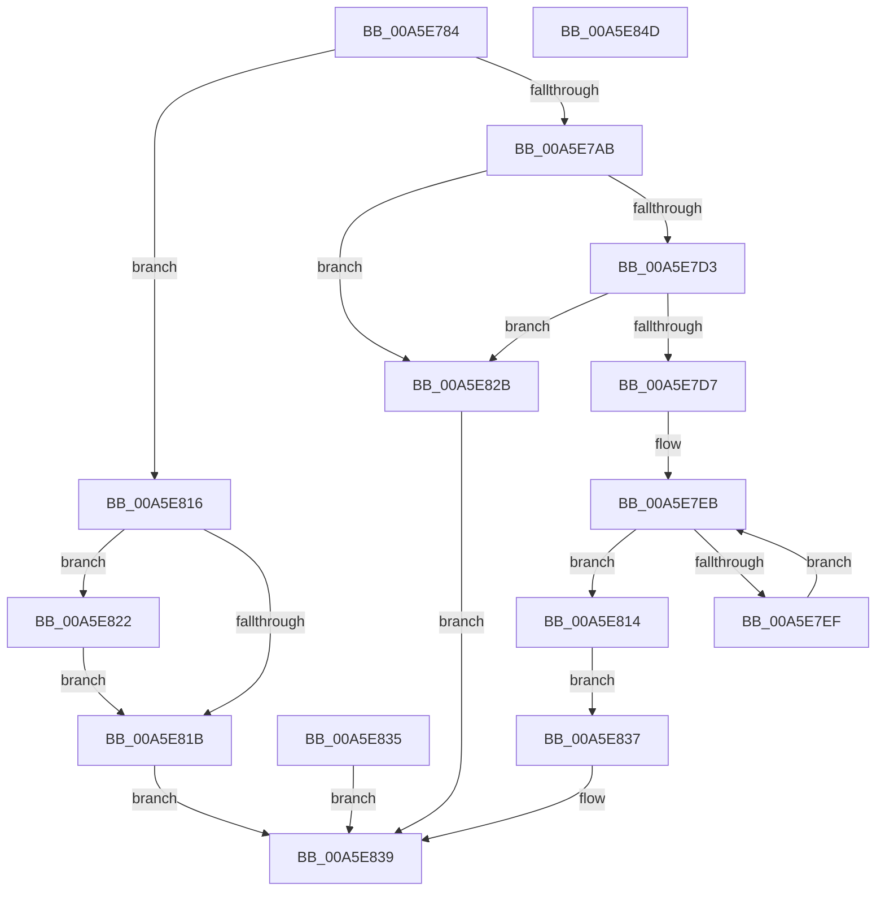

# ExpQueryNumaProcessorMap

- RVA: `0x00A5E784`–`0x00A5E84E` (길이 `202` bytes)
- VA: `0x0000000140A5E784`
- 실행 섹션: `PAGE`
- PDB 이름 있음: `예`; PDB Function 태그: `아니요`
- unwind 정보 RVA: `0x000B2950`
- 디코드: `69`개 명령, `202/202` bytes 표시
- 미해석 바이트: `0` (있으면 어셈블리에 `.byte`로 보존)

> 이 문서는 커널 이미지의 기계어와 PDB 기호를 분석해 생성했습니다. 4번과 5번은 함수 원형과 자료형을 바이너리 사용 방식에서 추정한 C 해석이며 원본 소스 복구 결과는 아닙니다.

## 1. Dependencies

- 직접 호출 지점: **2**; 고유 호출 대상: **2**
- 직접 호출자로 확인된 함수: **1**
- RIP 상대 이미지 참조: **0**

### Outgoing calls
- `0x00A5E7AB` → [KeQueryHighestNodeNumber](../../text/45/KeQueryHighestNodeNumber_function_0045CEC0.md) (function, `0x0045CEC0`)
- `0x00A5E800` → [KeQueryNodeActiveAffinity](../../text/43/KeQueryNodeActiveAffinity_function_0043EF80.md) (function, `0x0043EF80`)

### Direct callers
- [ExpQuerySystemInformation](ExpQuerySystemInformation_function_00A57858.md) at `0x00A58844`

### Static image references
- 디코드된 RIP-relative 메모리 참조가 없습니다.

## 2. Other-region calls and transfers

- 다른 실행 섹션으로 향하는 call: **2**
  - `0x00A5E7AB` → [KeQueryHighestNodeNumber](../../text/45/KeQueryHighestNodeNumber_function_0045CEC0.md) (`PAGE` → `.text`)
  - `0x00A5E800` → [KeQueryNodeActiveAffinity](../../text/43/KeQueryNodeActiveAffinity_function_0043EF80.md) (`PAGE` → `.text`)
- 별도 외부 분기/꼬리 이동을 확인하지 못했습니다.

## 3. Assembly (complete function range)

```asm
00A5E784  48 89 5C 24 10                  mov qword ptr [rsp + 0x10], rbx
00A5E789  48 89 74 24 18                  mov qword ptr [rsp + 0x18], rsi
00A5E78E  57                              push rdi
00A5E78F  41 56                           push r14
00A5E791  41 57                           push r15
00A5E793  48 83 EC 30                     sub rsp, 0x30
00A5E797  49 8B F8                        mov rdi, r8
00A5E79A  44 8B F2                        mov r14d, edx
00A5E79D  4C 8B F9                        mov r15, rcx
00A5E7A0  33 DB                           xor ebx, ebx
00A5E7A2  89 5C 24 50                     mov dword ptr [rsp + 0x50], ebx
00A5E7A6  83 FA 04                        cmp edx, 4
00A5E7A9  72 6B                           jb 0x140a5e816
00A5E7AB  E8 10 E7 9F FF                  call 0x14045cec0
00A5E7B0  0F B7 C0                        movzx eax, ax
00A5E7B3  41 89 07                        mov dword ptr [r15], eax
00A5E7B6  8D 70 01                        lea esi, [rax + 1]
00A5E7B9  89 74 24 68                     mov dword ptr [rsp + 0x68], esi
00A5E7BD  41 8D 46 F8                     lea eax, [r14 - 8]
00A5E7C1  C1 E8 04                        shr eax, 4
00A5E7C4  89 44 24 24                     mov dword ptr [rsp + 0x24], eax
00A5E7C8  3B C6                           cmp eax, esi
00A5E7CA  0F 46 F0                        cmovbe esi, eax
00A5E7CD  41 83 FE 08                     cmp r14d, 8
00A5E7D1  72 58                           jb 0x140a5e82b
00A5E7D3  85 F6                           test esi, esi
00A5E7D5  74 54                           je 0x140a5e82b
00A5E7D7  8B C6                           mov eax, esi
00A5E7D9  C1 E0 04                        shl eax, 4
00A5E7DC  83 C0 08                        add eax, 8
00A5E7DF  89 07                           mov dword ptr [rdi], eax
00A5E7E1  89 5C 24 50                     mov dword ptr [rsp + 0x50], ebx
00A5E7E5  8B C3                           mov eax, ebx
00A5E7E7  8B D3                           mov edx, ebx
00A5E7E9  8B FB                           mov edi, ebx
00A5E7EB  3B C6                           cmp eax, esi
00A5E7ED  73 25                           jae 0x140a5e814
00A5E7EF  48 C1 E2 04                     shl rdx, 4
00A5E7F3  48 83 C2 08                     add rdx, 8
00A5E7F7  49 03 D7                        add rdx, r15
00A5E7FA  45 33 C0                        xor r8d, r8d
00A5E7FD  0F B7 CB                        movzx ecx, bx
00A5E800  E8 7B 07 9E FF                  call 0x14043ef80
00A5E805  8D 47 01                        lea eax, [rdi + 1]
00A5E808  8B D8                           mov ebx, eax
00A5E80A  89 44 24 50                     mov dword ptr [rsp + 0x50], eax
00A5E80E  8B D0                           mov edx, eax
00A5E810  8B F8                           mov edi, eax
00A5E812  EB D7                           jmp 0x140a5e7eb
00A5E814  EB 21                           jmp 0x140a5e837
00A5E816  48 85 FF                        test rdi, rdi
00A5E819  75 07                           jne 0x140a5e822
00A5E81B  B8 04 00 00 C0                  mov eax, 0xc0000004
00A5E820  EB 17                           jmp 0x140a5e839
00A5E822  41 C7 00 04 00 00 00            mov dword ptr [r8], 4
00A5E829  EB F0                           jmp 0x140a5e81b
00A5E82B  C7 07 04 00 00 00               mov dword ptr [rdi], 4
00A5E831  33 C0                           xor eax, eax
00A5E833  EB 04                           jmp 0x140a5e839
00A5E835  EB 02                           jmp 0x140a5e839
00A5E837  33 C0                           xor eax, eax
00A5E839  48 8B 5C 24 58                  mov rbx, qword ptr [rsp + 0x58]
00A5E83E  48 8B 74 24 60                  mov rsi, qword ptr [rsp + 0x60]
00A5E843  48 83 C4 30                     add rsp, 0x30
00A5E847  41 5F                           pop r15
00A5E849  41 5E                           pop r14
00A5E84B  5F                              pop rdi
00A5E84C  C3                              ret
00A5E84D  CC                              int3
```

## 4. C-style interpretation (structured pseudocode)

```c
__int64 __fastcall ExpQueryNumaProcessorMap(__int64 a1, int a2, __int64 a3)
{
    __int64 result;
    __int64 v_rbx;
    __int64 v_rsi;
    __int64 v_rsp;
    unsigned int v_stack_m24;
    unsigned __int64 v_stack_p10;
    unsigned __int64 v_stack_p18;
    unsigned int v_stack_p20;
    unsigned int v_stack_p8;

    v_stack_p10 = v_rbx;
    v_stack_p18 = v_rsi;
    v_rsp = (v_rsp) - (48);
    v_rbx = 0;
    v_stack_p8 = 0;
    if (a2 < 4) goto loc_00A5E816;
    result = KeQueryHighestNodeNumber(a1, a2, a3, a4);
    *(unsigned int *)(a1) = (unsigned int)((unsigned __int16)(result));
    v_stack_p20 = (unsigned int)((unsigned __int16)(result) + 1);
    result = (unsigned int)(((unsigned int)(a2) - 8) >> (4));
    v_stack_m24 = (unsigned int)(result);
    v_rsi = (unsigned __int16)(result) + 1;
    if (((unsigned int)(result)) <= ((unsigned int)((unsigned __int16)(result) + 1))) { v_rsi = (unsigned int)(result); }
    if (((unsigned int)((unsigned int)(a2))) < 8) goto loc_00A5E82B;
    if ((unsigned int)(v_rsi) == 0) goto loc_00A5E82B;
    result = (unsigned int)(((unsigned int)((unsigned int)(v_rsi))) << (4));
    result = (unsigned int)((result) + (8));
    *(unsigned int *)(a3) = (unsigned int)(result);
    v_stack_p8 = 0;
loc_00A5E7EB:
    if (0 >= ((unsigned int)(v_rsi))) goto loc_00A5E814;
    a2 = (0) << (4);
    a2 = (a2) + (8);
    a2 = (a2) + (a1);
    a3 = 0;
    result = KeQueryNodeActiveAffinity(0, a2, a3, a4);
    v_stack_p8 = (unsigned int)(0 + 1);
    goto loc_00A5E7EB;
loc_00A5E814:
    goto loc_00A5E837;
loc_00A5E816:
    if ((unsigned int)((unsigned int)(0 + 1)) != 0) goto loc_00A5E822;
loc_00A5E81B:
    goto loc_00A5E839;
loc_00A5E822:
    *(unsigned int *)(a3) = 4;
    goto loc_00A5E81B;
loc_00A5E82B:
    *(unsigned int *)((unsigned int)((unsigned int)(0 + 1))) = 4;
    result = 0;
    goto loc_00A5E839;
loc_00A5E837:
    result = 0;
loc_00A5E839:
    v_rsp = (v_rsp) + (48);
    return result;
}
```

## 5. (Beta) C Style

```c
int64_t ExpQueryNumaProcessorMap(void *Arg1, void *Arg2, void *Arg3)
{
    uint8_t *arg1 = (uint8_t *)Arg1;
    uint8_t *arg2 = (uint8_t *)Arg2;
    uint8_t *arg3 = (uint8_t *)Arg3;

    int64_t result;
    int64_t local_rbx;
    int64_t local_rsi;
    int64_t local_rsp;
    uint32_t v_stack_m24;
    uint64_t v_stack_p10;
    uint64_t v_stack_p18;
    uint32_t v_stack_p20;
    uint32_t v_stack_p8;

    v_stack_p10 = local_rbx;
    v_stack_p18 = local_rsi;
    local_rsp = (local_rsp) - (48);
    local_rbx = 0;
    v_stack_p8 = 0;
    if (Arg2 < 4) goto loc_00A5E816;
    result = KeQueryHighestNodeNumber(Arg1, Arg2, Arg3, a4);
    *(uint32_t *)(arg1) = (uint32_t)((uint16_t)(result));
    v_stack_p20 = (uint32_t)((uint16_t)(result) + 1);
    result = (uint32_t)(((uint32_t)(Arg2) - 8) >> (4));
    v_stack_m24 = (uint32_t)(result);
    local_rsi = (uint16_t)(result) + 1;
    if (((uint32_t)(result)) <= ((uint32_t)((uint16_t)(result) + 1))) { local_rsi = (uint32_t)(result); }
    if (((uint32_t)((uint32_t)(Arg2))) < 8) goto loc_00A5E82B;
    if ((uint32_t)(local_rsi) == 0) goto loc_00A5E82B;
    result = (uint32_t)(((uint32_t)((uint32_t)(local_rsi))) << (4));
    result = (uint32_t)((result) + (8));
    *(uint32_t *)(arg3) = (uint32_t)(result);
    v_stack_p8 = 0;
loc_00A5E7EB:
    if (0 >= ((uint32_t)(local_rsi))) goto loc_00A5E814;
    Arg2 = (0) << (4);
    Arg2 = (Arg2) + (8);
    Arg2 = (Arg2) + (Arg1);
    Arg3 = 0;
    result = KeQueryNodeActiveAffinity(0, Arg2, Arg3, a4);
    v_stack_p8 = (uint32_t)(0 + 1);
    goto loc_00A5E7EB;
loc_00A5E814:
    goto loc_00A5E837;
loc_00A5E816:
    if ((uint32_t)((uint32_t)(0 + 1)) != 0) goto loc_00A5E822;
loc_00A5E81B:
    goto loc_00A5E839;
loc_00A5E822:
    *(uint32_t *)(arg3) = 4;
    goto loc_00A5E81B;
loc_00A5E82B:
    *(uint32_t *)((uint32_t)((uint32_t)(0 + 0x1))) = 4;
    result = 0;
    goto loc_00A5E839;
loc_00A5E837:
    result = 0;
loc_00A5E839:
    local_rsp = (local_rsp) + (48);
    return result;
}
```

### 관측된 메모리 오프셋

구조체 형식이 확인되지 않은 접근은 인자 기준의 오프셋으로만 기록했습니다.

| 기준 인자 | 오프셋 표현 | 폭 (bit) | 접근 |
|---|---:|---:|---|
| `Arg1` | `+ 0x0` | `32` | `W` |
| `Arg2` | `- 0x8` | `32` | `R` |
| `Arg3` | `+ 0x0` | `32` | `W` |

## 6. Execution-region graph

[열기: 2D/3D 그래프와 함수 탐색 컨트롤 패널](../../../control-panel.html?section=page&rva=0x00A5E784&view=graph)

- 2D 그래프는 위에서 아래로 흐르고, 3D 그래프는 빈 공간을 드래그해 회전합니다. Shift+드래그는 이동, 휠은 확대·축소, 함수 노드 선택은 대상 보고서 이동입니다.

### Static fallback


