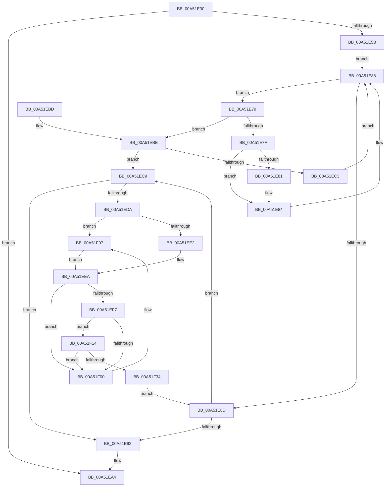

# FsRtlDeleteKeyFromTunnelCache

- RVA: `0x00A51E30`–`0x00A51F51` (길이 `289` bytes)
- VA: `0x0000000140A51E30`
- 실행 섹션: `PAGE`
- PDB 이름 있음: `예`; PDB Function 태그: `아니요`
- unwind 정보 RVA: `0x000B0CB8`
- 디코드: `86`개 명령, `289/289` bytes 표시
- 미해석 바이트: `0` (있으면 어셈블리에 `.byte`로 보존)

> 이 문서는 커널 이미지의 기계어와 PDB 기호를 분석해 생성했습니다. 4번과 5번은 함수 원형과 자료형을 바이너리 사용 방식에서 추정한 C 해석이며 원본 소스 복구 결과는 아닙니다.

## 1. Dependencies

- 직접 호출 지점: **6**; 고유 호출 대상: **6**
- 직접 호출자로 확인된 함수: **0**
- RIP 상대 이미지 참조: **1**

### Outgoing calls
- `0x00A51E6B` → [ExAcquireFastMutex](../../text/20/ExAcquireFastMutex_function_0020E5A0.md) (function, `0x0020E5A0`)
- `0x00A51E95` → [ExReleaseFastMutex](../../text/25/ExReleaseFastMutex_function_002519C0.md) (function, `0x002519C0`)
- `0x00A51E9F` → [FsRtlEmptyFreePoolList](../../text/38/FsRtlEmptyFreePoolList_function_00386D30.md) (function, `0x00386D30`)
- `0x00A51ECC` → [RtlRealSuccessor](../../text/38/RtlRealSuccessor_function_0038DF40.md) (function, `0x0038DF40`)
- `0x00A51EE5` → [RtlDeleteNoSplay](../../text/38/RtlDeleteNoSplay_function_0038C410.md) (function, `0x0038C410`)
- `0x00A51F07` → [RtlDelete](../../text/38/RtlDelete_function_0038D8B0.md) (function, `0x0038D8B0`)

### Direct callers
- 이 함수 시작 RVA로 연결되는 직접 call은 확인되지 않았습니다. 간접 호출은 완전히 역산할 수 없습니다.

### Static image references
- `0x00A51E4D` → RVA `0x00FD8034` (`PAGEDATA`; read)

## 2. Other-region calls and transfers

- 다른 실행 섹션으로 향하는 call: **6**
  - `0x00A51E6B` → [ExAcquireFastMutex](../../text/20/ExAcquireFastMutex_function_0020E5A0.md) (`PAGE` → `.text`)
  - `0x00A51E95` → [ExReleaseFastMutex](../../text/25/ExReleaseFastMutex_function_002519C0.md) (`PAGE` → `.text`)
  - `0x00A51E9F` → [FsRtlEmptyFreePoolList](../../text/38/FsRtlEmptyFreePoolList_function_00386D30.md) (`PAGE` → `.text`)
  - `0x00A51ECC` → [RtlRealSuccessor](../../text/38/RtlRealSuccessor_function_0038DF40.md) (`PAGE` → `.text`)
  - `0x00A51EE5` → [RtlDeleteNoSplay](../../text/38/RtlDeleteNoSplay_function_0038C410.md) (`PAGE` → `.text`)
  - `0x00A51F07` → [RtlDelete](../../text/38/RtlDelete_function_0038D8B0.md) (`PAGE` → `.text`)
- 별도 외부 분기/꼬리 이동을 확인하지 못했습니다.

## 3. Assembly (complete function range)

```asm
00A51E30  4C 8B DC                        mov r11, rsp
00A51E33  49 89 5B 08                     mov qword ptr [r11 + 8], rbx
00A51E37  49 89 6B 10                     mov qword ptr [r11 + 0x10], rbp
00A51E3B  49 89 73 18                     mov qword ptr [r11 + 0x18], rsi
00A51E3F  57                              push rdi
00A51E40  41 56                           push r14
00A51E42  41 57                           push r15
00A51E44  48 83 EC 30                     sub rsp, 0x30
00A51E48  33 DB                           xor ebx, ebx
00A51E4A  48 8B F2                        mov rsi, rdx
00A51E4D  39 1D E1 61 58 00               cmp dword ptr [rip + 0x5861e1], ebx
00A51E53  48 8B F9                        mov rdi, rcx
00A51E56  40 B5 01                        mov bpl, 1
00A51E59  74 49                           je 0x140a51ea4
00A51E5B  49 8D 43 D8                     lea rax, [r11 - 0x28]
00A51E5F  49 89 43 E0                     mov qword ptr [r11 - 0x20], rax
00A51E63  49 8D 43 D8                     lea rax, [r11 - 0x28]
00A51E67  49 89 43 D8                     mov qword ptr [r11 - 0x28], rax
00A51E6B  E8 30 C7 7B FF                  call 0x14020e5a0
00A51E70  4C 8D 77 38                     lea r14, [rdi + 0x38]
00A51E74  49 8B 06                        mov rax, qword ptr [r14]
00A51E77  EB 0F                           jmp 0x140a51e88
00A51E79  48 39 70 30                     cmp qword ptr [rax + 0x30], rsi
00A51E7D  72 3F                           jb 0x140a51ebe
00A51E7F  77 03                           ja 0x140a51e84
00A51E81  48 8B D8                        mov rbx, rax
00A51E84  48 8B 40 08                     mov rax, qword ptr [rax + 8]
00A51E88  48 85 C0                        test rax, rax
00A51E8B  75 EC                           jne 0x140a51e79
00A51E8D  48 85 DB                        test rbx, rbx
00A51E90  75 37                           jne 0x140a51ec9
00A51E92  48 8B CF                        mov rcx, rdi
00A51E95  E8 26 FB 7F FF                  call 0x1402519c0
00A51E9A  48 8D 4C 24 20                  lea rcx, [rsp + 0x20]
00A51E9F  E8 8C 4E 93 FF                  call 0x140386d30
00A51EA4  48 8B 5C 24 50                  mov rbx, qword ptr [rsp + 0x50]
00A51EA9  48 8B 6C 24 58                  mov rbp, qword ptr [rsp + 0x58]
00A51EAE  48 8B 74 24 60                  mov rsi, qword ptr [rsp + 0x60]
00A51EB3  48 83 C4 30                     add rsp, 0x30
00A51EB7  41 5F                           pop r15
00A51EB9  41 5E                           pop r14
00A51EBB  5F                              pop rdi
00A51EBC  C3                              ret
00A51EBD  CC                              int3
00A51EBE  48 85 DB                        test rbx, rbx
00A51EC1  75 06                           jne 0x140a51ec9
00A51EC3  48 8B 40 10                     mov rax, qword ptr [rax + 0x10]
00A51EC7  EB BF                           jmp 0x140a51e88
00A51EC9  48 8B CB                        mov rcx, rbx
00A51ECC  E8 6F C0 93 FF                  call 0x14038df40
00A51ED1  4C 8B F8                        mov r15, rax
00A51ED4  48 39 73 30                     cmp qword ptr [rbx + 0x30], rsi
00A51ED8  75 B8                           jne 0x140a51e92
00A51EDA  48 8B CB                        mov rcx, rbx
00A51EDD  40 84 ED                        test bpl, bpl
00A51EE0  75 25                           jne 0x140a51f07
00A51EE2  49 8B D6                        mov rdx, r14
00A51EE5  E8 26 A5 93 FF                  call 0x14038c410
00A51EEA  48 83 C3 18                     add rbx, 0x18
00A51EEE  48 8B 0B                        mov rcx, qword ptr [rbx]
00A51EF1  48 39 59 08                     cmp qword ptr [rcx + 8], rbx
00A51EF5  75 09                           jne 0x140a51f00
00A51EF7  48 8B 43 08                     mov rax, qword ptr [rbx + 8]
00A51EFB  48 39 18                        cmp qword ptr [rax], rbx
00A51EFE  74 14                           je 0x140a51f14
00A51F00  B9 03 00 00 00                  mov ecx, 3
00A51F05  CD 29                           int 0x29
00A51F07  E8 A4 B9 93 FF                  call 0x14038d8b0
00A51F0C  49 89 06                        mov qword ptr [r14], rax
00A51F0F  40 32 ED                        xor bpl, bpl
00A51F12  EB D6                           jmp 0x140a51eea
00A51F14  48 89 08                        mov qword ptr [rax], rcx
00A51F17  48 89 41 08                     mov qword ptr [rcx + 8], rax
00A51F1B  B8 FF FF 00 00                  mov eax, 0xffff
00A51F20  66 01 47 50                     add word ptr [rdi + 0x50], ax
00A51F24  48 8D 4C 24 20                  lea rcx, [rsp + 0x20]
00A51F29  48 8B 44 24 20                  mov rax, qword ptr [rsp + 0x20]
00A51F2E  48 39 48 08                     cmp qword ptr [rax + 8], rcx
00A51F32  75 CC                           jne 0x140a51f00
00A51F34  48 89 03                        mov qword ptr [rbx], rax
00A51F37  48 8D 4C 24 20                  lea rcx, [rsp + 0x20]
00A51F3C  48 89 4B 08                     mov qword ptr [rbx + 8], rcx
00A51F40  48 89 58 08                     mov qword ptr [rax + 8], rbx
00A51F44  48 89 5C 24 20                  mov qword ptr [rsp + 0x20], rbx
00A51F49  49 8B DF                        mov rbx, r15
00A51F4C  E9 3C FF FF FF                  jmp 0x140a51e8d
```

## 4. C-style interpretation (structured pseudocode)

```c
__int64 __fastcall FsRtlDeleteKeyFromTunnelCache(__int64 a1, __int64 a2)
{
    __int64 result;
    __int64 v_rbp;
    __int64 v_rbx;
    __int64 v_rsp;
    unsigned __int64 v_stack_m28;
    unsigned __int64 v_stack_p10;
    unsigned __int64 v_stack_p18;
    unsigned __int64 v_stack_p20;
    unsigned __int64 v_stack_p8;

    *(unsigned __int64 *)(v_rsp + 8) = v_rbx;
    *(unsigned __int64 *)(v_rsp + 16) = v_rbp;
    *(unsigned __int64 *)(v_rsp + 24) = v_rsi;
    v_rsp = (v_rsp) - (48);
    v_rbx = 0;
    if ((*(unsigned int *)(v_rip + 5792225)) == 0) goto loc_00A51EA4;
    *(unsigned __int64 *)(v_rsp - 32) = v_rsp - 40;
    *(unsigned __int64 *)(v_rsp - 40) = v_rsp - 40;
    result = ExAcquireFastMutex(a1, a2, a3, a4);
    goto loc_00A51E88;
loc_00A51E79:
    if ((*(unsigned __int64 *)(*(unsigned __int64 *)(a1 + 56) + 48)) < a2) goto loc_00A51EBE;
    if ((*(unsigned __int64 *)(*(unsigned __int64 *)(a1 + 56) + 48)) <= a2) {
        v_rbx = *(unsigned __int64 *)(a1 + 56);
    }
loc_00A51E88:
    if (*(unsigned __int64 *)(*(unsigned __int64 *)(a1 + 56) + 8) != 0) goto loc_00A51E79;
loc_00A51E8D:
    if (v_rbx != 0) goto loc_00A51EC9;
loc_00A51E92:
    result = ExReleaseFastMutex(a1, a2, a3, a4);
    result = FsRtlEmptyFreePoolList(v_stack_m28, a2, a3, a4);
loc_00A51EA4:
    v_rsp = (v_rsp) + (48);
    return result;
loc_00A51EBE:
    if (v_stack_p8 != 0) goto loc_00A51EC9;
    goto loc_00A51E88;
loc_00A51EC9:
    result = RtlRealSuccessor(v_stack_p8, a2, a3, a4);
    if ((*(unsigned __int64 *)(v_stack_p8 + 48)) != v_stack_p18) goto loc_00A51E92;
    if ((unsigned __int8)(v_stack_p10) != 0) goto loc_00A51F07;
    result = RtlDeleteNoSplay(v_stack_p8, a1 + 56, a3, a4);
loc_00A51EEA:
    v_rbx = (v_stack_p8) + (24);
    if ((*(unsigned __int64 *)(*(unsigned __int64 *)(v_rbx) + 8)) != v_rbx) goto loc_00A51F00;
    if ((*(unsigned __int64 *)(*(unsigned __int64 *)(v_rbx + 8))) == v_rbx) goto loc_00A51F14;
loc_00A51F00:
loc_00A51F07:
    result = RtlDelete(3, a1 + 56, a3, a4);
    *(unsigned __int64 *)(a1 + 56) = result;
    v_rbp = 0;
    goto loc_00A51EEA;
loc_00A51F14:
    *(unsigned __int64 *)(result) = 3;
    *(unsigned __int64 *)(3 + 8) = result;
    if ((*(unsigned __int64 *)(v_stack_p20 + 8)) != v_stack_p20) goto loc_00A51F00;
    *(unsigned __int64 *)(v_rbx) = v_stack_p20;
    *(unsigned __int64 *)(v_rbx + 8) = v_stack_p20;
    *(unsigned __int64 *)(v_stack_p20 + 8) = v_rbx;
    v_stack_p20 = v_rbx;
    goto loc_00A51E8D;
}
```

## 5. (Beta) C Style

```c
int64_t FsRtlDeleteKeyFromTunnelCache(void *Arg1, int64_t Arg2)
{
    uint8_t *arg1 = (uint8_t *)Arg1;

    int64_t result;
    int64_t local_rbp;
    int64_t local_rbx;
    int64_t local_rsp;
    uint64_t v_stack_m28;
    uint64_t v_stack_p10;
    uint64_t v_stack_p18;
    uint64_t v_stack_p20;
    uint64_t v_stack_p8;

    *(uint64_t *)(local_rsp + 0x8) = local_rbx;
    *(uint64_t *)(local_rsp + 0x10) = local_rbp;
    *(uint64_t *)(local_rsp + 0x18) = local_rsi;
    local_rsp = (local_rsp) - (48);
    local_rbx = 0;
    if ((*(uint32_t *)(v_rip + 0x5861E1)) == 0) goto loc_00A51EA4;
    *(uint64_t *)(local_rsp - 0x20) = local_rsp - 40;
    *(uint64_t *)(local_rsp - 0x28) = local_rsp - 40;
    result = ExAcquireFastMutex(Arg1, Arg2, a3, a4);
    goto loc_00A51E88;
loc_00A51E79:
    if ((*(uint64_t *)(*(uint64_t *)(arg1 + 0x38) + 0x30)) < Arg2) goto loc_00A51EBE;
    if ((*(uint64_t *)(*(uint64_t *)(arg1 + 0x38) + 0x30)) <= Arg2) {
        local_rbx = *(uint64_t *)(arg1 + 0x38);
    }
loc_00A51E88:
    if (*(uint64_t *)(*(uint64_t *)(arg1 + 0x38) + 0x8) != 0) goto loc_00A51E79;
loc_00A51E8D:
    if (local_rbx != 0) goto loc_00A51EC9;
loc_00A51E92:
    result = ExReleaseFastMutex(Arg1, Arg2, a3, a4);
    result = FsRtlEmptyFreePoolList(v_stack_m28, Arg2, a3, a4);
loc_00A51EA4:
    local_rsp = (local_rsp) + (48);
    return result;
loc_00A51EBE:
    if (v_stack_p8 != 0) goto loc_00A51EC9;
    goto loc_00A51E88;
loc_00A51EC9:
    result = RtlRealSuccessor(v_stack_p8, Arg2, a3, a4);
    if ((*(uint64_t *)(v_stack_p8 + 0x30)) != v_stack_p18) goto loc_00A51E92;
    if ((uint8_t)(v_stack_p10) != 0) goto loc_00A51F07;
    result = RtlDeleteNoSplay(v_stack_p8, Arg1 + 56, a3, a4);
loc_00A51EEA:
    local_rbx = (v_stack_p8) + (24);
    if ((*(uint64_t *)(*(uint64_t *)(local_rbx) + 0x8)) != local_rbx) goto loc_00A51F00;
    if ((*(uint64_t *)(*(uint64_t *)(local_rbx + 0x8))) == local_rbx) goto loc_00A51F14;
loc_00A51F00:
loc_00A51F07:
    result = RtlDelete(3, Arg1 + 56, a3, a4);
    *(uint64_t *)(arg1 + 0x38) = result;
    local_rbp = 0;
    goto loc_00A51EEA;
loc_00A51F14:
    *(uint64_t *)(result) = 3;
    *(uint64_t *)(3 + 0x8) = result;
    if ((*(uint64_t *)(v_stack_p20 + 0x8)) != v_stack_p20) goto loc_00A51F00;
    *(uint64_t *)(local_rbx) = v_stack_p20;
    *(uint64_t *)(local_rbx + 0x8) = v_stack_p20;
    *(uint64_t *)(v_stack_p20 + 0x8) = local_rbx;
    v_stack_p20 = local_rbx;
    goto loc_00A51E8D;
}
```

### 관측된 메모리 오프셋

구조체 형식이 확인되지 않은 접근은 인자 기준의 오프셋으로만 기록했습니다.

| 기준 인자 | 오프셋 표현 | 폭 (bit) | 접근 |
|---|---:|---:|---|
| `Arg1` | `+ 0x0` | `64` | `R` |
| `Arg1` | `+ 0x0` | `64` | `W` |
| `Arg1` | `+ 0x38` | `64` | `R` |
| `Arg1` | `+ 0x50` | `16` | `R/W` |

## 6. Execution-region graph

[열기: 2D/3D 그래프와 함수 탐색 컨트롤 패널](../../../control-panel.html?section=page&rva=0x00A51E30&view=graph)

- 2D 그래프는 위에서 아래로 흐르고, 3D 그래프는 빈 공간을 드래그해 회전합니다. Shift+드래그는 이동, 휠은 확대·축소, 함수 노드 선택은 대상 보고서 이동입니다.

### Static fallback


