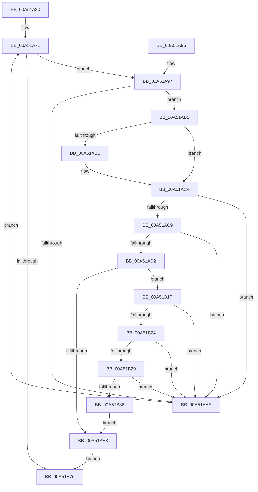

# GetPropertyFromPropArray

- RVA: `0x00A51A30`–`0x00A51B3C` (길이 `268` bytes)
- VA: `0x0000000140A51A30`
- 실행 섹션: `PAGE`
- PDB 이름 있음: `예`; PDB Function 태그: `아니요`
- unwind 정보 RVA: `0x00088A10`
- 디코드: `82`개 명령, `268/268` bytes 표시
- 미해석 바이트: `0` (있으면 어셈블리에 `.byte`로 보존)

> 이 문서는 커널 이미지의 기계어와 PDB 기호를 분석해 생성했습니다. 4번과 5번은 함수 원형과 자료형을 바이너리 사용 방식에서 추정한 C 해석이며 원본 소스 복구 결과는 아닙니다.

## 1. Dependencies

- 직접 호출 지점: **1**; 고유 호출 대상: **1**
- 직접 호출자로 확인된 함수: **0**
- RIP 상대 이미지 참조: **0**

### Outgoing calls
- `0x00A51B29` → [wcsicmp](../../text/50/wcsicmp_function_00500080.md) (function, `0x00500080`)

### Direct callers
- 이 함수 시작 RVA로 연결되는 직접 call은 확인되지 않았습니다. 간접 호출은 완전히 역산할 수 없습니다.

### Static image references
- 디코드된 RIP-relative 메모리 참조가 없습니다.

## 2. Other-region calls and transfers

- 다른 실행 섹션으로 향하는 call: **1**
  - `0x00A51B29` → [wcsicmp](../../text/50/wcsicmp_function_00500080.md) (`PAGE` → `.text`)
- 별도 외부 분기/꼬리 이동을 확인하지 못했습니다.

## 3. Assembly (complete function range)

```asm
00A51A30  48 89 5C 24 08                  mov qword ptr [rsp + 8], rbx
00A51A35  48 89 6C 24 10                  mov qword ptr [rsp + 0x10], rbp
00A51A3A  48 89 74 24 18                  mov qword ptr [rsp + 0x18], rsi
00A51A3F  57                              push rdi
00A51A40  41 54                           push r12
00A51A42  41 55                           push r13
00A51A44  41 56                           push r14
00A51A46  41 57                           push r15
00A51A48  48 83 EC 20                     sub rsp, 0x20
00A51A4C  41 83 20 00                     and dword ptr [r8], 0
00A51A50  4D 8B E1                        mov r12, r9
00A51A53  41 83 21 00                     and dword ptr [r9], 0
00A51A57  4D 8B E8                        mov r13, r8
00A51A5A  48 8B 44 24 70                  mov rax, qword ptr [rsp + 0x70]
00A51A5F  48 8B F2                        mov rsi, rdx
00A51A62  48 8B E9                        mov rbp, rcx
00A51A65  41 BE 25 02 00 C0               mov r14d, 0xc0000225
00A51A6B  48 83 20 00                     and qword ptr [rax], 0
00A51A6F  33 DB                           xor ebx, ebx
00A51A71  3B 5D 00                        cmp ebx, dword ptr [rbp]
00A51A74  72 21                           jb 0x140a51a97
00A51A76  48 8B 5C 24 50                  mov rbx, qword ptr [rsp + 0x50]
00A51A7B  41 8B C6                        mov eax, r14d
00A51A7E  48 8B 6C 24 58                  mov rbp, qword ptr [rsp + 0x58]
00A51A83  48 8B 74 24 60                  mov rsi, qword ptr [rsp + 0x60]
00A51A88  48 83 C4 20                     add rsp, 0x20
00A51A8C  41 5F                           pop r15
00A51A8E  41 5E                           pop r14
00A51A90  41 5D                           pop r13
00A51A92  41 5C                           pop r12
00A51A94  5F                              pop rdi
00A51A95  C3                              ret
00A51A96  CC                              int3
00A51A97  8B 46 10                        mov eax, dword ptr [rsi + 0x10]
00A51A9A  48 8D 3C 5B                     lea rdi, [rbx + rbx*2]
00A51A9E  4C 8D 7D 08                     lea r15, [rbp + 8]
00A51AA2  48 03 FF                        add rdi, rdi
00A51AA5  49 8B 17                        mov rdx, qword ptr [r15]
00A51AA8  39 44 FA 10                     cmp dword ptr [rdx + rdi*8 + 0x10], eax
00A51AAC  74 04                           je 0x140a51ab2
00A51AAE  FF C3                           inc ebx
00A51AB0  EB BF                           jmp 0x140a51a71
00A51AB2  48 8B 0C FA                     mov rcx, qword ptr [rdx + rdi*8]
00A51AB6  48 2B 0E                        sub rcx, qword ptr [rsi]
00A51AB9  75 09                           jne 0x140a51ac4
00A51ABB  48 8B 4C FA 08                  mov rcx, qword ptr [rdx + rdi*8 + 8]
00A51AC0  48 2B 4E 08                     sub rcx, qword ptr [rsi + 8]
00A51AC4  48 85 C9                        test rcx, rcx
00A51AC7  75 E5                           jne 0x140a51aae
00A51AC9  8B 46 14                        mov eax, dword ptr [rsi + 0x14]
00A51ACC  39 44 FA 14                     cmp dword ptr [rdx + rdi*8 + 0x14], eax
00A51AD0  75 DC                           jne 0x140a51aae
00A51AD2  48 8B 4C FA 18                  mov rcx, qword ptr [rdx + rdi*8 + 0x18]
00A51AD7  4D 8B C7                        mov r8, r15
00A51ADA  48 8B 56 18                     mov rdx, qword ptr [rsi + 0x18]
00A51ADE  48 3B CA                        cmp rcx, rdx
00A51AE1  75 3C                           jne 0x140a51b1f
00A51AE3  49 8B 07                        mov rax, qword ptr [r15]
00A51AE6  8B 4C F8 20                     mov ecx, dword ptr [rax + rdi*8 + 0x20]
00A51AEA  41 89 4D 00                     mov dword ptr [r13], ecx
00A51AEE  48 8D 0C 5B                     lea rcx, [rbx + rbx*2]
00A51AF2  49 8B 00                        mov rax, qword ptr [r8]
00A51AF5  48 03 C9                        add rcx, rcx
00A51AF8  8B 4C C8 24                     mov ecx, dword ptr [rax + rcx*8 + 0x24]
00A51AFC  41 89 0C 24                     mov dword ptr [r12], ecx
00A51B00  48 8D 0C 5B                     lea rcx, [rbx + rbx*2]
00A51B04  49 8B 00                        mov rax, qword ptr [r8]
00A51B07  48 03 C9                        add rcx, rcx
00A51B0A  45 33 F6                        xor r14d, r14d
00A51B0D  48 8B 4C C8 28                  mov rcx, qword ptr [rax + rcx*8 + 0x28]
00A51B12  48 8B 44 24 70                  mov rax, qword ptr [rsp + 0x70]
00A51B17  48 89 08                        mov qword ptr [rax], rcx
00A51B1A  E9 57 FF FF FF                  jmp 0x140a51a76
00A51B1F  48 85 C9                        test rcx, rcx
00A51B22  74 8A                           je 0x140a51aae
00A51B24  48 85 D2                        test rdx, rdx
00A51B27  74 85                           je 0x140a51aae
00A51B29  E8 52 E5 AA FF                  call 0x140500080
00A51B2E  85 C0                           test eax, eax
00A51B30  0F 85 78 FF FF FF               jne 0x140a51aae
00A51B36  4C 8D 45 08                     lea r8, [rbp + 8]
00A51B3A  EB A7                           jmp 0x140a51ae3
```

## 4. C-style interpretation (structured pseudocode)

```c
__int64 __fastcall GetPropertyFromPropArray(__int64 a1, __int64 a2, __int64 a3, __int64 a4, __int64 a5)
{
    __int64 result;
    __int64 v_r14;
    __int64 v_rbx;
    __int64 v_rdi;
    __int64 v_rsp;
    unsigned __int64 v_stack_p10;
    unsigned __int64 v_stack_p18;
    unsigned __int64 v_stack_p8;

    v_stack_p8 = v_rbx;
    v_stack_p10 = v_rbp;
    v_stack_p18 = v_rsi;
    v_rsp = (v_rsp) - (32);
    v_rbx = 0;
loc_00A51A71:
    if (0 < (*(unsigned int *)(a1))) goto loc_00A51A97;
loc_00A51A76:
    v_rsp = (v_rsp) + (32);
    return (unsigned int)((unsigned int)((unsigned int)(0xC0000225ULL)));
loc_00A51A97:
    v_rdi = (v_stack_p8 + v_stack_p8 * 2) + (v_stack_p8 + v_stack_p8 * 2);
    if ((*(unsigned int *)(*(unsigned __int64 *)(v_stack_p10 + 8) + v_rdi * 8 + 16)) == ((unsigned int)((unsigned int)(*(unsigned int *)(v_stack_p18 + 16))))) goto loc_00A51AB2;
loc_00A51AAE:
    v_rbx = (unsigned int)((v_stack_p8) + 1);
    goto loc_00A51A71;
loc_00A51AB2:
    a1 = (*(unsigned __int64 *)(*(unsigned __int64 *)(v_stack_p10 + 8) + v_rdi * 8)) - (*(unsigned __int64 *)(v_stack_p18));
    if (!(condition_is_not_equal)) {
        a1 = *(unsigned __int64 *)(*(unsigned __int64 *)(v_stack_p10 + 8) + v_rdi * 8 + 8);
        a1 = (a1) - (*(unsigned __int64 *)(v_stack_p18 + 8));
    }
    if (a1 != 0) goto loc_00A51AAE;
    if ((*(unsigned int *)(*(unsigned __int64 *)(v_stack_p10 + 8) + v_rdi * 8 + 20)) != ((unsigned int)((unsigned int)(*(unsigned int *)(v_stack_p18 + 20))))) goto loc_00A51AAE;
    if ((*(unsigned __int64 *)(*(unsigned __int64 *)(v_stack_p10 + 8) + v_rdi * 8 + 24)) != (*(unsigned __int64 *)(v_stack_p18 + 24))) goto loc_00A51B1F;
loc_00A51AE3:
    *(unsigned int *)(a3) = (unsigned int)((unsigned int)(*(unsigned int *)(*(unsigned __int64 *)(v_stack_p10 + 8) + v_rdi * 8 + 32)));
    a1 = (v_rbx + v_rbx * 2) + (v_rbx + v_rbx * 2);
    *(unsigned int *)(a4) = (unsigned int)((unsigned int)(*(unsigned int *)(*(unsigned __int64 *)(v_stack_p10 + 8) + a1 * 8 + 36)));
    a1 = (v_rbx + v_rbx * 2) + (v_rbx + v_rbx * 2);
    v_r14 = 0;
    *(unsigned __int64 *)(a5) = *(unsigned __int64 *)(*(unsigned __int64 *)(v_stack_p10 + 8) + a1 * 8 + 40);
    goto loc_00A51A76;
loc_00A51B1F:
    if (*(unsigned __int64 *)(*(unsigned __int64 *)(v_stack_p10 + 8) + a1 * 8 + 40) == 0) goto loc_00A51AAE;
    if (*(unsigned __int64 *)(v_stack_p18 + 24) == 0) goto loc_00A51AAE;
    result = wcsicmp(*(unsigned __int64 *)(*(unsigned __int64 *)(v_stack_p10 + 8) + a1 * 8 + 40), *(unsigned __int64 *)(v_stack_p18 + 24), v_stack_p10 + 8, a4);
    if ((unsigned int)(result) != 0) goto loc_00A51AAE;
    goto loc_00A51AE3;
}
```

## 5. (Beta) C Style

```c
int64_t GetPropertyFromPropArray(void *Arg1, void *Arg2, void *Arg3, void *Arg4, void *Arg5)
{
    uint8_t *arg1 = (uint8_t *)Arg1;
    uint8_t *arg2 = (uint8_t *)Arg2;
    uint8_t *arg3 = (uint8_t *)Arg3;
    uint8_t *arg4 = (uint8_t *)Arg4;
    uint8_t *arg5 = (uint8_t *)Arg5;

    int64_t result;
    int64_t local_r14;
    int64_t local_rbx;
    int64_t local_rdi;
    int64_t local_rsp;
    uint64_t v_stack_p10;
    uint64_t v_stack_p18;
    uint64_t v_stack_p8;

    v_stack_p8 = local_rbx;
    v_stack_p10 = local_rbp;
    v_stack_p18 = local_rsi;
    local_rsp = (local_rsp) - (32);
    local_rbx = 0;
loc_00A51A71:
    if (0 < (*(uint32_t *)(arg1))) goto loc_00A51A97;
loc_00A51A76:
    local_rsp = (local_rsp) + (32);
    return (uint32_t)((uint32_t)((uint32_t)(0xC0000225ULL)));
loc_00A51A97:
    local_rdi = (v_stack_p8 + v_stack_p8 * 2) + (v_stack_p8 + v_stack_p8 * 2);
    if ((*(uint32_t *)(*(uint64_t *)(v_stack_p10 + 0x8) + local_rdi * 8 + 0x10)) == ((uint32_t)((uint32_t)(*(uint32_t *)(v_stack_p18 + 0x10))))) goto loc_00A51AB2;
loc_00A51AAE:
    local_rbx = (uint32_t)((v_stack_p8) + 1);
    goto loc_00A51A71;
loc_00A51AB2:
    Arg1 = (*(uint64_t *)(*(uint64_t *)(v_stack_p10 + 0x8) + local_rdi * 8)) - (*(uint64_t *)(v_stack_p18));
    if (!(condition_is_not_equal)) {
        Arg1 = *(uint64_t *)(*(uint64_t *)(v_stack_p10 + 0x8) + local_rdi * 8 + 0x8);
        Arg1 = (Arg1) - (*(uint64_t *)(v_stack_p18 + 0x8));
    }
    if (Arg1 != NULL) goto loc_00A51AAE;
    if ((*(uint32_t *)(*(uint64_t *)(v_stack_p10 + 0x8) + local_rdi * 8 + 0x14)) != ((uint32_t)((uint32_t)(*(uint32_t *)(v_stack_p18 + 0x14))))) goto loc_00A51AAE;
    if ((*(uint64_t *)(*(uint64_t *)(v_stack_p10 + 0x8) + local_rdi * 8 + 0x18)) != (*(uint64_t *)(v_stack_p18 + 0x18))) goto loc_00A51B1F;
loc_00A51AE3:
    *(uint32_t *)(arg3) = (uint32_t)((uint32_t)(*(uint32_t *)(*(uint64_t *)(v_stack_p10 + 0x8) + local_rdi * 8 + 0x20)));
    Arg1 = (local_rbx + local_rbx * 2) + (local_rbx + local_rbx * 2);
    *(uint32_t *)(arg4) = (uint32_t)((uint32_t)(*(uint32_t *)(*(uint64_t *)(v_stack_p10 + 0x8) + arg1 * 8 + 0x24)));
    Arg1 = (local_rbx + local_rbx * 2) + (local_rbx + local_rbx * 2);
    local_r14 = 0;
    *(uint64_t *)(arg5) = *(uint64_t *)(*(uint64_t *)(v_stack_p10 + 0x8) + arg1 * 8 + 0x28);
    goto loc_00A51A76;
loc_00A51B1F:
    if (*(uint64_t *)(*(uint64_t *)(v_stack_p10 + 0x8) + arg1 * 8 + 0x28) == 0) goto loc_00A51AAE;
    if (*(uint64_t *)(v_stack_p18 + 0x18) == 0) goto loc_00A51AAE;
    result = wcsicmp(*(uint64_t *)(*(uint64_t *)(v_stack_p10 + 0x8) + arg1 * 8 + 0x28), *(uint64_t *)(v_stack_p18 + 0x18), v_stack_p10 + 8, Arg4);
    if ((uint32_t)(result) != 0) goto loc_00A51AAE;
    goto loc_00A51AE3;
}
```

### 관측된 메모리 오프셋

구조체 형식이 확인되지 않은 접근은 인자 기준의 오프셋으로만 기록했습니다.

| 기준 인자 | 오프셋 표현 | 폭 (bit) | 접근 |
|---|---:|---:|---|
| `Arg1` | `+ 0x0` | `32` | `R` |
| `Arg1` | `+ 0x0` | `64` | `R` |
| `Arg1` | `+ 0x8` | `64` | `R` |
| `Arg2` | `+ 0x0` | `64` | `R` |
| `Arg2` | `+ 0x8` | `64` | `R` |
| `Arg2` | `+ 0x10` | `32` | `R` |
| `Arg2` | `+ 0x14` | `32` | `R` |
| `Arg2` | `+ 0x18` | `64` | `R` |
| `Arg3` | `+ 0x0` | `32` | `R/W` |
| `Arg3` | `+ 0x0` | `32` | `W` |
| `Arg4` | `+ 0x0` | `32` | `R/W` |
| `Arg4` | `+ 0x0` | `32` | `W` |
| `Arg5` | `+ 0x0` | `64` | `R/W` |
| `Arg5` | `+ 0x0` | `64` | `W` |

## 6. Execution-region graph

[열기: 2D/3D 그래프와 함수 탐색 컨트롤 패널](../../../control-panel.html?section=page&rva=0x00A51A30&view=graph)

- 2D 그래프는 위에서 아래로 흐르고, 3D 그래프는 빈 공간을 드래그해 회전합니다. Shift+드래그는 이동, 휠은 확대·축소, 함수 노드 선택은 대상 보고서 이동입니다.

### Static fallback


