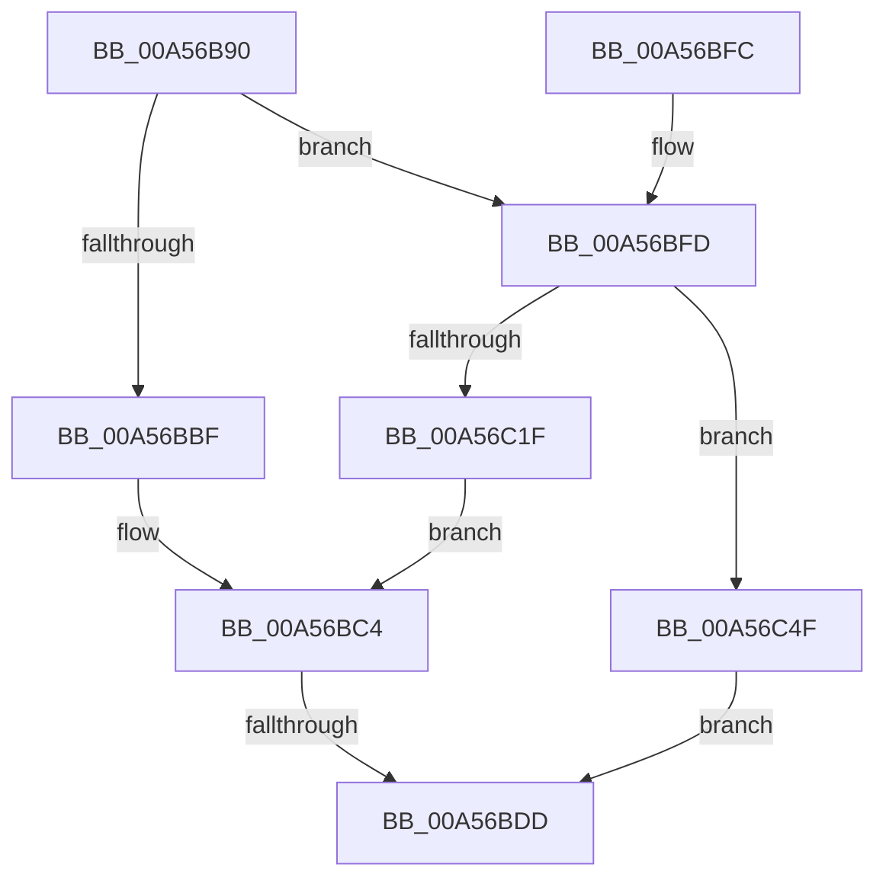

# HvpExpandMap

- RVA: `0x00A56B90`–`0x00A56C56` (길이 `198` bytes)
- VA: `0x0000000140A56B90`
- 실행 섹션: `PAGE`
- PDB 이름 있음: `예`; PDB Function 태그: `예`
- unwind 정보 RVA: `0x000B157C`
- 디코드: `60`개 명령, `198/198` bytes 표시
- 미해석 바이트: `0` (있으면 어셈블리에 `.byte`로 보존)

> 이 문서는 커널 이미지의 기계어와 PDB 기호를 분석해 생성했습니다. 4번과 5번은 함수 원형과 자료형을 바이너리 사용 방식에서 추정한 C 해석이며 원본 소스 복구 결과는 아닙니다.

## 1. Dependencies

- 직접 호출 지점: **2**; 고유 호출 대상: **2**
- 직접 호출자로 확인된 함수: **2**
- RIP 상대 이미지 참조: **0**

### Outgoing calls
- `0x00A56C12` → [guard_dispatch_icall](../../text/6B/guard_dispatch_icall_function_006BAAD0.md) (function, `0x006BAAD0`)
- `0x00A56C27` → [memset](../../text/6C/memset_function_006C6C40.md) (function, `0x006C6C40`)

### Direct callers
- [HvpPerformLogFileRecovery](../9B/HvpPerformLogFileRecovery_function_009B7994.md) at `0x009B7A80`
- [HvpAddBin](../AF/HvpAddBin_function_00AF7D48.md) at `0x00AF7E78`

### Static image references
- 디코드된 RIP-relative 메모리 참조가 없습니다.

## 2. Other-region calls and transfers

- 다른 실행 섹션으로 향하는 call: **2**
  - `0x00A56C12` → [guard_dispatch_icall](../../text/6B/guard_dispatch_icall_function_006BAAD0.md) (`PAGE` → `.text`)
  - `0x00A56C27` → [memset](../../text/6C/memset_function_006C6C40.md) (`PAGE` → `.text`)
- call이 아닌 외부 분기/꼬리 이동: **1**
  - `0x00A56BD7` → [sub_00B3D876](../B3/Unknown_function_00B3D876.md) (`tail-transfer`)

## 3. Assembly (complete function range)

```asm
00A56B90  48 89 5C 24 08                  mov qword ptr [rsp + 8], rbx
00A56B95  48 89 6C 24 10                  mov qword ptr [rsp + 0x10], rbp
00A56B9A  48 89 74 24 18                  mov qword ptr [rsp + 0x18], rsi
00A56B9F  57                              push rdi
00A56BA0  41 54                           push r12
00A56BA2  41 55                           push r13
00A56BA4  41 56                           push r14
00A56BA6  41 57                           push r15
00A56BA8  48 83 EC 20                     sub rsp, 0x20
00A56BAC  33 DB                           xor ebx, ebx
00A56BAE  44 8B F2                        mov r14d, edx
00A56BB1  41 8B E9                        mov ebp, r9d
00A56BB4  41 8B F8                        mov edi, r8d
00A56BB7  48 8B F1                        mov rsi, rcx
00A56BBA  45 85 C0                        test r8d, r8d
00A56BBD  74 3E                           je 0x140a56bfd
00A56BBF  C1 EF 0C                        shr edi, 0xc
00A56BC2  FF CF                           dec edi
00A56BC4  C1 ED 0C                        shr ebp, 0xc
00A56BC7  49 8B C6                        mov rax, r14
00A56BCA  FF CD                           dec ebp
00A56BCC  C1 EF 09                        shr edi, 9
00A56BCF  C1 ED 09                        shr ebp, 9
00A56BD2  4D 8B E6                        mov r12, r14
00A56BD5  3B EF                           cmp ebp, edi
00A56BD7  0F 87 99 6C 0E 00               ja 0x140b3d876
00A56BDD  48 8B 6C 24 58                  mov rbp, qword ptr [rsp + 0x58]
00A56BE2  8B C3                           mov eax, ebx
00A56BE4  48 8B 5C 24 50                  mov rbx, qword ptr [rsp + 0x50]
00A56BE9  48 8B 74 24 60                  mov rsi, qword ptr [rsp + 0x60]
00A56BEE  48 83 C4 20                     add rsp, 0x20
00A56BF2  41 5F                           pop r15
00A56BF4  41 5E                           pop r14
00A56BF6  41 5D                           pop r13
00A56BF8  41 5C                           pop r12
00A56BFA  5F                              pop rdi
00A56BFB  C3                              ret
00A56BFC  CC                              int3
00A56BFD  48 8B 41 18                     mov rax, qword ptr [rcx + 0x18]
00A56C01  41 BF 00 30 00 00               mov r15d, 0x3000
00A56C07  41 8B CF                        mov ecx, r15d
00A56C0A  33 D2                           xor edx, edx
00A56C0C  41 B8 43 4D 31 37               mov r8d, 0x37314d43
00A56C12  E8 B9 3E C6 FF                  call 0x1406baad0
00A56C17  48 8B F8                        mov rdi, rax
00A56C1A  48 85 C0                        test rax, rax
00A56C1D  74 30                           je 0x140a56c4f
00A56C1F  45 8B C7                        mov r8d, r15d
00A56C22  33 D2                           xor edx, edx
00A56C24  48 8B C8                        mov rcx, rax
00A56C27  E8 14 00 C7 FF                  call 0x1406c6c40
00A56C2C  49 69 CE 78 02 00 00            imul rcx, r14, 0x278
00A56C33  48 8D 86 28 01 00 00            lea rax, [rsi + 0x128]
00A56C3A  48 03 C1                        add rax, rcx
00A56C3D  48 89 84 31 20 01 00 00         mov qword ptr [rcx + rsi + 0x120], rax
00A56C45  48 89 38                        mov qword ptr [rax], rdi
00A56C48  8B FB                           mov edi, ebx
00A56C4A  E9 75 FF FF FF                  jmp 0x140a56bc4
00A56C4F  BB 17 00 00 C0                  mov ebx, 0xc0000017
00A56C54  EB 87                           jmp 0x140a56bdd
```

## 4. C-style interpretation (structured pseudocode)

```c
__int64 __fastcall HvpExpandMap(__int64 a1, int a2, int a3, int a4)
{
    __int64 result;
    __int64 v_rbp;
    __int64 v_rbx;
    __int64 v_rdi;
    __int64 v_rsp;
    unsigned __int64 v_stack_p10;
    unsigned __int64 v_stack_p18;
    unsigned __int64 v_stack_p8;

    v_stack_p8 = v_rbx;
    v_stack_p10 = v_rbp;
    v_stack_p18 = v_rsi;
    v_rsp = (v_rsp) - (32);
    v_rbx = 0;
    if (a3 == 0) goto loc_00A56BFD;
    v_rdi = (unsigned int)(((unsigned int)(a3)) >> (12));
    v_rdi = (unsigned int)((v_rdi) - 1);
loc_00A56BC4:
    v_rbp = (unsigned int)(((unsigned int)(a4)) >> (12));
    v_rbp = (unsigned int)((v_rbp) - 1);
    v_rdi = (unsigned int)((v_rdi) >> (9));
    v_rbp = (unsigned int)((v_rbp) >> (9));
loc_00A56BDD:
    v_rsp = (v_rsp) + (32);
    return 0;
loc_00A56BFD:
    a2 = 0;
    result = guard_dispatch_icall((unsigned int)((unsigned int)((unsigned int)(0x3000ULL))), a2, (unsigned int)(0x37314D43ULL), a4);
    if (result == 0) goto loc_00A56C4F;
    a2 = 0;
    result = memset(result, a2, (unsigned int)((unsigned int)((unsigned int)(0x3000ULL))), a4);
    a1 = (result) * ((unsigned int)(a2));
    result = (v_stack_p18 + 296) + (a1);
    *(unsigned __int64 *)(a1 + v_stack_p18 * 1 + 288) = result;
    *(unsigned __int64 *)(result) = result;
    goto loc_00A56BC4;
loc_00A56C4F:
    goto loc_00A56BDD;
}
```

## 5. (Beta) C Style

```c
int64_t HvpExpandMap(void *Arg1, int32_t Arg2, int32_t Arg3, int32_t Arg4)
{
    uint8_t *arg1 = (uint8_t *)Arg1;

    int64_t result;
    int64_t local_rbp;
    int64_t local_rbx;
    int64_t local_rdi;
    int64_t local_rsp;
    uint64_t v_stack_p10;
    uint64_t v_stack_p18;
    uint64_t v_stack_p8;

    v_stack_p8 = local_rbx;
    v_stack_p10 = local_rbp;
    v_stack_p18 = local_rsi;
    local_rsp = (local_rsp) - (32);
    local_rbx = 0;
    if (Arg3 == 0) goto loc_00A56BFD;
    local_rdi = (uint32_t)(((uint32_t)(Arg3)) >> (12));
    local_rdi = (uint32_t)((local_rdi) - 1);
loc_00A56BC4:
    local_rbp = (uint32_t)(((uint32_t)(Arg4)) >> (12));
    local_rbp = (uint32_t)((local_rbp) - 1);
    local_rdi = (uint32_t)((local_rdi) >> (9));
    local_rbp = (uint32_t)((local_rbp) >> (9));
loc_00A56BDD:
    local_rsp = (local_rsp) + (32);
    return 0;
loc_00A56BFD:
    Arg2 = 0;
    result = guard_dispatch_icall((uint32_t)((uint32_t)((uint32_t)(0x3000ULL))), Arg2, (uint32_t)(0x37314D43ULL), Arg4);
    if (result == 0) goto loc_00A56C4F;
    Arg2 = 0;
    result = memset(result, Arg2, (uint32_t)((uint32_t)((uint32_t)(0x3000ULL))), Arg4);
    Arg1 = (result) * ((uint32_t)(Arg2));
    result = (v_stack_p18 + 296) + (Arg1);
    *(uint64_t *)(arg1 + v_stack_p18 * 1 + 0x120) = result;
    *(uint64_t *)(result) = result;
    goto loc_00A56BC4;
loc_00A56C4F:
    goto loc_00A56BDD;
}
```

### 관측된 메모리 오프셋

구조체 형식이 확인되지 않은 접근은 인자 기준의 오프셋으로만 기록했습니다.

| 기준 인자 | 오프셋 표현 | 폭 (bit) | 접근 |
|---|---:|---:|---|
| `Arg1` | `+ 0x0` | `64` | `W` |
| `Arg1` | `+ 0x18` | `64` | `R` |
| `Arg1` | `+ 0x128` | `64` | `R` |

## 6. Execution-region graph

[열기: 2D/3D 그래프와 함수 탐색 컨트롤 패널](../../../control-panel.html?section=page&rva=0x00A56B90&view=graph)

- 2D 그래프는 위에서 아래로 흐르고, 3D 그래프는 빈 공간을 드래그해 회전합니다. Shift+드래그는 이동, 휠은 확대·축소, 함수 노드 선택은 대상 보고서 이동입니다.

### Static fallback


