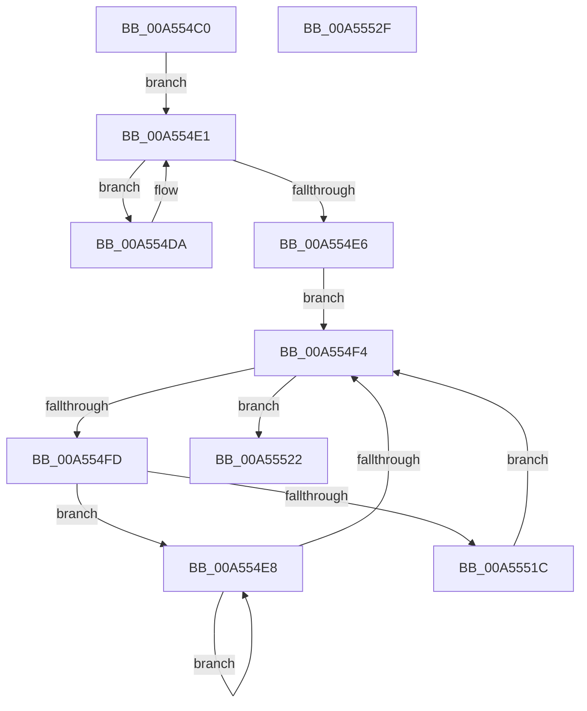

# IoDiagTraceDevicesRundown

- RVA: `0x00A554C0`–`0x00A55530` (길이 `112` bytes)
- VA: `0x0000000140A554C0`
- 실행 섹션: `PAGE`
- PDB 이름 있음: `예`; PDB Function 태그: `아니요`
- unwind 정보 RVA: `0x0005CF00`
- 디코드: `34`개 명령, `112/112` bytes 표시
- 미해석 바이트: `0` (있으면 어셈블리에 `.byte`로 보존)

> 이 문서는 커널 이미지의 기계어와 PDB 기호를 분석해 생성했습니다. 4번과 5번은 함수 원형과 자료형을 바이너리 사용 방식에서 추정한 C 해석이며 원본 소스 복구 결과는 아닙니다.

## 1. Dependencies

- 직접 호출 지점: **3**; 고유 호출 대상: **2**
- 직접 호출자로 확인된 함수: **1**
- RIP 상대 이미지 참조: **1**

### Outgoing calls
- `0x00A554C8` → [IoControlPnpDeviceActionQueue](../../text/4A/IoControlPnpDeviceActionQueue_function_004A42D4.md) (function, `0x004A42D4`)
- `0x00A5550F` → [PoDiagTraceDeviceRundown](PoDiagTraceDeviceRundown_function_00A55538.md) (function, `0x00A55538`)
- `0x00A55524` → [IoControlPnpDeviceActionQueue](../../text/4A/IoControlPnpDeviceActionQueue_function_004A42D4.md) (function, `0x004A42D4`)

### Direct callers
- [PopDiagDeviceRundownWorker](PopDiagDeviceRundownWorker_function_00A554A0.md) at `0x00A554AC`

### Static image references
- `0x00A554CD` → RVA `0x00F8C438` (`.data`; read)

## 2. Other-region calls and transfers

- 다른 실행 섹션으로 향하는 call: **2**
  - `0x00A554C8` → [IoControlPnpDeviceActionQueue](../../text/4A/IoControlPnpDeviceActionQueue_function_004A42D4.md) (`PAGE` → `.text`)
  - `0x00A55524` → [IoControlPnpDeviceActionQueue](../../text/4A/IoControlPnpDeviceActionQueue_function_004A42D4.md) (`PAGE` → `.text`)
- 별도 외부 분기/꼬리 이동을 확인하지 못했습니다.

## 3. Assembly (complete function range)

```asm
00A554C0  40 53                           push rbx
00A554C2  48 83 EC 20                     sub rsp, 0x20
00A554C6  B1 01                           mov cl, 1
00A554C8  E8 07 EE A4 FF                  call 0x1404a42d4
00A554CD  48 8B 1D 64 6F 53 00            mov rbx, qword ptr [rip + 0x536f64]
00A554D4  48 8B 43 08                     mov rax, qword ptr [rbx + 8]
00A554D8  EB 07                           jmp 0x140a554e1
00A554DA  48 8B D8                        mov rbx, rax
00A554DD  48 8B 40 08                     mov rax, qword ptr [rax + 8]
00A554E1  48 85 C0                        test rax, rax
00A554E4  75 F4                           jne 0x140a554da
00A554E6  EB 0C                           jmp 0x140a554f4
00A554E8  48 8B D8                        mov rbx, rax
00A554EB  48 8B 40 08                     mov rax, qword ptr [rax + 8]
00A554EF  48 85 C0                        test rax, rax
00A554F2  75 F4                           jne 0x140a554e8
00A554F4  48 3B 1D 3D 6F 53 00            cmp rbx, qword ptr [rip + 0x536f3d]
00A554FB  74 25                           je 0x140a55522
00A554FD  44 8B 8B 9C 00 00 00            mov r9d, dword ptr [rbx + 0x9c]
00A55504  4C 8D 43 38                     lea r8, [rbx + 0x38]
00A55508  48 8D 53 28                     lea rdx, [rbx + 0x28]
00A5550C  48 8B CB                        mov rcx, rbx
00A5550F  E8 24 00 00 00                  call 0x140a55538
00A55514  48 8B 03                        mov rax, qword ptr [rbx]
00A55517  48 85 C0                        test rax, rax
00A5551A  75 CC                           jne 0x140a554e8
00A5551C  48 8B 5B 10                     mov rbx, qword ptr [rbx + 0x10]
00A55520  EB D2                           jmp 0x140a554f4
00A55522  33 C9                           xor ecx, ecx
00A55524  E8 AB ED A4 FF                  call 0x1404a42d4
00A55529  48 83 C4 20                     add rsp, 0x20
00A5552D  5B                              pop rbx
00A5552E  C3                              ret
00A5552F  CC                              int3
```

## 4. C-style interpretation (structured pseudocode)

```c
__int64 __fastcall IoDiagTraceDevicesRundown(void)
{
    __int64 result;
    __int64 v_rsp;

    v_rsp = (v_rsp) - (32);
    result = IoControlPnpDeviceActionQueue(1, a2, a3, a4);
    goto loc_00A554E1;
loc_00A554DA:
loc_00A554E1:
    if (*(unsigned __int64 *)(*(unsigned __int64 *)(*(unsigned __int64 *)(v_rip + 5468004) + 8) + 8) != 0) goto loc_00A554DA;
    goto loc_00A554F4;
loc_00A554E8:
    if (*(unsigned __int64 *)(*(unsigned __int64 *)(*(unsigned __int64 *)(*(unsigned __int64 *)(v_rip + 5468004) + 8) + 8) + 8) != 0) goto loc_00A554E8;
loc_00A554F4:
    if ((*(unsigned __int64 *)(*(unsigned __int64 *)(*(unsigned __int64 *)(v_rip + 5468004) + 8) + 8)) == (*(unsigned __int64 *)(v_rip + 5467965))) goto loc_00A55522;
    result = PoDiagTraceDeviceRundown(*(unsigned __int64 *)(*(unsigned __int64 *)(*(unsigned __int64 *)(v_rip + 5468004) + 8) + 8), *(unsigned __int64 *)(*(unsigned __int64 *)(*(unsigned __int64 *)(v_rip + 5468004) + 8) + 8) + 40, *(unsigned __int64 *)(*(unsigned __int64 *)(*(unsigned __int64 *)(v_rip + 5468004) + 8) + 8) + 56, (unsigned int)(*(unsigned int *)(*(unsigned __int64 *)(*(unsigned __int64 *)(*(unsigned __int64 *)(v_rip + 5468004) + 8) + 8) + 156)));
    if (*(unsigned __int64 *)(*(unsigned __int64 *)(*(unsigned __int64 *)(*(unsigned __int64 *)(v_rip + 5468004) + 8) + 8)) != 0) goto loc_00A554E8;
    goto loc_00A554F4;
loc_00A55522:
    a1 = 0;
    result = IoControlPnpDeviceActionQueue(a1, *(unsigned __int64 *)(*(unsigned __int64 *)(*(unsigned __int64 *)(v_rip + 5468004) + 8) + 8) + 40, *(unsigned __int64 *)(*(unsigned __int64 *)(*(unsigned __int64 *)(v_rip + 5468004) + 8) + 8) + 56, (unsigned int)(*(unsigned int *)(*(unsigned __int64 *)(*(unsigned __int64 *)(*(unsigned __int64 *)(v_rip + 5468004) + 8) + 8) + 156)));
    v_rsp = (v_rsp) + (32);
    return result;
}
```

## 5. (Beta) C Style

```c
void IoDiagTraceDevicesRundown(void)
{
    int64_t result;
    int64_t local_rsp;

    local_rsp = (local_rsp) - (32);
    result = IoControlPnpDeviceActionQueue(1, a2, a3, a4);
    goto loc_00A554E1;
loc_00A554DA:
loc_00A554E1:
    if (*(uint64_t *)(*(uint64_t *)(*(uint64_t *)(v_rip + 0x536F64) + 0x8) + 0x8) != 0) goto loc_00A554DA;
    goto loc_00A554F4;
loc_00A554E8:
    if (*(uint64_t *)(*(uint64_t *)(*(uint64_t *)(*(uint64_t *)(v_rip + 0x536F64) + 0x8) + 0x8) + 0x8) != 0) goto loc_00A554E8;
loc_00A554F4:
    if ((*(uint64_t *)(*(uint64_t *)(*(uint64_t *)(v_rip + 0x536F64) + 0x8) + 0x8)) == (*(uint64_t *)(v_rip + 0x536F3D))) goto loc_00A55522;
    result = PoDiagTraceDeviceRundown(*(uint64_t *)(*(uint64_t *)(*(uint64_t *)(v_rip + 0x536F64) + 0x8) + 0x8), *(uint64_t *)(*(uint64_t *)(*(uint64_t *)(v_rip + 0x536F64) + 0x8) + 0x8) + 40, *(uint64_t *)(*(uint64_t *)(*(uint64_t *)(v_rip + 0x536F64) + 0x8) + 0x8) + 56, (uint32_t)(*(uint32_t *)(*(uint64_t *)(*(uint64_t *)(*(uint64_t *)(v_rip + 0x536F64) + 0x8) + 0x8) + 0x9C)));
    if (*(uint64_t *)(*(uint64_t *)(*(uint64_t *)(*(uint64_t *)(v_rip + 0x536F64) + 0x8) + 0x8)) != 0) goto loc_00A554E8;
    goto loc_00A554F4;
loc_00A55522:
    a1 = 0;
    result = IoControlPnpDeviceActionQueue(a1, *(uint64_t *)(*(uint64_t *)(*(uint64_t *)(v_rip + 0x536F64) + 0x8) + 0x8) + 40, *(uint64_t *)(*(uint64_t *)(*(uint64_t *)(v_rip + 0x536F64) + 0x8) + 0x8) + 56, (uint32_t)(*(uint32_t *)(*(uint64_t *)(*(uint64_t *)(*(uint64_t *)(v_rip + 0x536F64) + 0x8) + 0x8) + 0x9C)));
    local_rsp = (local_rsp) + (32);
    return result;
}
```

## 6. Execution-region graph

[열기: 2D/3D 그래프와 함수 탐색 컨트롤 패널](../../../control-panel.html?section=page&rva=0x00A554C0&view=graph)

- 2D 그래프는 위에서 아래로 흐르고, 3D 그래프는 빈 공간을 드래그해 회전합니다. Shift+드래그는 이동, 휠은 확대·축소, 함수 노드 선택은 대상 보고서 이동입니다.

### Static fallback


