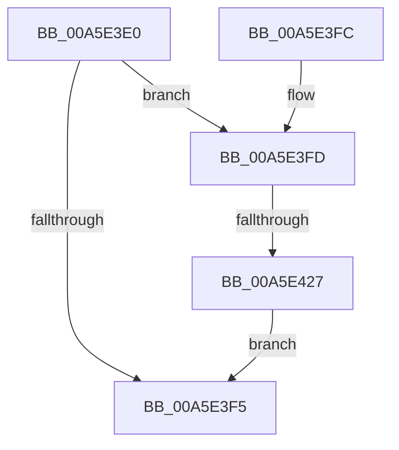

# IopErrorLogConnectSession

- RVA: `0x00A5E3E0`–`0x00A5E430` (길이 `80` bytes)
- VA: `0x0000000140A5E3E0`
- 실행 섹션: `PAGE`
- PDB 이름 있음: `예`; PDB Function 태그: `예`
- unwind 정보 RVA: `0x000B28A8`
- 디코드: `19`개 명령, `80/80` bytes 표시
- 미해석 바이트: `0` (있으면 어셈블리에 `.byte`로 보존)

> 이 문서는 커널 이미지의 기계어와 PDB 기호를 분석해 생성했습니다. 4번과 5번은 함수 원형과 자료형을 바이너리 사용 방식에서 추정한 C 해석이며 원본 소스 복구 결과는 아닙니다.

## 1. Dependencies

- 직접 호출 지점: **2**; 고유 호출 대상: **2**
- 직접 호출자로 확인된 함수: **1**
- RIP 상대 이미지 참조: **4**

### Outgoing calls
- `0x00A5E409` → [RtlInitUnicodeString](../../text/42/RtlInitUnicodeString_function_0042A780.md) (function, `0x0042A780`)
- `0x00A5E41A` → [EtwQueryTraceHandleByLoggerName](../AA/EtwQueryTraceHandleByLoggerName_function_00AA2578.md) (function, `0x00AA2578`)

### Direct callers
- [IopErrorLogThread](IopErrorLogThread_function_00A5DC80.md) at `0x00A5DCD3`

### Static image references
- `0x00A5E3E4` → RVA `0x00F8D059` (`.data`; read)
- `0x00A5E3FD` → RVA `0x00AFD080` (` ?? ::NNGAKEGL::`string'`; read)
- `0x00A5E40E` → RVA `0x00E66210` (`.data`; read)
- `0x00A5E427` → RVA `0x00F8D059` (`.data`; write)

## 2. Other-region calls and transfers

- 다른 실행 섹션으로 향하는 call: **1**
  - `0x00A5E409` → [RtlInitUnicodeString](../../text/42/RtlInitUnicodeString_function_0042A780.md) (`PAGE` → `.text`)
- call이 아닌 외부 분기/꼬리 이동: **1**
  - `0x00A5E421` → [sub_00B3DFBA](../B3/Unknown_function_00B3DFBA.md) (`tail-transfer`)

## 3. Assembly (complete function range)

```asm
00A5E3E0  48 83 EC 38                     sub rsp, 0x38
00A5E3E4  80 3D 6E EC 52 00 00            cmp byte ptr [rip + 0x52ec6e], 0
00A5E3EB  0F 57 C0                        xorps xmm0, xmm0
00A5E3EE  0F 11 44 24 20                  movups xmmword ptr [rsp + 0x20], xmm0
00A5E3F3  74 08                           je 0x140a5e3fd
00A5E3F5  B0 01                           mov al, 1
00A5E3F7  48 83 C4 38                     add rsp, 0x38
00A5E3FB  C3                              ret
00A5E3FC  CC                              int3
00A5E3FD  48 8D 15 7C EC 09 00            lea rdx, [rip + 0x9ec7c]
00A5E404  48 8D 4C 24 20                  lea rcx, [rsp + 0x20]
00A5E409  E8 72 C3 9C FF                  call 0x14042a780
00A5E40E  48 8D 15 FB 7D 40 00            lea rdx, [rip + 0x407dfb]
00A5E415  48 8D 4C 24 20                  lea rcx, [rsp + 0x20]
00A5E41A  E8 59 41 04 00                  call 0x140aa2578
00A5E41F  85 C0                           test eax, eax
00A5E421  0F 88 93 FB 0D 00               js 0x140b3dfba
00A5E427  C6 05 2B EC 52 00 01            mov byte ptr [rip + 0x52ec2b], 1
00A5E42E  EB C5                           jmp 0x140a5e3f5
```

## 4. C-style interpretation (structured pseudocode)

```c
__int64 __fastcall IopErrorLogConnectSession(void)
{
    __int64 result;
    __int64 v_rsp;
    unsigned __int64 v_stack_m18;
    unsigned __int64 v_stack_p20;

    v_rsp = (v_rsp) - (56);
    v_stack_m18 = v_xmm0;
    if ((*(unsigned __int8 *)(v_rip + 5434478)) == 0) goto loc_00A5E3FD;
loc_00A5E3F5:
    v_rsp = (v_rsp) + (56);
    return 1;
loc_00A5E3FD:
    result = RtlInitUnicodeString(v_stack_p20, v_rip + 650364, a3, a4);
    result = EtwQueryTraceHandleByLoggerName(v_stack_p20, v_rip + 4226555, a3, a4);
    *(unsigned __int8 *)(v_rip + 5434411) = 1;
    goto loc_00A5E3F5;
}
```

## 5. (Beta) C Style

```c
void IopErrorLogConnectSession(void)
{
    int64_t result;
    int64_t local_rsp;
    uint64_t v_stack_m18;
    uint64_t v_stack_p20;

    local_rsp = (local_rsp) - (56);
    v_stack_m18 = v_xmm0;
    if ((*(uint8_t *)(v_rip + 0x52EC6E)) == 0) goto loc_00A5E3FD;
loc_00A5E3F5:
    local_rsp = (local_rsp) + (56);
    return 1;
loc_00A5E3FD:
    result = RtlInitUnicodeString(v_stack_p20, v_rip + 650364, a3, a4);
    result = EtwQueryTraceHandleByLoggerName(v_stack_p20, v_rip + 4226555, a3, a4);
    *(uint8_t *)(v_rip + 0x52EC2B) = 1;
    goto loc_00A5E3F5;
}
```

## 6. Execution-region graph

[열기: 2D/3D 그래프와 함수 탐색 컨트롤 패널](../../../control-panel.html?section=page&rva=0x00A5E3E0&view=graph)

- 2D 그래프는 위에서 아래로 흐르고, 3D 그래프는 빈 공간을 드래그해 회전합니다. Shift+드래그는 이동, 휠은 확대·축소, 함수 노드 선택은 대상 보고서 이동입니다.

### Static fallback


