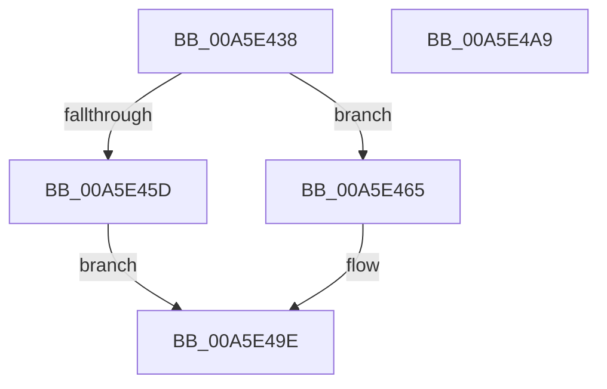

# IopErrorLogQueueRequest

- RVA: `0x00A5E438`–`0x00A5E4AA` (길이 `114` bytes)
- VA: `0x0000000140A5E438`
- 실행 섹션: `PAGE`
- PDB 이름 있음: `예`; PDB Function 태그: `아니요`
- unwind 정보 RVA: `0x0006E5F8`
- 디코드: `29`개 명령, `114/114` bytes 표시
- 미해석 바이트: `0` (있으면 어셈블리에 `.byte`로 보존)

> 이 문서는 커널 이미지의 기계어와 PDB 기호를 분석해 생성했습니다. 4번과 5번은 함수 원형과 자료형을 바이너리 사용 방식에서 추정한 C 해석이며 원본 소스 복구 결과는 아닙니다.

## 1. Dependencies

- 직접 호출 지점: **4**; 고유 호출 대상: **4**
- 직접 호출자로 확인된 함수: **2**
- RIP 상대 이미지 참조: **2**

### Outgoing calls
- `0x00A5E450` → [ExAllocatePool2](../../poolcode/B8/ExAllocatePool2_function_00B820F0.md) (function, `0x00B820F0`)
- `0x00A5E472` → [KeInitializeDpc](../../text/45/KeInitializeDpc_function_0045BBD0.md) (function, `0x0045BBD0`)
- `0x00A5E47B` → [KeInitializeTimer](../../text/45/KeInitializeTimer_function_0045B590.md) (function, `0x0045B590`)
- `0x00A5E499` → [KeSetCoalescableTimer](../../text/22/KeSetCoalescableTimer_function_0022FFD0.md) (function, `0x0022FFD0`)

### Direct callers
- [IopErrorLogThread](IopErrorLogThread_function_00A5DC80.md) at `0x00A5DF27`
- [sub_00B3DFBA](../B3/Unknown_function_00B3DFBA.md) at `0x00B3DFBA`

### Static image references
- `0x00A5E45D` → RVA `0x00F8D05B` (`.data`; write)
- `0x00A5E468` → RVA `0x005A3AA0` (`IopErrorLogDpc`; read)

## 2. Other-region calls and transfers

- 다른 실행 섹션으로 향하는 call: **4**
  - `0x00A5E450` → [ExAllocatePool2](../../poolcode/B8/ExAllocatePool2_function_00B820F0.md) (`PAGE` → `POOLCODE`)
  - `0x00A5E472` → [KeInitializeDpc](../../text/45/KeInitializeDpc_function_0045BBD0.md) (`PAGE` → `.text`)
  - `0x00A5E47B` → [KeInitializeTimer](../../text/45/KeInitializeTimer_function_0045B590.md) (`PAGE` → `.text`)
  - `0x00A5E499` → [KeSetCoalescableTimer](../../text/22/KeSetCoalescableTimer_function_0022FFD0.md) (`PAGE` → `.text`)
- 별도 외부 분기/꼬리 이동을 확인하지 못했습니다.

## 3. Assembly (complete function range)

```asm
00A5E438  48 89 5C 24 08                  mov qword ptr [rsp + 8], rbx
00A5E43D  57                              push rdi
00A5E43E  48 83 EC 30                     sub rsp, 0x30
00A5E442  BA 80 00 00 00                  mov edx, 0x80
00A5E447  41 B8 49 6F 45 4C               mov r8d, 0x4c456f49
00A5E44D  8D 4A C0                        lea ecx, [rdx - 0x40]
00A5E450  E8 9B 3C 12 00                  call 0x140b820f0
00A5E455  48 8B F8                        mov rdi, rax
00A5E458  48 85 C0                        test rax, rax
00A5E45B  75 08                           jne 0x140a5e465
00A5E45D  88 05 F8 EB 52 00               mov byte ptr [rip + 0x52ebf8], al
00A5E463  EB 39                           jmp 0x140a5e49e
00A5E465  45 33 C0                        xor r8d, r8d
00A5E468  48 8D 15 31 56 B4 FF            lea rdx, [rip - 0x4ba9cf]
00A5E46F  48 8B CF                        mov rcx, rdi
00A5E472  E8 59 D7 9F FF                  call 0x14045bbd0
00A5E477  48 8D 4F 40                     lea rcx, [rdi + 0x40]
00A5E47B  E8 10 D1 9F FF                  call 0x14045b590
00A5E480  41 B9 D0 07 00 00               mov r9d, 0x7d0
00A5E486  48 89 7C 24 20                  mov qword ptr [rsp + 0x20], rdi
00A5E48B  45 33 C0                        xor r8d, r8d
00A5E48E  48 8D 4F 40                     lea rcx, [rdi + 0x40]
00A5E492  48 C7 C2 00 5D 1E EE            mov rdx, 0xffffffffee1e5d00
00A5E499  E8 32 1B 7D FF                  call 0x14022ffd0
00A5E49E  48 8B 5C 24 40                  mov rbx, qword ptr [rsp + 0x40]
00A5E4A3  48 83 C4 30                     add rsp, 0x30
00A5E4A7  5F                              pop rdi
00A5E4A8  C3                              ret
00A5E4A9  CC                              int3
```

## 4. C-style interpretation (structured pseudocode)

```c
__int64 __fastcall IopErrorLogQueueRequest(void)
{
    __int64 result;
    __int64 v_rsp;
    unsigned __int64 v_stack_m18;
    unsigned __int64 v_stack_p8;

    v_stack_p8 = v_rbx;
    v_rsp = (v_rsp) - (48);
    result = ExAllocatePool2(128 - 64, 128, (unsigned int)(0x4C456F49ULL), a4);
    if (result != 0) goto loc_00A5E465;
    *(unsigned __int8 *)(v_rip + 5434360) = (unsigned __int8)(result);
    goto loc_00A5E49E;
loc_00A5E465:
    a3 = 0;
    result = KeInitializeDpc(result, v_rip - 4958671, a3, a4);
    result = KeInitializeTimer(result + 64, v_rip - 4958671, a3, a4);
    v_stack_m18 = result;
    a3 = 0;
    result = KeSetCoalescableTimer(result + 64, 0xFFFFFFFFEE1E5D00ULL, a3, (unsigned int)(0x7D0ULL));
loc_00A5E49E:
    v_rsp = (v_rsp) + (48);
    return result;
}
```

## 5. (Beta) C Style

```c
void IopErrorLogQueueRequest(void)
{
    int64_t result;
    int64_t local_rsp;
    uint64_t v_stack_m18;
    uint64_t v_stack_p8;

    v_stack_p8 = local_rbx;
    local_rsp = (local_rsp) - (48);
    result = ExAllocatePool2(128 - 64, 128, (uint32_t)(0x4C456F49ULL), a4);
    if (result != 0) goto loc_00A5E465;
    *(uint8_t *)(v_rip + 0x52EBF8) = (uint8_t)(result);
    goto loc_00A5E49E;
loc_00A5E465:
    a3 = 0;
    result = KeInitializeDpc(result, v_rip - 4958671, a3, a4);
    result = KeInitializeTimer(result + 64, v_rip - 4958671, a3, a4);
    v_stack_m18 = result;
    a3 = 0;
    result = KeSetCoalescableTimer(result + 64, 0xFFFFFFFFEE1E5D00ULL, a3, (uint32_t)(0x7D0ULL));
loc_00A5E49E:
    local_rsp = (local_rsp) + (48);
    return result;
}
```

## 6. Execution-region graph

[열기: 2D/3D 그래프와 함수 탐색 컨트롤 패널](../../../control-panel.html?section=page&rva=0x00A5E438&view=graph)

- 2D 그래프는 위에서 아래로 흐르고, 3D 그래프는 빈 공간을 드래그해 회전합니다. Shift+드래그는 이동, 휠은 확대·축소, 함수 노드 선택은 대상 보고서 이동입니다.

### Static fallback


