# IopErrorLogThread

- RVA: `0x00A5DC80`–`0x00A5E027` (길이 `935` bytes)
- VA: `0x0000000140A5DC80`
- 실행 섹션: `PAGE`
- PDB 이름 있음: `예`; PDB Function 태그: `예`
- unwind 정보 RVA: `0x000B2840`
- 디코드: `218`개 명령, `935/935` bytes 표시
- 미해석 바이트: `0` (있으면 어셈블리에 `.byte`로 보존)

> 이 문서는 커널 이미지의 기계어와 PDB 기호를 분석해 생성했습니다. 4번과 5번은 함수 원형과 자료형을 바이너리 사용 방식에서 추정한 C 해석이며 원본 소스 복구 결과는 아닙니다.

## 1. Dependencies

- 직접 호출 지점: **20**; 고유 호출 대상: **13**
- 직접 호출자로 확인된 함수: **0**
- RIP 상대 이미지 참조: **5**

### Outgoing calls
- `0x00A5DCD3` → [IopErrorLogConnectSession](IopErrorLogConnectSession_function_00A5E3E0.md) (function, `0x00A5E3E0`)
- `0x00A5DCE4` → [IopErrorLogGetEntry](../../text/4B/IopErrorLogGetEntry_function_004B2554.md) (function, `0x004B2554`)
- `0x00A5DD16` → [RtlInitUnicodeString](../../text/42/RtlInitUnicodeString_function_0042A780.md) (function, `0x0042A780`)
- `0x00A5DD8B` → [RtlInitUnicodeString](../../text/42/RtlInitUnicodeString_function_0042A780.md) (function, `0x0042A780`)
- `0x00A5DDC8` → [RtlInitUnicodeString](../../text/42/RtlInitUnicodeString_function_0042A780.md) (function, `0x0042A780`)
- `0x00A5DE4A` → [EtwWriteErrorLogEntry](EtwWriteErrorLogEntry_function_00A5E030.md) (function, `0x00A5E030`)
- `0x00A5DE6D` → [ObfDereferenceObject](../../text/2F/ObfDereferenceObject_function_002F9350.md) (function, `0x002F9350`)
- `0x00A5DE7B` → [ObfDereferenceObject](../../text/2F/ObfDereferenceObject_function_002F9350.md) (function, `0x002F9350`)
- `0x00A5DE85` → [ExFreePoolWithTag](../../poolcode/B8/ExFreePoolWithTag_function_00B82870.md) (function, `0x00B82870`)
- `0x00A5DEA5` → [ObQueryNameStringMode](../8A/ObQueryNameStringMode_function_008A7ED0.md) (function, `0x008A7ED0`)
- `0x00A5DEC0` → [ExAllocatePool2](../../poolcode/B8/ExAllocatePool2_function_00B820F0.md) (function, `0x00B820F0`)
- `0x00A5DEEA` → [ObQueryNameStringMode](../8A/ObQueryNameStringMode_function_008A7ED0.md) (function, `0x008A7ED0`)
- `0x00A5DF22` → [IopErrorLogRequeueEntry](../../text/4D/IopErrorLogRequeueEntry_function_004D88E0.md) (function, `0x004D88E0`)
- `0x00A5DF27` → [IopErrorLogQueueRequest](IopErrorLogQueueRequest_function_00A5E438.md) (function, `0x00A5E438`)
- `0x00A5DF36` → [_security_check_cookie](../../text/6A/_security_check_cookie_function_006AC640.md) (function, `0x006AC640`)
- `0x00A5DF77` → [ObQueryNameStringMode](../8A/ObQueryNameStringMode_function_008A7ED0.md) (function, `0x008A7ED0`)
- `0x00A5DFB3` → [RtlStringCchCopyNW](../../text/47/RtlStringCchCopyNW_function_0047169C.md) (function, `0x0047169C`)
- `0x00A5DFD2` → [RtlStringCchCopyNW](../../text/47/RtlStringCchCopyNW_function_0047169C.md) (function, `0x0047169C`)
- `0x00A5DFE1` → [ExFreePoolWithTag](../../poolcode/B8/ExFreePoolWithTag_function_00B82870.md) (function, `0x00B82870`)
- `0x00A5DFF9` → [wcsicmp](../../text/50/wcsicmp_function_00500080.md) (function, `0x00500080`)

### Direct callers
- 이 함수 시작 RVA로 연결되는 직접 call은 확인되지 않았습니다. 간접 호출은 완전히 역산할 수 없습니다.

### Static image references
- `0x00A5DCA6` → RVA `0x00E0A740` (`.data`; read)
- `0x00A5DD84` → RVA `0x00AFD0A0` (` ?? ::NNGAKEGL::`string'`; read)
- `0x00A5DDBC` → RVA `0x00AFCAD0` (` ?? ::NNGAKEGL::`string'`; read)
- `0x00A5DE5D` → RVA `0x00F8D168` (`.data`; read/write)
- `0x00A5DFEB` → RVA `0x00AFD070` (` ?? ::NNGAKEGL::`string'`; read)

## 2. Other-region calls and transfers

- 다른 실행 섹션으로 향하는 call: **14**
  - `0x00A5DCE4` → [IopErrorLogGetEntry](../../text/4B/IopErrorLogGetEntry_function_004B2554.md) (`PAGE` → `.text`)
  - `0x00A5DD16` → [RtlInitUnicodeString](../../text/42/RtlInitUnicodeString_function_0042A780.md) (`PAGE` → `.text`)
  - `0x00A5DD8B` → [RtlInitUnicodeString](../../text/42/RtlInitUnicodeString_function_0042A780.md) (`PAGE` → `.text`)
  - `0x00A5DDC8` → [RtlInitUnicodeString](../../text/42/RtlInitUnicodeString_function_0042A780.md) (`PAGE` → `.text`)
  - `0x00A5DE6D` → [ObfDereferenceObject](../../text/2F/ObfDereferenceObject_function_002F9350.md) (`PAGE` → `.text`)
  - `0x00A5DE7B` → [ObfDereferenceObject](../../text/2F/ObfDereferenceObject_function_002F9350.md) (`PAGE` → `.text`)
  - `0x00A5DE85` → [ExFreePoolWithTag](../../poolcode/B8/ExFreePoolWithTag_function_00B82870.md) (`PAGE` → `POOLCODE`)
  - `0x00A5DEC0` → [ExAllocatePool2](../../poolcode/B8/ExAllocatePool2_function_00B820F0.md) (`PAGE` → `POOLCODE`)
  - `0x00A5DF22` → [IopErrorLogRequeueEntry](../../text/4D/IopErrorLogRequeueEntry_function_004D88E0.md) (`PAGE` → `.text`)
  - `0x00A5DF36` → [_security_check_cookie](../../text/6A/_security_check_cookie_function_006AC640.md) (`PAGE` → `.text`)
  - `0x00A5DFB3` → [RtlStringCchCopyNW](../../text/47/RtlStringCchCopyNW_function_0047169C.md) (`PAGE` → `.text`)
  - `0x00A5DFD2` → [RtlStringCchCopyNW](../../text/47/RtlStringCchCopyNW_function_0047169C.md) (`PAGE` → `.text`)
  - `0x00A5DFE1` → [ExFreePoolWithTag](../../poolcode/B8/ExFreePoolWithTag_function_00B82870.md) (`PAGE` → `POOLCODE`)
  - `0x00A5DFF9` → [wcsicmp](../../text/50/wcsicmp_function_00500080.md) (`PAGE` → `.text`)
- call이 아닌 외부 분기/꼬리 이동: **2**
  - `0x00A5DF7E` → [sub_00B3DFA8](../B3/Unknown_function_00B3DFA8.md) (`tail-transfer`)
  - `0x00A5DF88` → [sub_00B3DFA8](../B3/Unknown_function_00B3DFA8.md) (`tail-transfer`)

## 3. Assembly (complete function range)

```asm
00A5DC80  48 8B C4                        mov rax, rsp
00A5DC83  48 89 58 08                     mov qword ptr [rax + 8], rbx
00A5DC87  48 89 70 10                     mov qword ptr [rax + 0x10], rsi
00A5DC8B  48 89 78 18                     mov qword ptr [rax + 0x18], rdi
00A5DC8F  55                              push rbp
00A5DC90  41 54                           push r12
00A5DC92  41 55                           push r13
00A5DC94  41 56                           push r14
00A5DC96  41 57                           push r15
00A5DC98  48 8D A8 28 FA FF FF            lea rbp, [rax - 0x5d8]
00A5DC9F  48 81 EC B0 06 00 00            sub rsp, 0x6b0
00A5DCA6  48 8B 05 93 CA 3A 00            mov rax, qword ptr [rip + 0x3aca93]
00A5DCAD  48 33 C4                        xor rax, rsp
00A5DCB0  48 89 85 A0 05 00 00            mov qword ptr [rbp + 0x5a0], rax
00A5DCB7  0F 57 C0                        xorps xmm0, xmm0
00A5DCBA  0F 57 C9                        xorps xmm1, xmm1
00A5DCBD  33 DB                           xor ebx, ebx
00A5DCBF  0F 11 44 24 48                  movups xmmword ptr [rsp + 0x48], xmm0
00A5DCC4  66 89 5C 24 44                  mov word ptr [rsp + 0x44], bx
00A5DCC9  0F 11 4C 24 68                  movups xmmword ptr [rsp + 0x68], xmm1
00A5DCCE  48 89 5C 24 60                  mov qword ptr [rsp + 0x60], rbx
00A5DCD3  E8 08 07 00 00                  call 0x140a5e3e0
00A5DCD8  84 C0                           test al, al
00A5DCDA  0F 84 4C 02 00 00               je 0x140a5df2c
00A5DCE0  89 5C 24 40                     mov dword ptr [rsp + 0x40], ebx
00A5DCE4  E8 6B 48 A5 FF                  call 0x1404b2554
00A5DCE9  48 89 44 24 78                  mov qword ptr [rsp + 0x78], rax
00A5DCEE  48 85 C0                        test rax, rax
00A5DCF1  0F 84 35 02 00 00               je 0x140a5df2c
00A5DCF7  48 8D 70 F8                     lea rsi, [rax - 8]
00A5DCFB  0F B7 46 02                     movzx eax, word ptr [rsi + 2]
00A5DCFF  48 8D 4C 24 48                  lea rcx, [rsp + 0x48]
00A5DD04  4C 8B 66 20                     mov r12, qword ptr [rsi + 0x20]
00A5DD08  83 E8 30                        sub eax, 0x30
00A5DD0B  89 44 24 58                     mov dword ptr [rsp + 0x58], eax
00A5DD0F  4D 85 E4                        test r12, r12
00A5DD12  74 70                           je 0x140a5dd84
00A5DD14  33 D2                           xor edx, edx
00A5DD16  E8 65 CA 9C FF                  call 0x14042a780
00A5DD1B  49 39 5C 24 40                  cmp qword ptr [r12 + 0x40], rbx
00A5DD20  74 0C                           je 0x140a5dd2e
00A5DD22  41 0F 10 44 24 38               movups xmm0, xmmword ptr [r12 + 0x38]
00A5DD28  F3 0F 7F 44 24 48               movdqu xmmword ptr [rsp + 0x48], xmm0
00A5DD2E  0F B7 7C 24 48                  movzx edi, word ptr [rsp + 0x48]
00A5DD33  66 85 FF                        test di, di
00A5DD36  0F 84 21 02 00 00               je 0x140a5df5d
00A5DD3C  48 8B 4C 24 50                  mov rcx, qword ptr [rsp + 0x50]
00A5DD41  0F B7 DF                        movzx ebx, di
00A5DD44  48 D1 EB                        shr rbx, 1
00A5DD47  48 FF CB                        dec rbx
00A5DD4A  48 8D 1C 59                     lea rbx, [rcx + rbx*2]
00A5DD4E  66 83 3B 5C                     cmp word ptr [rbx], 0x5c
00A5DD52  74 15                           je 0x140a5dd69
00A5DD54  48 3B D9                        cmp rbx, rcx
00A5DD57  74 0A                           je 0x140a5dd63
00A5DD59  48 83 EB 02                     sub rbx, 2
00A5DD5D  66 83 3B 5C                     cmp word ptr [rbx], 0x5c
00A5DD61  75 F1                           jne 0x140a5dd54
00A5DD63  66 83 3B 5C                     cmp word ptr [rbx], 0x5c
00A5DD67  75 04                           jne 0x140a5dd6d
00A5DD69  48 83 C3 02                     add rbx, 2
00A5DD6D  0F B7 44 24 50                  movzx eax, word ptr [rsp + 0x50]
00A5DD72  66 2B C3                        sub ax, bx
00A5DD75  48 89 5C 24 50                  mov qword ptr [rsp + 0x50], rbx
00A5DD7A  66 03 F8                        add di, ax
00A5DD7D  66 89 7C 24 48                  mov word ptr [rsp + 0x48], di
00A5DD82  EB 1B                           jmp 0x140a5dd9f
00A5DD84  48 8D 15 15 F3 09 00            lea rdx, [rip + 0x9f315]
00A5DD8B  E8 F0 C9 9C FF                  call 0x14042a780
00A5DD90  0F B7 7C 24 48                  movzx edi, word ptr [rsp + 0x48]
00A5DD95  66 85 FF                        test di, di
00A5DD98  75 A2                           jne 0x140a5dd3c
00A5DD9A  48 8B 5C 24 50                  mov rbx, qword ptr [rsp + 0x50]
00A5DD9F  33 C0                           xor eax, eax
00A5DDA1  4C 8D B5 90 00 00 00            lea r14, [rbp + 0x90]
00A5DDA8  89 44 24 40                     mov dword ptr [rsp + 0x40], eax
00A5DDAC  44 8A F8                        mov r15b, al
00A5DDAF  48 8B 4E 18                     mov rcx, qword ptr [rsi + 0x18]
00A5DDB3  48 85 C9                        test rcx, rcx
00A5DDB6  0F 85 D3 00 00 00               jne 0x140a5de8f
00A5DDBC  48 8D 15 0D ED 09 00            lea rdx, [rip + 0x9ed0d]
00A5DDC3  48 8D 4C 24 68                  lea rcx, [rsp + 0x68]
00A5DDC8  E8 B3 C9 9C FF                  call 0x14042a780
00A5DDCD  33 C9                           xor ecx, ecx
00A5DDCF  66 89 8D A0 01 00 00            mov word ptr [rbp + 0x1a0], cx
00A5DDD6  66 89 8D A0 03 00 00            mov word ptr [rbp + 0x3a0], cx
00A5DDDD  48 85 DB                        test rbx, rbx
00A5DDE0  0F 85 B7 01 00 00               jne 0x140a5df9d
00A5DDE6  4C 8B 44 24 70                  mov r8, qword ptr [rsp + 0x70]
00A5DDEB  33 DB                           xor ebx, ebx
00A5DDED  4D 85 C0                        test r8, r8
00A5DDF0  0F 85 C7 01 00 00               jne 0x140a5dfbd
00A5DDF6  41 80 FF 01                     cmp r15b, 1
00A5DDFA  0F 84 DC 01 00 00               je 0x140a5dfdc
00A5DE00  8B 46 3C                        mov eax, dword ptr [rsi + 0x3c]
00A5DE03  2D 24 00 04 40                  sub eax, 0x40040024
00A5DE08  83 F8 01                        cmp eax, 1
00A5DE0B  0F 86 DA 01 00 00               jbe 0x140a5dfeb
00A5DE11  48 8B 44 24 60                  mov rax, qword ptr [rsp + 0x60]
00A5DE16  4C 8D 4E 28                     lea r9, [rsi + 0x28]
00A5DE1A  44 8B 44 24 58                  mov r8d, dword ptr [rsp + 0x58]
00A5DE1F  48 8D 56 30                     lea rdx, [rsi + 0x30]
00A5DE23  48 89 44 24 38                  mov qword ptr [rsp + 0x38], rax
00A5DE28  0F B7 44 24 44                  movzx eax, word ptr [rsp + 0x44]
00A5DE2D  66 89 44 24 30                  mov word ptr [rsp + 0x30], ax
00A5DE32  48 8D 85 A0 03 00 00            lea rax, [rbp + 0x3a0]
00A5DE39  48 89 44 24 28                  mov qword ptr [rsp + 0x28], rax
00A5DE3E  48 8D 85 A0 01 00 00            lea rax, [rbp + 0x1a0]
00A5DE45  48 89 44 24 20                  mov qword ptr [rsp + 0x20], rax
00A5DE4A  E8 E1 01 00 00                  call 0x140a5e030
00A5DE4F  85 C0                           test eax, eax
00A5DE51  0F 88 C6 00 00 00               js 0x140a5df1d
00A5DE57  0F B7 46 02                     movzx eax, word ptr [rsi + 2]
00A5DE5B  F7 D8                           neg eax
00A5DE5D  F0 01 05 04 F3 52 00            lock add dword ptr [rip + 0x52f304], eax
00A5DE64  48 8B 4E 18                     mov rcx, qword ptr [rsi + 0x18]
00A5DE68  48 85 C9                        test rcx, rcx
00A5DE6B  74 05                           je 0x140a5de72
00A5DE6D  E8 DE B4 89 FF                  call 0x1402f9350
00A5DE72  4D 85 E4                        test r12, r12
00A5DE75  74 09                           je 0x140a5de80
00A5DE77  48 8B 4E 20                     mov rcx, qword ptr [rsi + 0x20]
00A5DE7B  E8 D0 B4 89 FF                  call 0x1402f9350
00A5DE80  33 D2                           xor edx, edx
00A5DE82  48 8B CE                        mov rcx, rsi
00A5DE85  E8 E6 49 12 00                  call 0x140b82870
00A5DE8A  E9 51 FE FF FF                  jmp 0x140a5dce0
00A5DE8F  4C 8D 4C 24 40                  lea r9, [rsp + 0x40]
00A5DE94  88 44 24 20                     mov byte ptr [rsp + 0x20], al
00A5DE98  41 B8 10 01 00 00               mov r8d, 0x110
00A5DE9E  48 8D 95 90 00 00 00            lea rdx, [rbp + 0x90]
00A5DEA5  E8 26 A0 E4 FF                  call 0x1408a7ed0
00A5DEAA  3D 04 00 00 C0                  cmp eax, 0xc0000004
00A5DEAF  75 49                           jne 0x140a5defa
00A5DEB1  8B 54 24 40                     mov edx, dword ptr [rsp + 0x40]
00A5DEB5  B9 00 01 00 00                  mov ecx, 0x100
00A5DEBA  41 B8 49 6F 20 20               mov r8d, 0x20206f49
00A5DEC0  E8 2B 42 12 00                  call 0x140b820f0
00A5DEC5  4C 8B F0                        mov r14, rax
00A5DEC8  48 85 C0                        test rax, rax
00A5DECB  0F 84 EB FE FF FF               je 0x140a5ddbc
00A5DED1  48 8B 4E 18                     mov rcx, qword ptr [rsi + 0x18]
00A5DED5  4C 8D 4C 24 40                  lea r9, [rsp + 0x40]
00A5DEDA  44 8B 44 24 40                  mov r8d, dword ptr [rsp + 0x40]
00A5DEDF  48 8B D0                        mov rdx, rax
00A5DEE2  41 B7 01                        mov r15b, 1
00A5DEE5  C6 44 24 20 00                  mov byte ptr [rsp + 0x20], 0
00A5DEEA  E8 E1 9F E4 FF                  call 0x1408a7ed0
00A5DEEF  3D 04 00 00 C0                  cmp eax, 0xc0000004
00A5DEF4  0F 84 C2 FE FF FF               je 0x140a5ddbc
00A5DEFA  33 C9                           xor ecx, ecx
00A5DEFC  85 C0                           test eax, eax
00A5DEFE  0F 88 B8 FE FF FF               js 0x140a5ddbc
00A5DF04  39 4C 24 40                     cmp dword ptr [rsp + 0x40], ecx
00A5DF08  0F 84 AE FE FF FF               je 0x140a5ddbc
00A5DF0E  41 0F 10 06                     movups xmm0, xmmword ptr [r14]
00A5DF12  F3 0F 7F 44 24 68               movdqu xmmword ptr [rsp + 0x68], xmm0
00A5DF18  E9 B2 FE FF FF                  jmp 0x140a5ddcf
00A5DF1D  48 8B 4C 24 78                  mov rcx, qword ptr [rsp + 0x78]
00A5DF22  E8 B9 A9 A7 FF                  call 0x1404d88e0
00A5DF27  E8 0C 05 00 00                  call 0x140a5e438
00A5DF2C  48 8B 8D A0 05 00 00            mov rcx, qword ptr [rbp + 0x5a0]
00A5DF33  48 33 CC                        xor rcx, rsp
00A5DF36  E8 05 E7 C4 FF                  call 0x1406ac640
00A5DF3B  4C 8D 9C 24 B0 06 00 00         lea r11, [rsp + 0x6b0]
00A5DF43  49 8B 5B 30                     mov rbx, qword ptr [r11 + 0x30]
00A5DF47  49 8B 73 38                     mov rsi, qword ptr [r11 + 0x38]
00A5DF4B  49 8B 7B 40                     mov rdi, qword ptr [r11 + 0x40]
00A5DF4F  49 8B E3                        mov rsp, r11
00A5DF52  41 5F                           pop r15
00A5DF54  41 5E                           pop r14
00A5DF56  41 5D                           pop r13
00A5DF58  41 5C                           pop r12
00A5DF5A  5D                              pop rbp
00A5DF5B  C3                              ret
00A5DF5C  CC                              int3
00A5DF5D  4C 8D 4C 24 40                  lea r9, [rsp + 0x40]
00A5DF62  89 5C 24 40                     mov dword ptr [rsp + 0x40], ebx
00A5DF66  41 B8 10 01 00 00               mov r8d, 0x110
00A5DF6C  88 5C 24 20                     mov byte ptr [rsp + 0x20], bl
00A5DF70  48 8D 55 80                     lea rdx, [rbp - 0x80]
00A5DF74  49 8B CC                        mov rcx, r12
00A5DF77  E8 54 9F E4 FF                  call 0x1408a7ed0
00A5DF7C  85 C0                           test eax, eax
00A5DF7E  0F 88 24 00 0E 00               js 0x140b3dfa8
00A5DF84  39 5C 24 40                     cmp dword ptr [rsp + 0x40], ebx
00A5DF88  0F 84 1A 00 0E 00               je 0x140b3dfa8
00A5DF8E  0F 28 45 80                     movaps xmm0, xmmword ptr [rbp - 0x80]
00A5DF92  F3 0F 7F 44 24 48               movdqu xmmword ptr [rsp + 0x48], xmm0
00A5DF98  E9 F3 FD FF FF                  jmp 0x140a5dd90
00A5DF9D  44 0F B7 CF                     movzx r9d, di
00A5DFA1  48 8D 8D A0 01 00 00            lea rcx, [rbp + 0x1a0]
00A5DFA8  49 D1 E9                        shr r9, 1
00A5DFAB  4C 8B C3                        mov r8, rbx
00A5DFAE  BA 00 01 00 00                  mov edx, 0x100
00A5DFB3  E8 E4 36 A1 FF                  call 0x14047169c
00A5DFB8  E9 29 FE FF FF                  jmp 0x140a5dde6
00A5DFBD  44 0F B7 4C 24 68               movzx r9d, word ptr [rsp + 0x68]
00A5DFC3  48 8D 8D A0 03 00 00            lea rcx, [rbp + 0x3a0]
00A5DFCA  49 D1 E9                        shr r9, 1
00A5DFCD  BA 00 01 00 00                  mov edx, 0x100
00A5DFD2  E8 C5 36 A1 FF                  call 0x14047169c
00A5DFD7  E9 1A FE FF FF                  jmp 0x140a5ddf6
00A5DFDC  33 D2                           xor edx, edx
00A5DFDE  49 8B CE                        mov rcx, r14
00A5DFE1  E8 8A 48 12 00                  call 0x140b82870
00A5DFE6  E9 15 FE FF FF                  jmp 0x140a5de00
00A5DFEB  48 8D 15 7E F0 09 00            lea rdx, [rip + 0x9f07e]
00A5DFF2  48 8D 8D A0 01 00 00            lea rcx, [rbp + 0x1a0]
00A5DFF9  E8 82 20 AA FF                  call 0x140500080
00A5DFFE  85 C0                           test eax, eax
00A5E000  0F 85 0B FE FF FF               jne 0x140a5de11
00A5E006  44 0F B7 4E 5C                  movzx r9d, word ptr [rsi + 0x5c]
00A5E00B  66 44 29 4E 32                  sub word ptr [rsi + 0x32], r9w
00A5E010  66 44 89 4C 24 44               mov word ptr [rsp + 0x44], r9w
00A5E016  4C 8D 8E 80 00 00 00            lea r9, [rsi + 0x80]
00A5E01D  4C 89 4C 24 60                  mov qword ptr [rsp + 0x60], r9
00A5E022  E9 EA FD FF FF                  jmp 0x140a5de11
```

## 4. C-style interpretation (structured pseudocode)

```c
__int64 __fastcall IopErrorLogThread(__int64 a1, int a2)
{
    __int64 result;
    __int64 v_rbx;
    __int64 v_rdi;
    __int64 v_rsp;
    unsigned __int64 v_stack_m28;
    unsigned __int16 v_stack_m648;
    unsigned __int64 v_stack_m650;
    unsigned __int64 v_stack_m660;
    unsigned __int64 v_stack_m668;
    unsigned __int16 v_stack_m66C;
    unsigned __int64 v_stack_m670;
    unsigned __int64 v_stack_m678;
    unsigned int v_stack_m680;
    unsigned __int64 v_stack_m688;
    unsigned __int64 v_stack_m690;
    unsigned __int16 v_stack_m694;
    unsigned int v_stack_m698;
    unsigned __int64 v_stack_m6A0;
    unsigned __int16 v_stack_m6A8;
    unsigned __int64 v_stack_m6B0;
    unsigned __int64 v_stack_m6B8;

    *(unsigned __int64 *)(v_rsp + 8) = v_rbx;
    *(unsigned __int64 *)(v_rsp + 16) = v_rsi;
    *(unsigned __int64 *)(v_rsp + 24) = v_rdi;
    v_rsp = (v_rsp) - (0x6B0ULL);
    result = (*(unsigned __int64 *)(v_rip + 3852947)) ^ (v_rsp);
    *(unsigned __int64 *)(v_rsp - 1496 + 1440) = result;
    v_rbx = 0;
    v_stack_m690 = v_xmm0;
    v_stack_m694 = 0;
    v_stack_m670 = v_xmm1;
    v_stack_m678 = 0;
    result = IopErrorLogConnectSession(a1, a2, a3, a4);
    if ((unsigned __int8)(result) == 0) goto loc_00A5DF2C;
loc_00A5DCE0:
    v_stack_m698 = 0;
    result = IopErrorLogGetEntry(a1, a2, a3, a4);
    v_stack_m660 = result;
    if (result == 0) goto loc_00A5DF2C;
    result = (unsigned int)((*(unsigned __int16 *)(result - 8 + 2)) - (48));
    v_stack_m680 = (unsigned int)(result);
    if (*(unsigned __int64 *)(result - 8 + 32) == 0) goto loc_00A5DD84;
    a2 = 0;
    result = RtlInitUnicodeString(v_stack_m690, a2, a3, a4);
    if ((*(unsigned __int64 *)(*(unsigned __int64 *)(result - 8 + 32) + 64)) != 0) {
        v_stack_m690 = v_xmm0;
    }
    if ((unsigned __int16)(v_stack_m690) == 0) goto loc_00A5DF5D;
loc_00A5DD3C:
    v_rbx = ((unsigned __int16)(v_stack_m690)) >> (1);
    v_rbx = (v_rbx) - 1;
    if ((*(unsigned __int16 *)(v_stack_m688 + v_rbx * 2)) == 92) goto loc_00A5DD69;
loc_00A5DD54:
    if ((v_stack_m688 + v_rbx * 2) == v_stack_m688) goto loc_00A5DD63;
    v_rbx = (v_stack_m688 + v_rbx * 2) - (2);
    if ((*(unsigned __int16 *)(v_rbx)) != 92) goto loc_00A5DD54;
loc_00A5DD63:
    if ((*(unsigned __int16 *)(v_rbx)) == 92) {
        v_rbx = (v_rbx) + (2);
    }
    result = (unsigned __int16)((v_stack_m688) - ((unsigned __int16)(v_rbx)));
    v_stack_m688 = v_rbx;
    v_rdi = (unsigned __int16)((v_stack_m690) + ((unsigned __int16)(result)));
    v_stack_m690 = (unsigned __int16)(v_rdi);
    goto loc_00A5DD9F;
loc_00A5DD84:
    result = RtlInitUnicodeString(v_stack_m688, v_rip + 652053, a3, a4);
loc_00A5DD90:
    if ((unsigned __int16)(v_stack_m690) != 0) goto loc_00A5DD3C;
loc_00A5DD9F:
    result = 0;
    v_stack_m698 = 0;
    if (*(unsigned __int64 *)(result - 8 + 24) != 0) goto loc_00A5DE8F;
loc_00A5DDBC:
    result = RtlInitUnicodeString(v_stack_m670, v_rip + 650509, a3, a4);
    a1 = 0;
loc_00A5DDCF:
    *(unsigned __int16 *)(v_rsp - 1496 + 416) = 0;
    *(unsigned __int16 *)(v_rsp - 1496 + 928) = 0;
    if (v_stack_m688 != 0) goto loc_00A5DF9D;
loc_00A5DDE6:
    v_rbx = 0;
    if (v_stack_m668 != 0) goto loc_00A5DFBD;
loc_00A5DDF6:
    if (0 == 1) goto loc_00A5DFDC;
loc_00A5DE00:
    result = (unsigned int)(((unsigned int)(*(unsigned int *)(result - 8 + 60))) - (0x40040024ULL));
    if (((unsigned int)(result)) <= 1) goto loc_00A5DFEB;
loc_00A5DE11:
    v_stack_m6A0 = v_stack_m678;
    v_stack_m6A8 = (unsigned __int16)(v_stack_m694);
    v_stack_m6B0 = v_rsp - 1496 + 928;
    v_stack_m6B8 = v_rsp - 1496 + 416;
    result = EtwWriteErrorLogEntry(a1, result - 8 + 48, (unsigned int)(v_stack_m680), result - 8 + 40);
    if (sign_flag) goto loc_00A5DF1D;
    result = (unsigned int)(-(*(unsigned __int16 *)(result - 8 + 2)));
    if (*(unsigned __int64 *)(result - 8 + 24) != 0) {
        result = ObfDereferenceObject(*(unsigned __int64 *)(result - 8 + 24), result - 8 + 48, (unsigned int)(v_stack_m680), result - 8 + 40);
    }
    if (*(unsigned __int64 *)(result - 8 + 32) != 0) {
        a1 = *(unsigned __int64 *)(result - 8 + 32);
        result = ObfDereferenceObject(a1, result - 8 + 48, (unsigned int)(v_stack_m680), result - 8 + 40);
    }
    a2 = 0;
    result = ExFreePoolWithTag(result - 8, a2, (unsigned int)(v_stack_m680), result - 8 + 40);
    goto loc_00A5DCE0;
loc_00A5DE8F:
    v_stack_m6B8 = (unsigned __int8)(result);
    result = ObQueryNameStringMode(result - 8, v_rsp - 1496 + 144, 272, v_stack_m698);
    if (((unsigned int)(result)) != 0xC0000004ULL) goto loc_00A5DEFA;
    result = ExAllocatePool2(256, (unsigned int)(v_stack_m698), (unsigned int)(0x20206F49ULL), v_stack_m698);
    if (result == 0) goto loc_00A5DDBC;
    v_stack_m6B8 = 0;
    result = ObQueryNameStringMode(*(unsigned __int64 *)(result - 8 + 24), result, (unsigned int)(v_stack_m698), v_stack_m698);
    if (((unsigned int)(result)) == 0xC0000004ULL) goto loc_00A5DDBC;
loc_00A5DEFA:
    a1 = 0;
    if (sign_flag) goto loc_00A5DDBC;
    if (v_stack_m698 == 0) goto loc_00A5DDBC;
    v_stack_m670 = v_xmm0;
    goto loc_00A5DDCF;
loc_00A5DF1D:
    result = IopErrorLogRequeueEntry(v_stack_m660, result, (unsigned int)(v_stack_m698), v_stack_m698);
    result = IopErrorLogQueueRequest(v_stack_m660, result, (unsigned int)(v_stack_m698), v_stack_m698);
loc_00A5DF2C:
    a1 = (*(unsigned __int64 *)(v_rsp - 1496 + 1440)) ^ (v_rsp);
    result = _security_check_cookie(a1, result, (unsigned int)(v_stack_m698), v_stack_m698);
    return result;
loc_00A5DF5D:
    v_stack_m670 = (unsigned int)(*(unsigned __int64 *)(v_stack_m28 + 48));
    v_stack_m690 = (unsigned __int8)(*(unsigned __int64 *)(v_stack_m28 + 48));
    result = ObQueryNameStringMode(*(unsigned __int64 *)(result - 8 + 32), v_rsp - 1496 - 128, 272, v_stack_m670);
    v_stack_m668 = v_xmm0;
    goto loc_00A5DD90;
loc_00A5DF9D:
    a4 = ((unsigned __int16)(*(unsigned __int64 *)(v_stack_m28 + 64))) >> (1);
    result = RtlStringCchCopyNW(v_rsp - 1496 + 416, 256, *(unsigned __int64 *)(v_stack_m28 + 48), a4);
    goto loc_00A5DDE6;
loc_00A5DFBD:
    a4 = (v_stack_m648) >> (1);
    result = RtlStringCchCopyNW(v_rsp - 1496 + 928, 256, *(unsigned __int64 *)(v_stack_m28 + 48), a4);
    goto loc_00A5DDF6;
loc_00A5DFDC:
    a2 = 0;
    result = ExFreePoolWithTag(result, a2, *(unsigned __int64 *)(v_stack_m28 + 48), a4);
    goto loc_00A5DE00;
loc_00A5DFEB:
    result = wcsicmp(v_rsp - 1496 + 416, v_rip + 651390, *(unsigned __int64 *)(v_stack_m28 + 48), a4);
    if ((unsigned int)(result) != 0) goto loc_00A5DE11;
    v_stack_m66C = (unsigned __int16)(*(unsigned __int16 *)(*(unsigned __int64 *)(v_stack_m28 + 56) + 92));
    v_stack_m650 = *(unsigned __int64 *)(v_stack_m28 + 56) + 128;
    goto loc_00A5DE11;
}
```

## 5. (Beta) C Style

```c
int64_t IopErrorLogThread(int64_t Arg1, int32_t Arg2)
{
    int64_t result;
    int64_t local_rbx;
    int64_t local_rdi;
    int64_t local_rsp;
    uint64_t v_stack_m28;
    uint16_t v_stack_m648;
    uint64_t v_stack_m650;
    uint64_t v_stack_m660;
    uint64_t v_stack_m668;
    uint16_t v_stack_m66C;
    uint64_t v_stack_m670;
    uint64_t v_stack_m678;
    uint32_t v_stack_m680;
    uint64_t v_stack_m688;
    uint64_t v_stack_m690;
    uint16_t v_stack_m694;
    uint32_t v_stack_m698;
    uint64_t v_stack_m6A0;
    uint16_t v_stack_m6A8;
    uint64_t v_stack_m6B0;
    uint64_t v_stack_m6B8;

    *(uint64_t *)(local_rsp + 0x8) = local_rbx;
    *(uint64_t *)(local_rsp + 0x10) = local_rsi;
    *(uint64_t *)(local_rsp + 0x18) = local_rdi;
    local_rsp = (local_rsp) - (0x6B0ULL);
    result = (*(uint64_t *)(v_rip + 0x3ACA93)) ^ (local_rsp);
    *(uint64_t *)(local_rsp - 0x5D8 + 0x5A0) = result;
    local_rbx = 0;
    v_stack_m690 = v_xmm0;
    v_stack_m694 = 0;
    v_stack_m670 = v_xmm1;
    v_stack_m678 = 0;
    result = IopErrorLogConnectSession(Arg1, Arg2, a3, a4);
    if ((uint8_t)(result) == 0) goto loc_00A5DF2C;
loc_00A5DCE0:
    v_stack_m698 = 0;
    result = IopErrorLogGetEntry(Arg1, Arg2, a3, a4);
    v_stack_m660 = result;
    if (result == 0) goto loc_00A5DF2C;
    result = (uint32_t)((*(uint16_t *)(result - 0x8 + 0x2)) - (48));
    v_stack_m680 = (uint32_t)(result);
    if (*(uint64_t *)(result - 0x8 + 0x20) == 0) goto loc_00A5DD84;
    Arg2 = 0;
    result = RtlInitUnicodeString(v_stack_m690, Arg2, a3, a4);
    if ((*(uint64_t *)(*(uint64_t *)(result - 0x8 + 0x20) + 0x40)) != 0) {
        v_stack_m690 = v_xmm0;
    }
    if ((uint16_t)(v_stack_m690) == 0) goto loc_00A5DF5D;
loc_00A5DD3C:
    local_rbx = ((uint16_t)(v_stack_m690)) >> (1);
    local_rbx = (local_rbx) - 1;
    if ((*(uint16_t *)(v_stack_m688 + local_rbx * 2)) == 92) goto loc_00A5DD69;
loc_00A5DD54:
    if ((v_stack_m688 + local_rbx * 2) == v_stack_m688) goto loc_00A5DD63;
    local_rbx = (v_stack_m688 + local_rbx * 2) - (2);
    if ((*(uint16_t *)(local_rbx)) != 92) goto loc_00A5DD54;
loc_00A5DD63:
    if ((*(uint16_t *)(local_rbx)) == 92) {
        local_rbx = (local_rbx) + (2);
    }
    result = (uint16_t)((v_stack_m688) - ((uint16_t)(local_rbx)));
    v_stack_m688 = local_rbx;
    local_rdi = (uint16_t)((v_stack_m690) + ((uint16_t)(result)));
    v_stack_m690 = (uint16_t)(local_rdi);
    goto loc_00A5DD9F;
loc_00A5DD84:
    result = RtlInitUnicodeString(v_stack_m688, v_rip + 652053, a3, a4);
loc_00A5DD90:
    if ((uint16_t)(v_stack_m690) != 0) goto loc_00A5DD3C;
loc_00A5DD9F:
    result = 0;
    v_stack_m698 = 0;
    if (*(uint64_t *)(result - 0x8 + 0x18) != 0) goto loc_00A5DE8F;
loc_00A5DDBC:
    result = RtlInitUnicodeString(v_stack_m670, v_rip + 650509, a3, a4);
    Arg1 = 0;
loc_00A5DDCF:
    *(uint16_t *)(local_rsp - 0x5D8 + 0x1A0) = 0;
    *(uint16_t *)(local_rsp - 0x5D8 + 0x3A0) = 0;
    if (v_stack_m688 != 0) goto loc_00A5DF9D;
loc_00A5DDE6:
    local_rbx = 0;
    if (v_stack_m668 != 0) goto loc_00A5DFBD;
loc_00A5DDF6:
    if (0 == 1) goto loc_00A5DFDC;
loc_00A5DE00:
    result = (uint32_t)(((uint32_t)(*(uint32_t *)(result - 0x8 + 0x3C))) - (0x40040024ULL));
    if (((uint32_t)(result)) <= 1) goto loc_00A5DFEB;
loc_00A5DE11:
    v_stack_m6A0 = v_stack_m678;
    v_stack_m6A8 = (uint16_t)(v_stack_m694);
    v_stack_m6B0 = local_rsp - 1496 + 928;
    v_stack_m6B8 = local_rsp - 1496 + 416;
    result = EtwWriteErrorLogEntry(Arg1, result - 8 + 48, (uint32_t)(v_stack_m680), result - 8 + 40);
    if (sign_flag) goto loc_00A5DF1D;
    result = (uint32_t)(-(*(uint16_t *)(result - 0x8 + 0x2)));
    if (*(uint64_t *)(result - 0x8 + 0x18) != 0) {
        result = ObfDereferenceObject(*(uint64_t *)(result - 0x8 + 0x18), result - 8 + 48, (uint32_t)(v_stack_m680), result - 8 + 40);
    }
    if (*(uint64_t *)(result - 0x8 + 0x20) != 0) {
        Arg1 = *(uint64_t *)(result - 0x8 + 0x20);
        result = ObfDereferenceObject(Arg1, result - 8 + 48, (uint32_t)(v_stack_m680), result - 8 + 40);
    }
    Arg2 = 0;
    result = ExFreePoolWithTag(result - 8, Arg2, (uint32_t)(v_stack_m680), result - 8 + 40);
    goto loc_00A5DCE0;
loc_00A5DE8F:
    v_stack_m6B8 = (uint8_t)(result);
    result = ObQueryNameStringMode(result - 8, local_rsp - 1496 + 144, 272, v_stack_m698);
    if (((uint32_t)(result)) != 0xC0000004ULL) goto loc_00A5DEFA;
    result = ExAllocatePool2(256, (uint32_t)(v_stack_m698), (uint32_t)(0x20206F49ULL), v_stack_m698);
    if (result == 0) goto loc_00A5DDBC;
    v_stack_m6B8 = 0;
    result = ObQueryNameStringMode(*(uint64_t *)(result - 0x8 + 0x18), result, (uint32_t)(v_stack_m698), v_stack_m698);
    if (((uint32_t)(result)) == 0xC0000004ULL) goto loc_00A5DDBC;
loc_00A5DEFA:
    Arg1 = 0;
    if (sign_flag) goto loc_00A5DDBC;
    if (v_stack_m698 == 0) goto loc_00A5DDBC;
    v_stack_m670 = v_xmm0;
    goto loc_00A5DDCF;
loc_00A5DF1D:
    result = IopErrorLogRequeueEntry(v_stack_m660, result, (uint32_t)(v_stack_m698), v_stack_m698);
    result = IopErrorLogQueueRequest(v_stack_m660, result, (uint32_t)(v_stack_m698), v_stack_m698);
loc_00A5DF2C:
    Arg1 = (*(uint64_t *)(local_rsp - 0x5D8 + 0x5A0)) ^ (local_rsp);
    result = _security_check_cookie(Arg1, result, (uint32_t)(v_stack_m698), v_stack_m698);
    return result;
loc_00A5DF5D:
    v_stack_m670 = (uint32_t)(*(uint64_t *)(v_stack_m28 + 0x30));
    v_stack_m690 = (uint8_t)(*(uint64_t *)(v_stack_m28 + 0x30));
    result = ObQueryNameStringMode(*(uint64_t *)(result - 0x8 + 0x20), local_rsp - 1496 - 128, 272, v_stack_m670);
    v_stack_m668 = v_xmm0;
    goto loc_00A5DD90;
loc_00A5DF9D:
    a4 = ((uint16_t)(*(uint64_t *)(v_stack_m28 + 0x40))) >> (1);
    result = RtlStringCchCopyNW(local_rsp - 1496 + 416, 256, *(uint64_t *)(v_stack_m28 + 0x30), a4);
    goto loc_00A5DDE6;
loc_00A5DFBD:
    a4 = (v_stack_m648) >> (1);
    result = RtlStringCchCopyNW(local_rsp - 1496 + 928, 256, *(uint64_t *)(v_stack_m28 + 0x30), a4);
    goto loc_00A5DDF6;
loc_00A5DFDC:
    Arg2 = 0;
    result = ExFreePoolWithTag(result, Arg2, *(uint64_t *)(v_stack_m28 + 0x30), a4);
    goto loc_00A5DE00;
loc_00A5DFEB:
    result = wcsicmp(local_rsp - 1496 + 416, v_rip + 651390, *(uint64_t *)(v_stack_m28 + 0x30), a4);
    if ((uint32_t)(result) != 0) goto loc_00A5DE11;
    v_stack_m66C = (uint16_t)(*(uint16_t *)(*(uint64_t *)(v_stack_m28 + 0x38) + 0x5C));
    v_stack_m650 = *(uint64_t *)(v_stack_m28 + 0x38) + 128;
    goto loc_00A5DE11;
}
```

## 6. Execution-region graph

[열기: 2D/3D 그래프와 함수 탐색 컨트롤 패널](../../../control-panel.html?section=page&rva=0x00A5DC80&view=graph)

- 2D 그래프는 위에서 아래로 흐르고, 3D 그래프는 빈 공간을 드래그해 회전합니다. Shift+드래그는 이동, 휠은 확대·축소, 함수 노드 선택은 대상 보고서 이동입니다.

### Static fallback

```mermaid
flowchart TD
  bb_00A5DC80[BB_00A5DC80]
  bb_00A5DCE0[BB_00A5DCE0]
  bb_00A5DCF7[BB_00A5DCF7]
  bb_00A5DD14[BB_00A5DD14]
  bb_00A5DD22[BB_00A5DD22]
  bb_00A5DD2E[BB_00A5DD2E]
  bb_00A5DD3C[BB_00A5DD3C]
  bb_00A5DD54[BB_00A5DD54]
  bb_00A5DD59[BB_00A5DD59]
  bb_00A5DD63[BB_00A5DD63]
  bb_00A5DD69[BB_00A5DD69]
  bb_00A5DD6D[BB_00A5DD6D]
  bb_00A5DD84[BB_00A5DD84]
  bb_00A5DD90[BB_00A5DD90]
  bb_00A5DD9A[BB_00A5DD9A]
  bb_00A5DD9F[BB_00A5DD9F]
  bb_00A5DDBC[BB_00A5DDBC]
  bb_00A5DDCF[BB_00A5DDCF]
  bb_00A5DDE6[BB_00A5DDE6]
  bb_00A5DDF6[BB_00A5DDF6]
  bb_00A5DE00[BB_00A5DE00]
  bb_00A5DE11[BB_00A5DE11]
  bb_00A5DE57[BB_00A5DE57]
  bb_00A5DE6D[BB_00A5DE6D]
  bb_00A5DE72[BB_00A5DE72]
  bb_00A5DE77[BB_00A5DE77]
  bb_00A5DE80[BB_00A5DE80]
  bb_00A5DE8F[BB_00A5DE8F]
  bb_00A5DEB1[BB_00A5DEB1]
  bb_00A5DED1[BB_00A5DED1]
  bb_00A5DEFA[BB_00A5DEFA]
  bb_00A5DF04[BB_00A5DF04]
  bb_00A5DF0E[BB_00A5DF0E]
  bb_00A5DF1D[BB_00A5DF1D]
  bb_00A5DF2C[BB_00A5DF2C]
  bb_00A5DF5C[BB_00A5DF5C]
  bb_00A5DF5D[BB_00A5DF5D]
  bb_00A5DF84[BB_00A5DF84]
  bb_00A5DF8E[BB_00A5DF8E]
  bb_00A5DF9D[BB_00A5DF9D]
  bb_00A5DFBD[BB_00A5DFBD]
  bb_00A5DFDC[BB_00A5DFDC]
  bb_00A5DFEB[BB_00A5DFEB]
  bb_00A5E006[BB_00A5E006]
  bb_00A5DC80 -->|branch| bb_00A5DF2C
  bb_00A5DC80 -->|fallthrough| bb_00A5DCE0
  bb_00A5DCE0 -->|branch| bb_00A5DF2C
  bb_00A5DCE0 -->|fallthrough| bb_00A5DCF7
  bb_00A5DCF7 -->|branch| bb_00A5DD84
  bb_00A5DCF7 -->|fallthrough| bb_00A5DD14
  bb_00A5DD14 -->|branch| bb_00A5DD2E
  bb_00A5DD14 -->|fallthrough| bb_00A5DD22
  bb_00A5DD22 -->|flow| bb_00A5DD2E
  bb_00A5DD2E -->|branch| bb_00A5DF5D
  bb_00A5DD2E -->|fallthrough| bb_00A5DD3C
  bb_00A5DD3C -->|branch| bb_00A5DD69
  bb_00A5DD3C -->|fallthrough| bb_00A5DD54
  bb_00A5DD54 -->|branch| bb_00A5DD63
  bb_00A5DD54 -->|fallthrough| bb_00A5DD59
  bb_00A5DD59 -->|branch| bb_00A5DD54
  bb_00A5DD59 -->|fallthrough| bb_00A5DD63
  bb_00A5DD63 -->|branch| bb_00A5DD6D
  bb_00A5DD63 -->|fallthrough| bb_00A5DD69
  bb_00A5DD69 -->|flow| bb_00A5DD6D
  bb_00A5DD6D -->|branch| bb_00A5DD9F
  bb_00A5DD84 -->|flow| bb_00A5DD90
  bb_00A5DD90 -->|branch| bb_00A5DD3C
  bb_00A5DD90 -->|fallthrough| bb_00A5DD9A
  bb_00A5DD9A -->|flow| bb_00A5DD9F
  bb_00A5DD9F -->|branch| bb_00A5DE8F
  bb_00A5DD9F -->|fallthrough| bb_00A5DDBC
  bb_00A5DDBC -->|flow| bb_00A5DDCF
  bb_00A5DDCF -->|branch| bb_00A5DF9D
  bb_00A5DDCF -->|fallthrough| bb_00A5DDE6
  bb_00A5DDE6 -->|branch| bb_00A5DFBD
  bb_00A5DDE6 -->|fallthrough| bb_00A5DDF6
  bb_00A5DDF6 -->|branch| bb_00A5DFDC
  bb_00A5DDF6 -->|fallthrough| bb_00A5DE00
  bb_00A5DE00 -->|branch| bb_00A5DFEB
  bb_00A5DE00 -->|fallthrough| bb_00A5DE11
  bb_00A5DE11 -->|branch| bb_00A5DF1D
  bb_00A5DE11 -->|fallthrough| bb_00A5DE57
  bb_00A5DE57 -->|branch| bb_00A5DE72
  bb_00A5DE57 -->|fallthrough| bb_00A5DE6D
  bb_00A5DE6D -->|flow| bb_00A5DE72
  bb_00A5DE72 -->|branch| bb_00A5DE80
  bb_00A5DE72 -->|fallthrough| bb_00A5DE77
  bb_00A5DE77 -->|flow| bb_00A5DE80
  bb_00A5DE80 -->|branch| bb_00A5DCE0
  bb_00A5DE8F -->|branch| bb_00A5DEFA
  bb_00A5DE8F -->|fallthrough| bb_00A5DEB1
  bb_00A5DEB1 -->|branch| bb_00A5DDBC
  bb_00A5DEB1 -->|fallthrough| bb_00A5DED1
  bb_00A5DED1 -->|branch| bb_00A5DDBC
  bb_00A5DED1 -->|fallthrough| bb_00A5DEFA
  bb_00A5DEFA -->|branch| bb_00A5DDBC
  bb_00A5DEFA -->|fallthrough| bb_00A5DF04
  bb_00A5DF04 -->|branch| bb_00A5DDBC
  bb_00A5DF04 -->|fallthrough| bb_00A5DF0E
  bb_00A5DF0E -->|branch| bb_00A5DDCF
  bb_00A5DF1D -->|flow| bb_00A5DF2C
  bb_00A5DF5C -->|flow| bb_00A5DF5D
  bb_00A5DF5D -->|fallthrough| bb_00A5DF84
  bb_00A5DF84 -->|fallthrough| bb_00A5DF8E
  bb_00A5DF8E -->|branch| bb_00A5DD90
  bb_00A5DF9D -->|branch| bb_00A5DDE6
  bb_00A5DFBD -->|branch| bb_00A5DDF6
  bb_00A5DFDC -->|branch| bb_00A5DE00
  bb_00A5DFEB -->|branch| bb_00A5DE11
  bb_00A5DFEB -->|fallthrough| bb_00A5E006
  bb_00A5E006 -->|branch| bb_00A5DE11
```


