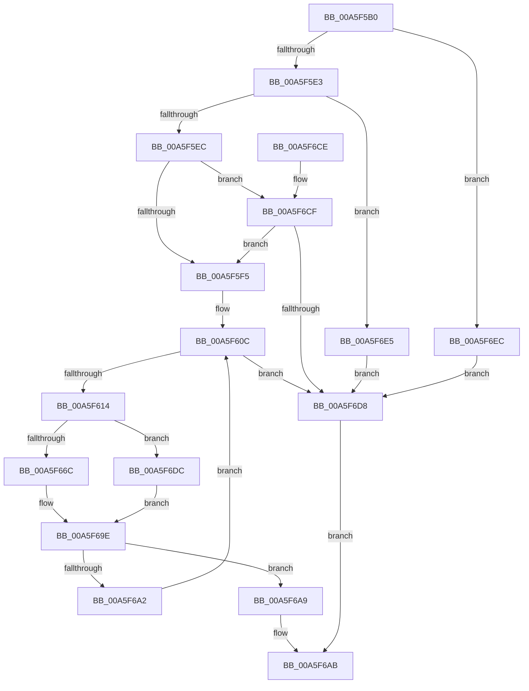

# KiSynchCounterSetCallback

- RVA: `0x00A5F5B0`–`0x00A5F6F3` (길이 `323` bytes)
- VA: `0x0000000140A5F5B0`
- 실행 섹션: `PAGE`
- PDB 이름 있음: `예`; PDB Function 태그: `아니요`
- unwind 정보 RVA: `0x000B2C80`
- 디코드: `79`개 명령, `323/323` bytes 표시
- 미해석 바이트: `0` (있으면 어셈블리에 `.byte`로 보존)

> 이 문서는 커널 이미지의 기계어와 PDB 기호를 분석해 생성했습니다. 4번과 5번은 함수 원형과 자료형을 바이너리 사용 방식에서 추정한 C 해석이며 원본 소스 복구 결과는 아닙니다.

## 1. Dependencies

- 직접 호출 지점: **10**; 고유 호출 대상: **10**
- 직접 호출자로 확인된 함수: **0**
- RIP 상대 이미지 참조: **4**

### Outgoing calls
- `0x00A5F603` → [KeQueryActiveProcessorCountEx](../../text/24/KeQueryActiveProcessorCountEx_function_00249EF0.md) (function, `0x00249EF0`)
- `0x00A5F633` → [RtlStringCbPrintfW](../../text/40/RtlStringCbPrintfW_function_0040FB40.md) (function, `0x0040FB40`)
- `0x00A5F642` → [RtlInitUnicodeString](../../text/42/RtlInitUnicodeString_function_0042A780.md) (function, `0x0042A780`)
- `0x00A5F662` → [ExGetExtensionTable](../../text/42/ExGetExtensionTable_function_00428814.md) (function, `0x00428814`)
- `0x00A5F68B` → [guard_dispatch_icall](../../text/6B/guard_dispatch_icall_function_006BAAD0.md) (function, `0x006BAAD0`)
- `0x00A5F699` → [ExReleaseExtensionTable](../../text/45/ExReleaseExtensionTable_function_00456DC0.md) (function, `0x00456DC0`)
- `0x00A5F6B3` → [_security_check_cookie](../../text/6A/_security_check_cookie_function_006AC640.md) (function, `0x006AC640`)
- `0x00A5F6DC` → [ExpPcwDisabledStatus](../A6/ExpPcwDisabledStatus_function_00A611E0.md) (function, `0x00A611E0`)
- `0x00A5F6E5` → [EtwDereferenceSpinLockCounters](../7B/EtwDereferenceSpinLockCounters_function_007BC2E8.md) (function, `0x007BC2E8`)
- `0x00A5F6EC` → [EtwReferenceSpinLockCounters](../7B/EtwReferenceSpinLockCounters_function_007BC344.md) (function, `0x007BC344`)

### Direct callers
- 이 함수 시작 RVA로 연결되는 직접 call은 확인되지 않았습니다. 간접 호출은 완전히 역산할 수 없습니다.

### Static image references
- `0x00A5F5C4` → RVA `0x00E0A740` (`.data`; read)
- `0x00A5F614` → RVA `0x00FC8C40` (`ALMOSTRO`; read)
- `0x00A5F622` → RVA `0x00AFDAA0` (` ?? ::NNGAKEGL::`string'`; read)
- `0x00A5F647` → RVA `0x00FD8080` (`PAGEDATA`; read)

## 2. Other-region calls and transfers

- 다른 실행 섹션으로 향하는 call: **7**
  - `0x00A5F603` → [KeQueryActiveProcessorCountEx](../../text/24/KeQueryActiveProcessorCountEx_function_00249EF0.md) (`PAGE` → `.text`)
  - `0x00A5F633` → [RtlStringCbPrintfW](../../text/40/RtlStringCbPrintfW_function_0040FB40.md) (`PAGE` → `.text`)
  - `0x00A5F642` → [RtlInitUnicodeString](../../text/42/RtlInitUnicodeString_function_0042A780.md) (`PAGE` → `.text`)
  - `0x00A5F662` → [ExGetExtensionTable](../../text/42/ExGetExtensionTable_function_00428814.md) (`PAGE` → `.text`)
  - `0x00A5F68B` → [guard_dispatch_icall](../../text/6B/guard_dispatch_icall_function_006BAAD0.md) (`PAGE` → `.text`)
  - `0x00A5F699` → [ExReleaseExtensionTable](../../text/45/ExReleaseExtensionTable_function_00456DC0.md) (`PAGE` → `.text`)
  - `0x00A5F6B3` → [_security_check_cookie](../../text/6A/_security_check_cookie_function_006AC640.md) (`PAGE` → `.text`)
- 별도 외부 분기/꼬리 이동을 확인하지 못했습니다.

## 3. Assembly (complete function range)

```asm
00A5F5B0  48 89 5C 24 08                  mov qword ptr [rsp + 8], rbx
00A5F5B5  48 89 6C 24 18                  mov qword ptr [rsp + 0x18], rbp
00A5F5BA  48 89 74 24 20                  mov qword ptr [rsp + 0x20], rsi
00A5F5BF  57                              push rdi
00A5F5C0  48 83 EC 70                     sub rsp, 0x70
00A5F5C4  48 8B 05 75 B1 3A 00            mov rax, qword ptr [rip + 0x3ab175]
00A5F5CB  48 33 C4                        xor rax, rsp
00A5F5CE  48 89 44 24 68                  mov qword ptr [rsp + 0x68], rax
00A5F5D3  0F 57 C0                        xorps xmm0, xmm0
00A5F5D6  0F 11 44 24 40                  movups xmmword ptr [rsp + 0x40], xmm0
00A5F5DB  85 C9                           test ecx, ecx
00A5F5DD  0F 84 09 01 00 00               je 0x140a5f6ec
00A5F5E3  83 E9 01                        sub ecx, 1
00A5F5E6  0F 84 F9 00 00 00               je 0x140a5f6e5
00A5F5EC  83 E9 01                        sub ecx, 1
00A5F5EF  0F 85 DA 00 00 00               jne 0x140a5f6cf
00A5F5F5  B8 18 00 00 00                  mov eax, 0x18
00A5F5FA  B9 FF FF 00 00                  mov ecx, 0xffff
00A5F5FF  48 8B 2C 02                     mov rbp, qword ptr [rdx + rax]
00A5F603  E8 E8 A8 7E FF                  call 0x140249ef0
00A5F608  8B F0                           mov esi, eax
00A5F60A  33 FF                           xor edi, edi
00A5F60C  3B FE                           cmp edi, esi
00A5F60E  0F 83 C4 00 00 00               jae 0x140a5f6d8
00A5F614  48 8D 1D 25 96 56 00            lea rbx, [rip + 0x569625]
00A5F61B  44 8B CF                        mov r9d, edi
00A5F61E  48 8B 1C FB                     mov rbx, qword ptr [rbx + rdi*8]
00A5F622  4C 8D 05 77 E4 09 00            lea r8, [rip + 0x9e477]
00A5F629  BA 16 00 00 00                  mov edx, 0x16
00A5F62E  48 8D 4C 24 50                  lea rcx, [rsp + 0x50]
00A5F633  E8 08 05 9B FF                  call 0x14040fb40
00A5F638  48 8D 54 24 50                  lea rdx, [rsp + 0x50]
00A5F63D  48 8D 4C 24 40                  lea rcx, [rsp + 0x40]
00A5F642  E8 39 B1 9C FF                  call 0x14042a780
00A5F647  48 8B 0D 32 8A 57 00            mov rcx, qword ptr [rip + 0x578a32]
00A5F64E  48 8D 83 C0 8E 00 00            lea rax, [rbx + 0x8ec0]
00A5F655  48 89 44 24 30                  mov qword ptr [rsp + 0x30], rax
00A5F65A  C7 44 24 38 B8 00 00 00         mov dword ptr [rsp + 0x38], 0xb8
00A5F662  E8 AD 91 9C FF                  call 0x140428814
00A5F667  48 85 C0                        test rax, rax
00A5F66A  74 70                           je 0x140a5f6dc
00A5F66C  48 8B 40 20                     mov rax, qword ptr [rax + 0x20]
00A5F670  48 8D 4C 24 30                  lea rcx, [rsp + 0x30]
00A5F675  48 89 4C 24 20                  mov qword ptr [rsp + 0x20], rcx
00A5F67A  48 8D 54 24 40                  lea rdx, [rsp + 0x40]
00A5F67F  48 8B CD                        mov rcx, rbp
00A5F682  41 B9 01 00 00 00               mov r9d, 1
00A5F688  44 8B C7                        mov r8d, edi
00A5F68B  E8 40 B4 C5 FF                  call 0x1406baad0
00A5F690  48 8B 0D E9 89 57 00            mov rcx, qword ptr [rip + 0x5789e9]
00A5F697  8B D8                           mov ebx, eax
00A5F699  E8 22 77 9F FF                  call 0x140456dc0
00A5F69E  85 DB                           test ebx, ebx
00A5F6A0  78 07                           js 0x140a5f6a9
00A5F6A2  FF C7                           inc edi
00A5F6A4  E9 63 FF FF FF                  jmp 0x140a5f60c
00A5F6A9  8B C3                           mov eax, ebx
00A5F6AB  48 8B 4C 24 68                  mov rcx, qword ptr [rsp + 0x68]
00A5F6B0  48 33 CC                        xor rcx, rsp
00A5F6B3  E8 88 CF C4 FF                  call 0x1406ac640
00A5F6B8  4C 8D 5C 24 70                  lea r11, [rsp + 0x70]
00A5F6BD  49 8B 5B 10                     mov rbx, qword ptr [r11 + 0x10]
00A5F6C1  49 8B 6B 20                     mov rbp, qword ptr [r11 + 0x20]
00A5F6C5  49 8B 73 28                     mov rsi, qword ptr [r11 + 0x28]
00A5F6C9  49 8B E3                        mov rsp, r11
00A5F6CC  5F                              pop rdi
00A5F6CD  C3                              ret
00A5F6CE  CC                              int3
00A5F6CF  83 F9 01                        cmp ecx, 1
00A5F6D2  0F 84 1D FF FF FF               je 0x140a5f5f5
00A5F6D8  33 C0                           xor eax, eax
00A5F6DA  EB CF                           jmp 0x140a5f6ab
00A5F6DC  E8 FF 1A 00 00                  call 0x140a611e0
00A5F6E1  8B D8                           mov ebx, eax
00A5F6E3  EB B9                           jmp 0x140a5f69e
00A5F6E5  E8 FE CB D5 FF                  call 0x1407bc2e8
00A5F6EA  EB EC                           jmp 0x140a5f6d8
00A5F6EC  E8 53 CC D5 FF                  call 0x1407bc344
00A5F6F1  EB E5                           jmp 0x140a5f6d8
```

## 4. C-style interpretation (structured pseudocode)

```c
__int64 __fastcall KiSynchCounterSetCallback(int a1, __int64 a2)
{
    __int64 result;
    __int64 v_rdi;
    __int64 v_rsp;
    unsigned __int64 v_stack_m10;
    unsigned __int64 v_stack_m28;
    unsigned __int64 v_stack_m38;
    unsigned int v_stack_m40;
    unsigned __int64 v_stack_m48;
    unsigned __int64 v_stack_m58;
    unsigned __int64 v_stack_m8;
    unsigned __int64 v_stack_p18;
    unsigned __int64 v_stack_p20;
    unsigned __int64 v_stack_p8;

    v_stack_p8 = v_rbx;
    v_stack_p18 = v_rbp;
    v_stack_p20 = v_rsi;
    v_rsp = (v_rsp) - (112);
    result = (*(unsigned __int64 *)(v_rip + 3846517)) ^ (v_rsp);
    v_stack_m10 = result;
    v_stack_m38 = v_xmm0;
    if (a1 == 0) goto loc_00A5F6EC;
    a1 = (unsigned int)((a1) - (1));
    if (condition_is_equal) goto loc_00A5F6E5;
    a1 = (unsigned int)((a1) - (1));
    if (condition_is_not_equal) goto loc_00A5F6CF;
loc_00A5F5F5:
    result = KeQueryActiveProcessorCountEx((unsigned int)(0xFFFFULL), a2, a3, a4);
    v_rdi = 0;
loc_00A5F60C:
    if (0 >= ((unsigned int)((unsigned int)((unsigned int)(result))))) goto loc_00A5F6D8;
    result = RtlStringCbPrintfW(v_stack_m28, 22, v_rip + 648311, 0);
    result = RtlInitUnicodeString(v_stack_m38, v_stack_m28, v_rip + 648311, 0);
    v_stack_m48 = *(unsigned __int64 *)(v_rip + 5674533 + v_rdi * 8) + 36544;
    v_stack_m40 = 184;
    result = ExGetExtensionTable(*(unsigned __int64 *)(v_rip + 5737010), v_stack_m28, v_rip + 648311, 0);
    if (result == 0) goto loc_00A5F6DC;
    v_stack_m58 = v_stack_m48;
    result = guard_dispatch_icall(*(unsigned __int64 *)(a2 + 24 * 1), v_stack_m38, 0, 1);
    result = ExReleaseExtensionTable(*(unsigned __int64 *)(v_rip + 5736937), v_stack_m38, 0, 1);
loc_00A5F69E:
    if (sign_flag) goto loc_00A5F6A9;
    v_rdi = (unsigned int)((v_rdi) + 1);
    goto loc_00A5F60C;
loc_00A5F6A9:
loc_00A5F6AB:
    a1 = (v_stack_m10) ^ (v_rsp);
    result = _security_check_cookie(a1, v_stack_m38, 0, 1);
    return result;
loc_00A5F6CF:
    if (a1 == 1) goto loc_00A5F5F5;
loc_00A5F6D8:
    result = 0;
    goto loc_00A5F6AB;
loc_00A5F6DC:
    result = ExpPcwDisabledStatus(a1, v_stack_m38, 0, 1);
    goto loc_00A5F69E;
loc_00A5F6E5:
    result = EtwDereferenceSpinLockCounters(a1, v_stack_m38, 0, 1);
    goto loc_00A5F6D8;
loc_00A5F6EC:
    result = EtwReferenceSpinLockCounters(a1, v_stack_m38, 0, 1);
    goto loc_00A5F6D8;
}
```

## 5. (Beta) C Style

```c
int64_t KiSynchCounterSetCallback(int32_t Arg1, void *Arg2)
{
    uint8_t *arg2 = (uint8_t *)Arg2;

    int64_t result;
    int64_t local_rdi;
    int64_t local_rsp;
    uint64_t v_stack_m10;
    uint64_t v_stack_m28;
    uint64_t v_stack_m38;
    uint32_t v_stack_m40;
    uint64_t v_stack_m48;
    uint64_t v_stack_m58;
    uint64_t v_stack_m8;
    uint64_t v_stack_p18;
    uint64_t v_stack_p20;
    uint64_t v_stack_p8;

    v_stack_p8 = local_rbx;
    v_stack_p18 = local_rbp;
    v_stack_p20 = local_rsi;
    local_rsp = (local_rsp) - (112);
    result = (*(uint64_t *)(v_rip + 0x3AB175)) ^ (local_rsp);
    v_stack_m10 = result;
    v_stack_m38 = v_xmm0;
    if (Arg1 == 0) goto loc_00A5F6EC;
    Arg1 = (uint32_t)((Arg1) - (1));
    if (condition_is_equal) goto loc_00A5F6E5;
    Arg1 = (uint32_t)((Arg1) - (1));
    if (condition_is_not_equal) goto loc_00A5F6CF;
loc_00A5F5F5:
    result = KeQueryActiveProcessorCountEx((uint32_t)(0xFFFFULL), Arg2, a3, a4);
    local_rdi = 0;
loc_00A5F60C:
    if (0 >= ((uint32_t)((uint32_t)((uint32_t)(result))))) goto loc_00A5F6D8;
    result = RtlStringCbPrintfW(v_stack_m28, 22, v_rip + 648311, 0);
    result = RtlInitUnicodeString(v_stack_m38, v_stack_m28, v_rip + 648311, 0);
    v_stack_m48 = *(uint64_t *)(v_rip + 0x569625 + local_rdi * 8) + 36544;
    v_stack_m40 = 184;
    result = ExGetExtensionTable(*(uint64_t *)(v_rip + 0x578A32), v_stack_m28, v_rip + 648311, 0);
    if (result == 0) goto loc_00A5F6DC;
    v_stack_m58 = v_stack_m48;
    result = guard_dispatch_icall(*(uint64_t *)(arg2 + 0x18 * 1), v_stack_m38, 0, 1);
    result = ExReleaseExtensionTable(*(uint64_t *)(v_rip + 0x5789E9), v_stack_m38, 0, 1);
loc_00A5F69E:
    if (sign_flag) goto loc_00A5F6A9;
    local_rdi = (uint32_t)((local_rdi) + 1);
    goto loc_00A5F60C;
loc_00A5F6A9:
loc_00A5F6AB:
    Arg1 = (v_stack_m10) ^ (local_rsp);
    result = _security_check_cookie(Arg1, v_stack_m38, 0, 1);
    return result;
loc_00A5F6CF:
    if (Arg1 == 1) goto loc_00A5F5F5;
loc_00A5F6D8:
    result = 0;
    goto loc_00A5F6AB;
loc_00A5F6DC:
    result = ExpPcwDisabledStatus(Arg1, v_stack_m38, 0, 1);
    goto loc_00A5F69E;
loc_00A5F6E5:
    result = EtwDereferenceSpinLockCounters(Arg1, v_stack_m38, 0, 1);
    goto loc_00A5F6D8;
loc_00A5F6EC:
    result = EtwReferenceSpinLockCounters(Arg1, v_stack_m38, 0, 1);
    goto loc_00A5F6D8;
}
```

### 관측된 메모리 오프셋

구조체 형식이 확인되지 않은 접근은 인자 기준의 오프셋으로만 기록했습니다.

| 기준 인자 | 오프셋 표현 | 폭 (bit) | 접근 |
|---|---:|---:|---|
| `Arg2` | `+ 0x0 + rax*1` | `64` | `R` |

## 6. Execution-region graph

[열기: 2D/3D 그래프와 함수 탐색 컨트롤 패널](../../../control-panel.html?section=page&rva=0x00A5F5B0&view=graph)

- 2D 그래프는 위에서 아래로 흐르고, 3D 그래프는 빈 공간을 드래그해 회전합니다. Shift+드래그는 이동, 휠은 확대·축소, 함수 노드 선택은 대상 보고서 이동입니다.

### Static fallback


