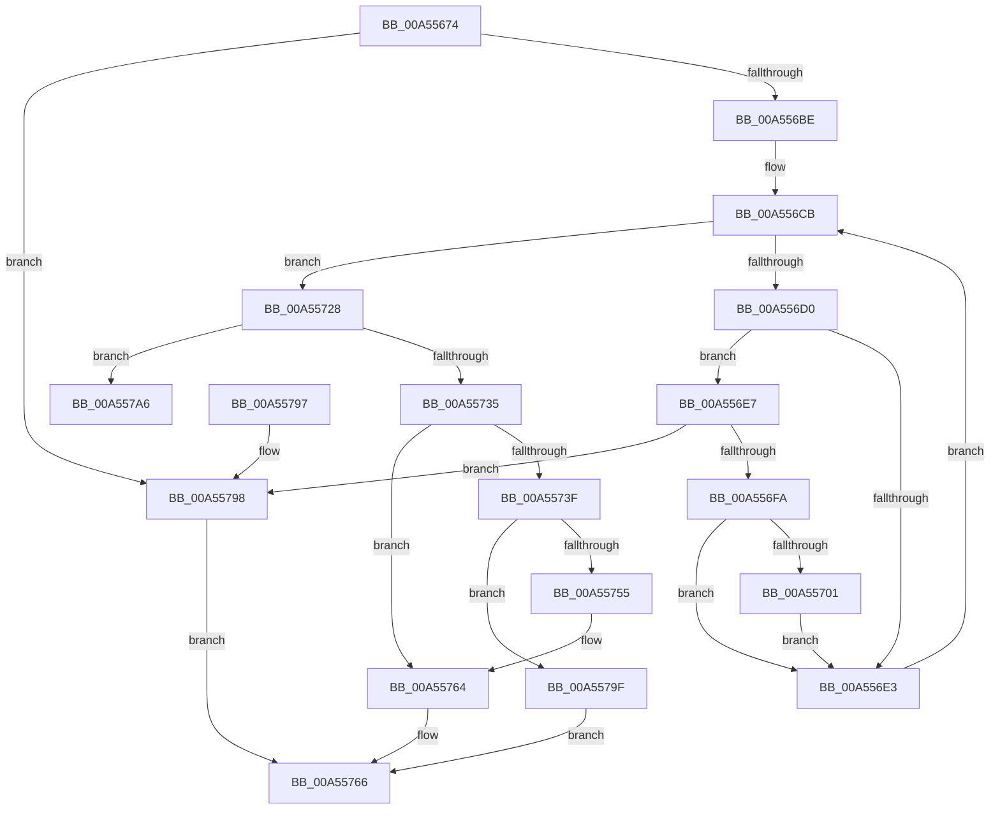

# LocalGetStringForControl

- RVA: `0x00A55674`–`0x00A557AC` (길이 `312` bytes)
- VA: `0x0000000140A55674`
- 실행 섹션: `PAGE`
- PDB 이름 있음: `예`; PDB Function 태그: `아니요`
- unwind 정보 RVA: `0x000B1230`
- 디코드: `88`개 명령, `312/312` bytes 표시
- 미해석 바이트: `0` (있으면 어셈블리에 `.byte`로 보존)

> 이 문서는 커널 이미지의 기계어와 PDB 기호를 분석해 생성했습니다. 4번과 5번은 함수 원형과 자료형을 바이너리 사용 방식에서 추정한 C 해석이며 원본 소스 복구 결과는 아닙니다.

## 1. Dependencies

- 직접 호출 지점: **5**; 고유 호출 대상: **5**
- 직접 호출자로 확인된 함수: **1**
- RIP 상대 이미지 참조: **2**

### Outgoing calls
- `0x00A5571C` → [wcsncpy_s](../../text/50/wcsncpy_s_function_00506650.md) (function, `0x00506650`)
- `0x00A55748` → [SddlpAlloc](../92/SddlpAlloc_function_00925F88.md) (function, `0x00925F88`)
- `0x00A5575F` → [wcscpy_s](../../text/50/wcscpy_s_function_005064B0.md) (function, `0x005064B0`)
- `0x00A55771` → [_security_check_cookie](../../text/6A/_security_check_cookie_function_006AC640.md) (function, `0x006AC640`)
- `0x00A557A6` → [_report_rangecheckfailure](../../text/4F/_report_rangecheckfailure_function_004F5FDC.md) (function, `0x004F5FDC`)

### Direct callers
- [LocalConvertSDToStringSD_Rev1](../92/LocalConvertSDToStringSD_Rev1_function_00924428.md) at `0x00924860`
- [LocalConvertSDToStringSD_Rev1](../92/LocalConvertSDToStringSD_Rev1_function_00924428.md) at `0x0092487A`

### Static image references
- `0x00A55693` → RVA `0x00E0A740` (`.data`; read)
- `0x00A556C1` → RVA `0x00002B20` (`.rdata`; read)

## 2. Other-region calls and transfers

- 다른 실행 섹션으로 향하는 call: **4**
  - `0x00A5571C` → [wcsncpy_s](../../text/50/wcsncpy_s_function_00506650.md) (`PAGE` → `.text`)
  - `0x00A5575F` → [wcscpy_s](../../text/50/wcscpy_s_function_005064B0.md) (`PAGE` → `.text`)
  - `0x00A55771` → [_security_check_cookie](../../text/6A/_security_check_cookie_function_006AC640.md) (`PAGE` → `.text`)
  - `0x00A557A6` → [_report_rangecheckfailure](../../text/4F/_report_rangecheckfailure_function_004F5FDC.md) (`PAGE` → `.text`)
- 별도 외부 분기/꼬리 이동을 확인하지 못했습니다.

## 3. Assembly (complete function range)

```asm
00A55674  48 89 5C 24 08                  mov qword ptr [rsp + 8], rbx
00A55679  48 89 6C 24 10                  mov qword ptr [rsp + 0x10], rbp
00A5567E  48 89 74 24 20                  mov qword ptr [rsp + 0x20], rsi
00A55683  57                              push rdi
00A55684  41 54                           push r12
00A55686  41 55                           push r13
00A55688  41 56                           push r14
00A5568A  41 57                           push r15
00A5568C  48 81 EC 30 02 00 00            sub rsp, 0x230
00A55693  48 8B 05 A6 50 3B 00            mov rax, qword ptr [rip + 0x3b50a6]
00A5569A  48 33 C4                        xor rax, rsp
00A5569D  48 89 84 24 20 02 00 00         mov qword ptr [rsp + 0x220], rax
00A556A5  45 33 E4                        xor r12d, r12d
00A556A8  44 0F B7 F9                     movzx r15d, cx
00A556AC  49 8B F0                        mov rsi, r8
00A556AF  44 8B F2                        mov r14d, edx
00A556B2  41 8B DC                        mov ebx, r12d
00A556B5  4D 85 C0                        test r8, r8
00A556B8  0F 84 DA 00 00 00               je 0x140a55798
00A556BE  4D 89 20                        mov qword ptr [r8], r12
00A556C1  4C 8D 2D 58 D4 5A FF            lea r13, [rip - 0xa52ba8]
00A556C8  41 8B FC                        mov edi, r12d
00A556CB  83 FF 06                        cmp edi, 6
00A556CE  73 58                           jae 0x140a55728
00A556D0  8B C7                           mov eax, edi
00A556D2  48 8D 2C 40                     lea rbp, [rax + rax*2]
00A556D6  41 8B 44 ED 10                  mov eax, dword ptr [r13 + rbp*8 + 0x10]
00A556DB  41 23 C6                        and eax, r14d
00A556DE  41 3B C6                        cmp eax, r14d
00A556E1  74 04                           je 0x140a556e7
00A556E3  FF C7                           inc edi
00A556E5  EB E4                           jmp 0x140a556cb
00A556E7  41 8B 54 ED 08                  mov edx, dword ptr [r13 + rbp*8 + 8]
00A556EC  8D 04 1A                        lea eax, [rdx + rbx]
00A556EF  3D 00 01 00 00                  cmp eax, 0x100
00A556F4  0F 83 9E 00 00 00               jae 0x140a55798
00A556FA  45 85 7C ED 0C                  test dword ptr [r13 + rbp*8 + 0xc], r15d
00A556FF  74 E2                           je 0x140a556e3
00A55701  4D 8B 44 ED 00                  mov r8, qword ptr [r13 + rbp*8]
00A55706  48 8D 4C 24 20                  lea rcx, [rsp + 0x20]
00A5570B  8B C3                           mov eax, ebx
00A5570D  44 8B CA                        mov r9d, edx
00A55710  BA 00 01 00 00                  mov edx, 0x100
00A55715  48 2B D0                        sub rdx, rax
00A55718  48 8D 0C 41                     lea rcx, [rcx + rax*2]
00A5571C  E8 2F 0F AB FF                  call 0x140506650
00A55721  41 03 5C ED 08                  add ebx, dword ptr [r13 + rbp*8 + 8]
00A55726  EB BB                           jmp 0x140a556e3
00A55728  8B C3                           mov eax, ebx
00A5572A  48 03 C0                        add rax, rax
00A5572D  48 3D 00 02 00 00               cmp rax, 0x200
00A55733  73 71                           jae 0x140a557a6
00A55735  66 44 89 64 04 20               mov word ptr [rsp + rax + 0x20], r12w
00A5573B  85 DB                           test ebx, ebx
00A5573D  74 25                           je 0x140a55764
00A5573F  8D 43 01                        lea eax, [rbx + 1]
00A55742  48 8D 0C 00                     lea rcx, [rax + rax]
00A55746  8B D8                           mov ebx, eax
00A55748  E8 3B 08 ED FF                  call 0x140925f88
00A5574D  48 89 06                        mov qword ptr [rsi], rax
00A55750  48 85 C0                        test rax, rax
00A55753  74 4A                           je 0x140a5579f
00A55755  4C 8D 44 24 20                  lea r8, [rsp + 0x20]
00A5575A  8B D3                           mov edx, ebx
00A5575C  48 8B C8                        mov rcx, rax
00A5575F  E8 4C 0D AB FF                  call 0x1405064b0
00A55764  33 C0                           xor eax, eax
00A55766  48 8B 8C 24 20 02 00 00         mov rcx, qword ptr [rsp + 0x220]
00A5576E  48 33 CC                        xor rcx, rsp
00A55771  E8 CA 6E C5 FF                  call 0x1406ac640
00A55776  4C 8D 9C 24 30 02 00 00         lea r11, [rsp + 0x230]
00A5577E  49 8B 5B 30                     mov rbx, qword ptr [r11 + 0x30]
00A55782  49 8B 6B 38                     mov rbp, qword ptr [r11 + 0x38]
00A55786  49 8B 73 48                     mov rsi, qword ptr [r11 + 0x48]
00A5578A  49 8B E3                        mov rsp, r11
00A5578D  41 5F                           pop r15
00A5578F  41 5E                           pop r14
00A55791  41 5D                           pop r13
00A55793  41 5C                           pop r12
00A55795  5F                              pop rdi
00A55796  C3                              ret
00A55797  CC                              int3
00A55798  B8 57 00 00 00                  mov eax, 0x57
00A5579D  EB C7                           jmp 0x140a55766
00A5579F  B8 08 00 00 00                  mov eax, 8
00A557A4  EB C0                           jmp 0x140a55766
00A557A6  E8 31 08 AA FF                  call 0x1404f5fdc
00A557AB  CC                              int3
```

## 4. C-style interpretation (structured pseudocode)

```c
__int64 __fastcall LocalGetStringForControl(unsigned __int16 a1, int a2, __int64 a3)
{
    __int64 result;
    __int64 v_r12;
    __int64 v_rbx;
    __int64 v_rdi;
    __int64 v_rsp;
    unsigned __int64 v_stack_m238;
    unsigned __int64 v_stack_m28;
    unsigned __int64 v_stack_m38;
    unsigned __int64 v_stack_p10;
    unsigned __int64 v_stack_p20;
    unsigned __int64 v_stack_p8;

    v_stack_p8 = v_rbx;
    v_stack_p10 = v_rbp;
    v_stack_p20 = v_rsi;
    v_rsp = (v_rsp) - (560);
    result = (*(unsigned __int64 *)(v_rip + 3887270)) ^ (v_rsp);
    v_stack_m38 = result;
    v_r12 = 0;
    if (a3 == 0) goto loc_00A55798;
    *(unsigned __int64 *)(a3) = 0;
loc_00A556CB:
    if (0 >= 6) goto loc_00A55728;
    result = (unsigned int)(((unsigned int)(*(unsigned int *)(v_rip - 10824616 + 0 + 0 * 2 * 8 + 16))) & ((unsigned int)((unsigned int)(a2))));
    if (((unsigned int)(result)) == ((unsigned int)((unsigned int)(a2)))) goto loc_00A556E7;
loc_00A556E3:
    v_rdi = (unsigned int)((0) + 1);
    goto loc_00A556CB;
loc_00A556E7:
    if (((unsigned int)((unsigned int)(*(unsigned int *)(v_rip - 10824616 + 0 + 0 * 2 * 8 + 8)) + 0 * 1)) >= 256) goto loc_00A55798;
    if (((*(unsigned int *)(v_rip - 10824616 + 0 + 0 * 2 * 8 + 12)) & (a1)) == 0) goto loc_00A556E3;
    a2 = (256) - (0);
    result = wcsncpy_s(v_stack_m238 + 0 * 2, a2, *(unsigned __int64 *)(v_rip - 10824616 + 0 + 0 * 2 * 8), (unsigned int)((unsigned int)((unsigned int)(*(unsigned int *)(v_rip - 10824616 + 0 + 0 * 2 * 8 + 8)))));
    v_rbx = (unsigned int)((0) + (*(unsigned int *)(v_rip - 10824616 + 0 + 0 * 2 * 8 + 8)));
    goto loc_00A556E3;
loc_00A55728:
    result = ((unsigned int)((unsigned int)(v_rbx))) + ((unsigned int)((unsigned int)(v_rbx)));
    if (result >= 512) goto loc_00A557A6;
    *(unsigned __int16 *)(v_rsp + result * 1 + 32) = 0;
    if ((unsigned int)(v_rbx) == 0) goto loc_00A55764;
    result = SddlpAlloc(v_rbx + 1 + v_rbx + 1 * 1, a2, *(unsigned __int64 *)(v_rip - 10824616 + 0 + 0 * 2 * 8), (unsigned int)((unsigned int)((unsigned int)(*(unsigned int *)(v_rip - 10824616 + 0 + 0 * 2 * 8 + 8)))));
    *(unsigned __int64 *)(a3) = result;
    if (result == 0) goto loc_00A5579F;
    result = wcscpy_s(result, (unsigned int)((unsigned int)((unsigned int)((unsigned int)(v_rbx + 1)))), v_stack_m238, (unsigned int)((unsigned int)((unsigned int)(*(unsigned int *)(v_rip - 10824616 + 0 + 0 * 2 * 8 + 8)))));
loc_00A55764:
    result = 0;
loc_00A55766:
    a1 = (v_stack_m38) ^ (v_rsp);
    result = _security_check_cookie(a1, (unsigned int)((unsigned int)((unsigned int)((unsigned int)(v_rbx + 1)))), v_stack_m238, (unsigned int)((unsigned int)((unsigned int)(*(unsigned int *)(v_rip - 10824616 + 0 + 0 * 2 * 8 + 8)))));
    return result;
loc_00A55798:
    goto loc_00A55766;
loc_00A5579F:
    goto loc_00A55766;
loc_00A557A6:
    result = _report_rangecheckfailure(a1, (unsigned int)((unsigned int)((unsigned int)((unsigned int)(v_rbx + 1)))), v_stack_m238, (unsigned int)((unsigned int)((unsigned int)(*(unsigned int *)(v_rip - 10824616 + 0 + 0 * 2 * 8 + 8)))));
    return result;
}
```

## 5. (Beta) C Style

```c
int64_t LocalGetStringForControl(uint16_t Arg1, int32_t Arg2, void *Arg3)
{
    uint8_t *arg3 = (uint8_t *)Arg3;

    int64_t result;
    int64_t local_r12;
    int64_t local_rbx;
    int64_t local_rdi;
    int64_t local_rsp;
    uint64_t v_stack_m238;
    uint64_t v_stack_m28;
    uint64_t v_stack_m38;
    uint64_t v_stack_p10;
    uint64_t v_stack_p20;
    uint64_t v_stack_p8;

    v_stack_p8 = local_rbx;
    v_stack_p10 = local_rbp;
    v_stack_p20 = local_rsi;
    local_rsp = (local_rsp) - (560);
    result = (*(uint64_t *)(v_rip + 0x3B50A6)) ^ (local_rsp);
    v_stack_m38 = result;
    local_r12 = 0;
    if (Arg3 == NULL) goto loc_00A55798;
    *(uint64_t *)(arg3) = 0;
loc_00A556CB:
    if (0 >= 6) goto loc_00A55728;
    result = (uint32_t)(((uint32_t)(*(uint32_t *)(v_rip - 0xA52BA8 + 0x0 + 0x0 * 2 * 8 + 0x10))) & ((uint32_t)((uint32_t)(Arg2))));
    if (((uint32_t)(result)) == ((uint32_t)((uint32_t)(Arg2)))) goto loc_00A556E7;
loc_00A556E3:
    local_rdi = (uint32_t)((0) + 1);
    goto loc_00A556CB;
loc_00A556E7:
    if (((uint32_t)((uint32_t)(*(uint32_t *)(v_rip - 0xA52BA8 + 0x0 + 0x0 * 2 * 8 + 0x8)) + 0 * 1)) >= 256) goto loc_00A55798;
    if (((*(uint32_t *)(v_rip - 0xA52BA8 + 0x0 + 0x0 * 2 * 8 + 0xC)) & (Arg1)) == 0) goto loc_00A556E3;
    Arg2 = (256) - (0);
    result = wcsncpy_s(v_stack_m238 + 0 * 2, Arg2, *(uint64_t *)(v_rip - 0xA52BA8 + 0x0 + 0x0 * 2 * 8), (uint32_t)((uint32_t)((uint32_t)(*(uint32_t *)(v_rip - 0xA52BA8 + 0x0 + 0x0 * 2 * 8 + 0x8)))));
    local_rbx = (uint32_t)((0) + (*(uint32_t *)(v_rip - 0xA52BA8 + 0x0 + 0x0 * 2 * 8 + 0x8)));
    goto loc_00A556E3;
loc_00A55728:
    result = ((uint32_t)((uint32_t)(local_rbx))) + ((uint32_t)((uint32_t)(local_rbx)));
    if (result >= 512) goto loc_00A557A6;
    *(uint16_t *)(local_rsp + result * 1 + 0x20) = 0;
    if ((uint32_t)(local_rbx) == 0) goto loc_00A55764;
    result = SddlpAlloc(local_rbx + 1 + local_rbx + 1 * 1, Arg2, *(uint64_t *)(v_rip - 0xA52BA8 + 0x0 + 0x0 * 2 * 8), (uint32_t)((uint32_t)((uint32_t)(*(uint32_t *)(v_rip - 0xA52BA8 + 0x0 + 0x0 * 2 * 8 + 0x8)))));
    *(uint64_t *)(arg3) = result;
    if (result == 0) goto loc_00A5579F;
    result = wcscpy_s(result, (uint32_t)((uint32_t)((uint32_t)((uint32_t)(local_rbx + 1)))), v_stack_m238, (uint32_t)((uint32_t)((uint32_t)(*(uint32_t *)(v_rip - 0xA52BA8 + 0x0 + 0x0 * 2 * 8 + 0x8)))));
loc_00A55764:
    result = 0;
loc_00A55766:
    Arg1 = (v_stack_m38) ^ (local_rsp);
    result = _security_check_cookie(Arg1, (uint32_t)((uint32_t)((uint32_t)((uint32_t)(local_rbx + 1)))), v_stack_m238, (uint32_t)((uint32_t)((uint32_t)(*(uint32_t *)(v_rip - 0xA52BA8 + 0x0 + 0x0 * 2 * 8 + 0x8)))));
    return result;
loc_00A55798:
    goto loc_00A55766;
loc_00A5579F:
    goto loc_00A55766;
loc_00A557A6:
    result = _report_rangecheckfailure(Arg1, (uint32_t)((uint32_t)((uint32_t)((uint32_t)(local_rbx + 1)))), v_stack_m238, (uint32_t)((uint32_t)((uint32_t)(*(uint32_t *)(v_rip - 0xA52BA8 + 0x0 + 0x0 * 2 * 8 + 0x8)))));
    return result;
}
```

### 관측된 메모리 오프셋

구조체 형식이 확인되지 않은 접근은 인자 기준의 오프셋으로만 기록했습니다.

| 기준 인자 | 오프셋 표현 | 폭 (bit) | 접근 |
|---|---:|---:|---|
| `Arg3` | `+ 0x0` | `64` | `W` |

## 6. Execution-region graph

[열기: 2D/3D 그래프와 함수 탐색 컨트롤 패널](../../../control-panel.html?section=page&rva=0x00A55674&view=graph)

- 2D 그래프는 위에서 아래로 흐르고, 3D 그래프는 빈 공간을 드래그해 회전합니다. Shift+드래그는 이동, 휠은 확대·축소, 함수 노드 선택은 대상 보고서 이동입니다.

### Static fallback


