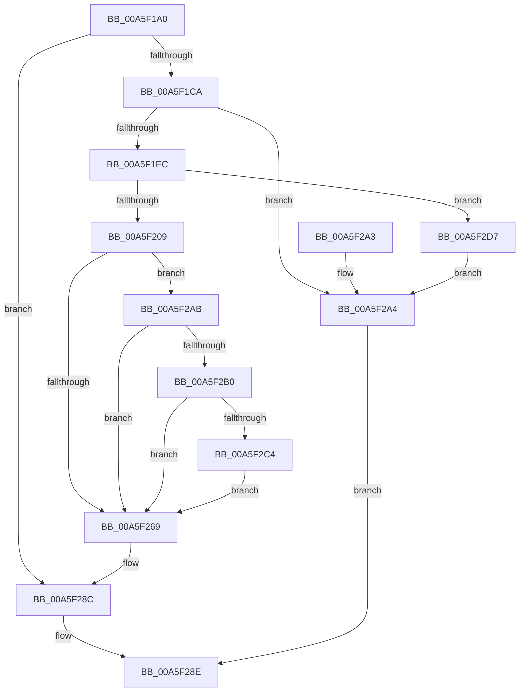

# MiAllocateProcessShadow

- RVA: `0x00A5F1A0`–`0x00A5F2E6` (길이 `326` bytes)
- VA: `0x0000000140A5F1A0`
- 실행 섹션: `PAGE`
- PDB 이름 있음: `예`; PDB Function 태그: `아니요`
- unwind 정보 RVA: `0x0007198C`
- 디코드: `78`개 명령, `326/326` bytes 표시
- 미해석 바이트: `0` (있으면 어셈블리에 `.byte`로 보존)

> 이 문서는 커널 이미지의 기계어와 PDB 기호를 분석해 생성했습니다. 4번과 5번은 함수 원형과 자료형을 바이너리 사용 방식에서 추정한 C 해석이며 원본 소스 복구 결과는 아닙니다.

## 1. Dependencies

- 직접 호출 지점: **11**; 고유 호출 대상: **11**
- 직접 호출자로 확인된 함수: **2**
- RIP 상대 이미지 참조: **2**

### Outgoing calls
- `0x00A5F1CA` → [MiGetProcessPartition](../../text/44/MiGetProcessPartition_function_00443B10.md) (function, `0x00443B10`)
- `0x00A5F1DF` → [MiAcquireNonPagedResources](../../text/28/MiAcquireNonPagedResources_function_00286C60.md) (function, `0x00286C60`)
- `0x00A5F1F8` → [MiReservePtes](../../text/31/MiReservePtes_function_00318D20.md) (function, `0x00318D20`)
- `0x00A5F20E` → [MiAllocateTopLevelPage](MiAllocateTopLevelPage_function_00A5F2EC.md) (function, `0x00A5F2EC`)
- `0x00A5F219` → [MiInitializeSelfmap](../../text/43/MiInitializeSelfmap_function_0043202C.md) (function, `0x0043202C`)
- `0x00A5F233` → [MiMarkPfnTradable](../../text/4B/MiMarkPfnTradable_function_004BDE84.md) (function, `0x004BDE84`)
- `0x00A5F23F` → [KeMakeUserDirectoryTableBase](../../text/4A/KeMakeUserDirectoryTableBase_function_004A5B94.md) (function, `0x004A5B94`)
- `0x00A5F256` → [MiMakeValidPte](../../text/2C/MiMakeValidPte_function_002C5590.md) (function, `0x002C5590`)
- `0x00A5F2BA` → [MiGetPteAddress](../../text/43/MiGetPteAddress_function_0043E130.md) (function, `0x0043E130`)
- `0x00A5F2D0` → [MiCheckLinearProtectedPteAccessedBit](../../text/29/MiCheckLinearProtectedPteAccessedBit_function_00292D80.md) (function, `0x00292D80`)
- `0x00A5F2DF` → [MiReleaseNonPagedResources](../../text/32/MiReleaseNonPagedResources_function_0032299C.md) (function, `0x0032299C`)

### Direct callers
- [MmInitializeHandBuiltProcess](../7F/MmInitializeHandBuiltProcess_function_007F83EC.md) at `0x007F846B`
- [MmCreateProcessAddressSpace](MmCreateProcessAddressSpace_function_00A5EE5C.md) at `0x00A5F022`

### Static image references
- `0x00A5F1B4` → RVA `0x00FC6A88` (`ALMOSTRO`; read)
- `0x00A5F1F1` → RVA `0x00E37668` (`.data`; read)

## 2. Other-region calls and transfers

- 다른 실행 섹션으로 향하는 call: **10**
  - `0x00A5F1CA` → [MiGetProcessPartition](../../text/44/MiGetProcessPartition_function_00443B10.md) (`PAGE` → `.text`)
  - `0x00A5F1DF` → [MiAcquireNonPagedResources](../../text/28/MiAcquireNonPagedResources_function_00286C60.md) (`PAGE` → `.text`)
  - `0x00A5F1F8` → [MiReservePtes](../../text/31/MiReservePtes_function_00318D20.md) (`PAGE` → `.text`)
  - `0x00A5F219` → [MiInitializeSelfmap](../../text/43/MiInitializeSelfmap_function_0043202C.md) (`PAGE` → `.text`)
  - `0x00A5F233` → [MiMarkPfnTradable](../../text/4B/MiMarkPfnTradable_function_004BDE84.md) (`PAGE` → `.text`)
  - `0x00A5F23F` → [KeMakeUserDirectoryTableBase](../../text/4A/KeMakeUserDirectoryTableBase_function_004A5B94.md) (`PAGE` → `.text`)
  - `0x00A5F256` → [MiMakeValidPte](../../text/2C/MiMakeValidPte_function_002C5590.md) (`PAGE` → `.text`)
  - `0x00A5F2BA` → [MiGetPteAddress](../../text/43/MiGetPteAddress_function_0043E130.md) (`PAGE` → `.text`)
  - `0x00A5F2D0` → [MiCheckLinearProtectedPteAccessedBit](../../text/29/MiCheckLinearProtectedPteAccessedBit_function_00292D80.md) (`PAGE` → `.text`)
  - `0x00A5F2DF` → [MiReleaseNonPagedResources](../../text/32/MiReleaseNonPagedResources_function_0032299C.md) (`PAGE` → `.text`)
- 별도 외부 분기/꼬리 이동을 확인하지 못했습니다.

## 3. Assembly (complete function range)

```asm
00A5F1A0  48 89 5C 24 08                  mov qword ptr [rsp + 8], rbx
00A5F1A5  48 89 6C 24 10                  mov qword ptr [rsp + 0x10], rbp
00A5F1AA  48 89 74 24 18                  mov qword ptr [rsp + 0x18], rsi
00A5F1AF  57                              push rdi
00A5F1B0  48 83 EC 20                     sub rsp, 0x20
00A5F1B4  48 F7 05 C9 78 56 00 00 00 60 00  test qword ptr [rip + 0x5678c9], 0x600000
00A5F1BF  8B DA                           mov ebx, edx
00A5F1C1  48 8B F1                        mov rsi, rcx
00A5F1C4  0F 84 C2 00 00 00               je 0x140a5f28c
00A5F1CA  E8 41 49 9E FF                  call 0x140443b10
00A5F1CF  45 33 C9                        xor r9d, r9d
00A5F1D2  45 33 C0                        xor r8d, r8d
00A5F1D5  48 8B C8                        mov rcx, rax
00A5F1D8  48 8B E8                        mov rbp, rax
00A5F1DB  41 8D 51 01                     lea edx, [r9 + 1]
00A5F1DF  E8 7C 7A 82 FF                  call 0x140286c60
00A5F1E4  85 C0                           test eax, eax
00A5F1E6  0F 88 B8 00 00 00               js 0x140a5f2a4
00A5F1EC  BA 01 00 00 00                  mov edx, 1
00A5F1F1  48 8D 0D 70 84 3D 00            lea rcx, [rip + 0x3d8470]
00A5F1F8  E8 23 9B 8B FF                  call 0x140318d20
00A5F1FD  48 8B F8                        mov rdi, rax
00A5F200  48 85 C0                        test rax, rax
00A5F203  0F 84 CE 00 00 00               je 0x140a5f2d7
00A5F209  8B D3                           mov edx, ebx
00A5F20B  48 8B CE                        mov rcx, rsi
00A5F20E  E8 D9 00 00 00                  call 0x140a5f2ec
00A5F213  48 8B C8                        mov rcx, rax
00A5F216  48 8B D8                        mov rbx, rax
00A5F219  E8 0E 2E 9D FF                  call 0x14043202c
00A5F21E  48 8D 0C 5B                     lea rcx, [rbx + rbx*2]
00A5F222  48 C1 E1 04                     shl rcx, 4
00A5F226  48 B8 00 00 00 00 00 DE FF FF   movabs rax, 0xffffde0000000000
00A5F230  48 03 C8                        add rcx, rax
00A5F233  E8 4C EC A5 FF                  call 0x1404bde84
00A5F238  48 8B CB                        mov rcx, rbx
00A5F23B  48 C1 E1 0C                     shl rcx, 0xc
00A5F23F  E8 50 69 A4 FF                  call 0x1404a5b94
00A5F244  41 B8 04 00 00 A0               mov r8d, 0xa0000004
00A5F24A  48 89 86 58 01 00 00            mov qword ptr [rsi + 0x158], rax
00A5F251  48 8B D3                        mov rdx, rbx
00A5F254  33 C9                           xor ecx, ecx
00A5F256  E8 35 63 86 FF                  call 0x1402c5590
00A5F25B  48 0F BA 25 24 78 56 00 24      bt qword ptr [rip + 0x567824], 0x24
00A5F264  48 8B D8                        mov rbx, rax
00A5F267  72 42                           jb 0x140a5f2ab
00A5F269  48 89 1F                        mov qword ptr [rdi], rbx
00A5F26C  48 C1 E7 19                     shl rdi, 0x19
00A5F270  48 B8 00 00 00 00 80 F6 FF FF   movabs rax, 0xfffff68000000000
00A5F27A  48 C1 E0 19                     shl rax, 0x19
00A5F27E  48 2B F8                        sub rdi, rax
00A5F281  48 C1 FF 10                     sar rdi, 0x10
00A5F285  48 89 BE 08 05 00 00            mov qword ptr [rsi + 0x508], rdi
00A5F28C  33 C0                           xor eax, eax
00A5F28E  48 8B 5C 24 30                  mov rbx, qword ptr [rsp + 0x30]
00A5F293  48 8B 6C 24 38                  mov rbp, qword ptr [rsp + 0x38]
00A5F298  48 8B 74 24 40                  mov rsi, qword ptr [rsp + 0x40]
00A5F29D  48 83 C4 20                     add rsp, 0x20
00A5F2A1  5F                              pop rdi
00A5F2A2  C3                              ret
00A5F2A3  CC                              int3
00A5F2A4  B8 9A 00 00 C0                  mov eax, 0xc000009a
00A5F2A9  EB E3                           jmp 0x140a5f28e
00A5F2AB  F6 C3 20                        test bl, 0x20
00A5F2AE  75 B9                           jne 0x140a5f269
00A5F2B0  48 B9 00 00 00 00 00 80 FF FF   movabs rcx, 0xffff800000000000
00A5F2BA  E8 71 EE 9D FF                  call 0x14043e130
00A5F2BF  48 3B F8                        cmp rdi, rax
00A5F2C2  72 A5                           jb 0x140a5f269
00A5F2C4  41 B8 80 00 00 00               mov r8d, 0x80
00A5F2CA  48 8B D3                        mov rdx, rbx
00A5F2CD  48 8B CF                        mov rcx, rdi
00A5F2D0  E8 AB 3A 83 FF                  call 0x140292d80
00A5F2D5  EB 92                           jmp 0x140a5f269
00A5F2D7  BA 01 00 00 00                  mov edx, 1
00A5F2DC  48 8B CD                        mov rcx, rbp
00A5F2DF  E8 B8 36 8C FF                  call 0x14032299c
00A5F2E4  EB BE                           jmp 0x140a5f2a4
```

## 4. C-style interpretation (structured pseudocode)

```c
__int64 __fastcall MiAllocateProcessShadow(__int64 a1, int a2, int a3, int a4)
{
    __int64 result;
    __int64 v_rdi;
    __int64 v_rsp;
    unsigned __int64 v_stack_p10;
    unsigned __int64 v_stack_p18;
    unsigned __int64 v_stack_p8;

    v_stack_p8 = v_rbx;
    v_stack_p10 = v_rbp;
    v_stack_p18 = v_rsi;
    v_rsp = (v_rsp) - (32);
    if (((*(unsigned __int64 *)(v_rip + 5667017)) & (0x600000ULL)) == 0) goto loc_00A5F28C;
    result = MiGetProcessPartition(a1, a2, a3, a4);
    a4 = 0;
    a3 = 0;
    result = MiAcquireNonPagedResources(result, a4 + 1, a3, a4);
    if (sign_flag) goto loc_00A5F2A4;
    result = MiReservePtes(v_rip + 4031600, 1, a3, a4);
    if (result == 0) goto loc_00A5F2D7;
    result = MiAllocateTopLevelPage(a1, (unsigned int)((unsigned int)((unsigned int)(a2))), a3, a4);
    result = MiInitializeSelfmap(result, (unsigned int)((unsigned int)((unsigned int)(a2))), a3, a4);
    a1 = (result + result * 2) << (4);
    a1 = (a1) + (result);
    result = MiMarkPfnTradable(a1, (unsigned int)((unsigned int)((unsigned int)(a2))), a3, a4);
    a1 = (result) << (12);
    result = KeMakeUserDirectoryTableBase(a1, (unsigned int)((unsigned int)((unsigned int)(a2))), a3, a4);
    *(unsigned __int64 *)(a1 + 344) = result;
    a1 = 0;
    result = MiMakeValidPte(a1, result, (unsigned int)(0xA0000004ULL), a4);
    if (condition_is_below) goto loc_00A5F2AB;
loc_00A5F269:
    *(unsigned __int64 *)(result) = result;
    v_rdi = (result) << (25);
    result = (result) << (25);
    v_rdi = (v_rdi) - (result);
    v_rdi = (v_rdi) >> (16);
    *(unsigned __int64 *)(a1 + 1288) = v_rdi;
loc_00A5F28C:
    result = 0;
loc_00A5F28E:
    v_rsp = (v_rsp) + (32);
    return result;
loc_00A5F2A4:
    goto loc_00A5F28E;
loc_00A5F2AB:
    if ((((unsigned __int8)(v_stack_p8)) & (32)) != 0) goto loc_00A5F269;
    result = MiGetPteAddress(a1, result, (unsigned int)(0xA0000004ULL), a4);
    if (v_rdi < result) goto loc_00A5F269;
    result = MiCheckLinearProtectedPteAccessedBit(v_rdi, v_stack_p8, 128, a4);
    goto loc_00A5F269;
loc_00A5F2D7:
    result = MiReleaseNonPagedResources(v_stack_p10, 1, 128, a4);
    goto loc_00A5F2A4;
}
```

## 5. (Beta) C Style

```c
int64_t MiAllocateProcessShadow(void *Arg1, int32_t Arg2, int32_t Arg3, int32_t Arg4)
{
    uint8_t *arg1 = (uint8_t *)Arg1;

    int64_t result;
    int64_t local_rdi;
    int64_t local_rsp;
    uint64_t v_stack_p10;
    uint64_t v_stack_p18;
    uint64_t v_stack_p8;

    v_stack_p8 = local_rbx;
    v_stack_p10 = local_rbp;
    v_stack_p18 = local_rsi;
    local_rsp = (local_rsp) - (32);
    if (((*(uint64_t *)(v_rip + 0x5678C9)) & (0x600000ULL)) == 0) goto loc_00A5F28C;
    result = MiGetProcessPartition(Arg1, Arg2, Arg3, Arg4);
    Arg4 = 0;
    Arg3 = 0;
    result = MiAcquireNonPagedResources(result, Arg4 + 1, Arg3, Arg4);
    if (sign_flag) goto loc_00A5F2A4;
    result = MiReservePtes(v_rip + 4031600, 1, Arg3, Arg4);
    if (result == 0) goto loc_00A5F2D7;
    result = MiAllocateTopLevelPage(Arg1, (uint32_t)((uint32_t)((uint32_t)(Arg2))), Arg3, Arg4);
    result = MiInitializeSelfmap(result, (uint32_t)((uint32_t)((uint32_t)(Arg2))), Arg3, Arg4);
    Arg1 = (result + result * 2) << (4);
    Arg1 = (Arg1) + (result);
    result = MiMarkPfnTradable(Arg1, (uint32_t)((uint32_t)((uint32_t)(Arg2))), Arg3, Arg4);
    Arg1 = (result) << (12);
    result = KeMakeUserDirectoryTableBase(Arg1, (uint32_t)((uint32_t)((uint32_t)(Arg2))), Arg3, Arg4);
    *(uint64_t *)(arg1 + 0x158) = result;
    Arg1 = 0;
    result = MiMakeValidPte(Arg1, result, (uint32_t)(0xA0000004ULL), Arg4);
    if (condition_is_below) goto loc_00A5F2AB;
loc_00A5F269:
    *(uint64_t *)(result) = result;
    local_rdi = (result) << (25);
    result = (result) << (25);
    local_rdi = (local_rdi) - (result);
    local_rdi = (local_rdi) >> (16);
    *(uint64_t *)(arg1 + 0x508) = local_rdi;
loc_00A5F28C:
    result = 0;
loc_00A5F28E:
    local_rsp = (local_rsp) + (32);
    return result;
loc_00A5F2A4:
    goto loc_00A5F28E;
loc_00A5F2AB:
    if ((((uint8_t)(v_stack_p8)) & (32)) != 0) goto loc_00A5F269;
    result = MiGetPteAddress(Arg1, result, (uint32_t)(0xA0000004ULL), Arg4);
    if (local_rdi < result) goto loc_00A5F269;
    result = MiCheckLinearProtectedPteAccessedBit(local_rdi, v_stack_p8, 128, Arg4);
    goto loc_00A5F269;
loc_00A5F2D7:
    result = MiReleaseNonPagedResources(v_stack_p10, 1, 128, Arg4);
    goto loc_00A5F2A4;
}
```

### 관측된 메모리 오프셋

구조체 형식이 확인되지 않은 접근은 인자 기준의 오프셋으로만 기록했습니다.

| 기준 인자 | 오프셋 표현 | 폭 (bit) | 접근 |
|---|---:|---:|---|
| `Arg1` | `+ 0x158` | `64` | `W` |
| `Arg1` | `+ 0x508` | `64` | `W` |

## 6. Execution-region graph

[열기: 2D/3D 그래프와 함수 탐색 컨트롤 패널](../../../control-panel.html?section=page&rva=0x00A5F1A0&view=graph)

- 2D 그래프는 위에서 아래로 흐르고, 3D 그래프는 빈 공간을 드래그해 회전합니다. Shift+드래그는 이동, 휠은 확대·축소, 함수 노드 선택은 대상 보고서 이동입니다.

### Static fallback


