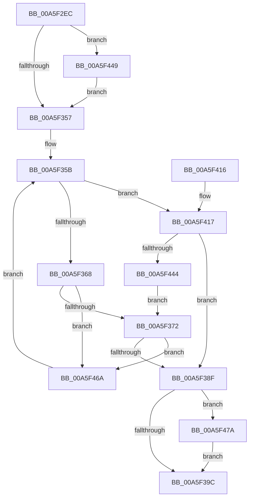

# MiAllocateTopLevelPage

- RVA: `0x00A5F2EC`–`0x00A5F486` (길이 `410` bytes)
- VA: `0x0000000140A5F2EC`
- 실행 섹션: `PAGE`
- PDB 이름 있음: `예`; PDB Function 태그: `아니요`
- unwind 정보 RVA: `0x000B2C50`
- 디코드: `94`개 명령, `410/410` bytes 표시
- 미해석 바이트: `0` (있으면 어셈블리에 `.byte`로 보존)

> 이 문서는 커널 이미지의 기계어와 PDB 기호를 분석해 생성했습니다. 4번과 5번은 함수 원형과 자료형을 바이너리 사용 방식에서 추정한 C 해석이며 원본 소스 복구 결과는 아닙니다.

## 1. Dependencies

- 직접 호출 지점: **10**; 고유 호출 대상: **10**
- 직접 호출자로 확인된 함수: **2**
- RIP 상대 이미지 참조: **0**

### Outgoing calls
- `0x00A5F316` → [MiGetProcessPartition](../../text/44/MiGetProcessPartition_function_00443B10.md) (function, `0x00443B10`)
- `0x00A5F32F` → [MiInitializePageColorBase](../../text/32/MiInitializePageColorBase_function_00320410.md) (function, `0x00320410`)
- `0x00A5F339` → [MiGetNextPageColor](../../text/44/MiGetNextPageColor_function_00442D64.md) (function, `0x00442D64`)
- `0x00A5F37D` → [MiGetPage](../../text/28/MiGetPage_function_002884C0.md) (function, `0x002884C0`)
- `0x00A5F3B7` → [MiSetPfnContainingFrame](../../text/36/MiSetPfnContainingFrame_function_00363FC0.md) (function, `0x00363FC0`)
- `0x00A5F3D9` → [MiInitializePfnForOtherProcess](../../text/38/MiInitializePfnForOtherProcess_function_00382A20.md) (function, `0x00382A20`)
- `0x00A5F3E7` → [MiSetPageTablePfnBuddy](../../text/4A/MiSetPageTablePfnBuddy_function_004A3394.md) (function, `0x004A3394`)
- `0x00A5F3EF` → [MiInitializeSelfmap](../../text/43/MiInitializeSelfmap_function_0043202C.md) (function, `0x0043202C`)
- `0x00A5F432` → [MiGetSlabPage](../../text/37/MiGetSlabPage_function_00376FBC.md) (function, `0x00376FBC`)
- `0x00A5F470` → [MiWaitForFreePage](../../text/2A/MiWaitForFreePage_function_002A3324.md) (function, `0x002A3324`)

### Direct callers
- [MmCreateProcessAddressSpace](MmCreateProcessAddressSpace_function_00A5EE5C.md) at `0x00A5F054`
- [MiAllocateProcessShadow](MiAllocateProcessShadow_function_00A5F1A0.md) at `0x00A5F20E`

### Static image references
- 디코드된 RIP-relative 메모리 참조가 없습니다.

## 2. Other-region calls and transfers

- 다른 실행 섹션으로 향하는 call: **10**
  - `0x00A5F316` → [MiGetProcessPartition](../../text/44/MiGetProcessPartition_function_00443B10.md) (`PAGE` → `.text`)
  - `0x00A5F32F` → [MiInitializePageColorBase](../../text/32/MiInitializePageColorBase_function_00320410.md) (`PAGE` → `.text`)
  - `0x00A5F339` → [MiGetNextPageColor](../../text/44/MiGetNextPageColor_function_00442D64.md) (`PAGE` → `.text`)
  - `0x00A5F37D` → [MiGetPage](../../text/28/MiGetPage_function_002884C0.md) (`PAGE` → `.text`)
  - `0x00A5F3B7` → [MiSetPfnContainingFrame](../../text/36/MiSetPfnContainingFrame_function_00363FC0.md) (`PAGE` → `.text`)
  - `0x00A5F3D9` → [MiInitializePfnForOtherProcess](../../text/38/MiInitializePfnForOtherProcess_function_00382A20.md) (`PAGE` → `.text`)
  - `0x00A5F3E7` → [MiSetPageTablePfnBuddy](../../text/4A/MiSetPageTablePfnBuddy_function_004A3394.md) (`PAGE` → `.text`)
  - `0x00A5F3EF` → [MiInitializeSelfmap](../../text/43/MiInitializeSelfmap_function_0043202C.md) (`PAGE` → `.text`)
  - `0x00A5F432` → [MiGetSlabPage](../../text/37/MiGetSlabPage_function_00376FBC.md) (`PAGE` → `.text`)
  - `0x00A5F470` → [MiWaitForFreePage](../../text/2A/MiWaitForFreePage_function_002A3324.md) (`PAGE` → `.text`)
- 별도 외부 분기/꼬리 이동을 확인하지 못했습니다.

## 3. Assembly (complete function range)

```asm
00A5F2EC  48 8B C4                        mov rax, rsp
00A5F2EF  48 89 58 08                     mov qword ptr [rax + 8], rbx
00A5F2F3  48 89 68 10                     mov qword ptr [rax + 0x10], rbp
00A5F2F7  48 89 70 18                     mov qword ptr [rax + 0x18], rsi
00A5F2FB  48 89 78 20                     mov qword ptr [rax + 0x20], rdi
00A5F2FF  41 54                           push r12
00A5F301  41 56                           push r14
00A5F303  41 57                           push r15
00A5F305  48 83 EC 40                     sub rsp, 0x40
00A5F309  0F 57 C0                        xorps xmm0, xmm0
00A5F30C  44 8B C2                        mov r8d, edx
00A5F30F  0F 11 40 D8                     movups xmmword ptr [rax - 0x28], xmm0
00A5F313  48 8B E9                        mov rbp, rcx
00A5F316  E8 F5 47 9E FF                  call 0x140443b10
00A5F31B  BA 03 00 00 00                  mov edx, 3
00A5F320  4C 8D 4C 24 30                  lea r9, [rsp + 0x30]
00A5F325  48 81 C1 00 04 00 00            add rcx, 0x400
00A5F32C  4C 8B F0                        mov r14, rax
00A5F32F  E8 DC 10 8C FF                  call 0x140320410
00A5F334  48 8D 4C 24 30                  lea rcx, [rsp + 0x30]
00A5F339  E8 26 3A 9E FF                  call 0x140442d64
00A5F33E  8B D8                           mov ebx, eax
00A5F340  45 33 E4                        xor r12d, r12d
00A5F343  8A 85 EE 06 00 00               mov al, byte ptr [rbp + 0x6ee]
00A5F349  41 B7 FF                        mov r15b, 0xff
00A5F34C  33 F6                           xor esi, esi
00A5F34E  41 3A C7                        cmp al, r15b
00A5F351  0F 85 F2 00 00 00               jne 0x140a5f449
00A5F357  48 83 CF FF                     or rdi, 0xffffffffffffffff
00A5F35B  80 BD EE 06 00 00 FF            cmp byte ptr [rbp + 0x6ee], 0xff
00A5F362  0F 85 AF 00 00 00               jne 0x140a5f417
00A5F368  48 83 FF FF                     cmp rdi, -1
00A5F36C  0F 85 F8 00 00 00               jne 0x140a5f46a
00A5F372  41 B8 30 00 00 00               mov r8d, 0x30
00A5F378  8B D3                           mov edx, ebx
00A5F37A  49 8B CE                        mov rcx, r14
00A5F37D  E8 3E 91 82 FF                  call 0x1402884c0
00A5F382  48 8B F8                        mov rdi, rax
00A5F385  48 83 F8 FF                     cmp rax, -1
00A5F389  0F 84 DB 00 00 00               je 0x140a5f46a
00A5F38F  80 BD EE 06 00 00 FF            cmp byte ptr [rbp + 0x6ee], 0xff
00A5F396  0F 85 DE 00 00 00               jne 0x140a5f47a
00A5F39C  48 8D 1C 7F                     lea rbx, [rdi + rdi*2]
00A5F3A0  48 C1 E3 04                     shl rbx, 4
00A5F3A4  48 B8 00 00 00 00 00 DE FF FF   movabs rax, 0xffffde0000000000
00A5F3AE  48 03 D8                        add rbx, rax
00A5F3B1  48 8B D7                        mov rdx, rdi
00A5F3B4  48 8B CB                        mov rcx, rbx
00A5F3B7  E8 04 4C 90 FF                  call 0x140363fc0
00A5F3BC  48 C7 03 00 00 00 00            mov qword ptr [rbx], 0
00A5F3C3  48 BA 68 DF BE 7D FB F6 FF FF   movabs rdx, 0xfffff6fb7dbedf68
00A5F3CD  41 B9 00 02 00 00               mov r9d, 0x200
00A5F3D3  4C 8B C7                        mov r8, rdi
00A5F3D6  48 8B CF                        mov rcx, rdi
00A5F3D9  E8 42 36 92 FF                  call 0x140382a20
00A5F3DE  45 33 C0                        xor r8d, r8d
00A5F3E1  48 8B D5                        mov rdx, rbp
00A5F3E4  48 8B CB                        mov rcx, rbx
00A5F3E7  E8 A8 3F A4 FF                  call 0x1404a3394
00A5F3EC  48 8B CF                        mov rcx, rdi
00A5F3EF  E8 38 2C 9D FF                  call 0x14043202c
00A5F3F4  48 8B 5C 24 60                  mov rbx, qword ptr [rsp + 0x60]
00A5F3F9  48 8B C7                        mov rax, rdi
00A5F3FC  48 8B 7C 24 78                  mov rdi, qword ptr [rsp + 0x78]
00A5F401  48 8B 6C 24 68                  mov rbp, qword ptr [rsp + 0x68]
00A5F406  48 8B 74 24 70                  mov rsi, qword ptr [rsp + 0x70]
00A5F40B  48 83 C4 40                     add rsp, 0x40
00A5F40F  41 5F                           pop r15
00A5F411  41 5E                           pop r14
00A5F413  41 5C                           pop r12
00A5F415  C3                              ret
00A5F416  CC                              int3
00A5F417  83 64 24 28 00                  and dword ptr [rsp + 0x28], 0
00A5F41C  41 B9 0C 00 00 00               mov r9d, 0xc
00A5F422  48 83 4C 24 20 FF               or qword ptr [rsp + 0x20], 0xffffffffffffffff
00A5F428  44 8B C3                        mov r8d, ebx
00A5F42B  49 8B CE                        mov rcx, r14
00A5F42E  41 8D 51 FC                     lea edx, [r9 - 4]
00A5F432  E8 85 7B 91 FF                  call 0x140376fbc
00A5F437  48 8B F8                        mov rdi, rax
00A5F43A  48 83 F8 FF                     cmp rax, -1
00A5F43E  0F 85 4B FF FF FF               jne 0x140a5f38f
00A5F444  E9 29 FF FF FF                  jmp 0x140a5f372
00A5F449  65 48 8B 34 25 88 01 00 00      mov rsi, qword ptr gs:[0x188]
00A5F452  41 BC 02 00 00 00               mov r12d, 2
00A5F458  44 8A BE 27 07 00 00            mov r15b, byte ptr [rsi + 0x727]
00A5F45F  88 86 27 07 00 00               mov byte ptr [rsi + 0x727], al
00A5F465  E9 ED FE FF FF                  jmp 0x140a5f357
00A5F46A  41 8B D4                        mov edx, r12d
00A5F46D  49 8B CE                        mov rcx, r14
00A5F470  E8 AF 3E 84 FF                  call 0x1402a3324
00A5F475  E9 E1 FE FF FF                  jmp 0x140a5f35b
00A5F47A  44 88 BE 27 07 00 00            mov byte ptr [rsi + 0x727], r15b
00A5F481  E9 16 FF FF FF                  jmp 0x140a5f39c
```

## 4. C-style interpretation (structured pseudocode)

```c
__int64 __fastcall MiAllocateTopLevelPage(__int64 a1, int a2)
{
    __int64 result;
    __int64 v_r12;
    __int64 v_rbx;
    __int64 v_rdi;
    __int64 v_rsi;
    __int64 v_rsp;
    unsigned __int64 v_stack_m28;
    unsigned __int64 v_stack_p10;
    unsigned __int64 v_stack_p18;
    unsigned __int64 v_stack_p20;
    unsigned int v_stack_p28;
    unsigned __int64 v_stack_p8;

    *(unsigned __int64 *)(v_rsp + 8) = v_rbx;
    *(unsigned __int64 *)(v_rsp + 16) = v_rbp;
    *(unsigned __int64 *)(v_rsp + 24) = v_rsi;
    *(unsigned __int64 *)(v_rsp + 32) = v_rdi;
    v_rsp = (v_rsp) - (64);
    *(unsigned __int64 *)(v_rsp - 40) = v_xmm0;
    result = MiGetProcessPartition(a1, a2, (unsigned int)(a2), a4);
    a1 = (a1) + (0x400ULL);
    result = MiInitializePageColorBase(a1, 3, (unsigned int)(a2), v_stack_m28);
    result = MiGetNextPageColor(v_stack_m28, 3, (unsigned int)(a2), v_stack_m28);
    v_r12 = 0;
    v_rsi = 0;
    if (((unsigned __int8)(*(unsigned __int8 *)(a1 + 1774))) != 255) goto loc_00A5F449;
loc_00A5F357:
    v_rdi = (v_rdi) | (-1);
loc_00A5F35B:
    if ((*(unsigned __int8 *)(a1 + 1774)) != 255) goto loc_00A5F417;
    if (v_rdi != -1) goto loc_00A5F46A;
loc_00A5F372:
    result = MiGetPage(result, (unsigned int)((unsigned int)((unsigned int)((unsigned int)(result)))), 48, v_stack_m28);
    if (result == -1) goto loc_00A5F46A;
loc_00A5F38F:
    if ((*(unsigned __int8 *)(a1 + 1774)) != 255) goto loc_00A5F47A;
loc_00A5F39C:
    v_rbx = (result + result * 2) << (4);
    v_rbx = (v_rbx) + (result);
    result = MiSetPfnContainingFrame(v_rbx, result, 48, v_stack_m28);
    *(unsigned __int64 *)(v_rbx) = 0;
    result = MiInitializePfnForOtherProcess(result, result, result, 512);
    a3 = 0;
    result = MiSetPageTablePfnBuddy(v_rbx, a1, a3, 512);
    result = MiInitializeSelfmap(result, a1, a3, 512);
    v_rsp = (v_rsp) + (64);
    return result;
loc_00A5F417:
    result = MiGetSlabPage(result, 12 - 4, (unsigned int)((unsigned int)(v_stack_p8)), 12);
    if (result != -1) goto loc_00A5F38F;
    goto loc_00A5F372;
loc_00A5F449:
    *(unsigned __int8 *)(*(unsigned __int64 *)(gs_base + (0 + 392)) + 1831) = (unsigned __int8)(result);
    goto loc_00A5F357;
loc_00A5F46A:
    result = MiWaitForFreePage(result, 2, (unsigned int)((unsigned int)(v_stack_p8)), 12);
    goto loc_00A5F35B;
loc_00A5F47A:
    *(unsigned __int8 *)(*(unsigned __int64 *)(gs_base + (0 + 392)) + 1831) = (unsigned __int8)(*(unsigned __int8 *)(*(unsigned __int64 *)(gs_base + (0 + 392)) + 1831));
    goto loc_00A5F39C;
}
```

## 5. (Beta) C Style

```c
int64_t MiAllocateTopLevelPage(void *Arg1, int32_t Arg2)
{
    uint8_t *arg1 = (uint8_t *)Arg1;

    int64_t result;
    int64_t local_r12;
    int64_t local_rbx;
    int64_t local_rdi;
    int64_t local_rsi;
    int64_t local_rsp;
    uint64_t v_stack_m28;
    uint64_t v_stack_p10;
    uint64_t v_stack_p18;
    uint64_t v_stack_p20;
    uint32_t v_stack_p28;
    uint64_t v_stack_p8;

    *(uint64_t *)(local_rsp + 0x8) = local_rbx;
    *(uint64_t *)(local_rsp + 0x10) = local_rbp;
    *(uint64_t *)(local_rsp + 0x18) = local_rsi;
    *(uint64_t *)(local_rsp + 0x20) = local_rdi;
    local_rsp = (local_rsp) - (64);
    *(uint64_t *)(local_rsp - 0x28) = v_xmm0;
    result = MiGetProcessPartition(Arg1, Arg2, (uint32_t)(Arg2), a4);
    Arg1 = (Arg1) + (0x400ULL);
    result = MiInitializePageColorBase(Arg1, 3, (uint32_t)(Arg2), v_stack_m28);
    result = MiGetNextPageColor(v_stack_m28, 3, (uint32_t)(Arg2), v_stack_m28);
    local_r12 = 0;
    local_rsi = 0;
    if (((uint8_t)(*(uint8_t *)(arg1 + 0x6EE))) != 255) goto loc_00A5F449;
loc_00A5F357:
    local_rdi = (local_rdi) | (-1);
loc_00A5F35B:
    if ((*(uint8_t *)(arg1 + 0x6EE)) != 255) goto loc_00A5F417;
    if (local_rdi != -1) goto loc_00A5F46A;
loc_00A5F372:
    result = MiGetPage(result, (uint32_t)((uint32_t)((uint32_t)((uint32_t)(result)))), 48, v_stack_m28);
    if (result == -1) goto loc_00A5F46A;
loc_00A5F38F:
    if ((*(uint8_t *)(arg1 + 0x6EE)) != 255) goto loc_00A5F47A;
loc_00A5F39C:
    local_rbx = (result + result * 2) << (4);
    local_rbx = (local_rbx) + (result);
    result = MiSetPfnContainingFrame(local_rbx, result, 48, v_stack_m28);
    *(uint64_t *)(local_rbx) = 0;
    result = MiInitializePfnForOtherProcess(result, result, result, 512);
    a3 = 0;
    result = MiSetPageTablePfnBuddy(local_rbx, Arg1, a3, 512);
    result = MiInitializeSelfmap(result, Arg1, a3, 512);
    local_rsp = (local_rsp) + (64);
    return result;
loc_00A5F417:
    result = MiGetSlabPage(result, 12 - 4, (uint32_t)((uint32_t)(v_stack_p8)), 12);
    if (result != -1) goto loc_00A5F38F;
    goto loc_00A5F372;
loc_00A5F449:
    *(uint8_t *)(*(uint64_t *)(gs_base + (0 + 0x188)) + 0x727) = (uint8_t)(result);
    goto loc_00A5F357;
loc_00A5F46A:
    result = MiWaitForFreePage(result, 2, (uint32_t)((uint32_t)(v_stack_p8)), 12);
    goto loc_00A5F35B;
loc_00A5F47A:
    *(uint8_t *)(*(uint64_t *)(gs_base + (0 + 0x188)) + 0x727) = (uint8_t)(*(uint8_t *)(*(uint64_t *)(gs_base + (0 + 0x188)) + 0x727));
    goto loc_00A5F39C;
}
```

### 관측된 메모리 오프셋

구조체 형식이 확인되지 않은 접근은 인자 기준의 오프셋으로만 기록했습니다.

| 기준 인자 | 오프셋 표현 | 폭 (bit) | 접근 |
|---|---:|---:|---|
| `Arg1` | `+ 0x6EE` | `8` | `R` |

## 6. Execution-region graph

[열기: 2D/3D 그래프와 함수 탐색 컨트롤 패널](../../../control-panel.html?section=page&rva=0x00A5F2EC&view=graph)

- 2D 그래프는 위에서 아래로 흐르고, 3D 그래프는 빈 공간을 드래그해 회전합니다. Shift+드래그는 이동, 휠은 확대·축소, 함수 노드 선택은 대상 보고서 이동입니다.

### Static fallback


