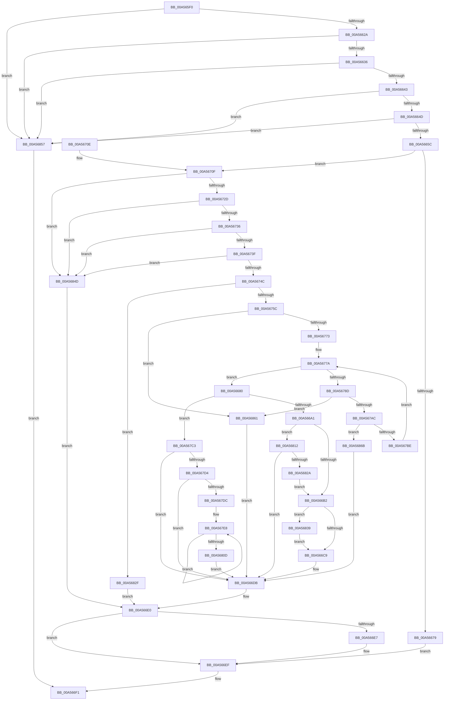

# MmChangeImageProtection

- RVA: `0x00A565F0`–`0x00A56875` (길이 `645` bytes)
- VA: `0x0000000140A565F0`
- 실행 섹션: `PAGE`
- PDB 이름 있음: `예`; PDB Function 태그: `아니요`
- unwind 정보 RVA: `0x000B1500`
- 디코드: `158`개 명령, `645/645` bytes 표시
- 미해석 바이트: `0` (있으면 어셈블리에 `.byte`로 보존)

> 이 문서는 커널 이미지의 기계어와 PDB 기호를 분석해 생성했습니다. 4번과 5번은 함수 원형과 자료형을 바이너리 사용 방식에서 추정한 C 해석이며 원본 소스 복구 결과는 아닙니다.

## 1. Dependencies

- 직접 호출 지점: **8**; 고유 호출 대상: **7**
- 직접 호출자로 확인된 함수: **0**
- RIP 상대 이미지 참조: **1**

### Outgoing calls
- `0x00A56668` → [MiLockLoadedDataTableEntryIfNecessary](../../text/2A/MiLockLoadedDataTableEntryIfNecessary_function_002A38B4.md) (function, `0x002A38B4`)
- `0x00A56691` → [MiSetImageProtection](../../text/38/MiSetImageProtection_function_003843D0.md) (function, `0x003843D0`)
- `0x00A566D4` → [MiSetImageProtection](../../text/38/MiSetImageProtection_function_003843D0.md) (function, `0x003843D0`)
- `0x00A566EA` → [MmUnlockLoadedDataTableEntry](../../text/2A/MmUnlockLoadedDataTableEntry_function_002A3C98.md) (function, `0x002A3C98`)
- `0x00A56766` → [MI_IS_PHYSICAL_ADDRESS](../../text/23/MI_IS_PHYSICAL_ADDRESS_function_0023B3A0.md) (function, `0x0023B3A0`)
- `0x00A567B1` → [MiGetPagePrivilege](../../text/28/MiGetPagePrivilege_function_00285420.md) (function, `0x00285420`)
- `0x00A567FE` → [MiClearPfnImageVerified](../../text/40/MiClearPfnImageVerified_function_00407000.md) (function, `0x00407000`)
- `0x00A5681B` → [VslValidateDynamicCodePages](VslValidateDynamicCodePages_function_00A5687C.md) (function, `0x00A5687C`)

### Direct callers
- 이 함수 시작 RVA로 연결되는 직접 call은 확인되지 않았습니다. 간접 호출은 완전히 역산할 수 없습니다.

### Static image references
- `0x00A566A1` → RVA `0x00FC6A88` (`ALMOSTRO`; read)

## 2. Other-region calls and transfers

- 다른 실행 섹션으로 향하는 call: **7**
  - `0x00A56668` → [MiLockLoadedDataTableEntryIfNecessary](../../text/2A/MiLockLoadedDataTableEntryIfNecessary_function_002A38B4.md) (`PAGE` → `.text`)
  - `0x00A56691` → [MiSetImageProtection](../../text/38/MiSetImageProtection_function_003843D0.md) (`PAGE` → `.text`)
  - `0x00A566D4` → [MiSetImageProtection](../../text/38/MiSetImageProtection_function_003843D0.md) (`PAGE` → `.text`)
  - `0x00A566EA` → [MmUnlockLoadedDataTableEntry](../../text/2A/MmUnlockLoadedDataTableEntry_function_002A3C98.md) (`PAGE` → `.text`)
  - `0x00A56766` → [MI_IS_PHYSICAL_ADDRESS](../../text/23/MI_IS_PHYSICAL_ADDRESS_function_0023B3A0.md) (`PAGE` → `.text`)
  - `0x00A567B1` → [MiGetPagePrivilege](../../text/28/MiGetPagePrivilege_function_00285420.md) (`PAGE` → `.text`)
  - `0x00A567FE` → [MiClearPfnImageVerified](../../text/40/MiClearPfnImageVerified_function_00407000.md) (`PAGE` → `.text`)
- 별도 외부 분기/꼬리 이동을 확인하지 못했습니다.

## 3. Assembly (complete function range)

```asm
00A565F0  48 8B C4                        mov rax, rsp
00A565F3  48 89 58 08                     mov qword ptr [rax + 8], rbx
00A565F7  48 89 68 10                     mov qword ptr [rax + 0x10], rbp
00A565FB  48 89 70 18                     mov qword ptr [rax + 0x18], rsi
00A565FF  44 89 48 20                     mov dword ptr [rax + 0x20], r9d
00A56603  57                              push rdi
00A56604  41 54                           push r12
00A56606  41 55                           push r13
00A56608  41 56                           push r14
00A5660A  41 57                           push r15
00A5660C  48 83 EC 30                     sub rsp, 0x30
00A56610  83 60 C8 00                     and dword ptr [rax - 0x38], 0
00A56614  49 8B D8                        mov rbx, r8
00A56617  41 8D 41 FF                     lea eax, [r9 - 1]
00A5661B  4C 8B E2                        mov r12, rdx
00A5661E  48 8B F9                        mov rdi, rcx
00A56621  83 F8 01                        cmp eax, 1
00A56624  0F 87 2D 02 00 00               ja 0x140a56857
00A5662A  44 8B EB                        mov r13d, ebx
00A5662D  49 3B DD                        cmp rbx, r13
00A56630  0F 85 21 02 00 00               jne 0x140a56857
00A56636  8A 41 0A                        mov al, byte ptr [rcx + 0xa]
00A56639  24 07                           and al, 7
00A5663B  3C 02                           cmp al, 2
00A5663D  0F 85 14 02 00 00               jne 0x140a56857
00A56643  83 79 2C 00                     cmp dword ptr [rcx + 0x2c], 0
00A56647  0F 85 0A 02 00 00               jne 0x140a56857
00A5664D  8B 69 28                        mov ebp, dword ptr [rcx + 0x28]
00A56650  F7 C5 FF 0F 00 00               test ebp, 0xfff
00A56656  0F 85 FB 01 00 00               jne 0x140a56857
00A5665C  48 8B 49 20                     mov rcx, qword ptr [rcx + 0x20]
00A56660  48 8D 54 24 20                  lea rdx, [rsp + 0x20]
00A56665  C1 ED 0C                        shr ebp, 0xc
00A56668  E8 47 D2 84 FF                  call 0x1402a38b4
00A5666D  48 8B F0                        mov rsi, rax
00A56670  48 85 C0                        test rax, rax
00A56673  0F 85 96 00 00 00               jne 0x140a5670f
00A56679  BB 25 02 00 C0                  mov ebx, 0xc0000225
00A5667E  EB 6F                           jmp 0x140a566ef
00A56680  44 8B 47 28                     mov r8d, dword ptr [rdi + 0x28]
00A56684  41 B9 01 00 00 00               mov r9d, 1
00A5668A  48 8B 57 20                     mov rdx, qword ptr [rdi + 0x20]
00A5668E  48 8B CE                        mov rcx, rsi
00A56691  E8 3A DD 92 FF                  call 0x1403843d0
00A56696  83 7C 24 78 01                  cmp dword ptr [rsp + 0x78], 1
00A5669B  0F 85 22 01 00 00               jne 0x140a567c3
00A566A1  48 F7 05 DC 03 57 00 00 40 00 00  test qword ptr [rip + 0x5703dc], 0x4000
00A566AC  0F 85 60 01 00 00               jne 0x140a56812
00A566B2  48 F7 05 CB 03 57 00 00 80 00 00  test qword ptr [rip + 0x5703cb], 0x8000
00A566BD  41 B9 03 00 00 00               mov r9d, 3
00A566C3  0F 85 70 01 00 00               jne 0x140a56839
00A566C9  44 8B 47 28                     mov r8d, dword ptr [rdi + 0x28]
00A566CD  48 8B CE                        mov rcx, rsi
00A566D0  48 8B 57 20                     mov rdx, qword ptr [rdi + 0x20]
00A566D4  E8 F7 DC 92 FF                  call 0x1403843d0
00A566D9  33 DB                           xor ebx, ebx
00A566DB  0F BA 76 68 13                  btr dword ptr [rsi + 0x68], 0x13
00A566E0  83 7C 24 20 00                  cmp dword ptr [rsp + 0x20], 0
00A566E5  74 08                           je 0x140a566ef
00A566E7  48 8B CE                        mov rcx, rsi
00A566EA  E8 A9 D5 84 FF                  call 0x1402a3c98
00A566EF  8B C3                           mov eax, ebx
00A566F1  48 8B 5C 24 60                  mov rbx, qword ptr [rsp + 0x60]
00A566F6  48 8B 6C 24 68                  mov rbp, qword ptr [rsp + 0x68]
00A566FB  48 8B 74 24 70                  mov rsi, qword ptr [rsp + 0x70]
00A56700  48 83 C4 30                     add rsp, 0x30
00A56704  41 5F                           pop r15
00A56706  41 5E                           pop r14
00A56708  41 5D                           pop r13
00A5670A  41 5C                           pop r12
00A5670C  5F                              pop rdi
00A5670D  C3                              ret
00A5670E  CC                              int3
00A5670F  4C 8B 40 30                     mov r8, qword ptr [rax + 0x30]
00A56713  49 8D 14 1C                     lea rdx, [r12 + rbx]
00A56717  8B 40 40                        mov eax, dword ptr [rax + 0x40]
00A5671A  8B 4F 28                        mov ecx, dword ptr [rdi + 0x28]
00A5671D  49 03 C0                        add rax, r8
00A56720  48 03 4F 20                     add rcx, qword ptr [rdi + 0x20]
00A56724  48 3B C8                        cmp rcx, rax
00A56727  0F 87 20 01 00 00               ja 0x140a5684d
00A5672D  4D 3B E0                        cmp r12, r8
00A56730  0F 82 17 01 00 00               jb 0x140a5684d
00A56736  48 3B D0                        cmp rdx, rax
00A56739  0F 87 0E 01 00 00               ja 0x140a5684d
00A5673F  48 8D 42 FF                     lea rax, [rdx - 1]
00A56743  49 3B C4                        cmp rax, r12
00A56746  0F 82 01 01 00 00               jb 0x140a5684d
00A5674C  8B 46 68                        mov eax, dword ptr [rsi + 0x68]
00A5674F  B9 00 00 08 00                  mov ecx, 0x80000
00A56754  85 C1                           test ecx, eax
00A56756  0F 85 D3 00 00 00               jne 0x140a5682f
00A5675C  0B C1                           or eax, ecx
00A5675E  33 DB                           xor ebx, ebx
00A56760  49 8B C8                        mov rcx, r8
00A56763  89 46 68                        mov dword ptr [rsi + 0x68], eax
00A56766  E8 35 4C 7E FF                  call 0x14023b3a0
00A5676B  85 C0                           test eax, eax
00A5676D  0F 85 EE 00 00 00               jne 0x140a56861
00A56773  4C 8D 7F 30                     lea r15, [rdi + 0x30]
00A56777  45 33 F6                        xor r14d, r14d
00A5677A  48 BA 00 00 00 00 00 DE FF FF   movabs rdx, 0xffffde0000000000
00A56784  44 3B F5                        cmp r14d, ebp
00A56787  0F 83 F3 FE FF FF               jae 0x140a56680
00A5678D  4B 8B 0C F7                     mov rcx, qword ptr [r15 + r14*8]
00A56791  48 8D 0C 49                     lea rcx, [rcx + rcx*2]
00A56795  48 C1 E1 04                     shl rcx, 4
00A56799  48 8B C2                        mov rax, rdx
00A5679C  48 03 C8                        add rcx, rax
00A5679F  48 8B 41 28                     mov rax, qword ptr [rcx + 0x28]
00A567A3  48 85 C0                        test rax, rax
00A567A6  0F 88 B5 00 00 00               js 0x140a56861
00A567AC  45 33 C0                        xor r8d, r8d
00A567AF  33 D2                           xor edx, edx
00A567B1  E8 6A EC 82 FF                  call 0x140285420
00A567B6  A8 40                           test al, 0x40
00A567B8  0F 85 AD 00 00 00               jne 0x140a5686b
00A567BE  41 FF C6                        inc r14d
00A567C1  EB B7                           jmp 0x140a5677a
00A567C3  48 F7 05 BA 02 57 00 00 80 00 00  test qword ptr [rip + 0x5702ba], 0x8000
00A567CE  0F 84 07 FF FF FF               je 0x140a566db
00A567D4  85 ED                           test ebp, ebp
00A567D6  0F 84 FF FE FF FF               je 0x140a566db
00A567DC  8B FD                           mov edi, ebp
00A567DE  48 BD 00 00 00 00 00 DE FF FF   movabs rbp, 0xffffde0000000000
00A567E8  49 8B 07                        mov rax, qword ptr [r15]
00A567EB  48 8D 0C 40                     lea rcx, [rax + rax*2]
00A567EF  48 C1 E1 04                     shl rcx, 4
00A567F3  48 8B C5                        mov rax, rbp
00A567F6  48 03 C8                        add rcx, rax
00A567F9  BA 09 00 00 00                  mov edx, 9
00A567FE  E8 FD 07 9B FF                  call 0x140407000
00A56803  4D 8D 7F 08                     lea r15, [r15 + 8]
00A56807  48 83 EF 01                     sub rdi, 1
00A5680B  75 DB                           jne 0x140a567e8
00A5680D  E9 C9 FE FF FF                  jmp 0x140a566db
00A56812  45 8B C5                        mov r8d, r13d
00A56815  49 8B D4                        mov rdx, r12
00A56818  48 8B CF                        mov rcx, rdi
00A5681B  E8 5C 00 00 00                  call 0x140a5687c
00A56820  8B D8                           mov ebx, eax
00A56822  85 C0                           test eax, eax
00A56824  0F 88 B1 FE FF FF               js 0x140a566db
00A5682A  E9 83 FE FF FF                  jmp 0x140a566b2
00A5682F  BB 43 00 00 C0                  mov ebx, 0xc0000043
00A56834  E9 A7 FE FF FF                  jmp 0x140a566e0
00A56839  81 FB 2C 01 00 00               cmp ebx, 0x12c
00A5683F  B8 13 00 00 00                  mov eax, 0x13
00A56844  44 0F 44 C8                     cmove r9d, eax
00A56848  E9 7C FE FF FF                  jmp 0x140a566c9
00A5684D  BB 18 00 00 C0                  mov ebx, 0xc0000018
00A56852  E9 89 FE FF FF                  jmp 0x140a566e0
00A56857  B8 0D 00 00 C0                  mov eax, 0xc000000d
00A5685C  E9 90 FE FF FF                  jmp 0x140a566f1
00A56861  BB 18 00 00 C0                  mov ebx, 0xc0000018
00A56866  E9 70 FE FF FF                  jmp 0x140a566db
00A5686B  BB 45 00 00 C0                  mov ebx, 0xc0000045
00A56870  E9 66 FE FF FF                  jmp 0x140a566db
```

## 4. C-style interpretation (structured pseudocode)

```c
__int64 __fastcall MmChangeImageProtection(__int64 a1, __int64 a2, __int64 a3, __int64 a4)
{
    __int64 result;
    __int64 v_r14;
    __int64 v_rbp;
    __int64 v_rbx;
    __int64 v_rdi;
    __int64 v_rsp;
    unsigned __int64 v_stack_m38;
    unsigned __int64 v_stack_p10;
    unsigned __int64 v_stack_p18;
    unsigned int v_stack_p20;
    unsigned __int64 v_stack_p8;

    *(unsigned __int64 *)(v_rsp + 8) = v_rbx;
    *(unsigned __int64 *)(v_rsp + 16) = v_rbp;
    *(unsigned __int64 *)(v_rsp + 24) = v_rsi;
    *(unsigned int *)(v_rsp + 32) = (unsigned int)(a4);
    v_rsp = (v_rsp) - (48);
    if (((unsigned int)(a4 - 1)) > 1) goto loc_00A56857;
    if (a3 != ((unsigned int)((unsigned int)(a3)))) goto loc_00A56857;
    result = (unsigned __int8)((*(unsigned __int8 *)(a1 + 10)) & (7));
    if (((unsigned __int8)(result)) != 2) goto loc_00A56857;
    if ((*(unsigned int *)(a1 + 44)) != 0) goto loc_00A56857;
    if ((((unsigned int)((unsigned int)(*(unsigned int *)(a1 + 40)))) & (0xFFFULL)) != 0) goto loc_00A56857;
    v_rbp = (unsigned int)(((unsigned int)(*(unsigned int *)(a1 + 40))) >> (12));
    result = MiLockLoadedDataTableEntryIfNecessary(*(unsigned __int64 *)(a1 + 32), v_stack_m38, a3, a4);
    if (result != 0) goto loc_00A5670F;
    goto loc_00A566EF;
loc_00A56680:
    result = MiSetImageProtection(result, *(unsigned __int64 *)(a1 + 32), (unsigned int)(*(unsigned int *)(a1 + 40)), 1);
    if (v_stack_p20 != 1) goto loc_00A567C3;
    if (((*(unsigned __int64 *)(v_rip + 5702620)) & (0x4000ULL)) != 0) goto loc_00A56812;
loc_00A566B2:
    if (((*(unsigned __int64 *)(v_rip + 5702603)) & (0x8000ULL)) != 0) goto loc_00A56839;
loc_00A566C9:
    result = MiSetImageProtection(result, *(unsigned __int64 *)(a1 + 32), (unsigned int)(*(unsigned int *)(a1 + 40)), 3);
    v_rbx = 0;
loc_00A566DB:
loc_00A566E0:
    if (v_stack_m38 != 0) {
        a1 = result;
        result = MmUnlockLoadedDataTableEntry(a1, *(unsigned __int64 *)(a1 + 32), (unsigned int)(*(unsigned int *)(a1 + 40)), 3);
    }
loc_00A566F1:
    v_rsp = (v_rsp) + (48);
    return 0;
loc_00A5670F:
    result = ((unsigned int)(*(unsigned int *)(0 + 64))) + (*(unsigned __int64 *)(0 + 48));
    a1 = ((unsigned int)(*(unsigned int *)(a1 + 40))) + (*(unsigned __int64 *)(a1 + 32));
    if (a1 > result) goto loc_00A5684D;
    if (a2 < (*(unsigned __int64 *)(0 + 48))) goto loc_00A5684D;
    if ((a2 + v_stack_p8 * 1) > result) goto loc_00A5684D;
    if ((a2 + v_stack_p8 * 1 - 1) < a2) goto loc_00A5684D;
    if ((((unsigned int)((unsigned int)(0x80000ULL))) & ((unsigned int)((unsigned int)(*(unsigned int *)(v_stack_p18 + 104))))) != 0) goto loc_00A5682F;
    result = (unsigned int)(((unsigned int)(*(unsigned int *)(v_stack_p18 + 104))) | ((unsigned int)((unsigned int)(0x80000ULL))));
    v_rbx = 0;
    *(unsigned int *)(v_stack_p18 + 104) = (unsigned int)(result);
    result = MI_IS_PHYSICAL_ADDRESS(*(unsigned __int64 *)(0 + 48), a2 + v_stack_p8 * 1, *(unsigned __int64 *)(0 + 48), 3);
    if ((unsigned int)(result) != 0) goto loc_00A56861;
    v_r14 = 0;
loc_00A5677A:
    if (0 >= ((unsigned int)(v_stack_p10))) goto loc_00A56680;
    a1 = (*(unsigned __int64 *)(a1 + 48 + v_r14 * 8) + *(unsigned __int64 *)(a1 + 48 + v_r14 * 8) * 2) << (4);
    a1 = (a1) + (a2 + v_stack_p8 * 1);
    if (sign_flag) goto loc_00A56861;
    a3 = 0;
    a2 = 0;
    result = MiGetPagePrivilege(a1, a2, a3, 3);
    if ((((unsigned __int8)(result)) & (64)) != 0) goto loc_00A5686B;
    v_r14 = (unsigned int)((v_r14) + 1);
    goto loc_00A5677A;
loc_00A567C3:
    if (((*(unsigned __int64 *)(v_rip + 5702330)) & (0x8000ULL)) == 0) goto loc_00A566DB;
    if ((unsigned int)(v_stack_p10) == 0) goto loc_00A566DB;
loc_00A567E8:
    a1 = (*(unsigned __int64 *)(a1 + 48) + *(unsigned __int64 *)(a1 + 48) * 2) << (4);
    a1 = (a1) + (v_stack_p10);
    result = MiClearPfnImageVerified(a1, 9, a3, 3);
    v_rdi = ((unsigned int)((unsigned int)(v_stack_p10))) - (1);
    if (condition_is_not_equal) goto loc_00A567E8;
    goto loc_00A566DB;
loc_00A56812:
    result = VslValidateDynamicCodePages(v_rdi, 0, (unsigned int)((unsigned int)((unsigned int)((unsigned int)(a3)))), 3);
    if (sign_flag) goto loc_00A566DB;
    goto loc_00A566B2;
loc_00A5682F:
    goto loc_00A566E0;
loc_00A56839:
    a4 = 3;
    if (((unsigned int)((unsigned int)(0xC0000043ULL))) == 300) { a4 = 19; }
    goto loc_00A566C9;
loc_00A5684D:
    goto loc_00A566E0;
loc_00A56857:
    goto loc_00A566F1;
loc_00A56861:
    goto loc_00A566DB;
loc_00A5686B:
    goto loc_00A566DB;
}
```

## 5. (Beta) C Style

```c
int64_t MmChangeImageProtection(void *Arg1, void *Arg2, int64_t Arg3, void *Arg4)
{
    uint8_t *arg1 = (uint8_t *)Arg1;
    uint8_t *arg2 = (uint8_t *)Arg2;
    uint8_t *arg4 = (uint8_t *)Arg4;

    int64_t result;
    int64_t local_r14;
    int64_t local_rbp;
    int64_t local_rbx;
    int64_t local_rdi;
    int64_t local_rsp;
    uint64_t v_stack_m38;
    uint64_t v_stack_p10;
    uint64_t v_stack_p18;
    uint32_t v_stack_p20;
    uint64_t v_stack_p8;

    *(uint64_t *)(local_rsp + 0x8) = local_rbx;
    *(uint64_t *)(local_rsp + 0x10) = local_rbp;
    *(uint64_t *)(local_rsp + 0x18) = local_rsi;
    *(uint32_t *)(local_rsp + 0x20) = (uint32_t)(Arg4);
    local_rsp = (local_rsp) - (48);
    if (((uint32_t)(Arg4 - 1)) > 1) goto loc_00A56857;
    if (Arg3 != ((uint32_t)((uint32_t)(Arg3)))) goto loc_00A56857;
    result = (uint8_t)((*(uint8_t *)(arg1 + 0xA)) & (7));
    if (((uint8_t)(result)) != 2) goto loc_00A56857;
    if ((*(uint32_t *)(arg1 + 0x2C)) != 0) goto loc_00A56857;
    if ((((uint32_t)((uint32_t)(*(uint32_t *)(arg1 + 0x28)))) & (0xFFFULL)) != 0) goto loc_00A56857;
    local_rbp = (uint32_t)(((uint32_t)(*(uint32_t *)(arg1 + 0x28))) >> (12));
    result = MiLockLoadedDataTableEntryIfNecessary(*(uint64_t *)(arg1 + 0x20), v_stack_m38, Arg3, Arg4);
    if (result != 0) goto loc_00A5670F;
    goto loc_00A566EF;
loc_00A56680:
    result = MiSetImageProtection(result, *(uint64_t *)(arg1 + 0x20), (uint32_t)(*(uint32_t *)(arg1 + 0x28)), 1);
    if (v_stack_p20 != 1) goto loc_00A567C3;
    if (((*(uint64_t *)(v_rip + 0x5703DC)) & (0x4000ULL)) != 0) goto loc_00A56812;
loc_00A566B2:
    if (((*(uint64_t *)(v_rip + 0x5703CB)) & (0x8000ULL)) != 0) goto loc_00A56839;
loc_00A566C9:
    result = MiSetImageProtection(result, *(uint64_t *)(arg1 + 0x20), (uint32_t)(*(uint32_t *)(arg1 + 0x28)), 3);
    local_rbx = 0;
loc_00A566DB:
loc_00A566E0:
    if (v_stack_m38 != 0) {
        Arg1 = result;
        result = MmUnlockLoadedDataTableEntry(Arg1, *(uint64_t *)(arg1 + 0x20), (uint32_t)(*(uint32_t *)(arg1 + 0x28)), 3);
    }
loc_00A566F1:
    local_rsp = (local_rsp) + (48);
    return 0;
loc_00A5670F:
    result = ((uint32_t)(*(uint32_t *)(0 + 0x40))) + (*(uint64_t *)(0 + 0x30));
    Arg1 = ((uint32_t)(*(uint32_t *)(arg1 + 0x28))) + (*(uint64_t *)(arg1 + 0x20));
    if (Arg1 > result) goto loc_00A5684D;
    if (Arg2 < (*(uint64_t *)(0 + 0x30))) goto loc_00A5684D;
    if ((Arg2 + v_stack_p8 * 1) > result) goto loc_00A5684D;
    if ((Arg2 + v_stack_p8 * 1 - 1) < Arg2) goto loc_00A5684D;
    if ((((uint32_t)((uint32_t)(0x80000ULL))) & ((uint32_t)((uint32_t)(*(uint32_t *)(v_stack_p18 + 0x68))))) != 0) goto loc_00A5682F;
    result = (uint32_t)(((uint32_t)(*(uint32_t *)(v_stack_p18 + 0x68))) | ((uint32_t)((uint32_t)(0x80000ULL))));
    local_rbx = 0;
    *(uint32_t *)(v_stack_p18 + 0x68) = (uint32_t)(result);
    result = MI_IS_PHYSICAL_ADDRESS(*(uint64_t *)(0 + 0x30), Arg2 + v_stack_p8 * 1, *(uint64_t *)(0 + 0x30), 3);
    if ((uint32_t)(result) != 0) goto loc_00A56861;
    local_r14 = 0;
loc_00A5677A:
    if (0 >= ((uint32_t)(v_stack_p10))) goto loc_00A56680;
    Arg1 = (*(uint64_t *)(arg1 + 0x30 + local_r14 * 8) + *(uint64_t *)(arg1 + 0x30 + local_r14 * 8) * 2) << (4);
    Arg1 = (Arg1) + (Arg2 + v_stack_p8 * 1);
    if (sign_flag) goto loc_00A56861;
    Arg3 = 0;
    Arg2 = 0;
    result = MiGetPagePrivilege(Arg1, Arg2, Arg3, 3);
    if ((((uint8_t)(result)) & (64)) != 0) goto loc_00A5686B;
    local_r14 = (uint32_t)((local_r14) + 1);
    goto loc_00A5677A;
loc_00A567C3:
    if (((*(uint64_t *)(v_rip + 0x5702BA)) & (0x8000ULL)) == 0) goto loc_00A566DB;
    if ((uint32_t)(v_stack_p10) == 0) goto loc_00A566DB;
loc_00A567E8:
    Arg1 = (*(uint64_t *)(arg1 + 0x30) + *(uint64_t *)(arg1 + 0x30) * 2) << (4);
    Arg1 = (Arg1) + (v_stack_p10);
    result = MiClearPfnImageVerified(Arg1, 9, Arg3, 3);
    local_rdi = ((uint32_t)((uint32_t)(v_stack_p10))) - (1);
    if (condition_is_not_equal) goto loc_00A567E8;
    goto loc_00A566DB;
loc_00A56812:
    result = VslValidateDynamicCodePages(local_rdi, 0, (uint32_t)((uint32_t)((uint32_t)((uint32_t)(Arg3)))), 3);
    if (sign_flag) goto loc_00A566DB;
    goto loc_00A566B2;
loc_00A5682F:
    goto loc_00A566E0;
loc_00A56839:
    Arg4 = 3;
    if (((uint32_t)((uint32_t)(0xC0000043ULL))) == 300) { Arg4 = 19; }
    goto loc_00A566C9;
loc_00A5684D:
    goto loc_00A566E0;
loc_00A56857:
    goto loc_00A566F1;
loc_00A56861:
    goto loc_00A566DB;
loc_00A5686B:
    goto loc_00A566DB;
}
```

### 관측된 메모리 오프셋

구조체 형식이 확인되지 않은 접근은 인자 기준의 오프셋으로만 기록했습니다.

| 기준 인자 | 오프셋 표현 | 폭 (bit) | 접근 |
|---|---:|---:|---|
| `Arg1` | `+ 0x0` | `64` | `R` |
| `Arg1` | `+ 0x0 + r14*8` | `64` | `R` |
| `Arg1` | `+ 0x8` | `64` | `R` |
| `Arg1` | `+ 0xA` | `8` | `R` |
| `Arg1` | `+ 0x20` | `64` | `R` |
| `Arg1` | `+ 0x28` | `32` | `R` |
| `Arg1` | `+ 0x2C` | `32` | `R` |
| `Arg1` | `+ 0x30` | `64` | `R` |
| `Arg2` | `+ 0x0 + rbx*1` | `64` | `R` |
| `Arg4` | `- 0x1` | `32` | `R` |

## 6. Execution-region graph

[열기: 2D/3D 그래프와 함수 탐색 컨트롤 패널](../../../control-panel.html?section=page&rva=0x00A565F0&view=graph)

- 2D 그래프는 위에서 아래로 흐르고, 3D 그래프는 빈 공간을 드래그해 회전합니다. Shift+드래그는 이동, 휠은 확대·축소, 함수 노드 선택은 대상 보고서 이동입니다.

### Static fallback


