# MmCreateProcessAddressSpace

- RVA: `0x00A5EE5C`–`0x00A5F111` (길이 `693` bytes)
- VA: `0x0000000140A5EE5C`
- 실행 섹션: `PAGE`
- PDB 이름 있음: `예`; PDB Function 태그: `아니요`
- unwind 정보 RVA: `0x000B2C34`
- 디코드: `175`개 명령, `693/693` bytes 표시
- 미해석 바이트: `0` (있으면 어셈블리에 `.byte`로 보존)

> 이 문서는 커널 이미지의 기계어와 PDB 기호를 분석해 생성했습니다. 4번과 5번은 함수 원형과 자료형을 바이너리 사용 방식에서 추정한 C 해석이며 원본 소스 복구 결과는 아닙니다.

## 1. Dependencies

- 직접 호출 지점: **22**; 고유 호출 대상: **22**
- 직접 호출자로 확인된 함수: **1**
- RIP 상대 이미지 참조: **3**

### Outgoing calls
- `0x00A5EEB7` → [MiMakePartitionActive](../../text/49/MiMakePartitionActive_function_004959B8.md) (function, `0x004959B8`)
- `0x00A5EECA` → [MiSetProcessPartitionId](../../text/4A/MiSetProcessPartitionId_function_004AE630.md) (function, `0x004AE630`)
- `0x00A5EEEC` → [MiCreateSlabIdentity](../../text/68/MiCreateSlabIdentity_function_0068D2D4.md) (function, `0x0068D2D4`)
- `0x00A5EF08` → [MiChargeCommit](../../text/28/MiChargeCommit_function_00286EB0.md) (function, `0x00286EB0`)
- `0x00A5EF22` → [MiGetSharedVm](../../text/41/MiGetSharedVm_function_00414A20.md) (function, `0x00414A20`)
- `0x00A5EF31` → [RtlRandomEx](../../text/41/RtlRandomEx_function_0041AFE0.md) (function, `0x0041AFE0`)
- `0x00A5EF52` → [PsGetDefaultWsMaximum](../../text/4B/PsGetDefaultWsMaximum_function_004B22FC.md) (function, `0x004B22FC`)
- `0x00A5EF77` → [MiCheckWsLimits](../../text/47/MiCheckWsLimits_function_0047DD44.md) (function, `0x0047DD44`)
- `0x00A5EFD2` → [MiAllocatePool](../../text/35/MiAllocatePool_function_0035B540.md) (function, `0x0035B540`)
- `0x00A5EFF7` → [PsChargeProcessQuota](../../text/47/PsChargeProcessQuota_function_0047DEC0.md) (function, `0x0047DEC0`)
- `0x00A5F00C` → [MiChargeResident](../../text/28/MiChargeResident_function_0028A0F0.md) (function, `0x0028A0F0`)
- `0x00A5F022` → [MiAllocateProcessShadow](MiAllocateProcessShadow_function_00A5F1A0.md) (function, `0x00A5F1A0`)
- `0x00A5F036` → [PsReserveSessionMembership](PsReserveSessionMembership_function_00A5F48C.md) (function, `0x00A5F48C`)
- `0x00A5F054` → [MiAllocateTopLevelPage](MiAllocateTopLevelPage_function_00A5F2EC.md) (function, `0x00A5F2EC`)
- `0x00A5F05F` → [MiCreateNewProcessTopLevelMappings](../../text/46/MiCreateNewProcessTopLevelMappings_function_0046C4A0.md) (function, `0x0046C4A0`)
- `0x00A5F076` → [PsJoinSession](PsJoinSession_function_00A5F118.md) (function, `0x00A5F118`)
- `0x00A5F08A` → [MiDeleteProcessShadow](../../text/46/MiDeleteProcessShadow_function_00465BF8.md) (function, `0x00465BF8`)
- `0x00A5F09B` → [MiReturnResident](../../text/28/MiReturnResident_function_00286890.md) (function, `0x00286890`)
- `0x00A5F0AC` → [PsReturnProcessQuota](../../text/47/PsReturnProcessQuota_function_0047DE8C.md) (function, `0x0047DE8C`)
- `0x00A5F0BC` → [ExFreePoolWithTag](../../poolcode/B8/ExFreePoolWithTag_function_00B82870.md) (function, `0x00B82870`)
- `0x00A5F0D1` → [MiReturnCommit](../../text/24/MiReturnCommit_function_00248410.md) (function, `0x00248410`)
- `0x00A5F0EA` → [MiDereferenceSlabIdentity](../../text/68/MiDereferenceSlabIdentity_function_0068E000.md) (function, `0x0068E000`)

### Direct callers
- [PspAllocateProcess](../A1/PspAllocateProcess_function_00A13B3C.md) at `0x00A1517E`

### Static image references
- `0x00A5EE7A` → RVA `0x00FD8240` (`PAGEDATA`; read)
- `0x00A5EEAD` → RVA `0x00E38D00` (`.data`; read)
- `0x00A5EF27` → RVA `0x00E2DB48` (`.data`; read)

## 2. Other-region calls and transfers

- 다른 실행 섹션으로 향하는 call: **18**
  - `0x00A5EEB7` → [MiMakePartitionActive](../../text/49/MiMakePartitionActive_function_004959B8.md) (`PAGE` → `.text`)
  - `0x00A5EECA` → [MiSetProcessPartitionId](../../text/4A/MiSetProcessPartitionId_function_004AE630.md) (`PAGE` → `.text`)
  - `0x00A5EEEC` → [MiCreateSlabIdentity](../../text/68/MiCreateSlabIdentity_function_0068D2D4.md) (`PAGE` → `.text`)
  - `0x00A5EF08` → [MiChargeCommit](../../text/28/MiChargeCommit_function_00286EB0.md) (`PAGE` → `.text`)
  - `0x00A5EF22` → [MiGetSharedVm](../../text/41/MiGetSharedVm_function_00414A20.md) (`PAGE` → `.text`)
  - `0x00A5EF31` → [RtlRandomEx](../../text/41/RtlRandomEx_function_0041AFE0.md) (`PAGE` → `.text`)
  - `0x00A5EF52` → [PsGetDefaultWsMaximum](../../text/4B/PsGetDefaultWsMaximum_function_004B22FC.md) (`PAGE` → `.text`)
  - `0x00A5EF77` → [MiCheckWsLimits](../../text/47/MiCheckWsLimits_function_0047DD44.md) (`PAGE` → `.text`)
  - `0x00A5EFD2` → [MiAllocatePool](../../text/35/MiAllocatePool_function_0035B540.md) (`PAGE` → `.text`)
  - `0x00A5EFF7` → [PsChargeProcessQuota](../../text/47/PsChargeProcessQuota_function_0047DEC0.md) (`PAGE` → `.text`)
  - `0x00A5F00C` → [MiChargeResident](../../text/28/MiChargeResident_function_0028A0F0.md) (`PAGE` → `.text`)
  - `0x00A5F05F` → [MiCreateNewProcessTopLevelMappings](../../text/46/MiCreateNewProcessTopLevelMappings_function_0046C4A0.md) (`PAGE` → `.text`)
  - `0x00A5F08A` → [MiDeleteProcessShadow](../../text/46/MiDeleteProcessShadow_function_00465BF8.md) (`PAGE` → `.text`)
  - `0x00A5F09B` → [MiReturnResident](../../text/28/MiReturnResident_function_00286890.md) (`PAGE` → `.text`)
  - `0x00A5F0AC` → [PsReturnProcessQuota](../../text/47/PsReturnProcessQuota_function_0047DE8C.md) (`PAGE` → `.text`)
  - `0x00A5F0BC` → [ExFreePoolWithTag](../../poolcode/B8/ExFreePoolWithTag_function_00B82870.md) (`PAGE` → `POOLCODE`)
  - `0x00A5F0D1` → [MiReturnCommit](../../text/24/MiReturnCommit_function_00248410.md) (`PAGE` → `.text`)
  - `0x00A5F0EA` → [MiDereferenceSlabIdentity](../../text/68/MiDereferenceSlabIdentity_function_0068E000.md) (`PAGE` → `.text`)
- 별도 외부 분기/꼬리 이동을 확인하지 못했습니다.

## 3. Assembly (complete function range)

```asm
00A5EE5C  48 8B C4                        mov rax, rsp
00A5EE5F  48 89 58 20                     mov qword ptr [rax + 0x20], rbx
00A5EE63  4C 89 40 18                     mov qword ptr [rax + 0x18], r8
00A5EE67  48 89 50 10                     mov qword ptr [rax + 0x10], rdx
00A5EE6B  55                              push rbp
00A5EE6C  56                              push rsi
00A5EE6D  57                              push rdi
00A5EE6E  41 54                           push r12
00A5EE70  41 55                           push r13
00A5EE72  41 56                           push r14
00A5EE74  41 57                           push r15
00A5EE76  48 83 EC 40                     sub rsp, 0x40
00A5EE7A  48 8B 2D BF 93 57 00            mov rbp, qword ptr [rip + 0x5793bf]
00A5EE81  45 33 F6                        xor r14d, r14d
00A5EE84  4C 21 70 08                     and qword ptr [rax + 8], r14
00A5EE88  33 FF                           xor edi, edi
00A5EE8A  48 8B 9C 24 A8 00 00 00         mov rbx, qword ptr [rsp + 0xa8]
00A5EE92  45 8B E1                        mov r12d, r9d
00A5EE95  48 89 68 B8                     mov qword ptr [rax - 0x48], rbp
00A5EE99  4D 8B F8                        mov r15, r8
00A5EE9C  48 85 C9                        test rcx, rcx
00A5EE9F  74 0C                           je 0x140a5eead
00A5EEA1  48 8B 83 58 07 00 00            mov rax, qword ptr [rbx + 0x758]
00A5EEA8  48 8B 30                        mov rsi, qword ptr [rax]
00A5EEAB  EB 07                           jmp 0x140a5eeb4
00A5EEAD  48 8D 35 4C 9E 3D 00            lea rsi, [rip + 0x3d9e4c]
00A5EEB4  48 8B CE                        mov rcx, rsi
00A5EEB7  E8 FC 6A A3 FF                  call 0x1404959b8
00A5EEBC  85 C0                           test eax, eax
00A5EEBE  0F 84 32 02 00 00               je 0x140a5f0f6
00A5EEC4  0F B7 16                        movzx edx, word ptr [rsi]
00A5EEC7  48 8B CB                        mov rcx, rbx
00A5EECA  E8 61 F7 A4 FF                  call 0x1404ae630
00A5EECF  C7 83 A4 07 00 00 01 00 00 00   mov dword ptr [rbx + 0x7a4], 1
00A5EED9  48 8D 93 EE 06 00 00            lea rdx, [rbx + 0x6ee]
00A5EEE0  C6 02 FF                        mov byte ptr [rdx], 0xff
00A5EEE3  41 F6 C4 10                     test r12b, 0x10
00A5EEE7  74 15                           je 0x140a5eefe
00A5EEE9  48 8B CE                        mov rcx, rsi
00A5EEEC  E8 E3 E3 C2 FF                  call 0x14068d2d4
00A5EEF1  85 C0                           test eax, eax
00A5EEF3  0F 88 FD 01 00 00               js 0x140a5f0f6
00A5EEF9  BF 01 00 00 00                  mov edi, 1
00A5EEFE  45 33 C0                        xor r8d, r8d
00A5EF01  48 8B CE                        mov rcx, rsi
00A5EF04  41 8D 50 04                     lea edx, [r8 + 4]
00A5EF08  E8 A3 7F 82 FF                  call 0x140286eb0
00A5EF0D  85 C0                           test eax, eax
00A5EF0F  0F 84 6A 01 00 00               je 0x140a5f07f
00A5EF15  4C 8D B3 00 04 00 00            lea r14, [rbx + 0x400]
00A5EF1C  83 CF 02                        or edi, 2
00A5EF1F  49 8B CE                        mov rcx, r14
00A5EF22  E8 F9 5A 9B FF                  call 0x140414a20
00A5EF27  48 8D 0D 1A EC 3C 00            lea rcx, [rip + 0x3cec1a]
00A5EF2E  4C 8B E8                        mov r13, rax
00A5EF31  E8 AA C0 9B FF                  call 0x14041afe0
00A5EF36  0F B7 C8                        movzx ecx, ax
00A5EF39  41 89 0E                        mov dword ptr [r14], ecx
00A5EF3C  48 8D 8B B8 06 00 00            lea rcx, [rbx + 0x6b8]
00A5EF43  48 89 49 08                     mov qword ptr [rcx + 8], rcx
00A5EF47  48 89 09                        mov qword ptr [rcx], rcx
00A5EF4A  48 83 A3 B0 06 00 00 00         and qword ptr [rbx + 0x6b0], 0
00A5EF52  E8 A5 33 A5 FF                  call 0x1404b22fc
00A5EF57  4C 3B F8                        cmp r15, rax
00A5EF5A  74 2D                           je 0x140a5ef89
00A5EF5C  45 8B CC                        mov r9d, r12d
00A5EF5F  C7 44 24 20 01 00 00 00         mov dword ptr [rsp + 0x20], 1
00A5EF67  4C 8D 84 24 90 00 00 00         lea r8, [rsp + 0x90]
00A5EF6F  49 8B CE                        mov rcx, r14
00A5EF72  48 8D 54 24 30                  lea rdx, [rsp + 0x30]
00A5EF77  E8 C8 ED A1 FF                  call 0x14047dd44
00A5EF7C  4C 8B BC 24 90 00 00 00         mov r15, qword ptr [rsp + 0x90]
00A5EF84  48 8B 6C 24 30                  mov rbp, qword ptr [rsp + 0x30]
00A5EF89  49 89 6E 70                     mov qword ptr [r14 + 0x70], rbp
00A5EF8D  4D 89 7E 78                     mov qword ptr [r14 + 0x78], r15
00A5EF91  41 F6 C4 01                     test r12b, 1
00A5EF95  74 2B                           je 0x140a5efc2
00A5EF97  41 8B 86 B8 00 00 00            mov eax, dword ptr [r14 + 0xb8]
00A5EF9E  48 8B 6C 24 30                  mov rbp, qword ptr [rsp + 0x30]
00A5EFA3  89 84 24 88 00 00 00            mov dword ptr [rsp + 0x88], eax
00A5EFAA  80 8C 24 88 00 00 00 40         or byte ptr [rsp + 0x88], 0x40
00A5EFB2  0F B7 84 24 88 00 00 00         movzx eax, word ptr [rsp + 0x88]
00A5EFBA  66 41 89 86 B8 00 00 00         mov word ptr [r14 + 0xb8], ax
00A5EFC2  BA 80 05 00 00                  mov edx, 0x580
00A5EFC7  B9 48 00 00 00                  mov ecx, 0x48
00A5EFCC  41 B8 4D 69 50 32               mov r8d, 0x3250694d
00A5EFD2  E8 69 C5 8F FF                  call 0x14035b540
00A5EFD7  4C 8B F0                        mov r14, rax
00A5EFDA  48 85 C0                        test rax, rax
00A5EFDD  0F 84 9C 00 00 00               je 0x140a5f07f
00A5EFE3  48 8D 88 00 01 00 00            lea rcx, [rax + 0x100]
00A5EFEA  4C 8B C5                        mov r8, rbp
00A5EFED  49 89 4D 00                     mov qword ptr [r13], rcx
00A5EFF1  83 CF 04                        or edi, 4
00A5EFF4  48 8B CB                        mov rcx, rbx
00A5EFF7  E8 C4 EE A1 FF                  call 0x14047dec0
00A5EFFC  85 C0                           test eax, eax
00A5EFFE  78 7F                           js 0x140a5f07f
00A5F000  45 33 C0                        xor r8d, r8d
00A5F003  48 8B D5                        mov rdx, rbp
00A5F006  48 8B CE                        mov rcx, rsi
00A5F009  83 CF 08                        or edi, 8
00A5F00C  E8 DF B0 82 FF                  call 0x14028a0f0
00A5F011  85 C0                           test eax, eax
00A5F013  74 6A                           je 0x140a5f07f
00A5F015  8B 94 24 A0 00 00 00            mov edx, dword ptr [rsp + 0xa0]
00A5F01C  48 8B CB                        mov rcx, rbx
00A5F01F  83 CF 10                        or edi, 0x10
00A5F022  E8 79 01 00 00                  call 0x140a5f1a0
00A5F027  85 C0                           test eax, eax
00A5F029  78 54                           js 0x140a5f07f
00A5F02B  48 8D 8C 24 80 00 00 00         lea rcx, [rsp + 0x80]
00A5F033  83 CF 40                        or edi, 0x40
00A5F036  E8 51 04 00 00                  call 0x140a5f48c
00A5F03B  85 C0                           test eax, eax
00A5F03D  74 40                           je 0x140a5f07f
00A5F03F  8B 94 24 A0 00 00 00            mov edx, dword ptr [rsp + 0xa0]
00A5F046  48 8B CB                        mov rcx, rbx
00A5F049  48 C7 83 D8 03 00 00 04 00 00 00  mov qword ptr [rbx + 0x3d8], 4
00A5F054  E8 93 02 00 00                  call 0x140a5f2ec
00A5F059  48 8B D0                        mov rdx, rax
00A5F05C  48 8B CB                        mov rcx, rbx
00A5F05F  E8 3C D4 A0 FF                  call 0x14046c4a0
00A5F064  48 8B 94 24 80 00 00 00         mov rdx, qword ptr [rsp + 0x80]
00A5F06C  48 8B CB                        mov rcx, rbx
00A5F06F  4C 89 B3 10 04 00 00            mov qword ptr [rbx + 0x410], r14
00A5F076  E8 9D 00 00 00                  call 0x140a5f118
00A5F07B  B0 01                           mov al, 1
00A5F07D  EB 79                           jmp 0x140a5f0f8
00A5F07F  40 F6 C7 40                     test dil, 0x40
00A5F083  74 0A                           je 0x140a5f08f
00A5F085  33 D2                           xor edx, edx
00A5F087  48 8B CB                        mov rcx, rbx
00A5F08A  E8 69 6B A0 FF                  call 0x140465bf8
00A5F08F  40 F6 C7 10                     test dil, 0x10
00A5F093  74 0B                           je 0x140a5f0a0
00A5F095  48 8B D5                        mov rdx, rbp
00A5F098  48 8B CE                        mov rcx, rsi
00A5F09B  E8 F0 77 82 FF                  call 0x140286890
00A5F0A0  40 F6 C7 08                     test dil, 8
00A5F0A4  74 0B                           je 0x140a5f0b1
00A5F0A6  4C 8B C5                        mov r8, rbp
00A5F0A9  48 8B CB                        mov rcx, rbx
00A5F0AC  E8 DB ED A1 FF                  call 0x14047de8c
00A5F0B1  40 F6 C7 04                     test dil, 4
00A5F0B5  74 0A                           je 0x140a5f0c1
00A5F0B7  33 D2                           xor edx, edx
00A5F0B9  49 8B CE                        mov rcx, r14
00A5F0BC  E8 AF 37 12 00                  call 0x140b82870
00A5F0C1  40 F6 C7 02                     test dil, 2
00A5F0C5  74 0F                           je 0x140a5f0d6
00A5F0C7  45 33 C0                        xor r8d, r8d
00A5F0CA  48 8B CE                        mov rcx, rsi
00A5F0CD  41 8D 50 04                     lea edx, [r8 + 4]
00A5F0D1  E8 3A 93 7E FF                  call 0x140248410
00A5F0D6  40 F6 C7 01                     test dil, 1
00A5F0DA  74 1A                           je 0x140a5f0f6
00A5F0DC  8A 93 EE 06 00 00               mov dl, byte ptr [rbx + 0x6ee]
00A5F0E2  80 FA FF                        cmp dl, 0xff
00A5F0E5  74 0F                           je 0x140a5f0f6
00A5F0E7  48 8B CE                        mov rcx, rsi
00A5F0EA  E8 11 EF C2 FF                  call 0x14068e000
00A5F0EF  C6 83 EE 06 00 00 FF            mov byte ptr [rbx + 0x6ee], 0xff
00A5F0F6  32 C0                           xor al, al
00A5F0F8  48 8B 9C 24 98 00 00 00         mov rbx, qword ptr [rsp + 0x98]
00A5F100  48 83 C4 40                     add rsp, 0x40
00A5F104  41 5F                           pop r15
00A5F106  41 5E                           pop r14
00A5F108  41 5D                           pop r13
00A5F10A  41 5C                           pop r12
00A5F10C  5F                              pop rdi
00A5F10D  5E                              pop rsi
00A5F10E  5D                              pop rbp
00A5F10F  C3                              ret
00A5F110  CC                              int3
```

## 4. C-style interpretation (structured pseudocode)

```c
__int64 __fastcall MmCreateProcessAddressSpace(__int64 a1, __int64 a2, __int64 a3, int a4, unsigned int a5, __int64 a6)
{
    __int64 result;
    __int64 v_r14;
    __int64 v_r15;
    __int64 v_rbp;
    __int64 v_rdi;
    __int64 v_rsp;
    unsigned __int64 v_stack_m48;
    unsigned int v_stack_m58;
    unsigned int v_stack_p10;
    unsigned __int64 v_stack_p18;
    unsigned __int64 v_stack_p20;
    unsigned __int64 v_stack_p8;

    *(unsigned __int64 *)(v_rsp + 32) = v_rbx;
    *(unsigned __int64 *)(v_rsp + 24) = a3;
    *(unsigned __int64 *)(v_rsp + 16) = a2;
    v_rsp = (v_rsp) - (64);
    v_r14 = 0;
    v_rdi = 0;
    *(unsigned __int64 *)(v_rsp - 72) = *(unsigned __int64 *)(v_rip + 5739455);
    if (a1 == 0) goto loc_00A5EEAD;
    goto loc_00A5EEB4;
loc_00A5EEAD:
loc_00A5EEB4:
    result = MiMakePartitionActive(v_rip + 4038220, a2, a3, a4);
    if ((unsigned int)(result) == 0) goto loc_00A5F0F6;
    result = MiSetProcessPartitionId(a6, *(unsigned __int16 *)(v_rip + 4038220), a3, a4);
    *(unsigned int *)(a6 + 1956) = 1;
    *(unsigned __int8 *)(a6 + 1774) = 255;
    if ((((unsigned __int8)((unsigned int)(a4))) & (16)) == 0) goto loc_00A5EEFE;
    result = MiCreateSlabIdentity(v_rip + 4038220, a6 + 1774, a3, a4);
    if (sign_flag) goto loc_00A5F0F6;
loc_00A5EEFE:
    a3 = 0;
    result = MiChargeCommit(v_rip + 4038220, a3 + 4, a3, a4);
    if ((unsigned int)(result) == 0) goto loc_00A5F07F;
    v_rdi = (unsigned int)((1) | (2));
    result = MiGetSharedVm(a6 + 1024, a3 + 4, a3, a4);
    result = RtlRandomEx(v_rip + 3992602, a3 + 4, a3, a4);
    *(unsigned int *)(a6 + 1024) = (unsigned int)((unsigned __int16)(result));
    *(unsigned __int64 *)(a6 + 1720 + 8) = a6 + 1720;
    *(unsigned __int64 *)(a6 + 1720) = a6 + 1720;
    result = PsGetDefaultWsMaximum(a6 + 1720, a3 + 4, a3, a4);
    v_rbp = *(unsigned __int64 *)(v_rip + 5739455);
    v_r15 = a3;
    if (0 != result) {
        a4 = (unsigned int)((unsigned int)(a4));
        v_stack_m58 = 1;
        a3 = v_stack_p18;
        a1 = a6 + 1024;
        a2 = v_stack_m48;
        result = MiCheckWsLimits(a1, a2, a3, a4);
        v_r15 = v_stack_p18;
        v_rbp = v_stack_m48;
    }
    *(unsigned __int64 *)(a6 + 1024 + 112) = v_rbp;
    *(unsigned __int64 *)(a6 + 1024 + 120) = v_r15;
    if ((((unsigned __int8)((unsigned int)(a4))) & (1)) != 0) {
        result = *(unsigned int *)(a6 + 1024 + 184);
        v_rbp = v_stack_m48;
        v_stack_p10 = (unsigned int)(result);
        result = v_stack_p10;
        *(unsigned __int16 *)(a6 + 1024 + 184) = (unsigned __int16)(result);
    }
    result = MiAllocatePool(72, (unsigned int)(0x580ULL), (unsigned int)(0x3250694DULL), a4);
    if (result == 0) goto loc_00A5F07F;
    *(unsigned __int64 *)(result) = result + 256;
    v_rdi = (unsigned int)((v_rdi) | (4));
    result = PsChargeProcessQuota(a6, (unsigned int)(0x580ULL), v_rbp, a4);
    if (sign_flag) goto loc_00A5F07F;
    a3 = 0;
    v_rdi = (unsigned int)((v_rdi) | (8));
    result = MiChargeResident(v_rip + 4038220, v_rbp, a3, a4);
    if ((unsigned int)(result) == 0) goto loc_00A5F07F;
    v_rdi = (unsigned int)((v_rdi) | (16));
    result = MiAllocateProcessShadow(a6, (unsigned int)(a5), a3, a4);
    if (sign_flag) goto loc_00A5F07F;
    v_rdi = (unsigned int)((v_rdi) | (64));
    result = PsReserveSessionMembership(v_stack_p8, (unsigned int)(a5), a3, a4);
    if ((unsigned int)(result) == 0) goto loc_00A5F07F;
    *(unsigned __int64 *)(a6 + 984) = 4;
    result = MiAllocateTopLevelPage(a6, (unsigned int)(a5), a3, a4);
    result = MiCreateNewProcessTopLevelMappings(a6, result, a3, a4);
    *(unsigned __int64 *)(a6 + 1040) = result;
    result = PsJoinSession(a6, v_stack_p8, a3, a4);
    goto loc_00A5F0F8;
loc_00A5F07F:
    result = 1;
    if ((((unsigned __int8)(v_rdi)) & (64)) != 0) {
        a2 = 0;
        a1 = a6;
        result = MiDeleteProcessShadow(a1, a2, a3, a4);
    }
    if ((((unsigned __int8)(v_rdi)) & (16)) != 0) {
        a2 = v_rbp;
        a1 = v_rip + 4038220;
        result = MiReturnResident(a1, a2, a3, a4);
    }
    if ((((unsigned __int8)(v_rdi)) & (8)) != 0) {
        a3 = v_rbp;
        a1 = a6;
        result = PsReturnProcessQuota(a1, a2, a3, a4);
    }
    if ((((unsigned __int8)(v_rdi)) & (4)) != 0) {
        a2 = 0;
        a1 = result;
        result = ExFreePoolWithTag(a1, a2, a3, a4);
    }
    if ((((unsigned __int8)(v_rdi)) & (2)) != 0) {
        a3 = 0;
        a1 = v_rip + 4038220;
        a2 = a3 + 4;
        result = MiReturnCommit(a1, a2, a3, a4);
    }
    if ((((unsigned __int8)(v_rdi)) & (1)) == 0) goto loc_00A5F0F6;
    if (((unsigned __int8)(*(unsigned __int8 *)(a6 + 1774))) != 255) {
        a1 = v_rip + 4038220;
        result = MiDereferenceSlabIdentity(a1, *(unsigned __int8 *)(a6 + 1774), a3, a4);
        *(unsigned __int8 *)(a6 + 1774) = 255;
    }
    result = 0;
loc_00A5F0F8:
    v_rsp = (v_rsp) + (64);
    return result;
}
```

## 5. (Beta) C Style

```c
int64_t MmCreateProcessAddressSpace(int64_t Arg1, int64_t Arg2, int64_t Arg3, int32_t Arg4, uint32_t Arg5, void *Arg6)
{
    uint8_t *arg6 = (uint8_t *)Arg6;

    int64_t result;
    int64_t local_r14;
    int64_t local_r15;
    int64_t local_rbp;
    int64_t local_rdi;
    int64_t local_rsp;
    uint64_t v_stack_m48;
    uint32_t v_stack_m58;
    uint32_t v_stack_p10;
    uint64_t v_stack_p18;
    uint64_t v_stack_p20;
    uint64_t v_stack_p8;

    *(uint64_t *)(local_rsp + 0x20) = local_rbx;
    *(uint64_t *)(local_rsp + 0x18) = Arg3;
    *(uint64_t *)(local_rsp + 0x10) = Arg2;
    local_rsp = (local_rsp) - (64);
    local_r14 = 0;
    local_rdi = 0;
    *(uint64_t *)(local_rsp - 0x48) = *(uint64_t *)(v_rip + 0x5793BF);
    if (Arg1 == 0) goto loc_00A5EEAD;
    goto loc_00A5EEB4;
loc_00A5EEAD:
loc_00A5EEB4:
    result = MiMakePartitionActive(v_rip + 4038220, Arg2, Arg3, Arg4);
    if ((uint32_t)(result) == 0) goto loc_00A5F0F6;
    result = MiSetProcessPartitionId(Arg6, *(uint16_t *)(v_rip + 0x3D9E4C), Arg3, Arg4);
    *(uint32_t *)(arg6 + 0x7A4) = 1;
    *(uint8_t *)(arg6 + 0x6EE) = 255;
    if ((((uint8_t)((uint32_t)(Arg4))) & (16)) == 0) goto loc_00A5EEFE;
    result = MiCreateSlabIdentity(v_rip + 4038220, Arg6 + 1774, Arg3, Arg4);
    if (sign_flag) goto loc_00A5F0F6;
loc_00A5EEFE:
    Arg3 = 0;
    result = MiChargeCommit(v_rip + 4038220, Arg3 + 4, Arg3, Arg4);
    if ((uint32_t)(result) == 0) goto loc_00A5F07F;
    local_rdi = (uint32_t)((1) | (2));
    result = MiGetSharedVm(Arg6 + 1024, Arg3 + 4, Arg3, Arg4);
    result = RtlRandomEx(v_rip + 3992602, Arg3 + 4, Arg3, Arg4);
    *(uint32_t *)(arg6 + 0x400) = (uint32_t)((uint16_t)(result));
    *(void **)(arg6 + 0x6B8 + 0x8) = Arg6 + 1720;
    *(void **)(arg6 + 0x6B8) = Arg6 + 1720;
    result = PsGetDefaultWsMaximum(Arg6 + 1720, Arg3 + 4, Arg3, Arg4);
    local_rbp = *(uint64_t *)(v_rip + 0x5793BF);
    local_r15 = Arg3;
    if (0 != result) {
        Arg4 = (uint32_t)((uint32_t)(Arg4));
        v_stack_m58 = 1;
        Arg3 = v_stack_p18;
        Arg1 = Arg6 + 1024;
        Arg2 = v_stack_m48;
        result = MiCheckWsLimits(Arg1, Arg2, Arg3, Arg4);
        local_r15 = v_stack_p18;
        local_rbp = v_stack_m48;
    }
    *(uint64_t *)(arg6 + 0x400 + 0x70) = local_rbp;
    *(uint64_t *)(arg6 + 0x400 + 0x78) = local_r15;
    if ((((uint8_t)((uint32_t)(Arg4))) & (1)) != 0) {
        result = *(uint32_t *)(arg6 + 0x400 + 0xB8);
        local_rbp = v_stack_m48;
        v_stack_p10 = (uint32_t)(result);
        result = v_stack_p10;
        *(uint16_t *)(arg6 + 0x400 + 0xB8) = (uint16_t)(result);
    }
    result = MiAllocatePool(72, (uint32_t)(0x580ULL), (uint32_t)(0x3250694DULL), Arg4);
    if (result == 0) goto loc_00A5F07F;
    *(uint64_t *)(result) = result + 256;
    local_rdi = (uint32_t)((local_rdi) | (4));
    result = PsChargeProcessQuota(Arg6, (uint32_t)(0x580ULL), local_rbp, Arg4);
    if (sign_flag) goto loc_00A5F07F;
    Arg3 = 0;
    local_rdi = (uint32_t)((local_rdi) | (8));
    result = MiChargeResident(v_rip + 4038220, local_rbp, Arg3, Arg4);
    if ((uint32_t)(result) == 0) goto loc_00A5F07F;
    local_rdi = (uint32_t)((local_rdi) | (16));
    result = MiAllocateProcessShadow(Arg6, (uint32_t)(Arg5), Arg3, Arg4);
    if (sign_flag) goto loc_00A5F07F;
    local_rdi = (uint32_t)((local_rdi) | (64));
    result = PsReserveSessionMembership(v_stack_p8, (uint32_t)(Arg5), Arg3, Arg4);
    if ((uint32_t)(result) == 0) goto loc_00A5F07F;
    *(uint64_t *)(arg6 + 0x3D8) = 4;
    result = MiAllocateTopLevelPage(Arg6, (uint32_t)(Arg5), Arg3, Arg4);
    result = MiCreateNewProcessTopLevelMappings(Arg6, result, Arg3, Arg4);
    *(uint64_t *)(arg6 + 0x410) = result;
    result = PsJoinSession(Arg6, v_stack_p8, Arg3, Arg4);
    goto loc_00A5F0F8;
loc_00A5F07F:
    result = 1;
    if ((((uint8_t)(local_rdi)) & (64)) != 0) {
        Arg2 = 0;
        Arg1 = Arg6;
        result = MiDeleteProcessShadow(Arg1, Arg2, Arg3, Arg4);
    }
    if ((((uint8_t)(local_rdi)) & (16)) != 0) {
        Arg2 = local_rbp;
        Arg1 = v_rip + 4038220;
        result = MiReturnResident(Arg1, Arg2, Arg3, Arg4);
    }
    if ((((uint8_t)(local_rdi)) & (8)) != 0) {
        Arg3 = local_rbp;
        Arg1 = Arg6;
        result = PsReturnProcessQuota(Arg1, Arg2, Arg3, Arg4);
    }
    if ((((uint8_t)(local_rdi)) & (4)) != 0) {
        Arg2 = 0;
        Arg1 = result;
        result = ExFreePoolWithTag(Arg1, Arg2, Arg3, Arg4);
    }
    if ((((uint8_t)(local_rdi)) & (2)) != 0) {
        Arg3 = 0;
        Arg1 = v_rip + 4038220;
        Arg2 = Arg3 + 4;
        result = MiReturnCommit(Arg1, Arg2, Arg3, Arg4);
    }
    if ((((uint8_t)(local_rdi)) & (1)) == 0) goto loc_00A5F0F6;
    if (((uint8_t)(*(uint8_t *)(arg6 + 0x6EE))) != 255) {
        Arg1 = v_rip + 4038220;
        result = MiDereferenceSlabIdentity(Arg1, *(uint8_t *)(arg6 + 0x6EE), Arg3, Arg4);
        *(uint8_t *)(arg6 + 0x6EE) = 255;
    }
    result = 0;
loc_00A5F0F8:
    local_rsp = (local_rsp) + (64);
    return result;
}
```

### 관측된 메모리 오프셋

구조체 형식이 확인되지 않은 접근은 인자 기준의 오프셋으로만 기록했습니다.

| 기준 인자 | 오프셋 표현 | 폭 (bit) | 접근 |
|---|---:|---:|---|
| `Arg6` | `+ 0x0` | `8` | `W` |
| `Arg6` | `+ 0x0` | `32` | `W` |
| `Arg6` | `+ 0x0` | `64` | `W` |
| `Arg6` | `+ 0x8` | `64` | `W` |
| `Arg6` | `+ 0x70` | `64` | `W` |
| `Arg6` | `+ 0x78` | `64` | `W` |
| `Arg6` | `+ 0xB8` | `16` | `W` |
| `Arg6` | `+ 0xB8` | `32` | `R` |
| `Arg6` | `+ 0x3D8` | `64` | `W` |
| `Arg6` | `+ 0x400` | `64` | `R` |
| `Arg6` | `+ 0x410` | `64` | `W` |
| `Arg6` | `+ 0x6B0` | `64` | `R/W` |
| `Arg6` | `+ 0x6B8` | `64` | `R` |
| `Arg6` | `+ 0x6EE` | `8` | `R` |
| `Arg6` | `+ 0x6EE` | `8` | `W` |
| `Arg6` | `+ 0x6EE` | `64` | `R` |
| `Arg6` | `+ 0x758` | `64` | `R` |
| `Arg6` | `+ 0x7A4` | `32` | `W` |

## 6. Execution-region graph

[열기: 2D/3D 그래프와 함수 탐색 컨트롤 패널](../../../control-panel.html?section=page&rva=0x00A5EE5C&view=graph)

- 2D 그래프는 위에서 아래로 흐르고, 3D 그래프는 빈 공간을 드래그해 회전합니다. Shift+드래그는 이동, 휠은 확대·축소, 함수 노드 선택은 대상 보고서 이동입니다.

### Static fallback

```mermaid
flowchart TD
  bb_00A5EE5C[BB_00A5EE5C]
  bb_00A5EEA1[BB_00A5EEA1]
  bb_00A5EEAD[BB_00A5EEAD]
  bb_00A5EEB4[BB_00A5EEB4]
  bb_00A5EEC4[BB_00A5EEC4]
  bb_00A5EEE9[BB_00A5EEE9]
  bb_00A5EEF9[BB_00A5EEF9]
  bb_00A5EEFE[BB_00A5EEFE]
  bb_00A5EF15[BB_00A5EF15]
  bb_00A5EF5C[BB_00A5EF5C]
  bb_00A5EF89[BB_00A5EF89]
  bb_00A5EF97[BB_00A5EF97]
  bb_00A5EFC2[BB_00A5EFC2]
  bb_00A5EFE3[BB_00A5EFE3]
  bb_00A5F000[BB_00A5F000]
  bb_00A5F015[BB_00A5F015]
  bb_00A5F02B[BB_00A5F02B]
  bb_00A5F03F[BB_00A5F03F]
  bb_00A5F07F[BB_00A5F07F]
  bb_00A5F085[BB_00A5F085]
  bb_00A5F08F[BB_00A5F08F]
  bb_00A5F095[BB_00A5F095]
  bb_00A5F0A0[BB_00A5F0A0]
  bb_00A5F0A6[BB_00A5F0A6]
  bb_00A5F0B1[BB_00A5F0B1]
  bb_00A5F0B7[BB_00A5F0B7]
  bb_00A5F0C1[BB_00A5F0C1]
  bb_00A5F0C7[BB_00A5F0C7]
  bb_00A5F0D6[BB_00A5F0D6]
  bb_00A5F0DC[BB_00A5F0DC]
  bb_00A5F0E7[BB_00A5F0E7]
  bb_00A5F0F6[BB_00A5F0F6]
  bb_00A5F0F8[BB_00A5F0F8]
  bb_00A5F110[BB_00A5F110]
  bb_00A5EE5C -->|branch| bb_00A5EEAD
  bb_00A5EE5C -->|fallthrough| bb_00A5EEA1
  bb_00A5EEA1 -->|branch| bb_00A5EEB4
  bb_00A5EEAD -->|flow| bb_00A5EEB4
  bb_00A5EEB4 -->|branch| bb_00A5F0F6
  bb_00A5EEB4 -->|fallthrough| bb_00A5EEC4
  bb_00A5EEC4 -->|branch| bb_00A5EEFE
  bb_00A5EEC4 -->|fallthrough| bb_00A5EEE9
  bb_00A5EEE9 -->|branch| bb_00A5F0F6
  bb_00A5EEE9 -->|fallthrough| bb_00A5EEF9
  bb_00A5EEF9 -->|flow| bb_00A5EEFE
  bb_00A5EEFE -->|branch| bb_00A5F07F
  bb_00A5EEFE -->|fallthrough| bb_00A5EF15
  bb_00A5EF15 -->|branch| bb_00A5EF89
  bb_00A5EF15 -->|fallthrough| bb_00A5EF5C
  bb_00A5EF5C -->|flow| bb_00A5EF89
  bb_00A5EF89 -->|branch| bb_00A5EFC2
  bb_00A5EF89 -->|fallthrough| bb_00A5EF97
  bb_00A5EF97 -->|flow| bb_00A5EFC2
  bb_00A5EFC2 -->|branch| bb_00A5F07F
  bb_00A5EFC2 -->|fallthrough| bb_00A5EFE3
  bb_00A5EFE3 -->|branch| bb_00A5F07F
  bb_00A5EFE3 -->|fallthrough| bb_00A5F000
  bb_00A5F000 -->|branch| bb_00A5F07F
  bb_00A5F000 -->|fallthrough| bb_00A5F015
  bb_00A5F015 -->|branch| bb_00A5F07F
  bb_00A5F015 -->|fallthrough| bb_00A5F02B
  bb_00A5F02B -->|branch| bb_00A5F07F
  bb_00A5F02B -->|fallthrough| bb_00A5F03F
  bb_00A5F03F -->|branch| bb_00A5F0F8
  bb_00A5F07F -->|branch| bb_00A5F08F
  bb_00A5F07F -->|fallthrough| bb_00A5F085
  bb_00A5F085 -->|flow| bb_00A5F08F
  bb_00A5F08F -->|branch| bb_00A5F0A0
  bb_00A5F08F -->|fallthrough| bb_00A5F095
  bb_00A5F095 -->|flow| bb_00A5F0A0
  bb_00A5F0A0 -->|branch| bb_00A5F0B1
  bb_00A5F0A0 -->|fallthrough| bb_00A5F0A6
  bb_00A5F0A6 -->|flow| bb_00A5F0B1
  bb_00A5F0B1 -->|branch| bb_00A5F0C1
  bb_00A5F0B1 -->|fallthrough| bb_00A5F0B7
  bb_00A5F0B7 -->|flow| bb_00A5F0C1
  bb_00A5F0C1 -->|branch| bb_00A5F0D6
  bb_00A5F0C1 -->|fallthrough| bb_00A5F0C7
  bb_00A5F0C7 -->|flow| bb_00A5F0D6
  bb_00A5F0D6 -->|branch| bb_00A5F0F6
  bb_00A5F0D6 -->|fallthrough| bb_00A5F0DC
  bb_00A5F0DC -->|branch| bb_00A5F0F6
  bb_00A5F0DC -->|fallthrough| bb_00A5F0E7
  bb_00A5F0E7 -->|flow| bb_00A5F0F6
  bb_00A5F0F6 -->|flow| bb_00A5F0F8
```


