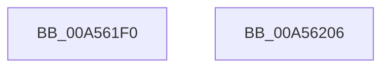

# NtCreateDirectoryObject

- RVA: `0x00A561F0`–`0x00A56207` (길이 `23` bytes)
- VA: `0x0000000140A561F0`
- 실행 섹션: `PAGE`
- PDB 이름 있음: `예`; PDB Function 태그: `아니요`
- unwind 정보 RVA: `0x0005D2F4`
- 디코드: `7`개 명령, `23/23` bytes 표시
- 미해석 바이트: `0` (있으면 어셈블리에 `.byte`로 보존)

> 이 문서는 커널 이미지의 기계어와 PDB 기호를 분석해 생성했습니다. 4번과 5번은 함수 원형과 자료형을 바이너리 사용 방식에서 추정한 C 해석이며 원본 소스 복구 결과는 아닙니다.

## 1. Dependencies

- 직접 호출 지점: **1**; 고유 호출 대상: **1**
- 직접 호출자로 확인된 함수: **5**
- RIP 상대 이미지 참조: **0**

### Outgoing calls
- `0x00A561FC` → [ObpCreateDirectoryObject](ObpCreateDirectoryObject_function_00A56230.md) (function, `0x00A56230`)

### Direct callers
- [CreateSystemRootLink](../../init/C1/CreateSystemRootLink_function_00C1AA18.md) at `0x00C1AAC4`
- [CreateSystemRootLink](../../init/C1/CreateSystemRootLink_function_00C1AA18.md) at `0x00C1AB36`
- [IopCreateRootDirectories](../../init/C2/IopCreateRootDirectories_function_00C2C728.md) at `0x00C2C786`
- [IopCreateRootDirectories](../../init/C2/IopCreateRootDirectories_function_00C2C728.md) at `0x00C2C7B7`
- [IopCreateRootDirectories](../../init/C2/IopCreateRootDirectories_function_00C2C728.md) at `0x00C2C7E8`
- [IopCreateUmdfDirectory](../../init/C2/IopCreateUmdfDirectory_function_00C2C818.md) at `0x00C2C9DC`
- [ExpInitializeCallbacks](../../init/C5/ExpInitializeCallbacks_function_00C532CC.md) at `0x00C533EA`
- [ObInitSystem](../../init/C7/ObInitSystem_function_00C71C7C.md) at `0x00C721D3`

### Static image references
- 디코드된 RIP-relative 메모리 참조가 없습니다.

## 2. Other-region calls and transfers

- 다른 실행 섹션으로 향하는 call: **0**
- 별도 외부 분기/꼬리 이동을 확인하지 못했습니다.

## 3. Assembly (complete function range)

```asm
00A561F0  48 83 EC 38                     sub rsp, 0x38
00A561F4  83 64 24 20 00                  and dword ptr [rsp + 0x20], 0
00A561F9  45 33 C9                        xor r9d, r9d
00A561FC  E8 2F 00 00 00                  call 0x140a56230
00A56201  48 83 C4 38                     add rsp, 0x38
00A56205  C3                              ret
00A56206  CC                              int3
```

## 4. C-style interpretation (structured pseudocode)

```c
__int64 __fastcall NtCreateDirectoryObject(__int64 a1, __int64 a2, __int64 a3, int a4)
{
    __int64 result;
    __int64 v_rsp;
    unsigned int v_stack_m18;

    v_rsp = (v_rsp) - (56);
    a4 = 0;
    result = ObpCreateDirectoryObject(a1, a2, a3, a4);
    v_rsp = (v_rsp) + (56);
    return result;
}
```

## 5. (Beta) C Style

```c
int64_t NtCreateDirectoryObject(int64_t Arg1, int64_t Arg2, int64_t Arg3, int32_t Arg4)
{
    int64_t result;
    int64_t local_rsp;
    uint32_t v_stack_m18;

    local_rsp = (local_rsp) - (56);
    Arg4 = 0;
    result = ObpCreateDirectoryObject(Arg1, Arg2, Arg3, Arg4);
    local_rsp = (local_rsp) + (56);
    return result;
}
```

## 6. Execution-region graph

[열기: 2D/3D 그래프와 함수 탐색 컨트롤 패널](../../../control-panel.html?section=page&rva=0x00A561F0&view=graph)

- 2D 그래프는 위에서 아래로 흐르고, 3D 그래프는 빈 공간을 드래그해 회전합니다. Shift+드래그는 이동, 휠은 확대·축소, 함수 노드 선택은 대상 보고서 이동입니다.

### Static fallback


