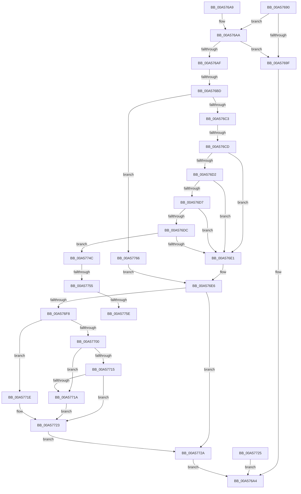

# NtQuerySystemInformationEx

- RVA: `0x00A57690`–`0x00A57770` (길이 `224` bytes)
- VA: `0x0000000140A57690`
- 실행 섹션: `PAGE`
- PDB 이름 있음: `예`; PDB Function 태그: `예`
- unwind 정보 RVA: `0x000B1700`
- 디코드: `60`개 명령, `224/224` bytes 표시
- 미해석 바이트: `0` (있으면 어셈블리에 `.byte`로 보존)

> 이 문서는 커널 이미지의 기계어와 PDB 기호를 분석해 생성했습니다. 4번과 5번은 함수 원형과 자료형을 바이너리 사용 방식에서 추정한 C 해석이며 원본 소스 복구 결과는 아닙니다.

## 1. Dependencies

- 직접 호출 지점: **2**; 고유 호출 대상: **2**
- 직접 호출자로 확인된 함수: **0**
- RIP 상대 이미지 참조: **0**

### Outgoing calls
- `0x00A5771E` → [ExRaiseDatatypeMisalignment](../89/ExRaiseDatatypeMisalignment_function_00899FD0.md) (function, `0x00899FD0`)
- `0x00A57742` → [ExpQuerySystemInformation](ExpQuerySystemInformation_function_00A57858.md) (function, `0x00A57858`)

### Direct callers
- 이 함수 시작 RVA로 연결되는 직접 call은 확인되지 않았습니다. 간접 호출은 완전히 역산할 수 없습니다.

### Static image references
- 디코드된 RIP-relative 메모리 참조가 없습니다.

## 2. Other-region calls and transfers

- 다른 실행 섹션으로 향하는 call: **0**
- call이 아닌 외부 분기/꼬리 이동: **5**
  - `0x00A576B7` → [sub_00B3DA12 + 0x66](../B3/Unknown_function_00B3DA12.md) (`tail-transfer`)
  - `0x00A576C7` → [sub_00B3DA12](../B3/Unknown_function_00B3DA12.md) (`tail-transfer`)
  - `0x00A5774F` → [sub_00B3DA12 + 0x5C](../B3/Unknown_function_00B3DA12.md) (`tail-transfer`)
  - `0x00A57758` → [sub_00B3DA12 + 0x5C](../B3/Unknown_function_00B3DA12.md) (`tail-transfer`)
  - `0x00A57761` → [sub_00B3DA12 + 0x56](../B3/Unknown_function_00B3DA12.md) (`tail-transfer`)

## 3. Assembly (complete function range)

```asm
00A57690  48 83 EC 38                     sub rsp, 0x38
00A57694  4C 8B DA                        mov r11, rdx
00A57697  44 8B D1                        mov r10d, ecx
00A5769A  48 85 D2                        test rdx, rdx
00A5769D  75 0B                           jne 0x140a576aa
00A5769F  B8 0D 00 00 C0                  mov eax, 0xc000000d
00A576A4  48 83 C4 38                     add rsp, 0x38
00A576A8  C3                              ret
00A576A9  CC                              int3
00A576AA  45 85 C0                        test r8d, r8d
00A576AD  74 F0                           je 0x140a5769f
00A576AF  B8 B4 00 00 00                  mov eax, 0xb4
00A576B4  44 3B D0                        cmp r10d, eax
00A576B7  0F 8F BB 63 0E 00               jg 0x140b3da78
00A576BD  0F 84 A3 00 00 00               je 0x140a57766
00A576C3  41 83 FA 6B                     cmp r10d, 0x6b
00A576C7  0F 8E 45 63 0E 00               jle 0x140b3da12
00A576CD  83 E9 6C                        sub ecx, 0x6c
00A576D0  74 0F                           je 0x140a576e1
00A576D2  83 E9 0D                        sub ecx, 0xd
00A576D5  74 0A                           je 0x140a576e1
00A576D7  83 E9 14                        sub ecx, 0x14
00A576DA  74 05                           je 0x140a576e1
00A576DC  83 E9 13                        sub ecx, 0x13
00A576DF  75 6B                           jne 0x140a5774c
00A576E1  BA 02 00 00 00                  mov edx, 2
00A576E6  65 48 8B 04 25 88 01 00 00      mov rax, qword ptr gs:[0x188]
00A576EF  80 B8 32 02 00 00 00            cmp byte ptr [rax + 0x232], 0
00A576F6  74 32                           je 0x140a5772a
00A576F8  8D 4A FF                        lea ecx, [rdx - 1]
00A576FB  49 85 CB                        test r11, rcx
00A576FE  75 1E                           jne 0x140a5771e
00A57700  41 8B C8                        mov ecx, r8d
00A57703  49 03 CB                        add rcx, r11
00A57706  48 B8 00 00 FF FF FF 7F 00 00   movabs rax, 0x7fffffff0000
00A57710  48 3B C8                        cmp rcx, rax
00A57713  77 05                           ja 0x140a5771a
00A57715  49 3B CB                        cmp rcx, r11
00A57718  73 09                           jae 0x140a57723
00A5771A  8A 00                           mov al, byte ptr [rax]
00A5771C  EB 05                           jmp 0x140a57723
00A5771E  E8 AD 28 E4 FF                  call 0x140899fd0
00A57723  EB 05                           jmp 0x140a5772a
00A57725  E9 7A FF FF FF                  jmp 0x140a576a4
00A5772A  48 8B 44 24 68                  mov rax, qword ptr [rsp + 0x68]
00A5772F  48 89 44 24 28                  mov qword ptr [rsp + 0x28], rax
00A57734  8B 44 24 60                     mov eax, dword ptr [rsp + 0x60]
00A57738  89 44 24 20                     mov dword ptr [rsp + 0x20], eax
00A5773C  49 8B D3                        mov rdx, r11
00A5773F  41 8B CA                        mov ecx, r10d
00A57742  E8 11 01 00 00                  call 0x140a57858
00A57747  E9 58 FF FF FF                  jmp 0x140a576a4
00A5774C  83 E9 05                        sub ecx, 5
00A5774F  0F 84 19 63 0E 00               je 0x140b3da6e
00A57755  83 E9 0A                        sub ecx, 0xa
00A57758  0F 84 10 63 0E 00               je 0x140b3da6e
00A5775E  83 F9 03                        cmp ecx, 3
00A57761  E9 02 63 0E 00                  jmp 0x140b3da68
00A57766  BA 04 00 00 00                  mov edx, 4
00A5776B  E9 76 FF FF FF                  jmp 0x140a576e6
```

## 4. C-style interpretation (structured pseudocode)

```c
__int64 __fastcall NtQuerySystemInformationEx(int a1, __int64 a2, int a3, __int64 a4, unsigned int a5, __int64 a6)
{
    __int64 result;
    __int64 v_rsp;
    unsigned int v_stack_p20;
    unsigned __int64 v_stack_p28;

    v_rsp = (v_rsp) - (56);
    if (a2 != 0) goto loc_00A576AA;
loc_00A5769F:
loc_00A576A4:
    v_rsp = (v_rsp) + (56);
    return (unsigned int)(0xC000000DULL);
loc_00A576AA:
    if (a3 == 0) goto loc_00A5769F;
    if (((unsigned int)((unsigned int)(a1))) == 180) goto loc_00A57766;
    a1 = (unsigned int)((a1) - (108));
    if (condition_is_equal) goto loc_00A576E1;
    a1 = (unsigned int)((a1) - (13));
    if (condition_is_equal) goto loc_00A576E1;
    a1 = (unsigned int)((a1) - (20));
    if (condition_is_equal) goto loc_00A576E1;
    a1 = (unsigned int)((a1) - (19));
    if (condition_is_not_equal) goto loc_00A5774C;
loc_00A576E1:
loc_00A576E6:
    if ((*(unsigned __int8 *)(*(unsigned __int64 *)(gs_base + (0 + 392)) + 562)) == 0) goto loc_00A5772A;
    if (((a2) & (2 - 1)) != 0) goto loc_00A5771E;
    a1 = ((unsigned int)(a3)) + (a2);
    if (a1 > (*(unsigned __int64 *)(gs_base + (0 + 392)))) goto loc_00A5771A;
    if (a1 >= a2) goto loc_00A57723;
loc_00A5771A:
    goto loc_00A57723;
loc_00A5771E:
    result = ExRaiseDatatypeMisalignment(a1, 2, a3, a4);
loc_00A57723:
    goto loc_00A5772A;
loc_00A5772A:
    v_stack_p28 = a6;
    v_stack_p20 = (unsigned int)((unsigned int)(a5));
    result = ExpQuerySystemInformation((unsigned int)((unsigned int)((unsigned int)(a1))), a2, a3, a4);
    goto loc_00A576A4;
loc_00A5774C:
    a1 = (unsigned int)(((unsigned int)((unsigned int)((unsigned int)(a1)))) - (5));
    a1 = (unsigned int)((a1) - (10));
loc_00A57766:
    goto loc_00A576E6;
}
```

## 5. (Beta) C Style

```c
int64_t NtQuerySystemInformationEx(int32_t Arg1, int64_t Arg2, int32_t Arg3, int64_t Arg4, uint32_t Arg5, int64_t Arg6)
{
    int64_t result;
    int64_t local_rsp;
    uint32_t v_stack_p20;
    uint64_t v_stack_p28;

    local_rsp = (local_rsp) - (56);
    if (Arg2 != 0) goto loc_00A576AA;
loc_00A5769F:
loc_00A576A4:
    local_rsp = (local_rsp) + (56);
    return (uint32_t)(0xC000000DULL);
loc_00A576AA:
    if (Arg3 == 0) goto loc_00A5769F;
    if (((uint32_t)((uint32_t)(Arg1))) == 180) goto loc_00A57766;
    Arg1 = (uint32_t)((Arg1) - (108));
    if (condition_is_equal) goto loc_00A576E1;
    Arg1 = (uint32_t)((Arg1) - (13));
    if (condition_is_equal) goto loc_00A576E1;
    Arg1 = (uint32_t)((Arg1) - (20));
    if (condition_is_equal) goto loc_00A576E1;
    Arg1 = (uint32_t)((Arg1) - (19));
    if (condition_is_not_equal) goto loc_00A5774C;
loc_00A576E1:
loc_00A576E6:
    if ((*(uint8_t *)(*(uint64_t *)(gs_base + (0 + 0x188)) + 0x232)) == 0) goto loc_00A5772A;
    if (((Arg2) & (2 - 1)) != 0) goto loc_00A5771E;
    Arg1 = ((uint32_t)(Arg3)) + (Arg2);
    if (Arg1 > (*(uint64_t *)(gs_base + (0 + 0x188)))) goto loc_00A5771A;
    if (Arg1 >= Arg2) goto loc_00A57723;
loc_00A5771A:
    goto loc_00A57723;
loc_00A5771E:
    result = ExRaiseDatatypeMisalignment(Arg1, 2, Arg3, Arg4);
loc_00A57723:
    goto loc_00A5772A;
loc_00A5772A:
    v_stack_p28 = Arg6;
    v_stack_p20 = (uint32_t)((uint32_t)(Arg5));
    result = ExpQuerySystemInformation((uint32_t)((uint32_t)((uint32_t)(Arg1))), Arg2, Arg3, Arg4);
    goto loc_00A576A4;
loc_00A5774C:
    Arg1 = (uint32_t)(((uint32_t)((uint32_t)((uint32_t)(Arg1)))) - (5));
    Arg1 = (uint32_t)((Arg1) - (10));
loc_00A57766:
    goto loc_00A576E6;
}
```

## 6. Execution-region graph

[열기: 2D/3D 그래프와 함수 탐색 컨트롤 패널](../../../control-panel.html?section=page&rva=0x00A57690&view=graph)

- 2D 그래프는 위에서 아래로 흐르고, 3D 그래프는 빈 공간을 드래그해 회전합니다. Shift+드래그는 이동, 휠은 확대·축소, 함수 노드 선택은 대상 보고서 이동입니다.

### Static fallback


