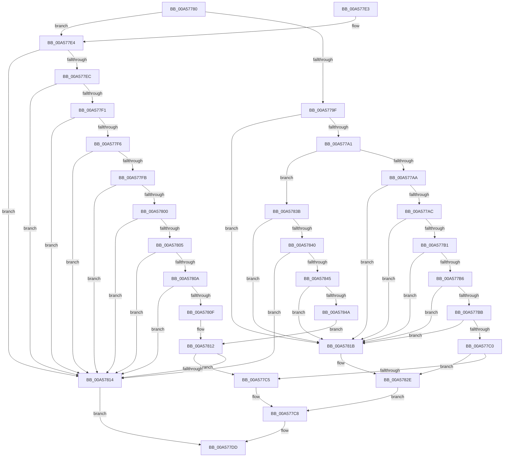

# NtQuerySystemInformation

- RVA: `0x00A57780`–`0x00A5784F` (길이 `207` bytes)
- VA: `0x0000000140A57780`
- 실행 섹션: `PAGE`
- PDB 이름 있음: `예`; PDB Function 태그: `아니요`
- unwind 정보 RVA: `0x000B1734`
- 디코드: `68`개 명령, `207/207` bytes 표시
- 미해석 바이트: `0` (있으면 어셈블리에 `.byte`로 보존)

> 이 문서는 커널 이미지의 기계어와 PDB 기호를 분석해 생성했습니다. 4번과 5번은 함수 원형과 자료형을 바이너리 사용 방식에서 추정한 C 해석이며 원본 소스 복구 결과는 아닙니다.

## 1. Dependencies

- 직접 호출 지점: **2**; 고유 호출 대상: **2**
- 직접 호출자로 확인된 함수: **2**
- RIP 상대 이미지 참조: **0**

### Outgoing calls
- `0x00A577D8` → [ExpQuerySystemInformation](ExpQuerySystemInformation_function_00A57858.md) (function, `0x00A57858`)
- `0x00A57824` → [KeQueryPrimaryGroupThread](../../text/49/KeQueryPrimaryGroupThread_function_004903B4.md) (function, `0x004903B4`)

### Direct callers
- [HalpTimerConfigureQpcBypass](../../text/54/HalpTimerConfigureQpcBypass_function_0054BDAC.md) at `0x0054BDD9`
- [AlpcpInitSystem](../74/AlpcpInitSystem_function_0074CB9C.md) at `0x0074CDD8`

### Static image references
- 디코드된 RIP-relative 메모리 참조가 없습니다.

## 2. Other-region calls and transfers

- 다른 실행 섹션으로 향하는 call: **1**
  - `0x00A57824` → [KeQueryPrimaryGroupThread](../../text/49/KeQueryPrimaryGroupThread_function_004903B4.md) (`PAGE` → `.text`)
- 별도 외부 분기/꼬리 이동을 확인하지 못했습니다.

## 3. Assembly (complete function range)

```asm
00A57780  40 53                           push rbx
00A57782  48 83 EC 30                     sub rsp, 0x30
00A57786  48 8B DA                        mov rbx, rdx
00A57789  B8 8D 00 00 00                  mov eax, 0x8d
00A5778E  33 D2                           xor edx, edx
00A57790  45 8B D8                        mov r11d, r8d
00A57793  66 89 54 24 40                  mov word ptr [rsp + 0x40], dx
00A57798  44 8B D1                        mov r10d, ecx
00A5779B  3B C8                           cmp ecx, eax
00A5779D  7F 45                           jg 0x140a577e4
00A5779F  74 7A                           je 0x140a5781b
00A577A1  83 F9 53                        cmp ecx, 0x53
00A577A4  0F 8F 91 00 00 00               jg 0x140a5783b
00A577AA  74 6F                           je 0x140a5781b
00A577AC  83 F9 17                        cmp ecx, 0x17
00A577AF  74 6A                           je 0x140a5781b
00A577B1  83 F9 08                        cmp ecx, 8
00A577B4  74 65                           je 0x140a5781b
00A577B6  83 F9 2A                        cmp ecx, 0x2a
00A577B9  74 60                           je 0x140a5781b
00A577BB  83 F9 3D                        cmp ecx, 0x3d
00A577BE  74 5B                           je 0x140a5781b
00A577C0  83 F9 49                        cmp ecx, 0x49
00A577C3  74 69                           je 0x140a5782e
00A577C5  44 8B C2                        mov r8d, edx
00A577C8  4C 89 4C 24 28                  mov qword ptr [rsp + 0x28], r9
00A577CD  41 8B CA                        mov ecx, r10d
00A577D0  4C 8B CB                        mov r9, rbx
00A577D3  44 89 5C 24 20                  mov dword ptr [rsp + 0x20], r11d
00A577D8  E8 7B 00 00 00                  call 0x140a57858
00A577DD  48 83 C4 30                     add rsp, 0x30
00A577E1  5B                              pop rbx
00A577E2  C3                              ret
00A577E3  CC                              int3
00A577E4  81 E9 B4 00 00 00               sub ecx, 0xb4
00A577EA  74 28                           je 0x140a57814
00A577EC  83 E9 1E                        sub ecx, 0x1e
00A577EF  74 23                           je 0x140a57814
00A577F1  83 E9 01                        sub ecx, 1
00A577F4  74 1E                           je 0x140a57814
00A577F6  83 E9 0B                        sub ecx, 0xb
00A577F9  74 19                           je 0x140a57814
00A577FB  83 E9 09                        sub ecx, 9
00A577FE  74 14                           je 0x140a57814
00A57800  83 E9 07                        sub ecx, 7
00A57803  74 0F                           je 0x140a57814
00A57805  83 E9 01                        sub ecx, 1
00A57808  74 0A                           je 0x140a57814
00A5780A  83 E9 01                        sub ecx, 1
00A5780D  74 05                           je 0x140a57814
00A5780F  83 F9 0E                        cmp ecx, 0xe
00A57812  75 B1                           jne 0x140a577c5
00A57814  B8 03 00 00 C0                  mov eax, 0xc0000003
00A57819  EB C2                           jmp 0x140a577dd
00A5781B  65 48 8B 0C 25 88 01 00 00      mov rcx, qword ptr gs:[0x188]
00A57824  E8 8B 8B A3 FF                  call 0x1404903b4
00A57829  66 89 44 24 40                  mov word ptr [rsp + 0x40], ax
00A5782E  48 8D 54 24 40                  lea rdx, [rsp + 0x40]
00A57833  41 B8 02 00 00 00               mov r8d, 2
00A57839  EB 8D                           jmp 0x140a577c8
00A5783B  83 E9 64                        sub ecx, 0x64
00A5783E  74 DB                           je 0x140a5781b
00A57840  83 E9 07                        sub ecx, 7
00A57843  74 CF                           je 0x140a57814
00A57845  83 E9 01                        sub ecx, 1
00A57848  74 D1                           je 0x140a5781b
00A5784A  83 F9 0D                        cmp ecx, 0xd
00A5784D  EB C3                           jmp 0x140a57812
```

## 4. C-style interpretation (structured pseudocode)

```c
__int64 __fastcall NtQuerySystemInformation(int a1, __int64 a2, int a3, __int64 a4)
{
    __int64 result;
    __int64 v_rsp;
    unsigned __int64 v_stack_m10;
    unsigned int v_stack_m18;
    unsigned __int16 v_stack_p40;
    unsigned __int16 v_stack_p8;

    v_rsp = (v_rsp) - (48);
    a2 = 0;
    v_stack_p8 = 0;
    if (a1 > 141) goto loc_00A577E4;
    if (a1 == 141) goto loc_00A5781B;
    if (a1 > 83) goto loc_00A5783B;
    if (a1 == 83) goto loc_00A5781B;
    if (a1 == 23) goto loc_00A5781B;
    if (a1 == 8) goto loc_00A5781B;
    if (a1 == 42) goto loc_00A5781B;
    if (a1 == 61) goto loc_00A5781B;
    if (a1 == 73) goto loc_00A5782E;
loc_00A577C5:
loc_00A577C8:
    v_stack_m10 = a4;
    v_stack_m18 = (unsigned int)((unsigned int)(a3));
    result = ExpQuerySystemInformation((unsigned int)((unsigned int)((unsigned int)(a1))), a2, 0, 0);
loc_00A577DD:
    v_rsp = (v_rsp) + (48);
    return result;
loc_00A577E4:
    a1 = (unsigned int)(((unsigned int)((unsigned int)((unsigned int)(a1)))) - (180));
    if (condition_is_equal) goto loc_00A57814;
    a1 = (unsigned int)((a1) - (30));
    if (condition_is_equal) goto loc_00A57814;
    a1 = (unsigned int)((a1) - (1));
    if (condition_is_equal) goto loc_00A57814;
    a1 = (unsigned int)((a1) - (11));
    if (condition_is_equal) goto loc_00A57814;
    a1 = (unsigned int)((a1) - (9));
    if (condition_is_equal) goto loc_00A57814;
    a1 = (unsigned int)((a1) - (7));
    if (condition_is_equal) goto loc_00A57814;
    a1 = (unsigned int)((a1) - (1));
    if (condition_is_equal) goto loc_00A57814;
    a1 = (unsigned int)((a1) - (1));
    if (condition_is_equal) goto loc_00A57814;
loc_00A57812:
    if (a1 != 14) goto loc_00A577C5;
loc_00A57814:
    goto loc_00A577DD;
loc_00A5781B:
    result = KeQueryPrimaryGroupThread(*(unsigned __int64 *)(gs_base + (0 + 392)), a2, 0, 0);
    v_stack_p40 = (unsigned __int16)(result);
loc_00A5782E:
    goto loc_00A577C8;
loc_00A5783B:
    a1 = (unsigned int)((*(unsigned __int64 *)(gs_base + (0 + 392))) - (100));
    if (condition_is_equal) goto loc_00A5781B;
    a1 = (unsigned int)((a1) - (7));
    if (condition_is_equal) goto loc_00A57814;
    a1 = (unsigned int)((a1) - (1));
    if (condition_is_equal) goto loc_00A5781B;
    goto loc_00A57812;
}
```

## 5. (Beta) C Style

```c
int64_t NtQuerySystemInformation(int32_t Arg1, int64_t Arg2, int32_t Arg3, int64_t Arg4)
{
    int64_t result;
    int64_t local_rsp;
    uint64_t v_stack_m10;
    uint32_t v_stack_m18;
    uint16_t v_stack_p40;
    uint16_t v_stack_p8;

    local_rsp = (local_rsp) - (48);
    Arg2 = 0;
    v_stack_p8 = 0;
    if (Arg1 > 141) goto loc_00A577E4;
    if (Arg1 == 141) goto loc_00A5781B;
    if (Arg1 > 83) goto loc_00A5783B;
    if (Arg1 == 83) goto loc_00A5781B;
    if (Arg1 == 23) goto loc_00A5781B;
    if (Arg1 == 8) goto loc_00A5781B;
    if (Arg1 == 42) goto loc_00A5781B;
    if (Arg1 == 61) goto loc_00A5781B;
    if (Arg1 == 73) goto loc_00A5782E;
loc_00A577C5:
loc_00A577C8:
    v_stack_m10 = Arg4;
    v_stack_m18 = (uint32_t)((uint32_t)(Arg3));
    result = ExpQuerySystemInformation((uint32_t)((uint32_t)((uint32_t)(Arg1))), Arg2, 0, 0);
loc_00A577DD:
    local_rsp = (local_rsp) + (48);
    return result;
loc_00A577E4:
    Arg1 = (uint32_t)(((uint32_t)((uint32_t)((uint32_t)(Arg1)))) - (180));
    if (condition_is_equal) goto loc_00A57814;
    Arg1 = (uint32_t)((Arg1) - (30));
    if (condition_is_equal) goto loc_00A57814;
    Arg1 = (uint32_t)((Arg1) - (1));
    if (condition_is_equal) goto loc_00A57814;
    Arg1 = (uint32_t)((Arg1) - (11));
    if (condition_is_equal) goto loc_00A57814;
    Arg1 = (uint32_t)((Arg1) - (9));
    if (condition_is_equal) goto loc_00A57814;
    Arg1 = (uint32_t)((Arg1) - (7));
    if (condition_is_equal) goto loc_00A57814;
    Arg1 = (uint32_t)((Arg1) - (1));
    if (condition_is_equal) goto loc_00A57814;
    Arg1 = (uint32_t)((Arg1) - (1));
    if (condition_is_equal) goto loc_00A57814;
loc_00A57812:
    if (Arg1 != 14) goto loc_00A577C5;
loc_00A57814:
    goto loc_00A577DD;
loc_00A5781B:
    result = KeQueryPrimaryGroupThread(*(uint64_t *)(gs_base + (0 + 0x188)), Arg2, 0, 0);
    v_stack_p40 = (uint16_t)(result);
loc_00A5782E:
    goto loc_00A577C8;
loc_00A5783B:
    Arg1 = (uint32_t)((*(uint64_t *)(gs_base + (0 + 0x188))) - (100));
    if (condition_is_equal) goto loc_00A5781B;
    Arg1 = (uint32_t)((Arg1) - (7));
    if (condition_is_equal) goto loc_00A57814;
    Arg1 = (uint32_t)((Arg1) - (1));
    if (condition_is_equal) goto loc_00A5781B;
    goto loc_00A57812;
}
```

## 6. Execution-region graph

[열기: 2D/3D 그래프와 함수 탐색 컨트롤 패널](../../../control-panel.html?section=page&rva=0x00A57780&view=graph)

- 2D 그래프는 위에서 아래로 흐르고, 3D 그래프는 빈 공간을 드래그해 회전합니다. Shift+드래그는 이동, 휠은 확대·축소, 함수 노드 선택은 대상 보고서 이동입니다.

### Static fallback


