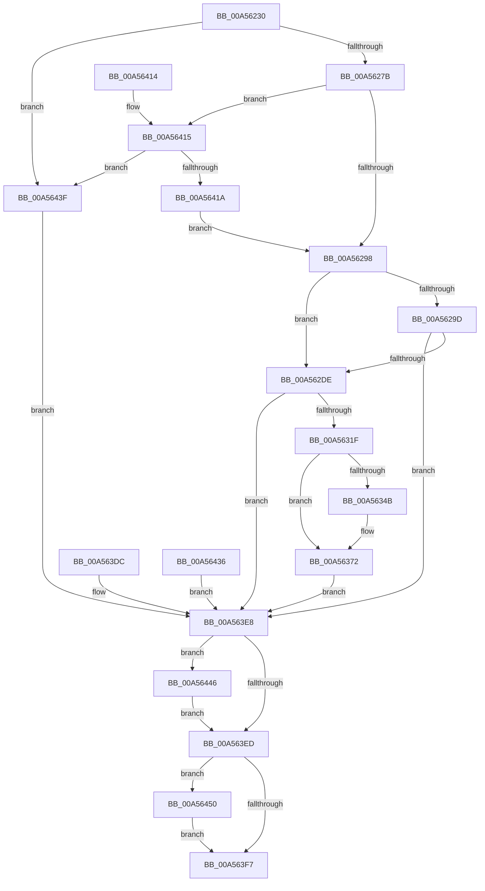

# ObpCreateDirectoryObject

- RVA: `0x00A56230`–`0x00A56457` (길이 `551` bytes)
- VA: `0x0000000140A56230`
- 실행 섹션: `PAGE`
- PDB 이름 있음: `예`; PDB Function 태그: `아니요`
- unwind 정보 RVA: `0x000B13C0`
- 디코드: `134`개 명령, `551/551` bytes 표시
- 미해석 바이트: `0` (있으면 어셈블리에 `.byte`로 보존)

> 이 문서는 커널 이미지의 기계어와 PDB 기호를 분석해 생성했습니다. 4번과 5번은 함수 원형과 자료형을 바이너리 사용 방식에서 추정한 C 해석이며 원본 소스 복구 결과는 아닙니다.

## 1. Dependencies

- 직접 호출 지점: **7**; 고유 호출 대상: **6**
- 직접 호출자로 확인된 함수: **2**
- RIP 상대 이미지 참조: **1**

### Outgoing calls
- `0x00A562C5` → [ObReferenceObjectByHandle](../86/ObReferenceObjectByHandle_function_00868DB0.md) (function, `0x00868DB0`)
- `0x00A56310` → [ObCreateObjectEx](../89/ObCreateObjectEx_function_0089B1E0.md) (function, `0x0089B1E0`)
- `0x00A5632F` → [memset](../../text/6C/memset_function_006C6C40.md) (function, `0x006C6C40`)
- `0x00A56364` → [RtlIsSandboxedToken](../8B/RtlIsSandboxedToken_function_008B3AB0.md) (function, `0x008B3AB0`)
- `0x00A563BA` → [ObInsertObjectEx](../8B/ObInsertObjectEx_function_008B97A0.md) (function, `0x008B97A0`)
- `0x00A56449` → [ObfDereferenceObject](../../text/2F/ObfDereferenceObject_function_002F9350.md) (function, `0x002F9350`)
- `0x00A56450` → [ObfDereferenceObject](../../text/2F/ObfDereferenceObject_function_002F9350.md) (function, `0x002F9350`)

### Direct callers
- [NtCreateDirectoryObject](NtCreateDirectoryObject_function_00A561F0.md) at `0x00A561FC`
- [NtCreateDirectoryObjectEx](NtCreateDirectoryObjectEx_function_00A56210.md) at `0x00A5621C`

### Static image references
- `0x00A5629D` → RVA `0x00F0F650` (`.data`; read)

## 2. Other-region calls and transfers

- 다른 실행 섹션으로 향하는 call: **3**
  - `0x00A5632F` → [memset](../../text/6C/memset_function_006C6C40.md) (`PAGE` → `.text`)
  - `0x00A56449` → [ObfDereferenceObject](../../text/2F/ObfDereferenceObject_function_002F9350.md) (`PAGE` → `.text`)
  - `0x00A56450` → [ObfDereferenceObject](../../text/2F/ObfDereferenceObject_function_002F9350.md) (`PAGE` → `.text`)
- 별도 외부 분기/꼬리 이동을 확인하지 못했습니다.

## 3. Assembly (complete function range)

```asm
00A56230  48 8B C4                        mov rax, rsp
00A56233  48 89 70 08                     mov qword ptr [rax + 8], rsi
00A56237  48 89 78 18                     mov qword ptr [rax + 0x18], rdi
00A5623B  4C 89 60 20                     mov qword ptr [rax + 0x20], r12
00A5623F  89 50 10                        mov dword ptr [rax + 0x10], edx
00A56242  41 55                           push r13
00A56244  41 56                           push r14
00A56246  41 57                           push r15
00A56248  48 83 EC 70                     sub rsp, 0x70
00A5624C  4D 8B D1                        mov r10, r9
00A5624F  4D 8B E0                        mov r12, r8
00A56252  4C 8B E9                        mov r13, rcx
00A56255  48 83 60 D8 00                  and qword ptr [rax - 0x28], 0
00A5625A  48 83 60 D0 00                  and qword ptr [rax - 0x30], 0
00A5625F  33 F6                           xor esi, esi
00A56261  48 89 74 24 50                  mov qword ptr [rsp + 0x50], rsi
00A56266  44 8B B4 24 B0 00 00 00         mov r14d, dword ptr [rsp + 0xb0]
00A5626E  41 F7 C6 FC FF FF FF            test r14d, 0xfffffffc
00A56275  0F 85 C4 01 00 00               jne 0x140a5643f
00A5627B  65 48 8B 04 25 88 01 00 00      mov rax, qword ptr gs:[0x188]
00A56284  44 8A B8 32 02 00 00            mov r15b, byte ptr [rax + 0x232]
00A5628B  41 83 E6 02                     and r14d, 2
00A5628F  45 84 FF                        test r15b, r15b
00A56292  0F 85 7D 01 00 00               jne 0x140a56415
00A56298  4D 85 D2                        test r10, r10
00A5629B  74 41                           je 0x140a562de
00A5629D  4C 8B 05 AC 93 4B 00            mov r8, qword ptr [rip + 0x4b93ac]
00A562A4  48 83 64 24 50 00               and qword ptr [rsp + 0x50], 0
00A562AA  48 83 64 24 28 00               and qword ptr [rsp + 0x28], 0
00A562B0  48 8D 44 24 50                  lea rax, [rsp + 0x50]
00A562B5  48 89 44 24 20                  mov qword ptr [rsp + 0x20], rax
00A562BA  45 8A CF                        mov r9b, r15b
00A562BD  BA 03 00 00 00                  mov edx, 3
00A562C2  49 8B CA                        mov rcx, r10
00A562C5  E8 E6 2A E1 FF                  call 0x140868db0
00A562CA  8B F8                           mov edi, eax
00A562CC  48 8B 74 24 50                  mov rsi, qword ptr [rsp + 0x50]
00A562D1  48 89 74 24 50                  mov qword ptr [rsp + 0x50], rsi
00A562D6  85 C0                           test eax, eax
00A562D8  0F 88 0A 01 00 00               js 0x140a563e8
00A562DE  48 8B 15 6B 93 4B 00            mov rdx, qword ptr [rip + 0x4b936b]
00A562E5  48 83 64 24 48 00               and qword ptr [rsp + 0x48], 0
00A562EB  48 8D 44 24 58                  lea rax, [rsp + 0x58]
00A562F0  48 89 44 24 40                  mov qword ptr [rsp + 0x40], rax
00A562F5  83 64 24 38 00                  and dword ptr [rsp + 0x38], 0
00A562FA  83 64 24 30 00                  and dword ptr [rsp + 0x30], 0
00A562FF  C7 44 24 28 58 01 00 00         mov dword ptr [rsp + 0x28], 0x158
00A56307  45 8A CF                        mov r9b, r15b
00A5630A  4D 8B C4                        mov r8, r12
00A5630D  41 8A CF                        mov cl, r15b
00A56310  E8 CB 4E E4 FF                  call 0x14089b1e0
00A56315  8B F8                           mov edi, eax
00A56317  85 C0                           test eax, eax
00A56319  0F 88 C9 00 00 00               js 0x140a563e8
00A5631F  33 D2                           xor edx, edx
00A56321  41 B8 58 01 00 00               mov r8d, 0x158
00A56327  48 8B 7C 24 58                  mov rdi, qword ptr [rsp + 0x58]
00A5632C  48 8B CF                        mov rcx, rdi
00A5632F  E8 0C 09 C7 FF                  call 0x1406c6c40
00A56334  48 83 A7 28 01 00 00 00         and qword ptr [rdi + 0x128], 0
00A5633C  83 8F 54 01 00 00 FF            or dword ptr [rdi + 0x154], 0xffffffff
00A56343  45 33 E4                        xor r12d, r12d
00A56346  48 85 F6                        test rsi, rsi
00A56349  74 27                           je 0x140a56372
00A5634B  41 BC 04 00 00 00               mov r12d, 4
00A56351  48 89 B7 38 01 00 00            mov qword ptr [rdi + 0x138], rsi
00A56358  33 F6                           xor esi, esi
00A5635A  48 89 74 24 50                  mov qword ptr [rsp + 0x50], rsi
00A5635F  41 8A D7                        mov dl, r15b
00A56362  33 C9                           xor ecx, ecx
00A56364  E8 47 D7 E5 FF                  call 0x1408b3ab0
00A56369  8D 4E 14                        lea ecx, [rsi + 0x14]
00A5636C  84 C0                           test al, al
00A5636E  44 0F 45 E1                     cmovne r12d, ecx
00A56372  41 8B D4                        mov edx, r12d
00A56375  83 CA 08                        or edx, 8
00A56378  F6 84 24 B0 00 00 00 01         test byte ptr [rsp + 0xb0], 1
00A56380  41 0F 44 D4                     cmove edx, r12d
00A56384  8B C2                           mov eax, edx
00A56386  83 C8 20                        or eax, 0x20
00A56389  45 85 F6                        test r14d, r14d
00A5638C  0F 44 C2                        cmove eax, edx
00A5638F  09 87 50 01 00 00               or dword ptr [rdi + 0x150], eax
00A56395  48 8D 44 24 60                  lea rax, [rsp + 0x60]
00A5639A  48 89 44 24 30                  mov qword ptr [rsp + 0x30], rax
00A5639F  48 83 64 24 28 00               and qword ptr [rsp + 0x28], 0
00A563A5  83 64 24 20 00                  and dword ptr [rsp + 0x20], 0
00A563AA  45 33 C9                        xor r9d, r9d
00A563AD  44 8B 84 24 98 00 00 00         mov r8d, dword ptr [rsp + 0x98]
00A563B5  33 D2                           xor edx, edx
00A563B7  48 8B CF                        mov rcx, rdi
00A563BA  E8 E1 33 E6 FF                  call 0x1408b97a0
00A563BF  8B F8                           mov edi, eax
00A563C1  89 84 24 B0 00 00 00            mov dword ptr [rsp + 0xb0], eax
00A563C8  48 C7 44 24 58 00 00 00 00      mov qword ptr [rsp + 0x58], 0
00A563D1  48 8B 44 24 60                  mov rax, qword ptr [rsp + 0x60]
00A563D6  49 89 45 00                     mov qword ptr [r13], rax
00A563DA  EB 0C                           jmp 0x140a563e8
00A563DC  48 8B 74 24 50                  mov rsi, qword ptr [rsp + 0x50]
00A563E1  8B BC 24 B0 00 00 00            mov edi, dword ptr [rsp + 0xb0]
00A563E8  48 85 F6                        test rsi, rsi
00A563EB  75 59                           jne 0x140a56446
00A563ED  48 8B 4C 24 58                  mov rcx, qword ptr [rsp + 0x58]
00A563F2  48 85 C9                        test rcx, rcx
00A563F5  75 59                           jne 0x140a56450
00A563F7  8B C7                           mov eax, edi
00A563F9  4C 8D 5C 24 70                  lea r11, [rsp + 0x70]
00A563FE  49 8B 73 20                     mov rsi, qword ptr [r11 + 0x20]
00A56402  49 8B 7B 30                     mov rdi, qword ptr [r11 + 0x30]
00A56406  4D 8B 63 38                     mov r12, qword ptr [r11 + 0x38]
00A5640A  49 8B E3                        mov rsp, r11
00A5640D  41 5F                           pop r15
00A5640F  41 5E                           pop r14
00A56411  41 5D                           pop r13
00A56413  C3                              ret
00A56414  CC                              int3
00A56415  45 85 F6                        test r14d, r14d
00A56418  75 25                           jne 0x140a5643f
00A5641A  48 B9 00 00 FF FF FF 7F 00 00   movabs rcx, 0x7fffffff0000
00A56424  4C 3B E9                        cmp r13, rcx
00A56427  49 0F 42 CD                     cmovb rcx, r13
00A5642B  48 8B 01                        mov rax, qword ptr [rcx]
00A5642E  48 89 01                        mov qword ptr [rcx], rax
00A56431  E9 62 FE FF FF                  jmp 0x140a56298
00A56436  8B F8                           mov edi, eax
00A56438  48 8B 74 24 50                  mov rsi, qword ptr [rsp + 0x50]
00A5643D  EB A9                           jmp 0x140a563e8
00A5643F  BF F3 00 00 C0                  mov edi, 0xc00000f3
00A56444  EB A2                           jmp 0x140a563e8
00A56446  48 8B CE                        mov rcx, rsi
00A56449  E8 02 2F 8A FF                  call 0x1402f9350
00A5644E  EB 9D                           jmp 0x140a563ed
00A56450  E8 FB 2E 8A FF                  call 0x1402f9350
00A56455  EB A0                           jmp 0x140a563f7
```

## 4. C-style interpretation (structured pseudocode)

```c
__int64 __fastcall ObpCreateDirectoryObject(__int64 a1, int a2, __int64 a3, __int64 a4, unsigned __int8 a5)
{
    __int64 result;
    __int64 v_r12;
    __int64 v_r14;
    __int64 v_rsi;
    __int64 v_rsp;
    unsigned __int64 v_stack_m18;
    unsigned __int64 v_stack_m20;
    unsigned __int64 v_stack_m28;
    unsigned __int64 v_stack_m30;
    unsigned __int64 v_stack_m38;
    unsigned __int64 v_stack_m40;
    unsigned __int64 v_stack_m48;
    unsigned int v_stack_m50;
    unsigned int v_stack_m58;
    unsigned __int64 v_stack_m60;
    unsigned __int64 v_stack_m68;
    unsigned int v_stack_p10;
    unsigned int v_stack_p28;

    *(unsigned __int64 *)(v_rsp + 8) = v_rsi;
    *(unsigned __int64 *)(v_rsp + 24) = v_rdi;
    *(unsigned __int64 *)(v_rsp + 32) = v_r12;
    *(unsigned int *)(v_rsp + 16) = a2;
    v_rsp = (v_rsp) - (112);
    v_rsi = 0;
    v_stack_m38 = 0;
    if ((((unsigned int)((unsigned int)(a5))) & (0xFFFFFFFCULL)) != 0) goto loc_00A5643F;
    v_r14 = (unsigned int)(((unsigned int)(a5)) & (2));
    if ((unsigned __int8)(*(unsigned __int8 *)(*(unsigned __int64 *)(gs_base + (0 + 392)) + 562)) != 0) goto loc_00A56415;
loc_00A56298:
    if (a4 == 0) goto loc_00A562DE;
    v_stack_m68 = v_stack_m38;
    result = ObReferenceObjectByHandle(a4, 3, *(unsigned __int64 *)(v_rip + 4953004), (unsigned __int8)(*(unsigned __int8 *)(*(unsigned __int64 *)(gs_base + (0 + 392)) + 562)));
    v_stack_m38 = v_stack_m38;
    if (sign_flag) goto loc_00A563E8;
loc_00A562DE:
    v_stack_m48 = v_stack_m30;
    v_stack_m60 = 344;
    result = ObCreateObjectEx((unsigned __int8)(*(unsigned __int8 *)(*(unsigned __int64 *)(gs_base + (0 + 392)) + 562)), *(unsigned __int64 *)(v_rip + 4952939), a3, (unsigned __int8)(*(unsigned __int8 *)(*(unsigned __int64 *)(gs_base + (0 + 392)) + 562)));
    if (sign_flag) goto loc_00A563E8;
    a2 = 0;
    result = memset(v_stack_m30, a2, 344, (unsigned __int8)(*(unsigned __int8 *)(*(unsigned __int64 *)(gs_base + (0 + 392)) + 562)));
    v_r12 = 0;
    v_rsi = v_stack_m38;
    if (v_stack_m38 != 0) {
        v_r12 = 4;
        *(unsigned __int64 *)(v_stack_m30 + 312) = v_stack_m38;
        v_rsi = 0;
        v_stack_m38 = 0;
        a2 = (unsigned __int8)(*(unsigned __int8 *)(*(unsigned __int64 *)(gs_base + (0 + 392)) + 562));
        a1 = 0;
        result = RtlIsSandboxedToken(a1, a2, 344, (unsigned __int8)(*(unsigned __int8 *)(*(unsigned __int64 *)(gs_base + (0 + 392)) + 562)));
        a1 = v_rsi + 20;
        if ((unsigned __int8)(result) != 0) { v_r12 = (unsigned int)(a1); }
    }
    a2 = (unsigned int)(((unsigned int)((unsigned int)(v_r12))) | (8));
    if (((a5) & (1)) == 0) { a2 = (unsigned int)(v_r12); }
    result = (unsigned int)(((unsigned int)(a2)) | (32));
    if ((unsigned int)(v_r14) == 0) { result = a2; }
    v_stack_m58 = v_stack_m28;
    a4 = 0;
    a2 = 0;
    result = ObInsertObjectEx(v_stack_m30, a2, (unsigned int)(v_stack_p10), a4);
    v_stack_p28 = (unsigned int)(result);
    v_stack_m30 = 0;
    *(unsigned __int64 *)(a1) = v_stack_m28;
    goto loc_00A563E8;
loc_00A563E8:
    if (0 != 0) goto loc_00A56446;
loc_00A563ED:
    if (v_stack_m30 != 0) goto loc_00A56450;
loc_00A563F7:
    return (unsigned int)((unsigned int)((unsigned int)((unsigned int)(result))));
loc_00A56415:
    if ((unsigned int)(v_r14) != 0) goto loc_00A5643F;
    a1 = v_stack_m30;
    if (a1 < v_stack_m30) { a1 = a1; }
    *(unsigned __int64 *)(a1) = *(unsigned __int64 *)(a1);
    goto loc_00A56298;
loc_00A5643F:
    goto loc_00A563E8;
loc_00A56446:
    result = ObfDereferenceObject(*(unsigned __int64 *)(v_stack_m18 + 32), a2, (unsigned int)(v_stack_p10), a4);
    goto loc_00A563ED;
loc_00A56450:
    result = ObfDereferenceObject(*(unsigned __int64 *)(v_stack_m18 + 32), a2, (unsigned int)(v_stack_p10), a4);
    goto loc_00A563F7;
}
```

## 5. (Beta) C Style

```c
int64_t ObpCreateDirectoryObject(int64_t Arg1, int32_t Arg2, int64_t Arg3, int64_t Arg4, uint8_t Arg5)
{
    int64_t result;
    int64_t local_r12;
    int64_t local_r14;
    int64_t local_rsi;
    int64_t local_rsp;
    uint64_t v_stack_m18;
    uint64_t v_stack_m20;
    uint64_t v_stack_m28;
    uint64_t v_stack_m30;
    uint64_t v_stack_m38;
    uint64_t v_stack_m40;
    uint64_t v_stack_m48;
    uint32_t v_stack_m50;
    uint32_t v_stack_m58;
    uint64_t v_stack_m60;
    uint64_t v_stack_m68;
    uint32_t v_stack_p10;
    uint32_t v_stack_p28;

    *(uint64_t *)(local_rsp + 0x8) = local_rsi;
    *(uint64_t *)(local_rsp + 0x18) = local_rdi;
    *(uint64_t *)(local_rsp + 0x20) = local_r12;
    *(uint32_t *)(local_rsp + 0x10) = Arg2;
    local_rsp = (local_rsp) - (112);
    local_rsi = 0;
    v_stack_m38 = 0;
    if ((((uint32_t)((uint32_t)(Arg5))) & (0xFFFFFFFCULL)) != 0) goto loc_00A5643F;
    local_r14 = (uint32_t)(((uint32_t)(Arg5)) & (2));
    if ((uint8_t)(*(uint8_t *)(*(uint64_t *)(gs_base + (0 + 0x188)) + 0x232)) != 0) goto loc_00A56415;
loc_00A56298:
    if (Arg4 == 0) goto loc_00A562DE;
    v_stack_m68 = v_stack_m38;
    result = ObReferenceObjectByHandle(Arg4, 3, *(uint64_t *)(v_rip + 0x4B93AC), (uint8_t)(*(uint8_t *)(*(uint64_t *)(gs_base + (0 + 0x188)) + 0x232)));
    v_stack_m38 = v_stack_m38;
    if (sign_flag) goto loc_00A563E8;
loc_00A562DE:
    v_stack_m48 = v_stack_m30;
    v_stack_m60 = 344;
    result = ObCreateObjectEx((uint8_t)(*(uint8_t *)(*(uint64_t *)(gs_base + (0 + 0x188)) + 0x232)), *(uint64_t *)(v_rip + 0x4B936B), Arg3, (uint8_t)(*(uint8_t *)(*(uint64_t *)(gs_base + (0 + 0x188)) + 0x232)));
    if (sign_flag) goto loc_00A563E8;
    Arg2 = 0;
    result = memset(v_stack_m30, Arg2, 344, (uint8_t)(*(uint8_t *)(*(uint64_t *)(gs_base + (0 + 0x188)) + 0x232)));
    local_r12 = 0;
    local_rsi = v_stack_m38;
    if (v_stack_m38 != 0) {
        local_r12 = 4;
        *(uint64_t *)(v_stack_m30 + 0x138) = v_stack_m38;
        local_rsi = 0;
        v_stack_m38 = 0;
        Arg2 = (uint8_t)(*(uint8_t *)(*(uint64_t *)(gs_base + (0 + 0x188)) + 0x232));
        Arg1 = 0;
        result = RtlIsSandboxedToken(Arg1, Arg2, 344, (uint8_t)(*(uint8_t *)(*(uint64_t *)(gs_base + (0 + 0x188)) + 0x232)));
        Arg1 = local_rsi + 20;
        if ((uint8_t)(result) != 0) { local_r12 = (uint32_t)(Arg1); }
    }
    Arg2 = (uint32_t)(((uint32_t)((uint32_t)(local_r12))) | (8));
    if (((Arg5) & (1)) == 0) { Arg2 = (uint32_t)(local_r12); }
    result = (uint32_t)(((uint32_t)(Arg2)) | (32));
    if ((uint32_t)(local_r14) == 0) { result = Arg2; }
    v_stack_m58 = v_stack_m28;
    Arg4 = 0;
    Arg2 = 0;
    result = ObInsertObjectEx(v_stack_m30, Arg2, (uint32_t)(v_stack_p10), Arg4);
    v_stack_p28 = (uint32_t)(result);
    v_stack_m30 = 0;
    *(uint64_t *)(Arg1) = v_stack_m28;
    goto loc_00A563E8;
loc_00A563E8:
    if (0 != 0) goto loc_00A56446;
loc_00A563ED:
    if (v_stack_m30 != 0) goto loc_00A56450;
loc_00A563F7:
    return (uint32_t)((uint32_t)((uint32_t)((uint32_t)(result))));
loc_00A56415:
    if ((uint32_t)(local_r14) != 0) goto loc_00A5643F;
    Arg1 = v_stack_m30;
    if (Arg1 < v_stack_m30) { Arg1 = Arg1; }
    *(uint64_t *)(Arg1) = *(uint64_t *)(Arg1);
    goto loc_00A56298;
loc_00A5643F:
    goto loc_00A563E8;
loc_00A56446:
    result = ObfDereferenceObject(*(uint64_t *)(v_stack_m18 + 0x20), Arg2, (uint32_t)(v_stack_p10), Arg4);
    goto loc_00A563ED;
loc_00A56450:
    result = ObfDereferenceObject(*(uint64_t *)(v_stack_m18 + 0x20), Arg2, (uint32_t)(v_stack_p10), Arg4);
    goto loc_00A563F7;
}
```

## 6. Execution-region graph

[열기: 2D/3D 그래프와 함수 탐색 컨트롤 패널](../../../control-panel.html?section=page&rva=0x00A56230&view=graph)

- 2D 그래프는 위에서 아래로 흐르고, 3D 그래프는 빈 공간을 드래그해 회전합니다. Shift+드래그는 이동, 휠은 확대·축소, 함수 노드 선택은 대상 보고서 이동입니다.

### Static fallback


