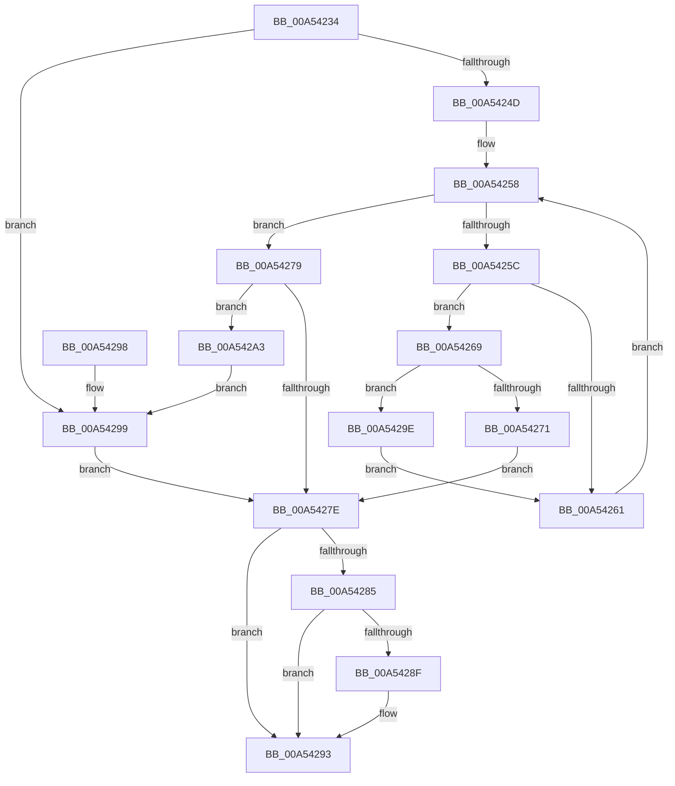

# ObpUnlockHandleDatabaseEntry

- RVA: `0x00A54234`–`0x00A542A8` (길이 `116` bytes)
- VA: `0x0000000140A54234`
- 실행 섹션: `PAGE`
- PDB 이름 있음: `예`; PDB Function 태그: `아니요`
- unwind 정보 RVA: `0x0005D35C`
- 디코드: `40`개 명령, `116/116` bytes 표시
- 미해석 바이트: `0` (있으면 어셈블리에 `.byte`로 보존)

> 이 문서는 커널 이미지의 기계어와 PDB 기호를 분석해 생성했습니다. 4번과 5번은 함수 원형과 자료형을 바이너리 사용 방식에서 추정한 C 해석이며 원본 소스 복구 결과는 아닙니다.

## 1. Dependencies

- 직접 호출 지점: **1**; 고유 호출 대상: **1**
- 직접 호출자로 확인된 함수: **1**
- RIP 상대 이미지 참조: **0**

### Outgoing calls
- `0x00A5423E` → [OBJECT_HEADER_TO_HANDLE_INFO](../../text/41/OBJECT_HEADER_TO_HANDLE_INFO_function_0041B570.md) (function, `0x0041B570`)

### Direct callers
- [ObpIncrementHandleCountEx](../86/ObpIncrementHandleCountEx_function_0086DA10.md) at `0x0086E093`

### Static image references
- 디코드된 RIP-relative 메모리 참조가 없습니다.

## 2. Other-region calls and transfers

- 다른 실행 섹션으로 향하는 call: **1**
  - `0x00A5423E` → [OBJECT_HEADER_TO_HANDLE_INFO](../../text/41/OBJECT_HEADER_TO_HANDLE_INFO_function_0041B570.md) (`PAGE` → `.text`)
- 별도 외부 분기/꼬리 이동을 확인하지 못했습니다.

## 3. Assembly (complete function range)

```asm
00A54234  48 83 EC 28                     sub rsp, 0x28
00A54238  4C 8B D2                        mov r10, rdx
00A5423B  4C 8B C1                        mov r8, rcx
00A5423E  E8 2D 73 9C FF                  call 0x14041b570
00A54243  41 F6 40 1B 40                  test byte ptr [r8 + 0x1b], 0x40
00A54248  4C 8B C8                        mov r9, rax
00A5424B  75 4C                           jne 0x140a54299
00A5424D  48 8B 00                        mov rax, qword ptr [rax]
00A54250  8B 08                           mov ecx, dword ptr [rax]
00A54252  4C 8D 48 08                     lea r9, [rax + 8]
00A54256  33 C0                           xor eax, eax
00A54258  85 C9                           test ecx, ecx
00A5425A  74 1D                           je 0x140a54279
00A5425C  4D 39 11                        cmp qword ptr [r9], r10
00A5425F  74 08                           je 0x140a54269
00A54261  49 83 C1 10                     add r9, 0x10
00A54265  FF C9                           dec ecx
00A54267  EB EF                           jmp 0x140a54258
00A54269  41 8A 41 0B                     mov al, byte ptr [r9 + 0xb]
00A5426D  3C FF                           cmp al, 0xff
00A5426F  73 2D                           jae 0x140a5429e
00A54271  FE C8                           dec al
00A54273  41 88 41 0B                     mov byte ptr [r9 + 0xb], al
00A54277  EB 05                           jmp 0x140a5427e
00A54279  48 85 C0                        test rax, rax
00A5427C  75 25                           jne 0x140a542a3
00A5427E  41 80 79 0B 00                  cmp byte ptr [r9 + 0xb], 0
00A54283  75 0E                           jne 0x140a54293
00A54285  41 F7 41 08 FF FF FF 00         test dword ptr [r9 + 8], 0xffffff
00A5428D  75 04                           jne 0x140a54293
00A5428F  49 83 21 00                     and qword ptr [r9], 0
00A54293  48 83 C4 28                     add rsp, 0x28
00A54297  C3                              ret
00A54298  CC                              int3
00A54299  FE 48 0B                        dec byte ptr [rax + 0xb]
00A5429C  EB E0                           jmp 0x140a5427e
00A5429E  49 8B C1                        mov rax, r9
00A542A1  EB BE                           jmp 0x140a54261
00A542A3  4C 8B C8                        mov r9, rax
00A542A6  EB F1                           jmp 0x140a54299
```

## 4. C-style interpretation (structured pseudocode)

```c
__int64 __fastcall ObpUnlockHandleDatabaseEntry(__int64 a1, __int64 a2)
{
    __int64 result;
    __int64 v_rsp;

    v_rsp = (v_rsp) - (40);
    result = OBJECT_HEADER_TO_HANDLE_INFO(a1, a2, a1, a4);
    if (((*(unsigned __int8 *)(a1 + 27)) & (64)) != 0) goto loc_00A54299;
    result = 0;
loc_00A54258:
    if ((unsigned int)((unsigned int)(*(unsigned int *)(*(unsigned __int64 *)(result)))) == 0) goto loc_00A54279;
    if ((*(unsigned __int64 *)(*(unsigned __int64 *)(result) + 8)) == a2) goto loc_00A54269;
loc_00A54261:
    a4 = (*(unsigned __int64 *)(result) + 8) + (16);
    a1 = (unsigned int)(((unsigned int)(*(unsigned int *)(*(unsigned __int64 *)(result)))) - 1);
    goto loc_00A54258;
loc_00A54269:
    if (((unsigned __int8)(*(unsigned __int8 *)(a4 + 11))) >= 255) goto loc_00A5429E;
    result = (unsigned __int8)((*(unsigned __int8 *)(a4 + 11)) - 1);
    *(unsigned __int8 *)(a4 + 11) = (unsigned __int8)(result);
    goto loc_00A5427E;
loc_00A54279:
    if (result != 0) goto loc_00A542A3;
loc_00A5427E:
    if ((*(unsigned __int8 *)(a4 + 11)) != 0) goto loc_00A54293;
    if (((*(unsigned int *)(a4 + 8)) & (0xFFFFFFULL)) == 0) {
    }
    v_rsp = (v_rsp) + (40);
    return result;
loc_00A54299:
    goto loc_00A5427E;
loc_00A5429E:
    goto loc_00A54261;
loc_00A542A3:
    goto loc_00A54299;
}
```

## 5. (Beta) C Style

```c
int64_t ObpUnlockHandleDatabaseEntry(int64_t Arg1, int64_t Arg2)
{
    int64_t result;
    int64_t local_rsp;

    local_rsp = (local_rsp) - (40);
    result = OBJECT_HEADER_TO_HANDLE_INFO(Arg1, Arg2, Arg1, a4);
    if (((*(uint8_t *)(Arg1 + 0x1B)) & (64)) != 0) goto loc_00A54299;
    result = 0;
loc_00A54258:
    if ((uint32_t)((uint32_t)(*(uint32_t *)(*(uint64_t *)(result)))) == 0) goto loc_00A54279;
    if ((*(uint64_t *)(*(uint64_t *)(result) + 0x8)) == Arg2) goto loc_00A54269;
loc_00A54261:
    a4 = (*(uint64_t *)(result) + 8) + (16);
    Arg1 = (uint32_t)(((uint32_t)(*(uint32_t *)(*(uint64_t *)(result)))) - 1);
    goto loc_00A54258;
loc_00A54269:
    if (((uint8_t)(*(uint8_t *)(a4 + 0xB))) >= 255) goto loc_00A5429E;
    result = (uint8_t)((*(uint8_t *)(a4 + 0xB)) - 1);
    *(uint8_t *)(a4 + 0xB) = (uint8_t)(result);
    goto loc_00A5427E;
loc_00A54279:
    if (result != 0) goto loc_00A542A3;
loc_00A5427E:
    if ((*(uint8_t *)(a4 + 0xB)) != 0) goto loc_00A54293;
    if (((*(uint32_t *)(a4 + 0x8)) & (0xFFFFFFULL)) == 0) {
    }
    local_rsp = (local_rsp) + (40);
    return result;
loc_00A54299:
    goto loc_00A5427E;
loc_00A5429E:
    goto loc_00A54261;
loc_00A542A3:
    goto loc_00A54299;
}
```

## 6. Execution-region graph

[열기: 2D/3D 그래프와 함수 탐색 컨트롤 패널](../../../control-panel.html?section=page&rva=0x00A54234&view=graph)

- 2D 그래프는 위에서 아래로 흐르고, 3D 그래프는 빈 공간을 드래그해 회전합니다. Shift+드래그는 이동, 휠은 확대·축소, 함수 노드 선택은 대상 보고서 이동입니다.

### Static fallback


