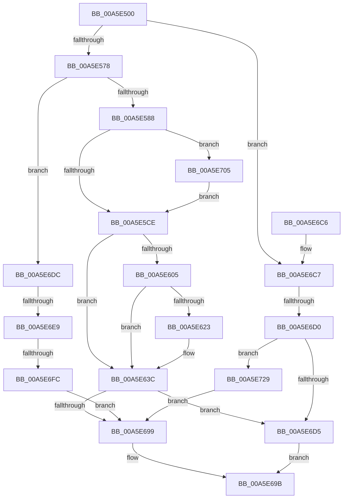

# ObpVerifyAccessToBoundaryEntry

- RVA: `0x00A5E500`–`0x00A5E735` (길이 `565` bytes)
- VA: `0x0000000140A5E500`
- 실행 섹션: `PAGE`
- PDB 이름 있음: `예`; PDB Function 태그: `예`
- unwind 정보 RVA: `0x000B28D4`
- 디코드: `139`개 명령, `565/565` bytes 표시
- 미해석 바이트: `0` (있으면 어셈블리에 `.byte`로 보존)

> 이 문서는 커널 이미지의 기계어와 PDB 기호를 분석해 생성했습니다. 4번과 5번은 함수 원형과 자료형을 바이너리 사용 방식에서 추정한 C 해석이며 원본 소스 복구 결과는 아닙니다.

## 1. Dependencies

- 직접 호출 지점: **9**; 고유 호출 대상: **7**
- 직접 호출자로 확인된 함수: **0**
- RIP 상대 이미지 참조: **2**

### Outgoing calls
- `0x00A5E54D` → [memset](../../text/6C/memset_function_006C6C40.md) (function, `0x006C6C40`)
- `0x00A5E57B` → [RtlIsPackageSid](RtlIsPackageSid_function_00A5E73C.md) (function, `0x00A5E73C`)
- `0x00A5E593` → [memset](../../text/6C/memset_function_006C6C40.md) (function, `0x006C6C40`)
- `0x00A5E5BC` → [RtlpAddKnownAce](../92/RtlpAddKnownAce_function_00929A20.md) (function, `0x00929A20`)
- `0x00A5E5F1` → [RtlAddMandatoryAce](../92/RtlAddMandatoryAce_function_00929BA0.md) (function, `0x00929BA0`)
- `0x00A5E690` → [SeAccessCheckWithHint](../../text/3A/SeAccessCheckWithHint_function_003A6C30.md) (function, `0x003A6C30`)
- `0x00A5E6A5` → [_security_check_cookie](../../text/6A/_security_check_cookie_function_006AC640.md) (function, `0x006AC640`)
- `0x00A5E6EF` → [RtlEqualSid](../../text/40/RtlEqualSid_function_00400AD0.md) (function, `0x00400AD0`)
- `0x00A5E71F` → [RtlpAddKnownAce](../92/RtlpAddKnownAce_function_00929A20.md) (function, `0x00929A20`)

### Direct callers
- 이 함수 시작 RVA로 연결되는 직접 call은 확인되지 않았습니다. 간접 호출은 완전히 역산할 수 없습니다.

### Static image references
- `0x00A5E521` → RVA `0x00E0A740` (`.data`; read)
- `0x00A5E65E` → RVA `0x00F0F650` (`.data`; read)

## 2. Other-region calls and transfers

- 다른 실행 섹션으로 향하는 call: **5**
  - `0x00A5E54D` → [memset](../../text/6C/memset_function_006C6C40.md) (`PAGE` → `.text`)
  - `0x00A5E593` → [memset](../../text/6C/memset_function_006C6C40.md) (`PAGE` → `.text`)
  - `0x00A5E690` → [SeAccessCheckWithHint](../../text/3A/SeAccessCheckWithHint_function_003A6C30.md) (`PAGE` → `.text`)
  - `0x00A5E6A5` → [_security_check_cookie](../../text/6A/_security_check_cookie_function_006AC640.md) (`PAGE` → `.text`)
  - `0x00A5E6EF` → [RtlEqualSid](../../text/40/RtlEqualSid_function_00400AD0.md) (`PAGE` → `.text`)
- call이 아닌 외부 분기/꼬리 이동: **3**
  - `0x00A5E6CA` → [sub_00B3E006 + 0x1E](../B3/Unknown_function_00B3E006.md) (`tail-transfer`)
  - `0x00A5E6E3` → [sub_00B3E006](../B3/Unknown_function_00B3E006.md) (`tail-transfer`)
  - `0x00A5E6F6` → [sub_00B3E006](../B3/Unknown_function_00B3E006.md) (`tail-transfer`)

## 3. Assembly (complete function range)

```asm
00A5E500  48 89 5C 24 18                  mov qword ptr [rsp + 0x18], rbx
00A5E505  48 89 74 24 20                  mov qword ptr [rsp + 0x20], rsi
00A5E50A  55                              push rbp
00A5E50B  57                              push rdi
00A5E50C  41 54                           push r12
00A5E50E  41 56                           push r14
00A5E510  41 57                           push r15
00A5E512  48 8D AC 24 60 FF FF FF         lea rbp, [rsp - 0xa0]
00A5E51A  48 81 EC A0 01 00 00            sub rsp, 0x1a0
00A5E521  48 8B 05 18 C2 3A 00            mov rax, qword ptr [rip + 0x3ac218]
00A5E528  48 33 C4                        xor rax, rsp
00A5E52B  48 89 85 90 00 00 00            mov qword ptr [rbp + 0x90], rax
00A5E532  45 33 F6                        xor r14d, r14d
00A5E535  48 8B FA                        mov rdi, rdx
00A5E538  48 8B D9                        mov rbx, rcx
00A5E53B  44 89 74 24 60                  mov dword ptr [rsp + 0x60], r14d
00A5E540  33 D2                           xor edx, edx
00A5E542  48 8D 4D 90                     lea rcx, [rbp - 0x70]
00A5E546  45 8D 66 54                     lea r12d, [r14 + 0x54]
00A5E54A  45 8B C4                        mov r8d, r12d
00A5E54D  E8 EE 86 C6 FF                  call 0x1406c6c40
00A5E552  33 C0                           xor eax, eax
00A5E554  45 8D 7E 02                     lea r15d, [r14 + 2]
00A5E558  0F 57 C0                        xorps xmm0, xmm0
00A5E55B  48 89 45 88                     mov qword ptr [rbp - 0x78], rax
00A5E55F  8B 03                           mov eax, dword ptr [rbx]
00A5E561  48 8D 73 08                     lea rsi, [rbx + 8]
00A5E565  0F 11 44 24 68                  movups xmmword ptr [rsp + 0x68], xmm0
00A5E56A  0F 11 44 24 78                  movups xmmword ptr [rsp + 0x78], xmm0
00A5E56F  41 3B C7                        cmp eax, r15d
00A5E572  0F 85 4F 01 00 00               jne 0x140a5e6c7
00A5E578  48 8B CE                        mov rcx, rsi
00A5E57B  E8 BC 01 00 00                  call 0x140a5e73c
00A5E580  84 C0                           test al, al
00A5E582  0F 85 54 01 00 00               jne 0x140a5e6dc
00A5E588  33 D2                           xor edx, edx
00A5E58A  45 8D 44 24 44                  lea r8d, [r12 + 0x44]
00A5E58F  48 8D 4D F8                     lea rcx, [rbp - 8]
00A5E593  E8 A8 86 C6 FF                  call 0x1406c6c40
00A5E598  BB 0F 00 0F 00                  mov ebx, 0xf000f
00A5E59D  44 88 74 24 28                  mov byte ptr [rsp + 0x28], r14b
00A5E5A2  44 8B CB                        mov r9d, ebx
00A5E5A5  48 C7 45 F0 02 00 A0 00         mov qword ptr [rbp - 0x10], 0xa00002
00A5E5AD  45 33 C0                        xor r8d, r8d
00A5E5B0  48 89 74 24 20                  mov qword ptr [rsp + 0x20], rsi
00A5E5B5  41 8B D7                        mov edx, r15d
00A5E5B8  48 8D 4D F0                     lea rcx, [rbp - 0x10]
00A5E5BC  E8 5F B4 EC FF                  call 0x140929a20
00A5E5C1  48 8B 47 20                     mov rax, qword ptr [rdi + 0x20]
00A5E5C5  48 85 C0                        test rax, rax
00A5E5C8  0F 85 37 01 00 00               jne 0x140a5e705
00A5E5CE  4C 8B 4F 28                     mov r9, qword ptr [rdi + 0x28]
00A5E5D2  48 8D 4D 90                     lea rcx, [rbp - 0x70]
00A5E5D6  C7 44 24 28 07 00 00 00         mov dword ptr [rsp + 0x28], 7
00A5E5DE  45 33 C0                        xor r8d, r8d
00A5E5E1  41 8B D7                        mov edx, r15d
00A5E5E4  C6 44 24 20 11                  mov byte ptr [rsp + 0x20], 0x11
00A5E5E9  48 C7 45 90 02 00 54 00         mov qword ptr [rbp - 0x70], 0x540002
00A5E5F1  E8 AA B5 EC FF                  call 0x140929ba0
00A5E5F6  0F B7 44 24 6A                  movzx eax, word ptr [rsp + 0x6a]
00A5E5FB  C6 44 24 68 01                  mov byte ptr [rsp + 0x68], 1
00A5E600  66 85 C0                        test ax, ax
00A5E603  78 37                           js 0x140a5e63c
00A5E605  48 8D 4D F0                     lea rcx, [rbp - 0x10]
00A5E609  48 89 4D 88                     mov qword ptr [rbp - 0x78], rcx
00A5E60D  B9 F7 FF 00 00                  mov ecx, 0xfff7
00A5E612  66 23 C1                        and ax, cx
00A5E615  66 83 C8 04                     or ax, 4
00A5E619  66 89 44 24 6A                  mov word ptr [rsp + 0x6a], ax
00A5E61E  66 85 C0                        test ax, ax
00A5E621  78 19                           js 0x140a5e63c
00A5E623  48 8D 4D 90                     lea rcx, [rbp - 0x70]
00A5E627  48 89 4D 80                     mov qword ptr [rbp - 0x80], rcx
00A5E62B  B9 DF FF 00 00                  mov ecx, 0xffdf
00A5E630  66 23 C1                        and ax, cx
00A5E633  66 83 C8 10                     or ax, 0x10
00A5E637  66 89 44 24 6A                  mov word ptr [rsp + 0x6a], ax
00A5E63C  65 48 8B 04 25 88 01 00 00      mov rax, qword ptr gs:[0x188]
00A5E645  48 8D 4F 30                     lea rcx, [rdi + 0x30]
00A5E649  48 89 4C 24 50                  mov qword ptr [rsp + 0x50], rcx
00A5E64E  48 8D 4C 24 60                  lea rcx, [rsp + 0x60]
00A5E653  48 89 4C 24 48                  mov qword ptr [rsp + 0x48], rcx
00A5E658  8A 90 32 02 00 00               mov dl, byte ptr [rax + 0x232]
00A5E65E  48 8B 05 EB 0F 4B 00            mov rax, qword ptr [rip + 0x4b0feb]
00A5E665  88 54 24 40                     mov byte ptr [rsp + 0x40], dl
00A5E669  48 83 C0 4C                     add rax, 0x4c
00A5E66D  48 89 44 24 38                  mov qword ptr [rsp + 0x38], rax
00A5E672  4C 89 74 24 30                  mov qword ptr [rsp + 0x30], r14
00A5E677  44 89 74 24 28                  mov dword ptr [rsp + 0x28], r14d
00A5E67C  89 5C 24 20                     mov dword ptr [rsp + 0x20], ebx
00A5E680  41 B1 01                        mov r9b, 1
00A5E683  48 8D 4C 24 68                  lea rcx, [rsp + 0x68]
00A5E688  4C 8B C7                        mov r8, rdi
00A5E68B  BA 01 00 00 00                  mov edx, 1
00A5E690  E8 9B 85 94 FF                  call 0x1403a6c30
00A5E695  84 C0                           test al, al
00A5E697  75 3C                           jne 0x140a5e6d5
00A5E699  33 C0                           xor eax, eax
00A5E69B  48 8B 8D 90 00 00 00            mov rcx, qword ptr [rbp + 0x90]
00A5E6A2  48 33 CC                        xor rcx, rsp
00A5E6A5  E8 96 DF C4 FF                  call 0x1406ac640
00A5E6AA  4C 8D 9C 24 A0 01 00 00         lea r11, [rsp + 0x1a0]
00A5E6B2  49 8B 5B 40                     mov rbx, qword ptr [r11 + 0x40]
00A5E6B6  49 8B 73 48                     mov rsi, qword ptr [r11 + 0x48]
00A5E6BA  49 8B E3                        mov rsp, r11
00A5E6BD  41 5F                           pop r15
00A5E6BF  41 5E                           pop r14
00A5E6C1  41 5C                           pop r12
00A5E6C3  5F                              pop rdi
00A5E6C4  5D                              pop rbp
00A5E6C5  C3                              ret
00A5E6C6  CC                              int3
00A5E6C7  83 F8 03                        cmp eax, 3
00A5E6CA  0F 84 54 F9 0D 00               je 0x140b3e024
00A5E6D0  83 F8 01                        cmp eax, 1
00A5E6D3  75 54                           jne 0x140a5e729
00A5E6D5  B8 01 00 00 00                  mov eax, 1
00A5E6DA  EB BF                           jmp 0x140a5e69b
00A5E6DC  48 8B 57 20                     mov rdx, qword ptr [rdi + 0x20]
00A5E6E0  48 85 D2                        test rdx, rdx
00A5E6E3  0F 84 1D F9 0D 00               je 0x140b3e006
00A5E6E9  48 8B 12                        mov rdx, qword ptr [rdx]
00A5E6EC  48 8B CE                        mov rcx, rsi
00A5E6EF  E8 DC 23 9A FF                  call 0x140400ad0
00A5E6F4  84 C0                           test al, al
00A5E6F6  0F 85 0A F9 0D 00               jne 0x140b3e006
00A5E6FC  C7 47 30 22 00 00 C0            mov dword ptr [rdi + 0x30], 0xc0000022
00A5E703  EB 94                           jmp 0x140a5e699
00A5E705  48 8B 00                        mov rax, qword ptr [rax]
00A5E708  48 8D 4D F0                     lea rcx, [rbp - 0x10]
00A5E70C  44 88 74 24 28                  mov byte ptr [rsp + 0x28], r14b
00A5E711  44 8B CB                        mov r9d, ebx
00A5E714  45 33 C0                        xor r8d, r8d
00A5E717  48 89 44 24 20                  mov qword ptr [rsp + 0x20], rax
00A5E71C  41 8B D7                        mov edx, r15d
00A5E71F  E8 FC B2 EC FF                  call 0x140929a20
00A5E724  E9 A5 FE FF FF                  jmp 0x140a5e5ce
00A5E729  C7 47 30 E5 00 00 C0            mov dword ptr [rdi + 0x30], 0xc00000e5
00A5E730  E9 64 FF FF FF                  jmp 0x140a5e699
```

## 4. C-style interpretation (structured pseudocode)

```c
__int64 __fastcall ObpVerifyAccessToBoundaryEntry(__int64 a1, __int64 a2)
{
    __int64 result;
    __int64 v_r14;
    __int64 v_rsp;
    unsigned __int64 v_stack_m138;
    unsigned __int64 v_stack_m140;
    unsigned __int64 v_stack_m148;
    unsigned __int64 v_stack_m150;
    unsigned __int16 v_stack_m15E;
    unsigned __int64 v_stack_m160;
    unsigned int v_stack_m168;
    unsigned __int64 v_stack_m178;
    unsigned __int64 v_stack_m180;
    unsigned __int8 v_stack_m188;
    unsigned __int64 v_stack_m190;
    unsigned __int64 v_stack_m198;
    unsigned __int8 v_stack_m1A0;
    unsigned __int64 v_stack_m1A8;
    unsigned __int64 v_stack_m28;
    unsigned __int64 v_stack_m38;
    unsigned __int64 v_stack_mC8;
    unsigned __int64 v_stack_mD0;
    unsigned __int64 v_stack_mD8;
    unsigned __int64 v_stack_p18;
    unsigned __int64 v_stack_p20;

    v_stack_p18 = v_rbx;
    v_stack_p20 = v_rsi;
    v_rsp = (v_rsp) - (416);
    result = (*(unsigned __int64 *)(v_rip + 3850776)) ^ (v_rsp);
    v_stack_m38 = result;
    v_r14 = 0;
    v_stack_m168 = 0;
    a2 = 0;
    result = memset(v_stack_m138, a2, (unsigned int)((unsigned int)(v_r14 + 84)), a4);
    result = 0;
    v_stack_m140 = 0;
    v_stack_m160 = v_xmm0;
    v_stack_m150 = v_xmm0;
    if (((unsigned int)((unsigned int)(*(unsigned int *)(a1)))) != ((unsigned int)(v_r14 + 2))) goto loc_00A5E6C7;
    result = RtlIsPackageSid(a1 + 8, a2, (unsigned int)((unsigned int)(v_r14 + 84)), a4);
    if ((unsigned __int8)(result) != 0) goto loc_00A5E6DC;
    a2 = 0;
    result = memset(v_stack_mD0, a2, v_r14 + 84 + 68, a4);
    v_stack_m1A0 = 0;
    v_stack_mD8 = 0xA00002ULL;
    a3 = 0;
    v_stack_m1A8 = a1 + 8;
    result = RtlpAddKnownAce(v_stack_mD8, (unsigned int)((unsigned int)(v_r14 + 2)), a3, (unsigned int)((unsigned int)((unsigned int)(0xF000FULL))));
    if (*(unsigned __int64 *)(a2 + 32) != 0) goto loc_00A5E705;
loc_00A5E5CE:
    v_stack_m1A0 = 7;
    a3 = 0;
    v_stack_m1A8 = 17;
    v_stack_m138 = 0x540002ULL;
    result = RtlAddMandatoryAce(v_stack_m138, (unsigned int)((unsigned int)(v_r14 + 2)), a3, *(unsigned __int64 *)(a2 + 40));
    v_stack_m160 = 1;
    if (sign_flag) goto loc_00A5E63C;
    v_stack_m140 = v_stack_mD8;
    result = (unsigned __int16)((v_stack_m15E) & ((unsigned __int16)((unsigned int)(0xFFF7ULL))));
    result = (unsigned __int16)((result) | (4));
    v_stack_m15E = (unsigned __int16)(result);
    if (!(sign_flag)) {
        a1 = v_stack_m138;
        v_stack_m148 = a1;
        a1 = 0xFFDFULL;
        result = (unsigned __int16)((result) & ((unsigned __int16)(a1)));
        result = (unsigned __int16)((result) | (16));
        v_stack_m15E = (unsigned __int16)(result);
    }
    v_stack_m178 = a2 + 48;
    v_stack_m180 = v_stack_m168;
    v_stack_m188 = (unsigned __int8)(*(unsigned __int8 *)(*(unsigned __int64 *)(gs_base + (0 + 392)) + 562));
    result = (*(unsigned __int64 *)(v_rip + 4919275)) + (76);
    v_stack_m190 = result;
    v_stack_m198 = 0;
    v_stack_m1A0 = 0;
    v_stack_m1A8 = (unsigned int)((unsigned int)(0xF000FULL));
    result = SeAccessCheckWithHint(v_stack_m160, 1, 0, 1);
    if ((unsigned __int8)(result) != 0) goto loc_00A5E6D5;
loc_00A5E699:
    result = 0;
loc_00A5E69B:
    a1 = (v_stack_m38) ^ (v_rsp);
    result = _security_check_cookie(a1, 1, 0, 1);
    return result;
loc_00A5E6C7:
    if (((unsigned int)(result)) != 1) goto loc_00A5E729;
loc_00A5E6D5:
    goto loc_00A5E69B;
loc_00A5E6DC:
    result = RtlEqualSid(*(unsigned __int64 *)(v_stack_m28 + 72), *(unsigned __int64 *)(*(unsigned __int64 *)(a2 + 32)), 0, 1);
    *(unsigned int *)(a2 + 48) = 0xC0000022ULL;
    goto loc_00A5E699;
loc_00A5E705:
    v_stack_m178 = 0;
    a3 = 0;
    v_stack_m180 = *(unsigned __int64 *)(result);
    result = RtlpAddKnownAce(v_stack_mD8, (unsigned int)((unsigned int)(v_r14 + 2)), a3, (unsigned int)((unsigned int)(*(unsigned __int64 *)(v_stack_m28 + 64))));
    goto loc_00A5E5CE;
loc_00A5E729:
    *(unsigned int *)(a2 + 48) = 0xC00000E5ULL;
    goto loc_00A5E699;
}
```

## 5. (Beta) C Style

```c
int64_t ObpVerifyAccessToBoundaryEntry(void *Arg1, void *Arg2)
{
    uint8_t *arg1 = (uint8_t *)Arg1;
    uint8_t *arg2 = (uint8_t *)Arg2;

    int64_t result;
    int64_t local_r14;
    int64_t local_rsp;
    uint64_t v_stack_m138;
    uint64_t v_stack_m140;
    uint64_t v_stack_m148;
    uint64_t v_stack_m150;
    uint16_t v_stack_m15E;
    uint64_t v_stack_m160;
    uint32_t v_stack_m168;
    uint64_t v_stack_m178;
    uint64_t v_stack_m180;
    uint8_t v_stack_m188;
    uint64_t v_stack_m190;
    uint64_t v_stack_m198;
    uint8_t v_stack_m1A0;
    uint64_t v_stack_m1A8;
    uint64_t v_stack_m28;
    uint64_t v_stack_m38;
    uint64_t v_stack_mC8;
    uint64_t v_stack_mD0;
    uint64_t v_stack_mD8;
    uint64_t v_stack_p18;
    uint64_t v_stack_p20;

    v_stack_p18 = local_rbx;
    v_stack_p20 = local_rsi;
    local_rsp = (local_rsp) - (416);
    result = (*(uint64_t *)(v_rip + 0x3AC218)) ^ (local_rsp);
    v_stack_m38 = result;
    local_r14 = 0;
    v_stack_m168 = 0;
    Arg2 = 0;
    result = memset(v_stack_m138, Arg2, (uint32_t)((uint32_t)(local_r14 + 84)), a4);
    result = 0;
    v_stack_m140 = 0;
    v_stack_m160 = v_xmm0;
    v_stack_m150 = v_xmm0;
    if (((uint32_t)((uint32_t)(*(uint32_t *)(arg1)))) != ((uint32_t)(local_r14 + 2))) goto loc_00A5E6C7;
    result = RtlIsPackageSid(Arg1 + 8, Arg2, (uint32_t)((uint32_t)(local_r14 + 84)), a4);
    if ((uint8_t)(result) != 0) goto loc_00A5E6DC;
    Arg2 = 0;
    result = memset(v_stack_mD0, Arg2, local_r14 + 84 + 68, a4);
    v_stack_m1A0 = 0;
    v_stack_mD8 = 0xA00002ULL;
    a3 = 0;
    v_stack_m1A8 = Arg1 + 8;
    result = RtlpAddKnownAce(v_stack_mD8, (uint32_t)((uint32_t)(local_r14 + 2)), a3, (uint32_t)((uint32_t)((uint32_t)(0xF000FULL))));
    if (*(uint64_t *)(arg2 + 0x20) != 0) goto loc_00A5E705;
loc_00A5E5CE:
    v_stack_m1A0 = 7;
    a3 = 0;
    v_stack_m1A8 = 17;
    v_stack_m138 = 0x540002ULL;
    result = RtlAddMandatoryAce(v_stack_m138, (uint32_t)((uint32_t)(local_r14 + 2)), a3, *(uint64_t *)(arg2 + 0x28));
    v_stack_m160 = 1;
    if (sign_flag) goto loc_00A5E63C;
    v_stack_m140 = v_stack_mD8;
    result = (uint16_t)((v_stack_m15E) & ((uint16_t)((uint32_t)(0xFFF7ULL))));
    result = (uint16_t)((result) | (4));
    v_stack_m15E = (uint16_t)(result);
    if (!(sign_flag)) {
        Arg1 = v_stack_m138;
        v_stack_m148 = Arg1;
        Arg1 = 0xFFDFULL;
        result = (uint16_t)((result) & ((uint16_t)(Arg1)));
        result = (uint16_t)((result) | (16));
        v_stack_m15E = (uint16_t)(result);
    }
    v_stack_m178 = Arg2 + 48;
    v_stack_m180 = v_stack_m168;
    v_stack_m188 = (uint8_t)(*(uint8_t *)(*(uint64_t *)(gs_base + (0 + 0x188)) + 0x232));
    result = (*(uint64_t *)(v_rip + 0x4B0FEB)) + (76);
    v_stack_m190 = result;
    v_stack_m198 = 0;
    v_stack_m1A0 = 0;
    v_stack_m1A8 = (uint32_t)((uint32_t)(0xF000FULL));
    result = SeAccessCheckWithHint(v_stack_m160, 1, 0, 1);
    if ((uint8_t)(result) != 0) goto loc_00A5E6D5;
loc_00A5E699:
    result = 0;
loc_00A5E69B:
    Arg1 = (v_stack_m38) ^ (local_rsp);
    result = _security_check_cookie(Arg1, 1, 0, 1);
    return result;
loc_00A5E6C7:
    if (((uint32_t)(result)) != 1) goto loc_00A5E729;
loc_00A5E6D5:
    goto loc_00A5E69B;
loc_00A5E6DC:
    result = RtlEqualSid(*(uint64_t *)(v_stack_m28 + 0x48), *(uint64_t *)(*(uint64_t *)(arg2 + 0x20)), 0, 1);
    *(uint32_t *)(arg2 + 0x30) = 0xC0000022ULL;
    goto loc_00A5E699;
loc_00A5E705:
    v_stack_m178 = 0;
    a3 = 0;
    v_stack_m180 = *(uint64_t *)(result);
    result = RtlpAddKnownAce(v_stack_mD8, (uint32_t)((uint32_t)(local_r14 + 2)), a3, (uint32_t)((uint32_t)(*(uint64_t *)(v_stack_m28 + 0x40))));
    goto loc_00A5E5CE;
loc_00A5E729:
    *(uint32_t *)(arg2 + 0x30) = 0xC00000E5ULL;
    goto loc_00A5E699;
}
```

### 관측된 메모리 오프셋

구조체 형식이 확인되지 않은 접근은 인자 기준의 오프셋으로만 기록했습니다.

| 기준 인자 | 오프셋 표현 | 폭 (bit) | 접근 |
|---|---:|---:|---|
| `Arg1` | `+ 0x0` | `32` | `R` |
| `Arg1` | `+ 0x8` | `64` | `R` |
| `Arg2` | `+ 0x20` | `64` | `R` |
| `Arg2` | `+ 0x28` | `64` | `R` |
| `Arg2` | `+ 0x30` | `32` | `W` |
| `Arg2` | `+ 0x30` | `64` | `R` |

## 6. Execution-region graph

[열기: 2D/3D 그래프와 함수 탐색 컨트롤 패널](../../../control-panel.html?section=page&rva=0x00A5E500&view=graph)

- 2D 그래프는 위에서 아래로 흐르고, 3D 그래프는 빈 공간을 드래그해 회전합니다. Shift+드래그는 이동, 휠은 확대·축소, 함수 노드 선택은 대상 보고서 이동입니다.

### Static fallback


