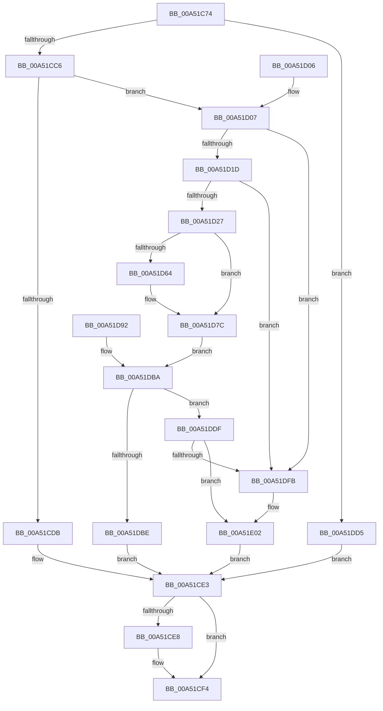

# PfSnGetCompletedTrace

- RVA: `0x00A51C74`–`0x00A51E1F` (길이 `427` bytes)
- VA: `0x0000000140A51C74`
- 실행 섹션: `PAGE`
- PDB 이름 있음: `예`; PDB Function 태그: `아니요`
- unwind 정보 RVA: `0x000B0C88`
- 디코드: `104`개 명령, `427/427` bytes 표시
- 미해석 바이트: `0` (있으면 어셈블리에 `.byte`로 보존)

> 이 문서는 커널 이미지의 기계어와 PDB 기호를 분석해 생성했습니다. 4번과 5번은 함수 원형과 자료형을 바이너리 사용 방식에서 추정한 C 해석이며 원본 소스 복구 결과는 아닙니다.

## 1. Dependencies

- 직접 호출 지점: **7**; 고유 호출 대상: **5**
- 직접 호출자로 확인된 함수: **1**
- RIP 상대 이미지 참조: **5**

### Outgoing calls
- `0x00A51CA0` → [ExAcquireFastMutex](../../text/20/ExAcquireFastMutex_function_0020E5A0.md) (function, `0x0020E5A0`)
- `0x00A51CEF` → [ExReleaseFastMutex](../../text/25/ExReleaseFastMutex_function_002519C0.md) (function, `0x002519C0`)
- `0x00A51D3F` → [ExReleaseFastMutex](../../text/25/ExReleaseFastMutex_function_002519C0.md) (function, `0x002519C0`)
- `0x00A51D77` → [ProbeForWrite](../8E/ProbeForWrite_function_008E91C0.md) (function, `0x008E91C0`)
- `0x00A51D8B` → [memcpy](../../text/6C/memcpy_function_006C6840.md) (function, `0x006C6840`)
- `0x00A51DC9` → [ExFreePoolWithTag](../../poolcode/B8/ExFreePoolWithTag_function_00B82870.md) (function, `0x00B82870`)
- `0x00A51DE9` → [ExAcquireFastMutex](../../text/20/ExAcquireFastMutex_function_0020E5A0.md) (function, `0x0020E5A0`)

### Direct callers
- [PfSnQueryPrefetcherInformation](PfSnQueryPrefetcherInformation_function_00A51B8C.md) at `0x00A51C12`

### Static image references
- `0x00A51C99` → RVA `0x00E67278` (`.data`; read)
- `0x00A51CA5` → RVA `0x00E672B4` (`.data`; write)
- `0x00A51CAF` → RVA `0x00E67268` (`.data`; read)
- `0x00A51D27` → RVA `0x00E67268` (`.data`; write)
- `0x00A51D32` → RVA `0x00E672B0` (`.data`; read/write)

## 2. Other-region calls and transfers

- 다른 실행 섹션으로 향하는 call: **6**
  - `0x00A51CA0` → [ExAcquireFastMutex](../../text/20/ExAcquireFastMutex_function_0020E5A0.md) (`PAGE` → `.text`)
  - `0x00A51CEF` → [ExReleaseFastMutex](../../text/25/ExReleaseFastMutex_function_002519C0.md) (`PAGE` → `.text`)
  - `0x00A51D3F` → [ExReleaseFastMutex](../../text/25/ExReleaseFastMutex_function_002519C0.md) (`PAGE` → `.text`)
  - `0x00A51D8B` → [memcpy](../../text/6C/memcpy_function_006C6840.md) (`PAGE` → `.text`)
  - `0x00A51DC9` → [ExFreePoolWithTag](../../poolcode/B8/ExFreePoolWithTag_function_00B82870.md) (`PAGE` → `POOLCODE`)
  - `0x00A51DE9` → [ExAcquireFastMutex](../../text/20/ExAcquireFastMutex_function_0020E5A0.md) (`PAGE` → `.text`)
- 별도 외부 분기/꼬리 이동을 확인하지 못했습니다.

## 3. Assembly (complete function range)

```asm
00A51C74  4C 89 44 24 18                  mov qword ptr [rsp + 0x18], r8
00A51C79  89 54 24 10                     mov dword ptr [rsp + 0x10], edx
00A51C7D  48 89 4C 24 08                  mov qword ptr [rsp + 8], rcx
00A51C82  53                              push rbx
00A51C83  56                              push rsi
00A51C84  57                              push rdi
00A51C85  41 54                           push r12
00A51C87  41 55                           push r13
00A51C89  41 56                           push r14
00A51C8B  41 57                           push r15
00A51C8D  48 83 EC 40                     sub rsp, 0x40
00A51C91  4D 8B F8                        mov r15, r8
00A51C94  8B FA                           mov edi, edx
00A51C96  41 B4 01                        mov r12b, 1
00A51C99  48 8D 0D D8 55 41 00            lea rcx, [rip + 0x4155d8]
00A51CA0  E8 FB C8 7B FF                  call 0x14020e5a0
00A51CA5  C7 05 05 56 41 00 02 00 00 00   mov dword ptr [rip + 0x415605], 2
00A51CAF  48 8B 1D B2 55 41 00            mov rbx, qword ptr [rip + 0x4155b2]
00A51CB6  48 8D 35 AB 55 41 00            lea rsi, [rip + 0x4155ab]
00A51CBD  48 3B DE                        cmp rbx, rsi
00A51CC0  0F 84 0F 01 00 00               je 0x140a51dd5
00A51CC6  48 89 5C 24 30                  mov qword ptr [rsp + 0x30], rbx
00A51CCB  4C 8D 73 18                     lea r14, [rbx + 0x18]
00A51CCF  4C 89 74 24 20                  mov qword ptr [rsp + 0x20], r14
00A51CD4  41 8B 06                        mov eax, dword ptr [r14]
00A51CD7  3B C7                           cmp eax, edi
00A51CD9  76 2C                           jbe 0x140a51d07
00A51CDB  41 89 07                        mov dword ptr [r15], eax
00A51CDE  BF 23 00 00 C0                  mov edi, 0xc0000023
00A51CE3  45 84 E4                        test r12b, r12b
00A51CE6  74 0C                           je 0x140a51cf4
00A51CE8  48 8D 0D 89 55 41 00            lea rcx, [rip + 0x415589]
00A51CEF  E8 CC FC 7F FF                  call 0x1402519c0
00A51CF4  8B C7                           mov eax, edi
00A51CF6  48 83 C4 40                     add rsp, 0x40
00A51CFA  41 5F                           pop r15
00A51CFC  41 5E                           pop r14
00A51CFE  41 5D                           pop r13
00A51D00  41 5C                           pop r12
00A51D02  5F                              pop rdi
00A51D03  5E                              pop rsi
00A51D04  5B                              pop rbx
00A51D05  C3                              ret
00A51D06  CC                              int3
00A51D07  48 8B 03                        mov rax, qword ptr [rbx]
00A51D0A  4C 8D 6B 08                     lea r13, [rbx + 8]
00A51D0E  4C 89 6C 24 28                  mov qword ptr [rsp + 0x28], r13
00A51D13  49 39 75 00                     cmp qword ptr [r13], rsi
00A51D17  0F 85 DE 00 00 00               jne 0x140a51dfb
00A51D1D  48 39 58 08                     cmp qword ptr [rax + 8], rbx
00A51D21  0F 85 D4 00 00 00               jne 0x140a51dfb
00A51D27  48 89 05 3A 55 41 00            mov qword ptr [rip + 0x41553a], rax
00A51D2E  48 89 70 08                     mov qword ptr [rax + 8], rsi
00A51D32  FF 0D 78 55 41 00               dec dword ptr [rip + 0x415578]
00A51D38  48 8D 0D 39 55 41 00            lea rcx, [rip + 0x415539]
00A51D3F  E8 7C FC 7F FF                  call 0x1402519c0
00A51D44  45 32 E4                        xor r12b, r12b
00A51D47  44 88 A4 24 98 00 00 00         mov byte ptr [rsp + 0x98], r12b
00A51D4F  33 FF                           xor edi, edi
00A51D51  65 48 8B 04 25 88 01 00 00      mov rax, qword ptr gs:[0x188]
00A51D5A  8A 88 32 02 00 00               mov cl, byte ptr [rax + 0x232]
00A51D60  84 C9                           test cl, cl
00A51D62  74 18                           je 0x140a51d7c
00A51D64  8B 94 24 88 00 00 00            mov edx, dword ptr [rsp + 0x88]
00A51D6B  44 8D 47 08                     lea r8d, [rdi + 8]
00A51D6F  48 8B 8C 24 80 00 00 00         mov rcx, qword ptr [rsp + 0x80]
00A51D77  E8 44 74 E9 FF                  call 0x1408e91c0
00A51D7C  45 8B 06                        mov r8d, dword ptr [r14]
00A51D7F  48 8D 53 10                     lea rdx, [rbx + 0x10]
00A51D83  48 8B 8C 24 80 00 00 00         mov rcx, qword ptr [rsp + 0x80]
00A51D8B  E8 B0 4A C7 FF                  call 0x1406c6840
00A51D90  EB 28                           jmp 0x140a51dba
00A51D92  8B F8                           mov edi, eax
00A51D94  48 8D 35 CD 54 41 00            lea rsi, [rip + 0x4154cd]
00A51D9B  4C 8B BC 24 90 00 00 00         mov r15, qword ptr [rsp + 0x90]
00A51DA3  44 8A A4 24 98 00 00 00         mov r12b, byte ptr [rsp + 0x98]
00A51DAB  4C 8B 74 24 20                  mov r14, qword ptr [rsp + 0x20]
00A51DB0  4C 8B 6C 24 28                  mov r13, qword ptr [rsp + 0x28]
00A51DB5  48 8B 5C 24 30                  mov rbx, qword ptr [rsp + 0x30]
00A51DBA  85 FF                           test edi, edi
00A51DBC  78 21                           js 0x140a51ddf
00A51DBE  41 8B 06                        mov eax, dword ptr [r14]
00A51DC1  41 89 07                        mov dword ptr [r15], eax
00A51DC4  33 D2                           xor edx, edx
00A51DC6  48 8B CB                        mov rcx, rbx
00A51DC9  E8 A2 0A 13 00                  call 0x140b82870
00A51DCE  33 FF                           xor edi, edi
00A51DD0  E9 0E FF FF FF                  jmp 0x140a51ce3
00A51DD5  BF 1A 00 00 80                  mov edi, 0x8000001a
00A51DDA  E9 04 FF FF FF                  jmp 0x140a51ce3
00A51DDF  41 B4 01                        mov r12b, 1
00A51DE2  48 8D 0D 8F 54 41 00            lea rcx, [rip + 0x41548f]
00A51DE9  E8 B2 C7 7B FF                  call 0x14020e5a0
00A51DEE  48 8B 05 73 54 41 00            mov rax, qword ptr [rip + 0x415473]
00A51DF5  48 39 70 08                     cmp qword ptr [rax + 8], rsi
00A51DF9  74 07                           je 0x140a51e02
00A51DFB  B9 03 00 00 00                  mov ecx, 3
00A51E00  CD 29                           int 0x29
00A51E02  48 89 03                        mov qword ptr [rbx], rax
00A51E05  49 89 75 00                     mov qword ptr [r13], rsi
00A51E09  48 89 58 08                     mov qword ptr [rax + 8], rbx
00A51E0D  48 89 1D 54 54 41 00            mov qword ptr [rip + 0x415454], rbx
00A51E14  FF 05 96 54 41 00               inc dword ptr [rip + 0x415496]
00A51E1A  E9 C4 FE FF FF                  jmp 0x140a51ce3
```

## 4. C-style interpretation (structured pseudocode)

```c
__int64 __fastcall PfSnGetCompletedTrace(__int64 a1, int a2, __int64 a3)
{
    __int64 result;
    __int64 v_r12;
    __int64 v_rdi;
    __int64 v_rsp;
    unsigned __int64 v_stack_m48;
    unsigned __int64 v_stack_m58;
    unsigned int v_stack_p10;
    unsigned __int64 v_stack_p18;
    unsigned __int64 v_stack_p20;
    unsigned __int64 v_stack_p28;
    unsigned __int64 v_stack_p30;
    unsigned __int64 v_stack_p8;
    unsigned __int64 v_stack_p80;
    unsigned int v_stack_p88;
    unsigned __int64 v_stack_p90;
    unsigned __int8 v_stack_p98;

    v_stack_p18 = a3;
    v_stack_p10 = a2;
    v_stack_p8 = a1;
    v_rsp = (v_rsp) - (64);
    result = ExAcquireFastMutex(v_rip + 4281816, a2, a3, a4);
    *(unsigned int *)(v_rip + 4281861) = 2;
    if ((*(unsigned __int64 *)(v_rip + 4281778)) == (v_rip + 4281771)) goto loc_00A51DD5;
    v_stack_m48 = *(unsigned __int64 *)(v_rip + 4281778);
    v_stack_m58 = *(unsigned __int64 *)(v_rip + 4281778) + 24;
    if (((unsigned int)((unsigned int)(*(unsigned int *)(*(unsigned __int64 *)(v_rip + 4281778) + 24)))) <= ((unsigned int)((unsigned int)(a2)))) goto loc_00A51D07;
    *(unsigned int *)(a3) = (unsigned int)((unsigned int)(*(unsigned int *)(*(unsigned __int64 *)(v_rip + 4281778) + 24)));
loc_00A51CE3:
    result = (unsigned int)(*(unsigned int *)(*(unsigned __int64 *)(v_rip + 4281778) + 24));
    if (1 != 0) {
        a1 = v_rip + 4281737;
        result = ExReleaseFastMutex(a1, a2, a3, a4);
    }
    v_rsp = (v_rsp) + (64);
    return (unsigned int)((unsigned int)((unsigned int)(0xC0000023ULL)));
loc_00A51D07:
    v_stack_p28 = *(unsigned __int64 *)(v_rip + 4281778) + 8;
    if ((*(unsigned __int64 *)(*(unsigned __int64 *)(v_rip + 4281778) + 8)) != (v_rip + 4281771)) goto loc_00A51DFB;
    if ((*(unsigned __int64 *)(*(unsigned __int64 *)(*(unsigned __int64 *)(v_rip + 4281778)) + 8)) != (*(unsigned __int64 *)(v_rip + 4281778))) goto loc_00A51DFB;
    *(unsigned __int64 *)(v_rip + 4281658) = *(unsigned __int64 *)(*(unsigned __int64 *)(v_rip + 4281778));
    *(unsigned __int64 *)(*(unsigned __int64 *)(*(unsigned __int64 *)(v_rip + 4281778)) + 8) = v_rip + 4281771;
    result = ExReleaseFastMutex(v_rip + 4281657, a2, a3, a4);
    v_r12 = 0;
    v_stack_p98 = 0;
    v_rdi = 0;
    result = *(unsigned __int64 *)(gs_base + (0 + 392));
    if ((unsigned __int8)(*(unsigned __int8 *)(*(unsigned __int64 *)(gs_base + (0 + 392)) + 562)) != 0) {
        a2 = v_stack_p88;
        a3 = v_rdi + 8;
        a1 = v_stack_p80;
        result = ProbeForWrite(a1, a2, a3, a4);
    }
    result = memcpy(v_stack_p80, *(unsigned __int64 *)(v_rip + 4281778) + 16, (unsigned int)(*(unsigned int *)(*(unsigned __int64 *)(v_rip + 4281778) + 24)), a4);
    goto loc_00A51DBA;
loc_00A51DBA:
    if (sign_flag) goto loc_00A51DDF;
    *(unsigned int *)(a3) = (unsigned int)((unsigned int)(*(unsigned int *)(*(unsigned __int64 *)(v_rip + 4281778) + 24)));
    a2 = 0;
    result = ExFreePoolWithTag(*(unsigned __int64 *)(v_rip + 4281778), a2, (unsigned int)(*(unsigned int *)(*(unsigned __int64 *)(v_rip + 4281778) + 24)), a4);
    v_rdi = 0;
    goto loc_00A51CE3;
loc_00A51DD5:
    goto loc_00A51CE3;
loc_00A51DDF:
    result = ExAcquireFastMutex(v_rip + 4281487, a2, (unsigned int)(*(unsigned int *)(*(unsigned __int64 *)(v_rip + 4281778) + 24)), a4);
    if ((*(unsigned __int64 *)(*(unsigned __int64 *)(v_rip + 4281459) + 8)) != (v_rip + 4281771)) {
        a1 = 3;
    }
    *(unsigned __int64 *)(*(unsigned __int64 *)(v_rip + 4281778)) = *(unsigned __int64 *)(v_rip + 4281459);
    *(unsigned __int64 *)(*(unsigned __int64 *)(v_rip + 4281778) + 8) = v_rip + 4281771;
    *(unsigned __int64 *)(*(unsigned __int64 *)(v_rip + 4281459) + 8) = *(unsigned __int64 *)(v_rip + 4281778);
    *(unsigned __int64 *)(v_rip + 4281428) = *(unsigned __int64 *)(v_rip + 4281778);
    goto loc_00A51CE3;
}
```

## 5. (Beta) C Style

```c
int64_t PfSnGetCompletedTrace(int64_t Arg1, int32_t Arg2, void *Arg3)
{
    uint8_t *arg3 = (uint8_t *)Arg3;

    int64_t result;
    int64_t local_r12;
    int64_t local_rdi;
    int64_t local_rsp;
    uint64_t v_stack_m48;
    uint64_t v_stack_m58;
    uint32_t v_stack_p10;
    uint64_t v_stack_p18;
    uint64_t v_stack_p20;
    uint64_t v_stack_p28;
    uint64_t v_stack_p30;
    uint64_t v_stack_p8;
    uint64_t v_stack_p80;
    uint32_t v_stack_p88;
    uint64_t v_stack_p90;
    uint8_t v_stack_p98;

    v_stack_p18 = Arg3;
    v_stack_p10 = Arg2;
    v_stack_p8 = Arg1;
    local_rsp = (local_rsp) - (64);
    result = ExAcquireFastMutex(v_rip + 4281816, Arg2, Arg3, a4);
    *(uint32_t *)(v_rip + 0x415605) = 2;
    if ((*(uint64_t *)(v_rip + 0x4155B2)) == (v_rip + 4281771)) goto loc_00A51DD5;
    v_stack_m48 = *(uint64_t *)(v_rip + 0x4155B2);
    v_stack_m58 = *(uint64_t *)(v_rip + 0x4155B2) + 24;
    if (((uint32_t)((uint32_t)(*(uint32_t *)(*(uint64_t *)(v_rip + 0x4155B2) + 0x18)))) <= ((uint32_t)((uint32_t)(Arg2)))) goto loc_00A51D07;
    *(uint32_t *)(arg3) = (uint32_t)((uint32_t)(*(uint32_t *)(*(uint64_t *)(v_rip + 0x4155B2) + 0x18)));
loc_00A51CE3:
    result = (uint32_t)(*(uint32_t *)(*(uint64_t *)(v_rip + 0x4155B2) + 0x18));
    if (1 != 0) {
        Arg1 = v_rip + 4281737;
        result = ExReleaseFastMutex(Arg1, Arg2, Arg3, a4);
    }
    local_rsp = (local_rsp) + (64);
    return (uint32_t)((uint32_t)((uint32_t)(0xC0000023ULL)));
loc_00A51D07:
    v_stack_p28 = *(uint64_t *)(v_rip + 0x4155B2) + 8;
    if ((*(uint64_t *)(*(uint64_t *)(v_rip + 0x4155B2) + 0x8)) != (v_rip + 4281771)) goto loc_00A51DFB;
    if ((*(uint64_t *)(*(uint64_t *)(*(uint64_t *)(v_rip + 0x4155B2)) + 0x8)) != (*(uint64_t *)(v_rip + 0x4155B2))) goto loc_00A51DFB;
    *(uint64_t *)(v_rip + 0x41553A) = *(uint64_t *)(*(uint64_t *)(v_rip + 0x4155B2));
    *(uint64_t *)(*(uint64_t *)(*(uint64_t *)(v_rip + 0x4155B2)) + 0x8) = v_rip + 4281771;
    result = ExReleaseFastMutex(v_rip + 4281657, Arg2, Arg3, a4);
    local_r12 = 0;
    v_stack_p98 = 0;
    local_rdi = 0;
    result = *(uint64_t *)(gs_base + (0 + 0x188));
    if ((uint8_t)(*(uint8_t *)(*(uint64_t *)(gs_base + (0 + 0x188)) + 0x232)) != 0) {
        Arg2 = v_stack_p88;
        Arg3 = local_rdi + 8;
        Arg1 = v_stack_p80;
        result = ProbeForWrite(Arg1, Arg2, Arg3, a4);
    }
    result = memcpy(v_stack_p80, *(uint64_t *)(v_rip + 0x4155B2) + 16, (uint32_t)(*(uint32_t *)(*(uint64_t *)(v_rip + 0x4155B2) + 0x18)), a4);
    goto loc_00A51DBA;
loc_00A51DBA:
    if (sign_flag) goto loc_00A51DDF;
    *(uint32_t *)(arg3) = (uint32_t)((uint32_t)(*(uint32_t *)(*(uint64_t *)(v_rip + 0x4155B2) + 0x18)));
    Arg2 = 0;
    result = ExFreePoolWithTag(*(uint64_t *)(v_rip + 0x4155B2), Arg2, (uint32_t)(*(uint32_t *)(*(uint64_t *)(v_rip + 0x4155B2) + 0x18)), a4);
    local_rdi = 0;
    goto loc_00A51CE3;
loc_00A51DD5:
    goto loc_00A51CE3;
loc_00A51DDF:
    result = ExAcquireFastMutex(v_rip + 4281487, Arg2, (uint32_t)(*(uint32_t *)(*(uint64_t *)(v_rip + 0x4155B2) + 0x18)), a4);
    if ((*(uint64_t *)(*(uint64_t *)(v_rip + 0x415473) + 0x8)) != (v_rip + 4281771)) {
        Arg1 = 3;
    }
    *(uint64_t *)(*(uint64_t *)(v_rip + 0x4155B2)) = *(uint64_t *)(v_rip + 0x415473);
    *(uint64_t *)(*(uint64_t *)(v_rip + 0x4155B2) + 0x8) = v_rip + 4281771;
    *(uint64_t *)(*(uint64_t *)(v_rip + 0x415473) + 0x8) = *(uint64_t *)(v_rip + 0x4155B2);
    *(uint64_t *)(v_rip + 0x415454) = *(uint64_t *)(v_rip + 0x4155B2);
    goto loc_00A51CE3;
}
```

### 관측된 메모리 오프셋

구조체 형식이 확인되지 않은 접근은 인자 기준의 오프셋으로만 기록했습니다.

| 기준 인자 | 오프셋 표현 | 폭 (bit) | 접근 |
|---|---:|---:|---|
| `Arg3` | `+ 0x0` | `32` | `W` |

## 6. Execution-region graph

[열기: 2D/3D 그래프와 함수 탐색 컨트롤 패널](../../../control-panel.html?section=page&rva=0x00A51C74&view=graph)

- 2D 그래프는 위에서 아래로 흐르고, 3D 그래프는 빈 공간을 드래그해 회전합니다. Shift+드래그는 이동, 휠은 확대·축소, 함수 노드 선택은 대상 보고서 이동입니다.

### Static fallback


