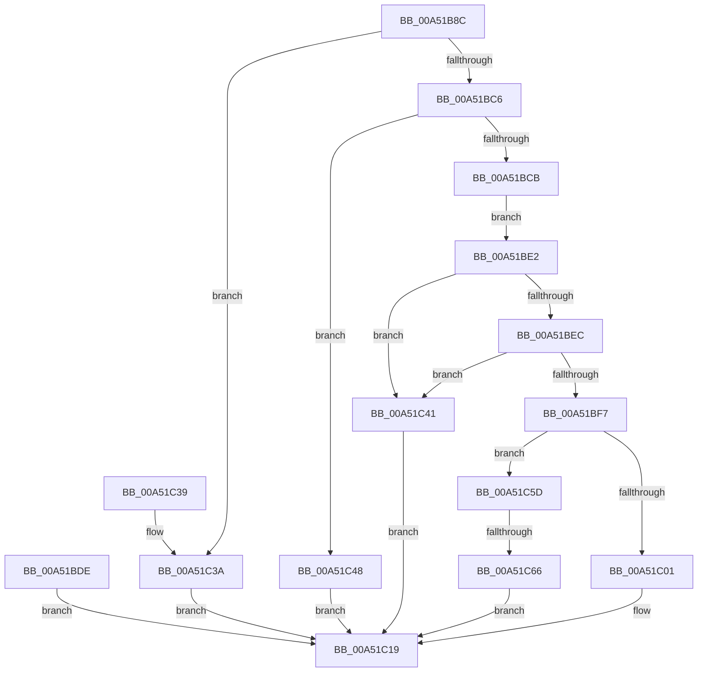

# PfSnQueryPrefetcherInformation

- RVA: `0x00A51B8C`–`0x00A51C6D` (길이 `225` bytes)
- VA: `0x0000000140A51B8C`
- 실행 섹션: `PAGE`
- PDB 이름 있음: `예`; PDB Function 태그: `예`
- unwind 정보 RVA: `0x000B0C30`
- 디코드: `61`개 명령, `225/225` bytes 표시
- 미해석 바이트: `0` (있으면 어셈블리에 `.byte`로 보존)

> 이 문서는 커널 이미지의 기계어와 PDB 기호를 분석해 생성했습니다. 4번과 5번은 함수 원형과 자료형을 바이너리 사용 방식에서 추정한 C 해석이며 원본 소스 복구 결과는 아닙니다.

## 1. Dependencies

- 직접 호출 지점: **2**; 고유 호출 대상: **2**
- 직접 호출자로 확인된 함수: **1**
- RIP 상대 이미지 참조: **1**

### Outgoing calls
- `0x00A51BBB` → [SeSinglePrivilegeCheck](../87/SeSinglePrivilegeCheck_function_00871E20.md) (function, `0x00871E20`)
- `0x00A51C12` → [PfSnGetCompletedTrace](PfSnGetCompletedTrace_function_00A51C74.md) (function, `0x00A51C74`)

### Direct callers
- [ExpQuerySystemInformation](ExpQuerySystemInformation_function_00A57858.md) at `0x00A5882F`

### Static image references
- `0x00A51BB4` → RVA `0x00FD9B08` (`PAGEDATA`; read)

## 2. Other-region calls and transfers

- 다른 실행 섹션으로 향하는 call: **0**
- call이 아닌 외부 분기/꼬리 이동: **1**
  - `0x00A51C60` → [sub_00B3C840](../B3/Unknown_function_00B3C840.md) (`tail-transfer`)

## 3. Assembly (complete function range)

```asm
00A51B8C  48 8B C4                        mov rax, rsp
00A51B8F  48 89 58 08                     mov qword ptr [rax + 8], rbx
00A51B93  48 89 70 10                     mov qword ptr [rax + 0x10], rsi
00A51B97  48 89 78 18                     mov qword ptr [rax + 0x18], rdi
00A51B9B  4C 89 70 20                     mov qword ptr [rax + 0x20], r14
00A51B9F  41 57                           push r15
00A51BA1  48 81 EC E0 01 00 00            sub rsp, 0x1e0
00A51BA8  45 8A F1                        mov r14b, r9b
00A51BAB  41 8B F0                        mov esi, r8d
00A51BAE  48 8B FA                        mov rdi, rdx
00A51BB1  41 8A D1                        mov dl, r9b
00A51BB4  48 8B 0D 4D 7F 58 00            mov rcx, qword ptr [rip + 0x587f4d]
00A51BBB  E8 60 02 E2 FF                  call 0x140871e20
00A51BC0  33 DB                           xor ebx, ebx
00A51BC2  84 C0                           test al, al
00A51BC4  74 74                           je 0x140a51c3a
00A51BC6  83 FE 20                        cmp esi, 0x20
00A51BC9  75 7D                           jne 0x140a51c48
00A51BCB  0F 10 07                        movups xmm0, xmmword ptr [rdi]
00A51BCE  0F 11 44 24 20                  movups xmmword ptr [rsp + 0x20], xmm0
00A51BD3  0F 10 4F 10                     movups xmm1, xmmword ptr [rdi + 0x10]
00A51BD7  0F 11 4C 24 30                  movups xmmword ptr [rsp + 0x30], xmm1
00A51BDC  EB 04                           jmp 0x140a51be2
00A51BDE  8B D8                           mov ebx, eax
00A51BE0  EB 37                           jmp 0x140a51c19
00A51BE2  48 8B 44 24 20                  mov rax, qword ptr [rsp + 0x20]
00A51BE7  83 F8 01                        cmp eax, 1
00A51BEA  75 55                           jne 0x140a51c41
00A51BEC  48 C1 E8 20                     shr rax, 0x20
00A51BF0  3D 43 68 75 6B                  cmp eax, 0x6b756843
00A51BF5  75 4A                           jne 0x140a51c41
00A51BF7  48 8B 4C 24 28                  mov rcx, qword ptr [rsp + 0x28]
00A51BFC  83 E9 01                        sub ecx, 1
00A51BFF  75 5C                           jne 0x140a51c5d
00A51C01  4C 8B 84 24 10 02 00 00         mov r8, qword ptr [rsp + 0x210]
00A51C09  8B 54 24 38                     mov edx, dword ptr [rsp + 0x38]
00A51C0D  48 8B 4C 24 30                  mov rcx, qword ptr [rsp + 0x30]
00A51C12  E8 5D 00 00 00                  call 0x140a51c74
00A51C17  8B D8                           mov ebx, eax
00A51C19  8B C3                           mov eax, ebx
00A51C1B  4C 8D 9C 24 E0 01 00 00         lea r11, [rsp + 0x1e0]
00A51C23  49 8B 5B 10                     mov rbx, qword ptr [r11 + 0x10]
00A51C27  49 8B 73 18                     mov rsi, qword ptr [r11 + 0x18]
00A51C2B  49 8B 7B 20                     mov rdi, qword ptr [r11 + 0x20]
00A51C2F  4D 8B 73 28                     mov r14, qword ptr [r11 + 0x28]
00A51C33  49 8B E3                        mov rsp, r11
00A51C36  41 5F                           pop r15
00A51C38  C3                              ret
00A51C39  CC                              int3
00A51C3A  BB 22 00 00 C0                  mov ebx, 0xc0000022
00A51C3F  EB D8                           jmp 0x140a51c19
00A51C41  BB 0D 00 00 C0                  mov ebx, 0xc000000d
00A51C46  EB D1                           jmp 0x140a51c19
00A51C48  BB 04 00 00 C0                  mov ebx, 0xc0000004
00A51C4D  48 8B 84 24 10 02 00 00         mov rax, qword ptr [rsp + 0x210]
00A51C55  C7 00 20 00 00 00               mov dword ptr [rax], 0x20
00A51C5B  EB BC                           jmp 0x140a51c19
00A51C5D  83 F9 01                        cmp ecx, 1
00A51C60  0F 84 DA AB 0E 00               je 0x140b3c840
00A51C66  BB 03 00 00 C0                  mov ebx, 0xc0000003
00A51C6B  EB AC                           jmp 0x140a51c19
```

## 4. C-style interpretation (structured pseudocode)

```c
__int64 __fastcall PfSnQueryPrefetcherInformation(__int64 a1, __int64 a2, int a3, unsigned __int8 a4, __int64 a5)
{
    __int64 result;
    __int64 v_rbx;
    __int64 v_rsp;
    unsigned int v_stack_m1B0;
    unsigned __int64 v_stack_m1B8;
    unsigned __int64 v_stack_m1C0;
    unsigned __int64 v_stack_m1C8;
    unsigned __int64 v_stack_m8;

    *(unsigned __int64 *)(v_rsp + 8) = v_rbx;
    *(unsigned __int64 *)(v_rsp + 16) = v_rsi;
    *(unsigned __int64 *)(v_rsp + 24) = v_rdi;
    *(unsigned __int64 *)(v_rsp + 32) = v_r14;
    v_rsp = (v_rsp) - (480);
    result = SeSinglePrivilegeCheck(*(unsigned __int64 *)(v_rip + 5799757), a4, a3, a4);
    v_rbx = 0;
    if ((unsigned __int8)(result) == 0) goto loc_00A51C3A;
    if (((unsigned int)((unsigned int)(a3))) != 32) goto loc_00A51C48;
    v_stack_m1C8 = v_xmm0;
    v_stack_m1B8 = v_xmm1;
    goto loc_00A51BE2;
loc_00A51BE2:
    if (((unsigned int)(v_stack_m1C8)) != 1) goto loc_00A51C41;
    result = (v_stack_m1C8) >> (32);
    if (((unsigned int)(result)) != 0x6B756843ULL) goto loc_00A51C41;
    a1 = (unsigned int)((v_stack_m1C0) - (1));
    if (condition_is_not_equal) goto loc_00A51C5D;
    result = PfSnGetCompletedTrace(v_stack_m1B8, (unsigned int)(v_stack_m1B0), a5, a4);
loc_00A51C19:
    return (unsigned int)((unsigned int)((unsigned int)((unsigned int)(result))));
loc_00A51C3A:
    goto loc_00A51C19;
loc_00A51C41:
    goto loc_00A51C19;
loc_00A51C48:
    *(unsigned int *)(a5) = 32;
    goto loc_00A51C19;
loc_00A51C5D:
    goto loc_00A51C19;
}
```

## 5. (Beta) C Style

```c
int64_t PfSnQueryPrefetcherInformation(int64_t Arg1, void *Arg2, int32_t Arg3, uint8_t Arg4, void *Arg5)
{
    uint8_t *arg2 = (uint8_t *)Arg2;
    uint8_t *arg5 = (uint8_t *)Arg5;

    int64_t result;
    int64_t local_rbx;
    int64_t local_rsp;
    uint32_t v_stack_m1B0;
    uint64_t v_stack_m1B8;
    uint64_t v_stack_m1C0;
    uint64_t v_stack_m1C8;
    uint64_t v_stack_m8;

    *(uint64_t *)(local_rsp + 0x8) = local_rbx;
    *(uint64_t *)(local_rsp + 0x10) = local_rsi;
    *(uint64_t *)(local_rsp + 0x18) = local_rdi;
    *(uint64_t *)(local_rsp + 0x20) = local_r14;
    local_rsp = (local_rsp) - (480);
    result = SeSinglePrivilegeCheck(*(uint64_t *)(v_rip + 0x587F4D), Arg4, Arg3, Arg4);
    local_rbx = 0;
    if ((uint8_t)(result) == 0) goto loc_00A51C3A;
    if (((uint32_t)((uint32_t)(Arg3))) != 32) goto loc_00A51C48;
    v_stack_m1C8 = v_xmm0;
    v_stack_m1B8 = v_xmm1;
    goto loc_00A51BE2;
loc_00A51BE2:
    if (((uint32_t)(v_stack_m1C8)) != 1) goto loc_00A51C41;
    result = (v_stack_m1C8) >> (32);
    if (((uint32_t)(result)) != 0x6B756843ULL) goto loc_00A51C41;
    Arg1 = (uint32_t)((v_stack_m1C0) - (1));
    if (condition_is_not_equal) goto loc_00A51C5D;
    result = PfSnGetCompletedTrace(v_stack_m1B8, (uint32_t)(v_stack_m1B0), Arg5, Arg4);
loc_00A51C19:
    return (uint32_t)((uint32_t)((uint32_t)((uint32_t)(result))));
loc_00A51C3A:
    goto loc_00A51C19;
loc_00A51C41:
    goto loc_00A51C19;
loc_00A51C48:
    *(uint32_t *)(arg5) = 32;
    goto loc_00A51C19;
loc_00A51C5D:
    goto loc_00A51C19;
}
```

### 관측된 메모리 오프셋

구조체 형식이 확인되지 않은 접근은 인자 기준의 오프셋으로만 기록했습니다.

| 기준 인자 | 오프셋 표현 | 폭 (bit) | 접근 |
|---|---:|---:|---|
| `Arg2` | `+ 0x0` | `128` | `R` |
| `Arg2` | `+ 0x10` | `128` | `R` |
| `Arg5` | `+ 0x0` | `32` | `W` |

## 6. Execution-region graph

[열기: 2D/3D 그래프와 함수 탐색 컨트롤 패널](../../../control-panel.html?section=page&rva=0x00A51B8C&view=graph)

- 2D 그래프는 위에서 아래로 흐르고, 3D 그래프는 빈 공간을 드래그해 회전합니다. Shift+드래그는 이동, 휠은 확대·축소, 함수 노드 선택은 대상 보고서 이동입니다.

### Static fallback


