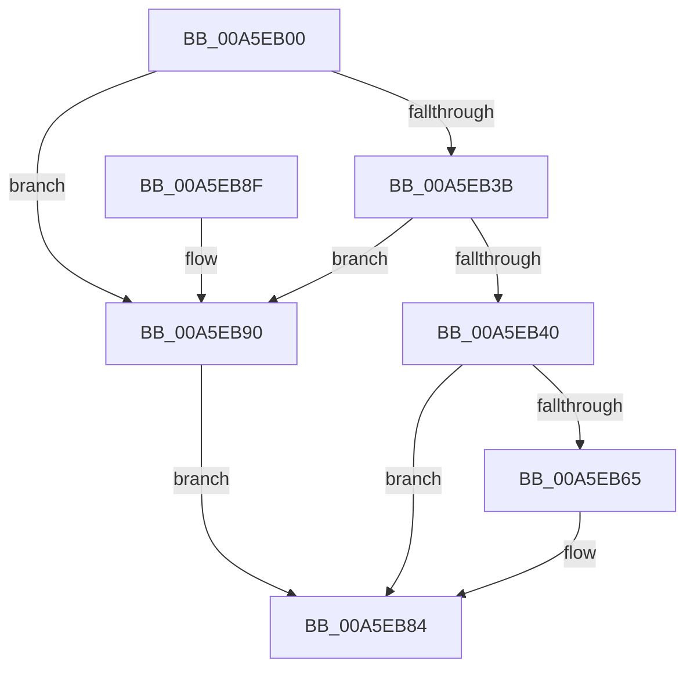

# PiControlGetDeviceDepth

- RVA: `0x00A5EB00`–`0x00A5EB97` (길이 `151` bytes)
- VA: `0x0000000140A5EB00`
- 실행 섹션: `PAGE`
- PDB 이름 있음: `예`; PDB Function 태그: `아니요`
- unwind 정보 RVA: `0x000B2A54`
- 디코드: `43`개 명령, `151/151` bytes 표시
- 미해석 바이트: `0` (있으면 어셈블리에 `.byte`로 보존)

> 이 문서는 커널 이미지의 기계어와 PDB 기호를 분석해 생성했습니다. 4번과 5번은 함수 원형과 자료형을 바이너리 사용 방식에서 추정한 C 해석이며 원본 소스 복구 결과는 아닙니다.

## 1. Dependencies

- 직접 호출 지점: **3**; 고유 호출 대상: **3**
- 직접 호출자로 확인된 함수: **0**
- RIP 상대 이미지 참조: **0**

### Outgoing calls
- `0x00A5EB5C` → [PiControlMakeUserModeCallersCopy](../8E/PiControlMakeUserModeCallersCopy_function_008E4630.md) (function, `0x008E4630`)
- `0x00A5EB6E` → [PiGetDeviceDepth](PiGetDeviceDepth_function_00A5EBA0.md) (function, `0x00A5EBA0`)
- `0x00A5EB7D` → [PiControlFreeUserModeCallersBuffer](../../text/44/PiControlFreeUserModeCallersBuffer_function_00448990.md) (function, `0x00448990`)

### Direct callers
- 이 함수 시작 RVA로 연결되는 직접 call은 확인되지 않았습니다. 간접 호출은 완전히 역산할 수 없습니다.

### Static image references
- 디코드된 RIP-relative 메모리 참조가 없습니다.

## 2. Other-region calls and transfers

- 다른 실행 섹션으로 향하는 call: **1**
  - `0x00A5EB7D` → [PiControlFreeUserModeCallersBuffer](../../text/44/PiControlFreeUserModeCallersBuffer_function_00448990.md) (`PAGE` → `.text`)
- 별도 외부 분기/꼬리 이동을 확인하지 못했습니다.

## 3. Assembly (complete function range)

```asm
00A5EB00  48 8B C4                        mov rax, rsp
00A5EB03  48 89 58 08                     mov qword ptr [rax + 8], rbx
00A5EB07  57                              push rdi
00A5EB08  48 83 EC 40                     sub rsp, 0x40
00A5EB0C  0F B7 0A                        movzx ecx, word ptr [rdx]
00A5EB0F  0F 57 C0                        xorps xmm0, xmm0
00A5EB12  0F 11 40 E8                     movups xmmword ptr [rax - 0x18], xmm0
00A5EB16  66 89 48 EA                     mov word ptr [rax - 0x16], cx
00A5EB1A  41 8A F9                        mov dil, r9b
00A5EB1D  66 89 48 E8                     mov word ptr [rax - 0x18], cx
00A5EB21  41 B9 01 00 00 00               mov r9d, 1
00A5EB27  0F B7 C1                        movzx eax, cx
00A5EB2A  48 8B DA                        mov rbx, rdx
00A5EB2D  66 41 2B C1                     sub ax, r9w
00A5EB31  BA 8F 01 00 00                  mov edx, 0x18f
00A5EB36  66 3B C2                        cmp ax, dx
00A5EB39  77 55                           ja 0x140a5eb90
00A5EB3B  41 84 C9                        test r9b, cl
00A5EB3E  75 50                           jne 0x140a5eb90
00A5EB40  48 8B 53 08                     mov rdx, qword ptr [rbx + 8]
00A5EB44  44 8B C1                        mov r8d, ecx
00A5EB47  44 89 4C 24 28                  mov dword ptr [rsp + 0x28], r9d
00A5EB4C  48 8D 4C 24 38                  lea rcx, [rsp + 0x38]
00A5EB51  41 B9 02 00 00 00               mov r9d, 2
00A5EB57  40 88 7C 24 20                  mov byte ptr [rsp + 0x20], dil
00A5EB5C  E8 CF 5A E8 FF                  call 0x1408e4630
00A5EB61  85 C0                           test eax, eax
00A5EB63  78 1F                           js 0x140a5eb84
00A5EB65  48 8D 53 10                     lea rdx, [rbx + 0x10]
00A5EB69  48 8D 4C 24 30                  lea rcx, [rsp + 0x30]
00A5EB6E  E8 2D 00 00 00                  call 0x140a5eba0
00A5EB73  48 8B 54 24 38                  mov rdx, qword ptr [rsp + 0x38]
00A5EB78  40 8A CF                        mov cl, dil
00A5EB7B  8B D8                           mov ebx, eax
00A5EB7D  E8 0E 9E 9E FF                  call 0x140448990
00A5EB82  8B C3                           mov eax, ebx
00A5EB84  48 8B 5C 24 50                  mov rbx, qword ptr [rsp + 0x50]
00A5EB89  48 83 C4 40                     add rsp, 0x40
00A5EB8D  5F                              pop rdi
00A5EB8E  C3                              ret
00A5EB8F  CC                              int3
00A5EB90  B8 0D 00 00 C0                  mov eax, 0xc000000d
00A5EB95  EB ED                           jmp 0x140a5eb84
```

## 4. C-style interpretation (structured pseudocode)

```c
__int64 __fastcall PiControlGetDeviceDepth(__int64 a1, __int64 a2, __int64 a3, unsigned __int8 a4)
{
    __int64 result;
    __int64 v_rbx;
    __int64 v_rsp;
    unsigned __int64 v_stack_m10;
    unsigned __int64 v_stack_m18;
    unsigned int v_stack_m20;
    unsigned __int8 v_stack_m28;
    unsigned __int64 v_stack_p8;

    *(unsigned __int64 *)(v_rsp + 8) = v_rbx;
    v_rsp = (v_rsp) - (64);
    *(unsigned __int64 *)(v_rsp - 24) = v_xmm0;
    *(unsigned __int16 *)(v_rsp - 22) = (unsigned __int16)(*(unsigned __int16 *)(a2));
    *(unsigned __int16 *)(v_rsp - 24) = (unsigned __int16)(*(unsigned __int16 *)(a2));
    result = (unsigned __int16)(((unsigned __int16)(*(unsigned __int16 *)(a2))) - (1));
    if (((unsigned __int16)(result)) > 399) goto loc_00A5EB90;
    if (((1) & ((unsigned __int8)(*(unsigned __int16 *)(a2)))) != 0) goto loc_00A5EB90;
    v_stack_m20 = 1;
    v_stack_m28 = a4;
    result = PiControlMakeUserModeCallersCopy(v_stack_m10, *(unsigned __int64 *)(a2 + 8), (unsigned int)((unsigned int)(*(unsigned __int16 *)(a2))), 2);
    v_rbx = a2;
    if (!(sign_flag)) {
        a2 = a2 + 16;
        a1 = v_stack_m18;
        result = PiGetDeviceDepth(a1, a2, (unsigned int)((unsigned int)(*(unsigned __int16 *)(a2))), 2);
        a2 = v_stack_m10;
        a1 = a4;
        v_rbx = (unsigned int)(result);
        result = PiControlFreeUserModeCallersBuffer(a1, a2, (unsigned int)((unsigned int)(*(unsigned __int16 *)(a2))), 2);
        result = (unsigned int)(v_rbx);
    }
    v_rsp = (v_rsp) + (64);
    return result;
loc_00A5EB90:
    goto loc_00A5EB84;
}
```

## 5. (Beta) C Style

```c
int64_t PiControlGetDeviceDepth(int64_t Arg1, void *Arg2, int64_t Arg3, uint8_t Arg4)
{
    uint8_t *arg2 = (uint8_t *)Arg2;

    int64_t result;
    int64_t local_rbx;
    int64_t local_rsp;
    uint64_t v_stack_m10;
    uint64_t v_stack_m18;
    uint32_t v_stack_m20;
    uint8_t v_stack_m28;
    uint64_t v_stack_p8;

    *(uint64_t *)(local_rsp + 0x8) = local_rbx;
    local_rsp = (local_rsp) - (64);
    *(uint64_t *)(local_rsp - 0x18) = v_xmm0;
    *(uint16_t *)(local_rsp - 0x16) = (uint16_t)(*(uint16_t *)(arg2));
    *(uint16_t *)(local_rsp - 0x18) = (uint16_t)(*(uint16_t *)(arg2));
    result = (uint16_t)(((uint16_t)(*(uint16_t *)(arg2))) - (1));
    if (((uint16_t)(result)) > 399) goto loc_00A5EB90;
    if (((1) & ((uint8_t)(*(uint16_t *)(arg2)))) != 0) goto loc_00A5EB90;
    v_stack_m20 = 1;
    v_stack_m28 = Arg4;
    result = PiControlMakeUserModeCallersCopy(v_stack_m10, *(uint64_t *)(arg2 + 0x8), (uint32_t)((uint32_t)(*(uint16_t *)(arg2))), 2);
    local_rbx = Arg2;
    if (!(sign_flag)) {
        Arg2 = Arg2 + 16;
        Arg1 = v_stack_m18;
        result = PiGetDeviceDepth(Arg1, Arg2, (uint32_t)((uint32_t)(*(uint16_t *)(arg2))), 2);
        Arg2 = v_stack_m10;
        Arg1 = Arg4;
        local_rbx = (uint32_t)(result);
        result = PiControlFreeUserModeCallersBuffer(Arg1, Arg2, (uint32_t)((uint32_t)(*(uint16_t *)(arg2))), 2);
        result = (uint32_t)(local_rbx);
    }
    local_rsp = (local_rsp) + (64);
    return result;
loc_00A5EB90:
    goto loc_00A5EB84;
}
```

### 관측된 메모리 오프셋

구조체 형식이 확인되지 않은 접근은 인자 기준의 오프셋으로만 기록했습니다.

| 기준 인자 | 오프셋 표현 | 폭 (bit) | 접근 |
|---|---:|---:|---|
| `Arg2` | `+ 0x0` | `16` | `R` |
| `Arg2` | `+ 0x8` | `64` | `R` |
| `Arg2` | `+ 0x10` | `64` | `R` |

## 6. Execution-region graph

[열기: 2D/3D 그래프와 함수 탐색 컨트롤 패널](../../../control-panel.html?section=page&rva=0x00A5EB00&view=graph)

- 2D 그래프는 위에서 아래로 흐르고, 3D 그래프는 빈 공간을 드래그해 회전합니다. Shift+드래그는 이동, 휠은 확대·축소, 함수 노드 선택은 대상 보고서 이동입니다.

### Static fallback


