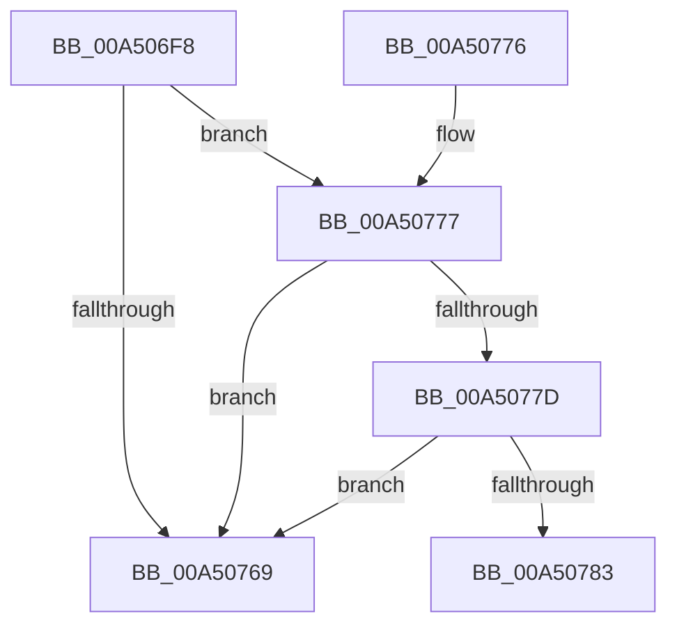

# PiDcGenerateConfigNotificationIfContainerRequiresConfiguration

- RVA: `0x00A506F8`–`0x00A50788` (길이 `144` bytes)
- VA: `0x0000000140A506F8`
- 실행 섹션: `PAGE`
- PDB 이름 있음: `예`; PDB Function 태그: `예`
- unwind 정보 RVA: `0x000B0A48`
- 디코드: `47`개 명령, `144/144` bytes 표시
- 미해석 바이트: `0` (있으면 어셈블리에 `.byte`로 보존)

> 이 문서는 커널 이미지의 기계어와 PDB 기호를 분석해 생성했습니다. 4번과 5번은 함수 원형과 자료형을 바이너리 사용 방식에서 추정한 C 해석이며 원본 소스 복구 결과는 아닙니다.

## 1. Dependencies

- 직접 호출 지점: **1**; 고유 호출 대상: **1**
- 직접 호출자로 확인된 함수: **2**
- RIP 상대 이미지 참조: **2**

### Outgoing calls
- `0x00A5075E` → [PnpGetObjectProperty](../8E/PnpGetObjectProperty_function_008E2180.md) (function, `0x008E2180`)

### Direct callers
- [PiDcHandleContainerEvent](PiDcHandleContainerEvent_function_00A5067C.md) at `0x00A506DB`
- [PiDcInit](../../init/C3/PiDcInit_function_00C344DC.md) at `0x00C34503`

### Static image references
- `0x00A5071C` → RVA `0x00E66398` (`.data`; read)
- `0x00A50745` → RVA `0x0001A660` (`.rdata`; read)

## 2. Other-region calls and transfers

- 다른 실행 섹션으로 향하는 call: **0**
- call이 아닌 외부 분기/꼬리 이동: **1**
  - `0x00A50783` → [sub_00B3C62C](../B3/Unknown_function_00B3C62C.md) (`tail-transfer`)

## 3. Assembly (complete function range)

```asm
00A506F8  4C 8B DC                        mov r11, rsp
00A506FB  55                              push rbp
00A506FC  53                              push rbx
00A506FD  56                              push rsi
00A506FE  57                              push rdi
00A506FF  41 54                           push r12
00A50701  48 8B EC                        mov rbp, rsp
00A50704  48 83 EC 70                     sub rsp, 0x70
00A50708  33 F6                           xor esi, esi
00A5070A  48 8D 45 48                     lea rax, [rbp + 0x48]
00A5070E  89 74 24 50                     mov dword ptr [rsp + 0x50], esi
00A50712  48 8B F9                        mov rdi, rcx
00A50715  49 89 43 B0                     mov qword ptr [r11 - 0x50], rax
00A50719  48 8B D1                        mov rdx, rcx
00A5071C  48 8B 0D 75 5C 41 00            mov rcx, qword ptr [rip + 0x415c75]
00A50723  48 8D 45 38                     lea rax, [rbp + 0x38]
00A50727  C7 44 24 40 01 00 00 00         mov dword ptr [rsp + 0x40], 1
00A5072F  44 8D 46 05                     lea r8d, [rsi + 5]
00A50733  49 89 43 A0                     mov qword ptr [r11 - 0x60], rax
00A50737  45 33 C9                        xor r9d, r9d
00A5073A  48 8D 45 40                     lea rax, [rbp + 0x40]
00A5073E  89 75 40                        mov dword ptr [rbp + 0x40], esi
00A50741  49 89 43 98                     mov qword ptr [r11 - 0x68], rax
00A50745  48 8D 05 14 9F 5C FF            lea rax, [rip - 0xa360ec]
00A5074C  49 89 43 90                     mov qword ptr [r11 - 0x70], rax
00A50750  49 89 73 88                     mov qword ptr [r11 - 0x78], rsi
00A50754  89 75 48                        mov dword ptr [rbp + 0x48], esi
00A50757  89 75 F0                        mov dword ptr [rbp - 0x10], esi
00A5075A  40 88 75 38                     mov byte ptr [rbp + 0x38], sil
00A5075E  E8 1D 1A E9 FF                  call 0x1408e2180
00A50763  8B D8                           mov ebx, eax
00A50765  85 C0                           test eax, eax
00A50767  79 0E                           jns 0x140a50777
00A50769  8B C3                           mov eax, ebx
00A5076B  48 83 C4 70                     add rsp, 0x70
00A5076F  41 5C                           pop r12
00A50771  5F                              pop rdi
00A50772  5E                              pop rsi
00A50773  5B                              pop rbx
00A50774  5D                              pop rbp
00A50775  C3                              ret
00A50776  CC                              int3
00A50777  40 38 75 38                     cmp byte ptr [rbp + 0x38], sil
00A5077B  74 EC                           je 0x140a50769
00A5077D  83 7D 40 11                     cmp dword ptr [rbp + 0x40], 0x11
00A50781  75 E6                           jne 0x140a50769
00A50783  E9 A4 BE 0E 00                  jmp 0x140b3c62c
```

## 4. C-style interpretation (structured pseudocode)

```c
__int64 __fastcall PiDcGenerateConfigNotificationIfContainerRequiresConfiguration(__int64 a1, __int64 a2, __int64 a3, int a4)
{
    __int64 result;
    __int64 v_rsi;
    __int64 v_rsp;
    unsigned int v_stack_m38;
    unsigned int v_stack_m48;
    unsigned int v_stack_m58;
    unsigned __int64 v_stack_p10;
    unsigned __int64 v_stack_p18;
    unsigned __int64 v_stack_p20;

    v_rsp = (v_rsp) - (112);
    v_rsi = 0;
    v_stack_m48 = 0;
    *(unsigned __int64 *)(v_rsp - 80) = v_stack_p20;
    v_stack_m58 = 1;
    *(unsigned __int64 *)(v_rsp - 96) = v_stack_p10;
    a4 = 0;
    v_stack_p18 = 0;
    *(unsigned __int64 *)(v_rsp - 104) = v_stack_p18;
    *(unsigned __int64 *)(v_rsp - 112) = v_rip - 10707180;
    *(unsigned __int64 *)(v_rsp - 120) = 0;
    v_stack_p20 = 0;
    v_stack_m38 = 0;
    v_stack_p10 = 0;
    result = PnpGetObjectProperty(*(unsigned __int64 *)(v_rip + 4283509), a1, v_rsi + 5, a4);
    if (!sign_flag) goto loc_00A50777;
loc_00A50769:
    v_rsp = (v_rsp) + (112);
    return (unsigned int)((unsigned int)((unsigned int)((unsigned int)(result))));
loc_00A50777:
    if (v_stack_p10 == 0) goto loc_00A50769;
    if (v_stack_p18 != 17) goto loc_00A50769;
}
```

## 5. (Beta) C Style

```c
int64_t PiDcGenerateConfigNotificationIfContainerRequiresConfiguration(int64_t Arg1, int64_t Arg2, int64_t Arg3, int32_t Arg4)
{
    int64_t result;
    int64_t local_rsi;
    int64_t local_rsp;
    uint32_t v_stack_m38;
    uint32_t v_stack_m48;
    uint32_t v_stack_m58;
    uint64_t v_stack_p10;
    uint64_t v_stack_p18;
    uint64_t v_stack_p20;

    local_rsp = (local_rsp) - (112);
    local_rsi = 0;
    v_stack_m48 = 0;
    *(uint64_t *)(local_rsp - 0x50) = v_stack_p20;
    v_stack_m58 = 1;
    *(uint64_t *)(local_rsp - 0x60) = v_stack_p10;
    Arg4 = 0;
    v_stack_p18 = 0;
    *(uint64_t *)(local_rsp - 0x68) = v_stack_p18;
    *(uint64_t *)(local_rsp - 0x70) = v_rip - 10707180;
    *(uint64_t *)(local_rsp - 0x78) = 0;
    v_stack_p20 = 0;
    v_stack_m38 = 0;
    v_stack_p10 = 0;
    result = PnpGetObjectProperty(*(uint64_t *)(v_rip + 0x415C75), Arg1, local_rsi + 5, Arg4);
    if (!sign_flag) goto loc_00A50777;
loc_00A50769:
    local_rsp = (local_rsp) + (112);
    return (uint32_t)((uint32_t)((uint32_t)((uint32_t)(result))));
loc_00A50777:
    if (v_stack_p10 == 0) goto loc_00A50769;
    if (v_stack_p18 != 17) goto loc_00A50769;
}
```

## 6. Execution-region graph

[열기: 2D/3D 그래프와 함수 탐색 컨트롤 패널](../../../control-panel.html?section=page&rva=0x00A506F8&view=graph)

- 2D 그래프는 위에서 아래로 흐르고, 3D 그래프는 빈 공간을 드래그해 회전합니다. Shift+드래그는 이동, 휠은 확대·축소, 함수 노드 선택은 대상 보고서 이동입니다.

### Static fallback


