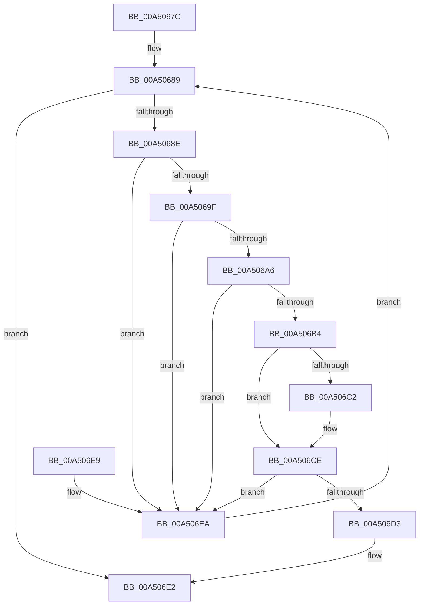

# PiDcHandleContainerEvent

- RVA: `0x00A5067C`–`0x00A506EF` (길이 `115` bytes)
- VA: `0x0000000140A5067C`
- 실행 섹션: `PAGE`
- PDB 이름 있음: `예`; PDB Function 태그: `아니요`
- unwind 정보 RVA: `0x0009FDFC`
- 디코드: `34`개 명령, `115/115` bytes 표시
- 미해석 바이트: `0` (있으면 어셈블리에 `.byte`로 보존)

> 이 문서는 커널 이미지의 기계어와 PDB 기호를 분석해 생성했습니다. 4번과 5번은 함수 원형과 자료형을 바이너리 사용 방식에서 추정한 C 해석이며 원본 소스 복구 결과는 아닙니다.

## 1. Dependencies

- 직접 호출 지점: **1**; 고유 호출 대상: **1**
- 직접 호출자로 확인된 함수: **1**
- RIP 상대 이미지 참조: **2**

### Outgoing calls
- `0x00A506DB` → [PiDcGenerateConfigNotificationIfContainerRequiresConfiguration](PiDcGenerateConfigNotificationIfContainerRequiresConfiguration_function_00A506F8.md) (function, `0x00A506F8`)

### Direct callers
- [PiDcHandleObjectEvent](PiDcHandleObjectEvent_function_00A50368.md) at `0x00A503AA`

### Static image references
- `0x00A506B9` → RVA `0x0001A660` (`.rdata`; read)
- `0x00A506C7` → RVA `0x0001A668` (`.rdata`; read)

## 2. Other-region calls and transfers

- 다른 실행 섹션으로 향하는 call: **0**
- 별도 외부 분기/꼬리 이동을 확인하지 못했습니다.

## 3. Assembly (complete function range)

```asm
00A5067C  48 83 EC 28                     sub rsp, 0x28
00A50680  44 8B 51 4C                     mov r10d, dword ptr [rcx + 0x4c]
00A50684  33 D2                           xor edx, edx
00A50686  44 8B C2                        mov r8d, edx
00A50689  45 3B C2                        cmp r8d, r10d
00A5068C  73 54                           jae 0x140a506e2
00A5068E  45 8B C8                        mov r9d, r8d
00A50691  49 C1 E1 05                     shl r9, 5
00A50695  41 8B C0                        mov eax, r8d
00A50698  41 39 54 09 64                  cmp dword ptr [r9 + rcx + 0x64], edx
00A5069D  75 4B                           jne 0x140a506ea
00A5069F  49 39 54 09 68                  cmp qword ptr [r9 + rcx + 0x68], rdx
00A506A4  75 44                           jne 0x140a506ea
00A506A6  48 83 C0 03                     add rax, 3
00A506AA  48 C1 E0 05                     shl rax, 5
00A506AE  83 3C 08 37                     cmp dword ptr [rax + rcx], 0x37
00A506B2  75 36                           jne 0x140a506ea
00A506B4  49 8B 44 09 50                  mov rax, qword ptr [r9 + rcx + 0x50]
00A506B9  48 2B 05 A0 9F 5C FF            sub rax, qword ptr [rip - 0xa36060]
00A506C0  75 0C                           jne 0x140a506ce
00A506C2  49 8B 44 09 58                  mov rax, qword ptr [r9 + rcx + 0x58]
00A506C7  48 2B 05 9A 9F 5C FF            sub rax, qword ptr [rip - 0xa36066]
00A506CE  48 85 C0                        test rax, rax
00A506D1  75 17                           jne 0x140a506ea
00A506D3  48 8B 49 08                     mov rcx, qword ptr [rcx + 8]
00A506D7  48 8B 49 10                     mov rcx, qword ptr [rcx + 0x10]
00A506DB  E8 18 00 00 00                  call 0x140a506f8
00A506E0  8B D0                           mov edx, eax
00A506E2  8B C2                           mov eax, edx
00A506E4  48 83 C4 28                     add rsp, 0x28
00A506E8  C3                              ret
00A506E9  CC                              int3
00A506EA  41 FF C0                        inc r8d
00A506ED  EB 9A                           jmp 0x140a50689
```

## 4. C-style interpretation (structured pseudocode)

```c
__int64 __fastcall PiDcHandleContainerEvent(__int64 a1, int a2)
{
    __int64 result;
    __int64 v_rsp;

    v_rsp = (v_rsp) - (40);
    a2 = 0;
loc_00A50689:
    if (0 >= ((unsigned int)((unsigned int)(*(unsigned int *)(a1 + 76))))) goto loc_00A506E2;
    a4 = (0) << (5);
    if ((*(unsigned int *)(a4 + a1 * 1 + 100)) != 0) goto loc_00A506EA;
    if ((*(unsigned __int64 *)(a4 + a1 * 1 + 104)) != 0) goto loc_00A506EA;
    result = (0) + (3);
    result = (result) << (5);
    if ((*(unsigned int *)(result + a1 * 1)) != 55) goto loc_00A506EA;
    result = (*(unsigned __int64 *)(a4 + a1 * 1 + 80)) - (*(unsigned __int64 *)(v_rip - 10707040));
    if (!(condition_is_not_equal)) {
        result = *(unsigned __int64 *)(a4 + a1 * 1 + 88);
        result = (result) - (*(unsigned __int64 *)(v_rip - 10707046));
    }
    if (result != 0) goto loc_00A506EA;
    result = PiDcGenerateConfigNotificationIfContainerRequiresConfiguration(*(unsigned __int64 *)(*(unsigned __int64 *)(a1 + 8) + 16), a2, 0, a4);
loc_00A506E2:
    v_rsp = (v_rsp) + (40);
    return (unsigned int)((unsigned int)((unsigned int)((unsigned int)(result))));
loc_00A506EA:
    a3 = (unsigned int)((0) + 1);
    goto loc_00A50689;
}
```

## 5. (Beta) C Style

```c
int64_t PiDcHandleContainerEvent(void *Arg1, int32_t Arg2)
{
    uint8_t *arg1 = (uint8_t *)Arg1;

    int64_t result;
    int64_t local_rsp;

    local_rsp = (local_rsp) - (40);
    Arg2 = 0;
loc_00A50689:
    if (0 >= ((uint32_t)((uint32_t)(*(uint32_t *)(arg1 + 0x4C))))) goto loc_00A506E2;
    a4 = (0) << (5);
    if ((*(uint32_t *)(a4 + arg1 * 1 + 0x64)) != 0) goto loc_00A506EA;
    if ((*(uint64_t *)(a4 + arg1 * 1 + 0x68)) != 0) goto loc_00A506EA;
    result = (0) + (3);
    result = (result) << (5);
    if ((*(uint32_t *)(result + arg1 * 1)) != 55) goto loc_00A506EA;
    result = (*(uint64_t *)(a4 + arg1 * 1 + 0x50)) - (*(uint64_t *)(v_rip - 0xA36060));
    if (!(condition_is_not_equal)) {
        result = *(uint64_t *)(a4 + arg1 * 1 + 0x58);
        result = (result) - (*(uint64_t *)(v_rip - 0xA36066));
    }
    if (result != 0) goto loc_00A506EA;
    result = PiDcGenerateConfigNotificationIfContainerRequiresConfiguration(*(uint64_t *)(*(uint64_t *)(arg1 + 0x8) + 0x10), Arg2, 0, a4);
loc_00A506E2:
    local_rsp = (local_rsp) + (40);
    return (uint32_t)((uint32_t)((uint32_t)((uint32_t)(result))));
loc_00A506EA:
    a3 = (uint32_t)((0) + 1);
    goto loc_00A50689;
}
```

### 관측된 메모리 오프셋

구조체 형식이 확인되지 않은 접근은 인자 기준의 오프셋으로만 기록했습니다.

| 기준 인자 | 오프셋 표현 | 폭 (bit) | 접근 |
|---|---:|---:|---|
| `Arg1` | `+ 0x8` | `64` | `R` |
| `Arg1` | `+ 0x4C` | `32` | `R` |

## 6. Execution-region graph

[열기: 2D/3D 그래프와 함수 탐색 컨트롤 패널](../../../control-panel.html?section=page&rva=0x00A5067C&view=graph)

- 2D 그래프는 위에서 아래로 흐르고, 3D 그래프는 빈 공간을 드래그해 회전합니다. Shift+드래그는 이동, 휠은 확대·축소, 함수 노드 선택은 대상 보고서 이동입니다.

### Static fallback


