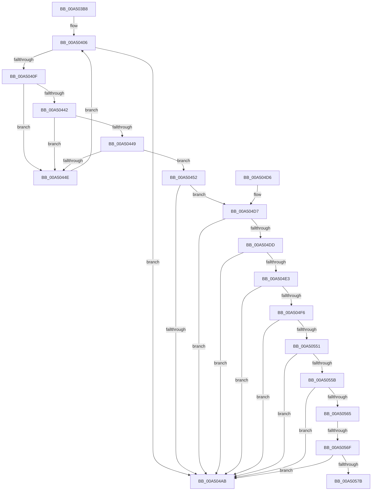

# PiDcHandleDeviceEvent

- RVA: `0x00A503B8`–`0x00A50580` (길이 `456` bytes)
- VA: `0x0000000140A503B8`
- 실행 섹션: `PAGE`
- PDB 이름 있음: `예`; PDB Function 태그: `예`
- unwind 정보 RVA: `0x000B09FC`
- 디코드: `116`개 명령, `456/456` bytes 표시
- 미해석 바이트: `0` (있으면 어셈블리에 `.byte`로 보존)

> 이 문서는 커널 이미지의 기계어와 PDB 기호를 분석해 생성했습니다. 4번과 5번은 함수 원형과 자료형을 바이너리 사용 방식에서 추정한 C 해석이며 원본 소스 복구 결과는 아닙니다.

## 1. Dependencies

- 직접 호출 지점: **5**; 고유 호출 대상: **4**
- 직접 호출자로 확인된 함수: **1**
- RIP 상대 이미지 참조: **5**

### Outgoing calls
- `0x00A50433` → [RtlLookupElementGenericTableAvl](../../text/3F/RtlLookupElementGenericTableAvl_function_003FEFB0.md) (function, `0x003FEFB0`)
- `0x00A504A0` → [PnpGetObjectProperty](../8E/PnpGetObjectProperty_function_008E2180.md) (function, `0x008E2180`)
- `0x00A504B4` → [_security_check_cookie](../../text/6A/_security_check_cookie_function_006AC640.md) (function, `0x006AC640`)
- `0x00A504EB` → [PnpStringFromGuid](../8F/PnpStringFromGuid_function_008F5A2C.md) (function, `0x008F5A2C`)
- `0x00A50542` → [PnpGetObjectProperty](../8E/PnpGetObjectProperty_function_008E2180.md) (function, `0x008E2180`)

### Direct callers
- [PiDcHandleObjectEvent](PiDcHandleObjectEvent_function_00A50368.md) at `0x00A50399`

### Static image references
- `0x00A503D7` → RVA `0x00E0A740` (`.data`; read)
- `0x00A5041A` → RVA `0x00F8B3A0` (`.data`; read)
- `0x00A50461` → RVA `0x00E66398` (`.data`; read)
- `0x00A5048F` → RVA `0x00011568` (`.rdata`; read)
- `0x00A5052C` → RVA `0x000115D0` (`.rdata`; read)

## 2. Other-region calls and transfers

- 다른 실행 섹션으로 향하는 call: **2**
  - `0x00A50433` → [RtlLookupElementGenericTableAvl](../../text/3F/RtlLookupElementGenericTableAvl_function_003FEFB0.md) (`PAGE` → `.text`)
  - `0x00A504B4` → [_security_check_cookie](../../text/6A/_security_check_cookie_function_006AC640.md) (`PAGE` → `.text`)
- call이 아닌 외부 분기/꼬리 이동: **2**
  - `0x00A50569` → [sub_00B3C61C](../B3/Unknown_function_00B3C61C.md) (`tail-transfer`)
  - `0x00A5057B` → [sub_00B3C61C](../B3/Unknown_function_00B3C61C.md) (`tail-transfer`)

## 3. Assembly (complete function range)

```asm
00A503B8  48 8B C4                        mov rax, rsp
00A503BB  48 89 58 10                     mov qword ptr [rax + 0x10], rbx
00A503BF  48 89 70 18                     mov qword ptr [rax + 0x18], rsi
00A503C3  48 89 78 20                     mov qword ptr [rax + 0x20], rdi
00A503C7  55                              push rbp
00A503C8  41 56                           push r14
00A503CA  41 57                           push r15
00A503CC  48 8D 68 A1                     lea rbp, [rax - 0x5f]
00A503D0  48 81 EC 00 01 00 00            sub rsp, 0x100
00A503D7  48 8B 05 62 A3 3B 00            mov rax, qword ptr [rip + 0x3ba362]
00A503DE  48 33 C4                        xor rax, rsp
00A503E1  48 89 45 37                     mov qword ptr [rbp + 0x37], rax
00A503E5  33 DB                           xor ebx, ebx
00A503E7  0F 57 C0                        xorps xmm0, xmm0
00A503EA  21 5D AF                        and dword ptr [rbp - 0x51], ebx
00A503ED  33 C0                           xor eax, eax
00A503EF  21 5D AB                        and dword ptr [rbp - 0x55], ebx
00A503F2  48 8B F1                        mov rsi, rcx
00A503F5  33 FF                           xor edi, edi
00A503F7  88 5D A7                        mov byte ptr [rbp - 0x59], bl
00A503FA  0F 11 45 CF                     movups xmmword ptr [rbp - 0x31], xmm0
00A503FE  48 89 45 C7                     mov qword ptr [rbp - 0x39], rax
00A50402  0F 11 45 B7                     movups xmmword ptr [rbp - 0x49], xmm0
00A50406  3B 7E 4C                        cmp edi, dword ptr [rsi + 0x4c]
00A50409  0F 83 9C 00 00 00               jae 0x140a504ab
00A5040F  44 8B F7                        mov r14d, edi
00A50412  48 8D 55 B7                     lea rdx, [rbp - 0x49]
00A50416  49 C1 E6 05                     shl r14, 5
00A5041A  48 8D 0D 7F AF 53 00            lea rcx, [rip + 0x53af7f]
00A50421  41 0F 10 44 36 50               movups xmm0, xmmword ptr [r14 + rsi + 0x50]
00A50427  41 8B 44 36 60                  mov eax, dword ptr [r14 + rsi + 0x60]
00A5042C  89 45 C7                        mov dword ptr [rbp - 0x39], eax
00A5042F  0F 11 45 B7                     movups xmmword ptr [rbp - 0x49], xmm0
00A50433  E8 78 EB 9A FF                  call 0x1403fefb0
00A50438  4C 8B F8                        mov r15, rax
00A5043B  41 39 5C 36 64                  cmp dword ptr [r14 + rsi + 0x64], ebx
00A50440  75 0C                           jne 0x140a5044e
00A50442  49 39 5C 36 68                  cmp qword ptr [r14 + rsi + 0x68], rbx
00A50447  75 05                           jne 0x140a5044e
00A50449  48 85 C0                        test rax, rax
00A5044C  75 04                           jne 0x140a50452
00A5044E  FF C7                           inc edi
00A50450  EB B4                           jmp 0x140a50406
00A50452  21 5C 24 50                     and dword ptr [rsp + 0x50], ebx
00A50456  48 8D 45 AF                     lea rax, [rbp - 0x51]
00A5045A  48 8B 56 08                     mov rdx, qword ptr [rsi + 8]
00A5045E  45 33 C9                        xor r9d, r9d
00A50461  48 8B 0D 30 5F 41 00            mov rcx, qword ptr [rip + 0x415f30]
00A50468  48 89 44 24 48                  mov qword ptr [rsp + 0x48], rax
00A5046D  48 8D 45 CF                     lea rax, [rbp - 0x31]
00A50471  C7 44 24 40 10 00 00 00         mov dword ptr [rsp + 0x40], 0x10
00A50479  48 8B 52 10                     mov rdx, qword ptr [rdx + 0x10]
00A5047D  45 8D 41 01                     lea r8d, [r9 + 1]
00A50481  48 89 44 24 38                  mov qword ptr [rsp + 0x38], rax
00A50486  48 8D 45 AB                     lea rax, [rbp - 0x55]
00A5048A  48 89 44 24 30                  mov qword ptr [rsp + 0x30], rax
00A5048F  48 8D 05 D2 10 5C FF            lea rax, [rip - 0xa3ef2e]
00A50496  48 89 44 24 28                  mov qword ptr [rsp + 0x28], rax
00A5049B  48 21 5C 24 20                  and qword ptr [rsp + 0x20], rbx
00A504A0  E8 DB 1C E9 FF                  call 0x1408e2180
00A504A5  8B D8                           mov ebx, eax
00A504A7  85 C0                           test eax, eax
00A504A9  79 2C                           jns 0x140a504d7
00A504AB  8B C3                           mov eax, ebx
00A504AD  48 8B 4D 37                     mov rcx, qword ptr [rbp + 0x37]
00A504B1  48 33 CC                        xor rcx, rsp
00A504B4  E8 87 C1 C5 FF                  call 0x1406ac640
00A504B9  4C 8D 9C 24 00 01 00 00         lea r11, [rsp + 0x100]
00A504C1  49 8B 5B 28                     mov rbx, qword ptr [r11 + 0x28]
00A504C5  49 8B 73 30                     mov rsi, qword ptr [r11 + 0x30]
00A504C9  49 8B 7B 38                     mov rdi, qword ptr [r11 + 0x38]
00A504CD  49 8B E3                        mov rsp, r11
00A504D0  41 5F                           pop r15
00A504D2  41 5E                           pop r14
00A504D4  5D                              pop rbp
00A504D5  C3                              ret
00A504D6  CC                              int3
00A504D7  83 7D AB 0D                     cmp dword ptr [rbp - 0x55], 0xd
00A504DB  75 CE                           jne 0x140a504ab
00A504DD  83 7D AF 10                     cmp dword ptr [rbp - 0x51], 0x10
00A504E1  75 C8                           jne 0x140a504ab
00A504E3  48 8D 55 E7                     lea rdx, [rbp - 0x19]
00A504E7  48 8D 4D CF                     lea rcx, [rbp - 0x31]
00A504EB  E8 3C 55 EA FF                  call 0x1408f5a2c
00A504F0  8B D8                           mov ebx, eax
00A504F2  85 C0                           test eax, eax
00A504F4  78 B5                           js 0x140a504ab
00A504F6  83 64 24 50 00                  and dword ptr [rsp + 0x50], 0
00A504FB  48 8D 45 AF                     lea rax, [rbp - 0x51]
00A504FF  48 8B 0D 92 5E 41 00            mov rcx, qword ptr [rip + 0x415e92]
00A50506  48 8D 55 E7                     lea rdx, [rbp - 0x19]
00A5050A  48 89 44 24 48                  mov qword ptr [rsp + 0x48], rax
00A5050F  45 33 C9                        xor r9d, r9d
00A50512  C7 44 24 40 01 00 00 00         mov dword ptr [rsp + 0x40], 1
00A5051A  48 8D 45 A7                     lea rax, [rbp - 0x59]
00A5051E  48 89 44 24 38                  mov qword ptr [rsp + 0x38], rax
00A50523  48 8D 45 AB                     lea rax, [rbp - 0x55]
00A50527  48 89 44 24 30                  mov qword ptr [rsp + 0x30], rax
00A5052C  48 8D 05 9D 10 5C FF            lea rax, [rip - 0xa3ef63]
00A50533  48 89 44 24 28                  mov qword ptr [rsp + 0x28], rax
00A50538  45 8D 41 05                     lea r8d, [r9 + 5]
00A5053C  48 83 64 24 20 00               and qword ptr [rsp + 0x20], 0
00A50542  E8 39 1C E9 FF                  call 0x1408e2180
00A50547  8B D8                           mov ebx, eax
00A50549  85 C0                           test eax, eax
00A5054B  0F 88 5A FF FF FF               js 0x140a504ab
00A50551  83 7D AB 11                     cmp dword ptr [rbp - 0x55], 0x11
00A50555  0F 85 50 FF FF FF               jne 0x140a504ab
00A5055B  83 7D AF 01                     cmp dword ptr [rbp - 0x51], 1
00A5055F  0F 85 46 FF FF FF               jne 0x140a504ab
00A50565  80 7D A7 FF                     cmp byte ptr [rbp - 0x59], 0xff
00A50569  0F 85 AD C0 0E 00               jne 0x140b3c61c
00A5056F  41 8B 47 14                     mov eax, dword ptr [r15 + 0x14]
00A50573  A8 01                           test al, 1
00A50575  0F 84 30 FF FF FF               je 0x140a504ab
00A5057B  E9 9C C0 0E 00                  jmp 0x140b3c61c
```

## 4. C-style interpretation (structured pseudocode)

```c
__int64 __fastcall PiDcHandleDeviceEvent(__int64 a1, __int64 a2, __int64 a3, int a4)
{
    __int64 result;
    __int64 v_r14;
    __int64 v_rbx;
    __int64 v_rdi;
    __int64 v_rsp;
    unsigned __int64 v_stack_m18;
    unsigned int v_stack_mB0;
    unsigned __int64 v_stack_mB8;
    unsigned int v_stack_mC0;
    unsigned int v_stack_mC8;
    unsigned __int64 v_stack_mD0;
    unsigned int v_stack_mD8;
    unsigned __int64 v_stack_mE0;
    unsigned __int64 v_stack_mE8;
    unsigned __int64 v_stack_mF0;
    unsigned __int64 v_stack_mF8;

    *(unsigned __int64 *)(v_rsp + 16) = v_rbx;
    *(unsigned __int64 *)(v_rsp + 24) = v_rsi;
    *(unsigned __int64 *)(v_rsp + 32) = v_rdi;
    v_rsp = (v_rsp) - (256);
    result = (*(unsigned __int64 *)(v_rip + 3908450)) ^ (v_rsp);
    *(unsigned __int64 *)(v_rsp - 95 + 55) = result;
    v_rbx = 0;
    result = 0;
    v_rdi = 0;
    *(unsigned __int8 *)(v_rsp - 95 - 89) = 0;
    *(unsigned __int64 *)(v_rsp - 95 - 49) = v_xmm0;
    *(unsigned __int64 *)(v_rsp - 95 - 57) = 0;
    *(unsigned __int64 *)(v_rsp - 95 - 73) = v_xmm0;
loc_00A50406:
    if (0 >= (*(unsigned int *)(a1 + 76))) goto loc_00A504AB;
    v_r14 = (0) << (5);
    *(unsigned int *)(v_rsp - 95 - 57) = (unsigned int)((unsigned int)(*(unsigned int *)(v_r14 + a1 * 1 + 96)));
    *(unsigned __int64 *)(v_rsp - 95 - 73) = v_xmm0;
    result = RtlLookupElementGenericTableAvl(v_rip + 5484415, v_rsp - 95 - 73, a3, a4);
    if ((*(unsigned int *)(v_r14 + a1 * 1 + 100)) != 0) goto loc_00A5044E;
    if ((*(unsigned __int64 *)(v_r14 + a1 * 1 + 104)) != 0) goto loc_00A5044E;
    if (result != 0) goto loc_00A50452;
loc_00A5044E:
    v_rdi = (unsigned int)((v_rdi) + 1);
    goto loc_00A50406;
loc_00A50452:
    a4 = 0;
    v_stack_mD0 = v_rsp - 95 - 81;
    v_stack_mD8 = 16;
    v_stack_mE0 = v_rsp - 95 - 49;
    v_stack_mE8 = v_rsp - 95 - 85;
    v_stack_mF0 = v_rip - 10743598;
    result = PnpGetObjectProperty(*(unsigned __int64 *)(v_rip + 4284208), *(unsigned __int64 *)(*(unsigned __int64 *)(a1 + 8) + 16), a4 + 1, a4);
    if (!sign_flag) goto loc_00A504D7;
loc_00A504AB:
    a1 = (*(unsigned __int64 *)(v_rsp - 95 + 55)) ^ (v_rsp);
    result = _security_check_cookie(a1, *(unsigned __int64 *)(*(unsigned __int64 *)(a1 + 8) + 16), a4 + 1, a4);
    return result;
loc_00A504D7:
    if ((*(unsigned int *)(v_rsp - 95 - 85)) != 13) goto loc_00A504AB;
    if ((*(unsigned int *)(v_rsp - 95 - 81)) != 16) goto loc_00A504AB;
    result = PnpStringFromGuid(v_rsp - 95 - 49, v_rsp - 95 - 25, a4 + 1, a4);
    if (sign_flag) goto loc_00A504AB;
    v_stack_mB8 = v_rsp - 95 - 81;
    a4 = 0;
    v_stack_mC0 = 1;
    v_stack_mC8 = v_rsp - 95 - 89;
    v_stack_mD0 = v_rsp - 95 - 85;
    v_stack_mD8 = v_rip - 10743651;
    result = PnpGetObjectProperty(*(unsigned __int64 *)(v_rip + 4284050), v_rsp - 95 - 25, a4 + 5, a4);
    if (sign_flag) goto loc_00A504AB;
    if ((*(unsigned int *)(v_rsp - 95 - 85)) != 17) goto loc_00A504AB;
    if ((*(unsigned int *)(v_rsp - 95 - 81)) != 1) goto loc_00A504AB;
    if ((((unsigned __int8)((unsigned int)(*(unsigned int *)(result + 20)))) & (1)) == 0) goto loc_00A504AB;
}
```

## 5. (Beta) C Style

```c
int64_t PiDcHandleDeviceEvent(void *Arg1, int64_t Arg2, int64_t Arg3, int32_t Arg4)
{
    uint8_t *arg1 = (uint8_t *)Arg1;

    int64_t result;
    int64_t local_r14;
    int64_t local_rbx;
    int64_t local_rdi;
    int64_t local_rsp;
    uint64_t v_stack_m18;
    uint32_t v_stack_mB0;
    uint64_t v_stack_mB8;
    uint32_t v_stack_mC0;
    uint32_t v_stack_mC8;
    uint64_t v_stack_mD0;
    uint32_t v_stack_mD8;
    uint64_t v_stack_mE0;
    uint64_t v_stack_mE8;
    uint64_t v_stack_mF0;
    uint64_t v_stack_mF8;

    *(uint64_t *)(local_rsp + 0x10) = local_rbx;
    *(uint64_t *)(local_rsp + 0x18) = local_rsi;
    *(uint64_t *)(local_rsp + 0x20) = local_rdi;
    local_rsp = (local_rsp) - (256);
    result = (*(uint64_t *)(v_rip + 0x3BA362)) ^ (local_rsp);
    *(uint64_t *)(local_rsp - 0x5F + 0x37) = result;
    local_rbx = 0;
    result = 0;
    local_rdi = 0;
    *(uint8_t *)(local_rsp - 0x5F - 0x59) = 0;
    *(uint64_t *)(local_rsp - 0x5F - 0x31) = v_xmm0;
    *(uint64_t *)(local_rsp - 0x5F - 0x39) = 0;
    *(uint64_t *)(local_rsp - 0x5F - 0x49) = v_xmm0;
loc_00A50406:
    if (0 >= (*(uint32_t *)(arg1 + 0x4C))) goto loc_00A504AB;
    local_r14 = (0) << (5);
    *(uint32_t *)(local_rsp - 0x5F - 0x39) = (uint32_t)((uint32_t)(*(uint32_t *)(local_r14 + arg1 * 1 + 0x60)));
    *(uint64_t *)(local_rsp - 0x5F - 0x49) = v_xmm0;
    result = RtlLookupElementGenericTableAvl(v_rip + 5484415, local_rsp - 95 - 73, Arg3, Arg4);
    if ((*(uint32_t *)(local_r14 + arg1 * 1 + 0x64)) != 0) goto loc_00A5044E;
    if ((*(uint64_t *)(local_r14 + arg1 * 1 + 0x68)) != 0) goto loc_00A5044E;
    if (result != 0) goto loc_00A50452;
loc_00A5044E:
    local_rdi = (uint32_t)((local_rdi) + 1);
    goto loc_00A50406;
loc_00A50452:
    Arg4 = 0;
    v_stack_mD0 = local_rsp - 95 - 81;
    v_stack_mD8 = 16;
    v_stack_mE0 = local_rsp - 95 - 49;
    v_stack_mE8 = local_rsp - 95 - 85;
    v_stack_mF0 = v_rip - 10743598;
    result = PnpGetObjectProperty(*(uint64_t *)(v_rip + 0x415F30), *(uint64_t *)(*(uint64_t *)(arg1 + 0x8) + 0x10), Arg4 + 1, Arg4);
    if (!sign_flag) goto loc_00A504D7;
loc_00A504AB:
    Arg1 = (*(uint64_t *)(local_rsp - 0x5F + 0x37)) ^ (local_rsp);
    result = _security_check_cookie(Arg1, *(uint64_t *)(*(uint64_t *)(arg1 + 0x8) + 0x10), Arg4 + 1, Arg4);
    return result;
loc_00A504D7:
    if ((*(uint32_t *)(local_rsp - 0x5F - 0x55)) != 13) goto loc_00A504AB;
    if ((*(uint32_t *)(local_rsp - 0x5F - 0x51)) != 16) goto loc_00A504AB;
    result = PnpStringFromGuid(local_rsp - 95 - 49, local_rsp - 95 - 25, Arg4 + 1, Arg4);
    if (sign_flag) goto loc_00A504AB;
    v_stack_mB8 = local_rsp - 95 - 81;
    Arg4 = 0;
    v_stack_mC0 = 1;
    v_stack_mC8 = local_rsp - 95 - 89;
    v_stack_mD0 = local_rsp - 95 - 85;
    v_stack_mD8 = v_rip - 10743651;
    result = PnpGetObjectProperty(*(uint64_t *)(v_rip + 0x415E92), local_rsp - 95 - 25, Arg4 + 5, Arg4);
    if (sign_flag) goto loc_00A504AB;
    if ((*(uint32_t *)(local_rsp - 0x5F - 0x55)) != 17) goto loc_00A504AB;
    if ((*(uint32_t *)(local_rsp - 0x5F - 0x51)) != 1) goto loc_00A504AB;
    if ((((uint8_t)((uint32_t)(*(uint32_t *)(result + 0x14)))) & (1)) == 0) goto loc_00A504AB;
}
```

### 관측된 메모리 오프셋

구조체 형식이 확인되지 않은 접근은 인자 기준의 오프셋으로만 기록했습니다.

| 기준 인자 | 오프셋 표현 | 폭 (bit) | 접근 |
|---|---:|---:|---|
| `Arg1` | `+ 0x8` | `64` | `R` |
| `Arg1` | `+ 0x4C` | `32` | `R` |

## 6. Execution-region graph

[열기: 2D/3D 그래프와 함수 탐색 컨트롤 패널](../../../control-panel.html?section=page&rva=0x00A503B8&view=graph)

- 2D 그래프는 위에서 아래로 흐르고, 3D 그래프는 빈 공간을 드래그해 회전합니다. Shift+드래그는 이동, 휠은 확대·축소, 함수 노드 선택은 대상 보고서 이동입니다.

### Static fallback


