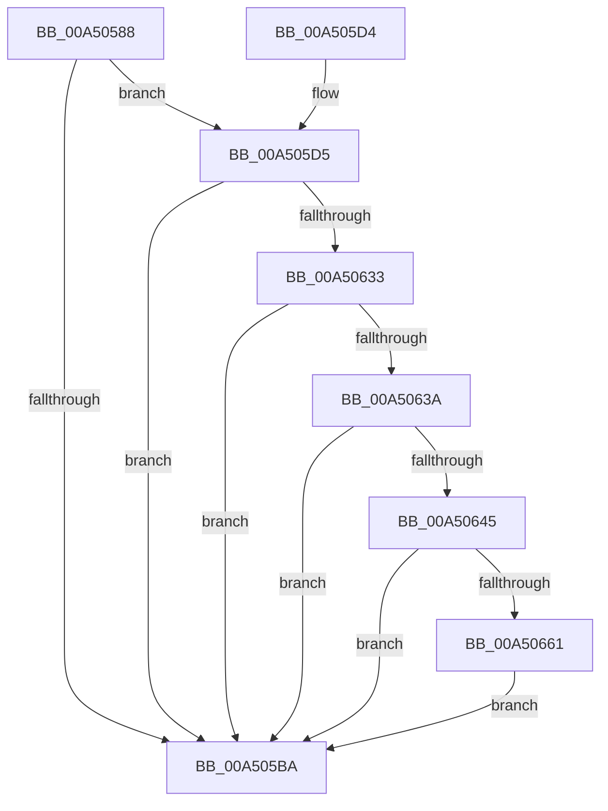

# PiDcHandleInterfaceEvent

- RVA: `0x00A50588`–`0x00A50675` (길이 `237` bytes)
- VA: `0x0000000140A50588`
- 실행 섹션: `PAGE`
- PDB 이름 있음: `예`; PDB Function 태그: `아니요`
- unwind 정보 RVA: `0x000B0A34`
- 디코드: `53`개 명령, `237/237` bytes 표시
- 미해석 바이트: `0` (있으면 어셈블리에 `.byte`로 보존)

> 이 문서는 커널 이미지의 기계어와 PDB 기호를 분석해 생성했습니다. 4번과 5번은 함수 원형과 자료형을 바이너리 사용 방식에서 추정한 C 해석이며 원본 소스 복구 결과는 아닙니다.

## 1. Dependencies

- 직접 호출 지점: **4**; 고유 호출 대상: **4**
- 직접 호출자로 확인된 함수: **1**
- RIP 상대 이미지 참조: **3**

### Outgoing calls
- `0x00A505C7` → [_security_check_cookie](../../text/6A/_security_check_cookie_function_006AC640.md) (function, `0x006AC640`)
- `0x00A50628` → [PnpGetObjectProperty](../8E/PnpGetObjectProperty_function_008E2180.md) (function, `0x008E2180`)
- `0x00A50652` → [PnpStringFromGuid](../8F/PnpStringFromGuid_function_008F5A2C.md) (function, `0x008F5A2C`)
- `0x00A50669` → [PiDcContainerRequiresConfiguration](../AB/PiDcContainerRequiresConfiguration_function_00AB6004.md) (function, `0x00AB6004`)

### Direct callers
- [PiDcHandleObjectEvent](PiDcHandleObjectEvent_function_00A50368.md) at `0x00A503A3`

### Static image references
- `0x00A5058F` → RVA `0x00E0A740` (`.data`; read)
- `0x00A505E6` → RVA `0x00E66398` (`.data`; read)
- `0x00A50616` → RVA `0x00011568` (`.rdata`; read)

## 2. Other-region calls and transfers

- 다른 실행 섹션으로 향하는 call: **1**
  - `0x00A505C7` → [_security_check_cookie](../../text/6A/_security_check_cookie_function_006AC640.md) (`PAGE` → `.text`)
- 별도 외부 분기/꼬리 이동을 확인하지 못했습니다.

## 3. Assembly (complete function range)

```asm
00A50588  48 81 EC E8 00 00 00            sub rsp, 0xe8
00A5058F  48 8B 05 AA A1 3B 00            mov rax, qword ptr [rip + 0x3ba1aa]
00A50596  48 33 C4                        xor rax, rsp
00A50599  48 89 84 24 D0 00 00 00         mov qword ptr [rsp + 0xd0], rax
00A505A1  8B 41 04                        mov eax, dword ptr [rcx + 4]
00A505A4  33 D2                           xor edx, edx
00A505A6  21 54 24 64                     and dword ptr [rsp + 0x64], edx
00A505AA  0F 57 C0                        xorps xmm0, xmm0
00A505AD  21 54 24 60                     and dword ptr [rsp + 0x60], edx
00A505B1  0F 11 44 24 68                  movups xmmword ptr [rsp + 0x68], xmm0
00A505B6  A8 01                           test al, 1
00A505B8  75 1B                           jne 0x140a505d5
00A505BA  8B C2                           mov eax, edx
00A505BC  48 8B 8C 24 D0 00 00 00         mov rcx, qword ptr [rsp + 0xd0]
00A505C4  48 33 CC                        xor rcx, rsp
00A505C7  E8 74 C0 C5 FF                  call 0x1406ac640
00A505CC  48 81 C4 E8 00 00 00            add rsp, 0xe8
00A505D3  C3                              ret
00A505D4  CC                              int3
00A505D5  83 64 24 50 00                  and dword ptr [rsp + 0x50], 0
00A505DA  48 8D 44 24 64                  lea rax, [rsp + 0x64]
00A505DF  48 8B 51 08                     mov rdx, qword ptr [rcx + 8]
00A505E3  45 33 C9                        xor r9d, r9d
00A505E6  48 8B 0D AB 5D 41 00            mov rcx, qword ptr [rip + 0x415dab]
00A505ED  48 89 44 24 48                  mov qword ptr [rsp + 0x48], rax
00A505F2  48 8D 44 24 68                  lea rax, [rsp + 0x68]
00A505F7  C7 44 24 40 10 00 00 00         mov dword ptr [rsp + 0x40], 0x10
00A505FF  48 8B 52 10                     mov rdx, qword ptr [rdx + 0x10]
00A50603  45 8D 41 03                     lea r8d, [r9 + 3]
00A50607  48 89 44 24 38                  mov qword ptr [rsp + 0x38], rax
00A5060C  48 8D 44 24 60                  lea rax, [rsp + 0x60]
00A50611  48 89 44 24 30                  mov qword ptr [rsp + 0x30], rax
00A50616  48 8D 05 4B 0F 5C FF            lea rax, [rip - 0xa3f0b5]
00A5061D  48 89 44 24 28                  mov qword ptr [rsp + 0x28], rax
00A50622  48 83 64 24 20 00               and qword ptr [rsp + 0x20], 0
00A50628  E8 53 1B E9 FF                  call 0x1408e2180
00A5062D  8B D0                           mov edx, eax
00A5062F  85 C0                           test eax, eax
00A50631  78 87                           js 0x140a505ba
00A50633  83 7C 24 60 0D                  cmp dword ptr [rsp + 0x60], 0xd
00A50638  75 80                           jne 0x140a505ba
00A5063A  83 7C 24 64 10                  cmp dword ptr [rsp + 0x64], 0x10
00A5063F  0F 85 75 FF FF FF               jne 0x140a505ba
00A50645  48 8D 94 24 80 00 00 00         lea rdx, [rsp + 0x80]
00A5064D  48 8D 4C 24 68                  lea rcx, [rsp + 0x68]
00A50652  E8 D5 53 EA FF                  call 0x1408f5a2c
00A50657  8B D0                           mov edx, eax
00A50659  85 C0                           test eax, eax
00A5065B  0F 88 59 FF FF FF               js 0x140a505ba
00A50661  48 8D 8C 24 80 00 00 00         lea rcx, [rsp + 0x80]
00A50669  E8 96 59 06 00                  call 0x140ab6004
00A5066E  8B D0                           mov edx, eax
00A50670  E9 45 FF FF FF                  jmp 0x140a505ba
```

## 4. C-style interpretation (structured pseudocode)

```c
__int64 __fastcall PiDcHandleInterfaceEvent(__int64 a1, int a2, __int64 a3, int a4)
{
    __int64 result;
    __int64 v_rsp;
    unsigned __int64 v_stack_m18;
    unsigned __int64 v_stack_m80;
    unsigned int v_stack_m84;
    unsigned int v_stack_m88;
    unsigned __int64 v_stack_p20;
    unsigned __int64 v_stack_p28;
    unsigned __int64 v_stack_p30;
    unsigned __int64 v_stack_p38;
    unsigned int v_stack_p40;
    unsigned __int64 v_stack_p48;
    unsigned int v_stack_p50;
    unsigned __int64 v_stack_p60;
    unsigned __int64 v_stack_p64;
    unsigned __int64 v_stack_p68;
    unsigned __int64 v_stack_p80;

    v_rsp = (v_rsp) - (232);
    result = (*(unsigned __int64 *)(v_rip + 3908010)) ^ (v_rsp);
    v_stack_m18 = result;
    a2 = 0;
    v_stack_m80 = v_xmm0;
    if ((((unsigned __int8)((unsigned int)(*(unsigned int *)(a1 + 4)))) & (1)) != 0) goto loc_00A505D5;
loc_00A505BA:
    a1 = (v_stack_m18) ^ (v_rsp);
    result = _security_check_cookie(a1, a2, a3, a4);
    v_rsp = (v_rsp) + (232);
    return result;
loc_00A505D5:
    a4 = 0;
    v_stack_p48 = v_stack_p64;
    v_stack_p40 = 16;
    v_stack_p38 = v_stack_p68;
    v_stack_p30 = v_stack_p60;
    v_stack_p28 = v_rip - 10743989;
    result = PnpGetObjectProperty(*(unsigned __int64 *)(v_rip + 4283819), *(unsigned __int64 *)(*(unsigned __int64 *)(a1 + 8) + 16), a4 + 3, a4);
    if (sign_flag) goto loc_00A505BA;
    if (v_stack_p60 != 13) goto loc_00A505BA;
    if (v_stack_p64 != 16) goto loc_00A505BA;
    result = PnpStringFromGuid(v_stack_p68, v_stack_p80, a4 + 3, a4);
    if (sign_flag) goto loc_00A505BA;
    result = PiDcContainerRequiresConfiguration(v_stack_p80, (unsigned int)((unsigned int)(result)), a4 + 3, a4);
    goto loc_00A505BA;
}
```

## 5. (Beta) C Style

```c
int64_t PiDcHandleInterfaceEvent(void *Arg1, int32_t Arg2, int64_t Arg3, int32_t Arg4)
{
    uint8_t *arg1 = (uint8_t *)Arg1;

    int64_t result;
    int64_t local_rsp;
    uint64_t v_stack_m18;
    uint64_t v_stack_m80;
    uint32_t v_stack_m84;
    uint32_t v_stack_m88;
    uint64_t v_stack_p20;
    uint64_t v_stack_p28;
    uint64_t v_stack_p30;
    uint64_t v_stack_p38;
    uint32_t v_stack_p40;
    uint64_t v_stack_p48;
    uint32_t v_stack_p50;
    uint64_t v_stack_p60;
    uint64_t v_stack_p64;
    uint64_t v_stack_p68;
    uint64_t v_stack_p80;

    local_rsp = (local_rsp) - (232);
    result = (*(uint64_t *)(v_rip + 0x3BA1AA)) ^ (local_rsp);
    v_stack_m18 = result;
    Arg2 = 0;
    v_stack_m80 = v_xmm0;
    if ((((uint8_t)((uint32_t)(*(uint32_t *)(arg1 + 0x4)))) & (1)) != 0) goto loc_00A505D5;
loc_00A505BA:
    Arg1 = (v_stack_m18) ^ (local_rsp);
    result = _security_check_cookie(Arg1, Arg2, Arg3, Arg4);
    local_rsp = (local_rsp) + (232);
    return result;
loc_00A505D5:
    Arg4 = 0;
    v_stack_p48 = v_stack_p64;
    v_stack_p40 = 16;
    v_stack_p38 = v_stack_p68;
    v_stack_p30 = v_stack_p60;
    v_stack_p28 = v_rip - 10743989;
    result = PnpGetObjectProperty(*(uint64_t *)(v_rip + 0x415DAB), *(uint64_t *)(*(uint64_t *)(arg1 + 0x8) + 0x10), Arg4 + 3, Arg4);
    if (sign_flag) goto loc_00A505BA;
    if (v_stack_p60 != 13) goto loc_00A505BA;
    if (v_stack_p64 != 16) goto loc_00A505BA;
    result = PnpStringFromGuid(v_stack_p68, v_stack_p80, Arg4 + 3, Arg4);
    if (sign_flag) goto loc_00A505BA;
    result = PiDcContainerRequiresConfiguration(v_stack_p80, (uint32_t)((uint32_t)(result)), Arg4 + 3, Arg4);
    goto loc_00A505BA;
}
```

### 관측된 메모리 오프셋

구조체 형식이 확인되지 않은 접근은 인자 기준의 오프셋으로만 기록했습니다.

| 기준 인자 | 오프셋 표현 | 폭 (bit) | 접근 |
|---|---:|---:|---|
| `Arg1` | `+ 0x4` | `32` | `R` |
| `Arg1` | `+ 0x8` | `64` | `R` |

## 6. Execution-region graph

[열기: 2D/3D 그래프와 함수 탐색 컨트롤 패널](../../../control-panel.html?section=page&rva=0x00A50588&view=graph)

- 2D 그래프는 위에서 아래로 흐르고, 3D 그래프는 빈 공간을 드래그해 회전합니다. Shift+드래그는 이동, 휠은 확대·축소, 함수 노드 선택은 대상 보고서 이동입니다.

### Static fallback


