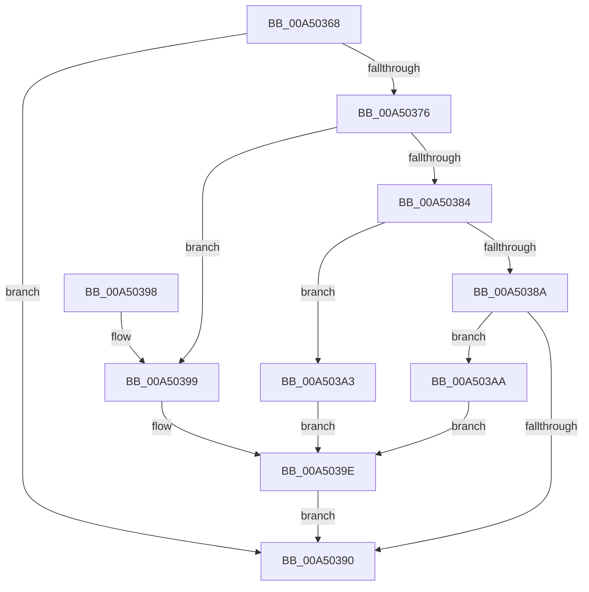

# PiDcHandleObjectEvent

- RVA: `0x00A50368`–`0x00A503B1` (길이 `73` bytes)
- VA: `0x0000000140A50368`
- 실행 섹션: `PAGE`
- PDB 이름 있음: `예`; PDB Function 태그: `아니요`
- unwind 정보 RVA: `0x00065F4C`
- 디코드: `24`개 명령, `73/73` bytes 표시
- 미해석 바이트: `0` (있으면 어셈블리에 `.byte`로 보존)

> 이 문서는 커널 이미지의 기계어와 PDB 기호를 분석해 생성했습니다. 4번과 5번은 함수 원형과 자료형을 바이너리 사용 방식에서 추정한 C 해석이며 원본 소스 복구 결과는 아닙니다.

## 1. Dependencies

- 직접 호출 지점: **3**; 고유 호출 대상: **3**
- 직접 호출자로 확인된 함수: **1**
- RIP 상대 이미지 참조: **0**

### Outgoing calls
- `0x00A50399` → [PiDcHandleDeviceEvent](PiDcHandleDeviceEvent_function_00A503B8.md) (function, `0x00A503B8`)
- `0x00A503A3` → [PiDcHandleInterfaceEvent](PiDcHandleInterfaceEvent_function_00A50588.md) (function, `0x00A50588`)
- `0x00A503AA` → [PiDcHandleContainerEvent](PiDcHandleContainerEvent_function_00A5067C.md) (function, `0x00A5067C`)

### Direct callers
- [PiPnpRtlObjectEventDispatch](../8E/PiPnpRtlObjectEventDispatch_function_008E0D5C.md) at `0x008E0D79`

### Static image references
- 디코드된 RIP-relative 메모리 참조가 없습니다.

## 2. Other-region calls and transfers

- 다른 실행 섹션으로 향하는 call: **0**
- 별도 외부 분기/꼬리 이동을 확인하지 못했습니다.

## 3. Assembly (complete function range)

```asm
00A50368  48 83 EC 28                     sub rsp, 0x28
00A5036C  8B 41 04                        mov eax, dword ptr [rcx + 4]
00A5036F  45 33 C9                        xor r9d, r9d
00A50372  A8 02                           test al, 2
00A50374  75 1A                           jne 0x140a50390
00A50376  48 8B 51 08                     mov rdx, qword ptr [rcx + 8]
00A5037A  44 8B 42 1C                     mov r8d, dword ptr [rdx + 0x1c]
00A5037E  41 83 E8 01                     sub r8d, 1
00A50382  74 15                           je 0x140a50399
00A50384  41 83 E8 02                     sub r8d, 2
00A50388  74 19                           je 0x140a503a3
00A5038A  41 83 F8 02                     cmp r8d, 2
00A5038E  74 1A                           je 0x140a503aa
00A50390  41 8B C1                        mov eax, r9d
00A50393  48 83 C4 28                     add rsp, 0x28
00A50397  C3                              ret
00A50398  CC                              int3
00A50399  E8 1A 00 00 00                  call 0x140a503b8
00A5039E  44 8B C8                        mov r9d, eax
00A503A1  EB ED                           jmp 0x140a50390
00A503A3  E8 E0 01 00 00                  call 0x140a50588
00A503A8  EB F4                           jmp 0x140a5039e
00A503AA  E8 CD 02 00 00                  call 0x140a5067c
00A503AF  EB ED                           jmp 0x140a5039e
```

## 4. C-style interpretation (structured pseudocode)

```c
__int64 __fastcall PiDcHandleObjectEvent(__int64 a1, __int64 a2, __int64 a3, int a4)
{
    __int64 result;
    __int64 v_rsp;

    v_rsp = (v_rsp) - (40);
    a4 = 0;
    if ((((unsigned __int8)((unsigned int)(*(unsigned int *)(a1 + 4)))) & (2)) != 0) goto loc_00A50390;
    a3 = (unsigned int)(((unsigned int)(*(unsigned int *)(*(unsigned __int64 *)(a1 + 8) + 28))) - (1));
    if (condition_is_equal) goto loc_00A50399;
    a3 = (unsigned int)((a3) - (2));
    if (condition_is_equal) goto loc_00A503A3;
    if (((unsigned int)(a3)) == 2) goto loc_00A503AA;
loc_00A50390:
    v_rsp = (v_rsp) + (40);
    return 0;
loc_00A50399:
    result = PiDcHandleDeviceEvent(a1, *(unsigned __int64 *)(a1 + 8), a3, a4);
loc_00A5039E:
    goto loc_00A50390;
loc_00A503A3:
    result = PiDcHandleInterfaceEvent(a1, *(unsigned __int64 *)(a1 + 8), a3, (unsigned int)((unsigned int)(result)));
    goto loc_00A5039E;
loc_00A503AA:
    result = PiDcHandleContainerEvent(a1, *(unsigned __int64 *)(a1 + 8), a3, (unsigned int)((unsigned int)(result)));
    goto loc_00A5039E;
}
```

## 5. (Beta) C Style

```c
int64_t PiDcHandleObjectEvent(void *Arg1, int64_t Arg2, int64_t Arg3, int32_t Arg4)
{
    uint8_t *arg1 = (uint8_t *)Arg1;

    int64_t result;
    int64_t local_rsp;

    local_rsp = (local_rsp) - (40);
    Arg4 = 0;
    if ((((uint8_t)((uint32_t)(*(uint32_t *)(arg1 + 0x4)))) & (2)) != 0) goto loc_00A50390;
    Arg3 = (uint32_t)(((uint32_t)(*(uint32_t *)(*(uint64_t *)(arg1 + 0x8) + 0x1C))) - (1));
    if (condition_is_equal) goto loc_00A50399;
    Arg3 = (uint32_t)((Arg3) - (2));
    if (condition_is_equal) goto loc_00A503A3;
    if (((uint32_t)(Arg3)) == 2) goto loc_00A503AA;
loc_00A50390:
    local_rsp = (local_rsp) + (40);
    return 0;
loc_00A50399:
    result = PiDcHandleDeviceEvent(Arg1, *(uint64_t *)(arg1 + 0x8), Arg3, Arg4);
loc_00A5039E:
    goto loc_00A50390;
loc_00A503A3:
    result = PiDcHandleInterfaceEvent(Arg1, *(uint64_t *)(arg1 + 0x8), Arg3, (uint32_t)((uint32_t)(result)));
    goto loc_00A5039E;
loc_00A503AA:
    result = PiDcHandleContainerEvent(Arg1, *(uint64_t *)(arg1 + 0x8), Arg3, (uint32_t)((uint32_t)(result)));
    goto loc_00A5039E;
}
```

### 관측된 메모리 오프셋

구조체 형식이 확인되지 않은 접근은 인자 기준의 오프셋으로만 기록했습니다.

| 기준 인자 | 오프셋 표현 | 폭 (bit) | 접근 |
|---|---:|---:|---|
| `Arg1` | `+ 0x4` | `32` | `R` |
| `Arg1` | `+ 0x8` | `64` | `R` |

## 6. Execution-region graph

[열기: 2D/3D 그래프와 함수 탐색 컨트롤 패널](../../../control-panel.html?section=page&rva=0x00A50368&view=graph)

- 2D 그래프는 위에서 아래로 흐르고, 3D 그래프는 빈 공간을 드래그해 회전합니다. Shift+드래그는 이동, 휠은 확대·축소, 함수 노드 선택은 대상 보고서 이동입니다.

### Static fallback


