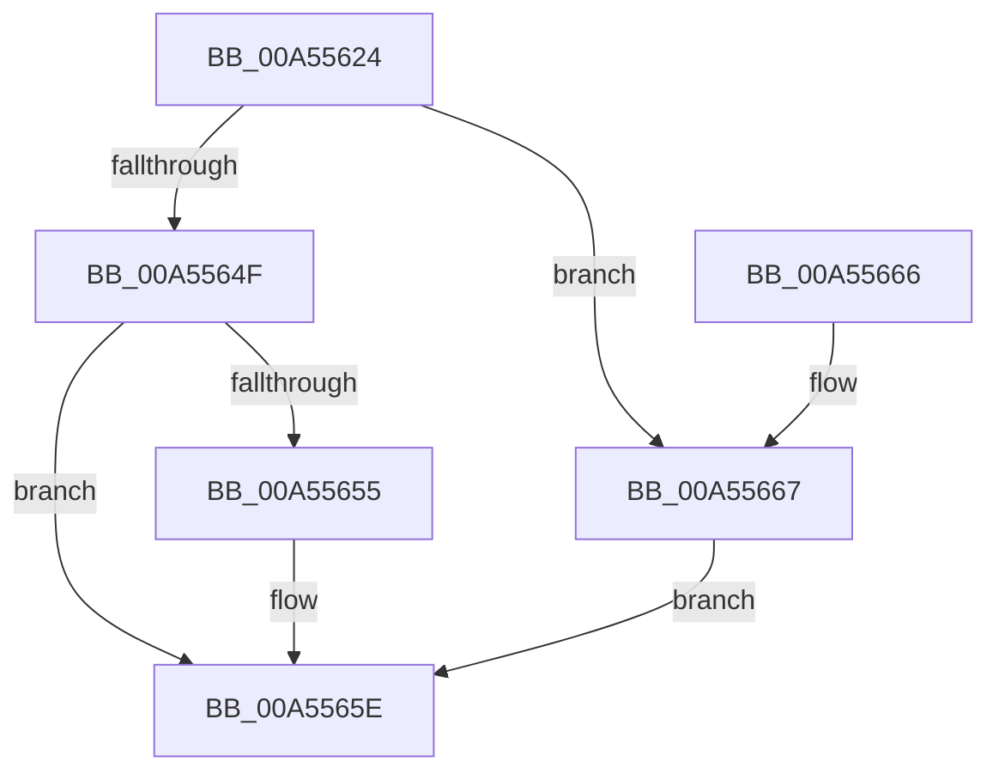

# PiDqQueryAddObjectToResultSet

- RVA: `0x00A55624`–`0x00A5566E` (길이 `74` bytes)
- VA: `0x0000000140A55624`
- 실행 섹션: `PAGE`
- PDB 이름 있음: `예`; PDB Function 태그: `아니요`
- unwind 정보 RVA: `0x000B1224`
- 디코드: `24`개 명령, `74/74` bytes 표시
- 미해석 바이트: `0` (있으면 어셈블리에 `.byte`로 보존)

> 이 문서는 커널 이미지의 기계어와 PDB 기호를 분석해 생성했습니다. 4번과 5번은 함수 원형과 자료형을 바이너리 사용 방식에서 추정한 C 해석이며 원본 소스 복구 결과는 아닙니다.

## 1. Dependencies

- 직접 호출 지점: **1**; 고유 호출 대상: **1**
- 직접 호출자로 확인된 함수: **2**
- RIP 상대 이미지 참조: **0**

### Outgoing calls
- `0x00A55645` → [RtlInsertElementGenericTableAvl](../../text/3E/RtlInsertElementGenericTableAvl_function_003EE510.md) (function, `0x003EE510`)

### Direct callers
- [PiDqQueryApplyObjectEvent](../8D/PiDqQueryApplyObjectEvent_function_008DDACC.md) at `0x008DE045`
- [PiDqQueryEnumObject](../8D/PiDqQueryEnumObject_function_008DF424.md) at `0x008DF550`

### Static image references
- 디코드된 RIP-relative 메모리 참조가 없습니다.

## 2. Other-region calls and transfers

- 다른 실행 섹션으로 향하는 call: **1**
  - `0x00A55645` → [RtlInsertElementGenericTableAvl](../../text/3E/RtlInsertElementGenericTableAvl_function_003EE510.md) (`PAGE` → `.text`)
- 별도 외부 분기/꼬리 이동을 확인하지 못했습니다.

## 3. Assembly (complete function range)

```asm
00A55624  48 8B C4                        mov rax, rsp
00A55627  48 89 50 10                     mov qword ptr [rax + 0x10], rdx
00A5562B  53                              push rbx
00A5562C  48 83 EC 20                     sub rsp, 0x20
00A55630  33 DB                           xor ebx, ebx
00A55632  4C 8D 48 08                     lea r9, [rax + 8]
00A55636  48 83 C1 48                     add rcx, 0x48
00A5563A  88 58 08                        mov byte ptr [rax + 8], bl
00A5563D  48 8D 50 10                     lea rdx, [rax + 0x10]
00A55641  44 8D 43 08                     lea r8d, [rbx + 8]
00A55645  E8 C6 8E 99 FF                  call 0x1403ee510
00A5564A  48 85 C0                        test rax, rax
00A5564D  74 18                           je 0x140a55667
00A5564F  38 5C 24 30                     cmp byte ptr [rsp + 0x30], bl
00A55653  74 09                           je 0x140a5565e
00A55655  48 8B 44 24 38                  mov rax, qword ptr [rsp + 0x38]
00A5565A  F0 FF 40 08                     lock inc dword ptr [rax + 8]
00A5565E  8B C3                           mov eax, ebx
00A55660  48 83 C4 20                     add rsp, 0x20
00A55664  5B                              pop rbx
00A55665  C3                              ret
00A55666  CC                              int3
00A55667  BB 9A 00 00 C0                  mov ebx, 0xc000009a
00A5566C  EB F0                           jmp 0x140a5565e
```

## 4. C-style interpretation (structured pseudocode)

```c
__int64 __fastcall PiDqQueryAddObjectToResultSet(__int64 a1, __int64 a2)
{
    __int64 result;
    __int64 v_rbx;
    __int64 v_rsp;
    unsigned __int64 v_stack_p10;
    unsigned __int8 v_stack_p8;

    *(unsigned __int64 *)(v_rsp + 16) = a2;
    v_rsp = (v_rsp) - (32);
    v_rbx = 0;
    a1 = (a1) + (72);
    *(unsigned __int8 *)(v_rsp + 8) = 0;
    result = RtlInsertElementGenericTableAvl(a1, v_rsp + 16, v_rbx + 8, v_rsp + 8);
    if (result == 0) goto loc_00A55667;
    if (v_stack_p8 != 0) {
        result = v_stack_p10;
    }
    v_rsp = (v_rsp) + (32);
    return 0;
loc_00A55667:
    goto loc_00A5565E;
}
```

## 5. (Beta) C Style

```c
int64_t PiDqQueryAddObjectToResultSet(int64_t Arg1, int64_t Arg2)
{
    int64_t result;
    int64_t local_rbx;
    int64_t local_rsp;
    uint64_t v_stack_p10;
    uint8_t v_stack_p8;

    *(uint64_t *)(local_rsp + 0x10) = Arg2;
    local_rsp = (local_rsp) - (32);
    local_rbx = 0;
    Arg1 = (Arg1) + (72);
    *(uint8_t *)(local_rsp + 0x8) = 0;
    result = RtlInsertElementGenericTableAvl(Arg1, local_rsp + 16, local_rbx + 8, local_rsp + 8);
    if (result == 0) goto loc_00A55667;
    if (v_stack_p8 != 0) {
        result = v_stack_p10;
    }
    local_rsp = (local_rsp) + (32);
    return 0;
loc_00A55667:
    goto loc_00A5565E;
}
```

## 6. Execution-region graph

[열기: 2D/3D 그래프와 함수 탐색 컨트롤 패널](../../../control-panel.html?section=page&rva=0x00A55624&view=graph)

- 2D 그래프는 위에서 아래로 흐르고, 3D 그래프는 빈 공간을 드래그해 회전합니다. Shift+드래그는 이동, 휠은 확대·축소, 함수 노드 선택은 대상 보고서 이동입니다.

### Static fallback


