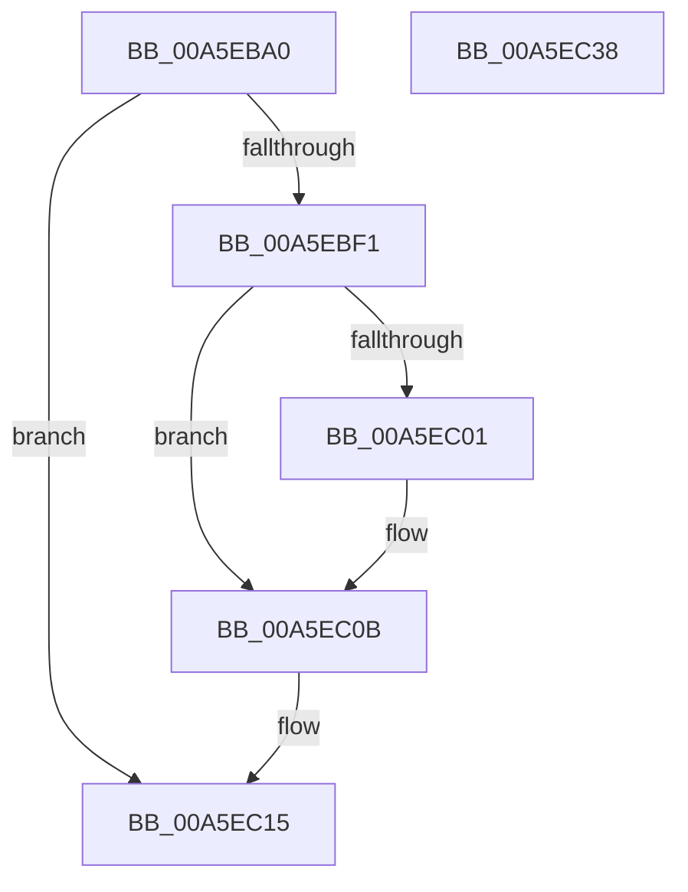

# PiGetDeviceDepth

- RVA: `0x00A5EBA0`–`0x00A5EC39` (길이 `153` bytes)
- VA: `0x0000000140A5EBA0`
- 실행 섹션: `PAGE`
- PDB 이름 있음: `예`; PDB Function 태그: `아니요`
- unwind 정보 RVA: `0x00060BC4`
- 디코드: `39`개 명령, `153/153` bytes 표시
- 미해석 바이트: `0` (있으면 어셈블리에 `.byte`로 보존)

> 이 문서는 커널 이미지의 기계어와 PDB 기호를 분석해 생성했습니다. 4번과 5번은 함수 원형과 자료형을 바이너리 사용 방식에서 추정한 C 해석이며 원본 소스 복구 결과는 아닙니다.

## 1. Dependencies

- 직접 호출 지점: **5**; 고유 호출 대상: **5**
- 직접 호출자로 확인된 함수: **2**
- RIP 상대 이미지 참조: **1**

### Outgoing calls
- `0x00A5EBD7` → [ExAcquireResourceSharedLite](../../text/21/ExAcquireResourceSharedLite_function_00211BC0.md) (function, `0x00211BC0`)
- `0x00A5EBE4` → [PnpDeviceObjectFromDeviceInstanceWithTag](../8E/PnpDeviceObjectFromDeviceInstanceWithTag_function_008E7490.md) (function, `0x008E7490`)
- `0x00A5EC10` → [ObfDereferenceObjectWithTag](../../text/2F/ObfDereferenceObjectWithTag_function_002F78E0.md) (function, `0x002F78E0`)
- `0x00A5EC1C` → [ExReleaseResourceLite](../../text/25/ExReleaseResourceLite_function_0025FA10.md) (function, `0x0025FA10`)
- `0x00A5EC21` → [KeLeaveCriticalRegion](../../text/25/KeLeaveCriticalRegion_function_0025D8B0.md) (function, `0x0025D8B0`)

### Direct callers
- [PiControlGetDeviceDepth](PiControlGetDeviceDepth_function_00A5EB00.md) at `0x00A5EB6E`
- [PiCMGetDeviceDepth](../A9/PiCMGetDeviceDepth_function_00A96B98.md) at `0x00A96C95`

### Static image references
- `0x00A5EBC3` → RVA `0x00F8C560` (`.data`; read)

## 2. Other-region calls and transfers

- 다른 실행 섹션으로 향하는 call: **4**
  - `0x00A5EBD7` → [ExAcquireResourceSharedLite](../../text/21/ExAcquireResourceSharedLite_function_00211BC0.md) (`PAGE` → `.text`)
  - `0x00A5EC10` → [ObfDereferenceObjectWithTag](../../text/2F/ObfDereferenceObjectWithTag_function_002F78E0.md) (`PAGE` → `.text`)
  - `0x00A5EC1C` → [ExReleaseResourceLite](../../text/25/ExReleaseResourceLite_function_0025FA10.md) (`PAGE` → `.text`)
  - `0x00A5EC21` → [KeLeaveCriticalRegion](../../text/25/KeLeaveCriticalRegion_function_0025D8B0.md) (`PAGE` → `.text`)
- 별도 외부 분기/꼬리 이동을 확인하지 못했습니다.

## 3. Assembly (complete function range)

```asm
00A5EBA0  48 89 5C 24 08                  mov qword ptr [rsp + 8], rbx
00A5EBA5  48 89 74 24 10                  mov qword ptr [rsp + 0x10], rsi
00A5EBAA  57                              push rdi
00A5EBAB  48 83 EC 20                     sub rsp, 0x20
00A5EBAF  83 22 00                        and dword ptr [rdx], 0
00A5EBB2  48 8B F2                        mov rsi, rdx
00A5EBB5  65 48 8B 04 25 88 01 00 00      mov rax, qword ptr gs:[0x188]
00A5EBBE  48 8B D9                        mov rbx, rcx
00A5EBC1  B2 01                           mov dl, 1
00A5EBC3  48 8D 0D 96 D9 52 00            lea rcx, [rip + 0x52d996]
00A5EBCA  BF 0E 00 00 C0                  mov edi, 0xc000000e
00A5EBCF  66 FF 88 E4 01 00 00            dec word ptr [rax + 0x1e4]
00A5EBD6  90                              nop
00A5EBD7  E8 E4 2F 7B FF                  call 0x140211bc0
00A5EBDC  BA 50 6E 70 43                  mov edx, 0x43706e50
00A5EBE1  48 8B CB                        mov rcx, rbx
00A5EBE4  E8 A7 88 E8 FF                  call 0x1408e7490
00A5EBE9  48 8B C8                        mov rcx, rax
00A5EBEC  48 85 C0                        test rax, rax
00A5EBEF  74 24                           je 0x140a5ec15
00A5EBF1  48 8B 80 38 01 00 00            mov rax, qword ptr [rax + 0x138]
00A5EBF8  48 8B 40 28                     mov rax, qword ptr [rax + 0x28]
00A5EBFC  48 85 C0                        test rax, rax
00A5EBFF  74 0A                           je 0x140a5ec0b
00A5EC01  8B 80 98 00 00 00               mov eax, dword ptr [rax + 0x98]
00A5EC07  33 FF                           xor edi, edi
00A5EC09  89 06                           mov dword ptr [rsi], eax
00A5EC0B  BA 50 6E 70 43                  mov edx, 0x43706e50
00A5EC10  E8 CB 8C 89 FF                  call 0x1402f78e0
00A5EC15  48 8D 0D 44 D9 52 00            lea rcx, [rip + 0x52d944]
00A5EC1C  E8 EF 0D 80 FF                  call 0x14025fa10
00A5EC21  E8 8A EC 7F FF                  call 0x14025d8b0
00A5EC26  48 8B 5C 24 30                  mov rbx, qword ptr [rsp + 0x30]
00A5EC2B  8B C7                           mov eax, edi
00A5EC2D  48 8B 74 24 38                  mov rsi, qword ptr [rsp + 0x38]
00A5EC32  48 83 C4 20                     add rsp, 0x20
00A5EC36  5F                              pop rdi
00A5EC37  C3                              ret
00A5EC38  CC                              int3
```

## 4. C-style interpretation (structured pseudocode)

```c
__int64 __fastcall PiGetDeviceDepth(__int64 a1, __int64 a2)
{
    __int64 result;
    __int64 v_rdi;
    __int64 v_rsp;
    unsigned __int64 v_stack_p10;
    unsigned __int64 v_stack_p8;

    v_stack_p8 = v_rbx;
    v_stack_p10 = v_rsi;
    v_rsp = (v_rsp) - (32);
    result = ExAcquireResourceSharedLite(v_rip + 5429654, 1, a3, a4);
    result = PnpDeviceObjectFromDeviceInstanceWithTag(a1, (unsigned int)(0x43706E50ULL), a3, a4);
    if (result == 0) goto loc_00A5EC15;
    result = *(unsigned __int64 *)(*(unsigned __int64 *)(result + 312) + 40);
    v_rdi = (unsigned int)(0xC000000EULL);
    if (*(unsigned __int64 *)(*(unsigned __int64 *)(result + 312) + 40) != 0) {
        result = *(unsigned int *)(*(unsigned __int64 *)(*(unsigned __int64 *)(result + 312) + 40) + 152);
        v_rdi = 0;
        *(unsigned int *)(a2) = (unsigned int)(result);
    }
    result = ObfDereferenceObjectWithTag(result, (unsigned int)(0x43706E50ULL), a3, a4);
loc_00A5EC15:
    result = ExReleaseResourceLite(v_rip + 5429572, (unsigned int)(0x43706E50ULL), a3, a4);
    result = KeLeaveCriticalRegion(v_rip + 5429572, (unsigned int)(0x43706E50ULL), a3, a4);
    v_rsp = (v_rsp) + (32);
    return 0;
}
```

## 5. (Beta) C Style

```c
int64_t PiGetDeviceDepth(int64_t Arg1, void *Arg2)
{
    uint8_t *arg2 = (uint8_t *)Arg2;

    int64_t result;
    int64_t local_rdi;
    int64_t local_rsp;
    uint64_t v_stack_p10;
    uint64_t v_stack_p8;

    v_stack_p8 = local_rbx;
    v_stack_p10 = local_rsi;
    local_rsp = (local_rsp) - (32);
    result = ExAcquireResourceSharedLite(v_rip + 5429654, 1, a3, a4);
    result = PnpDeviceObjectFromDeviceInstanceWithTag(Arg1, (uint32_t)(0x43706E50ULL), a3, a4);
    if (result == 0) goto loc_00A5EC15;
    result = *(uint64_t *)(*(uint64_t *)(result + 0x138) + 0x28);
    local_rdi = (uint32_t)(0xC000000EULL);
    if (*(uint64_t *)(*(uint64_t *)(result + 0x138) + 0x28) != 0) {
        result = *(uint32_t *)(*(uint64_t *)(*(uint64_t *)(result + 0x138) + 0x28) + 0x98);
        local_rdi = 0;
        *(uint32_t *)(arg2) = (uint32_t)(result);
    }
    result = ObfDereferenceObjectWithTag(result, (uint32_t)(0x43706E50ULL), a3, a4);
loc_00A5EC15:
    result = ExReleaseResourceLite(v_rip + 5429572, (uint32_t)(0x43706E50ULL), a3, a4);
    result = KeLeaveCriticalRegion(v_rip + 5429572, (uint32_t)(0x43706E50ULL), a3, a4);
    local_rsp = (local_rsp) + (32);
    return 0;
}
```

### 관측된 메모리 오프셋

구조체 형식이 확인되지 않은 접근은 인자 기준의 오프셋으로만 기록했습니다.

| 기준 인자 | 오프셋 표현 | 폭 (bit) | 접근 |
|---|---:|---:|---|
| `Arg2` | `+ 0x0` | `32` | `R/W` |
| `Arg2` | `+ 0x0` | `32` | `W` |

## 6. Execution-region graph

[열기: 2D/3D 그래프와 함수 탐색 컨트롤 패널](../../../control-panel.html?section=page&rva=0x00A5EBA0&view=graph)

- 2D 그래프는 위에서 아래로 흐르고, 3D 그래프는 빈 공간을 드래그해 회전합니다. Shift+드래그는 이동, 휠은 확대·축소, 함수 노드 선택은 대상 보고서 이동입니다.

### Static fallback


