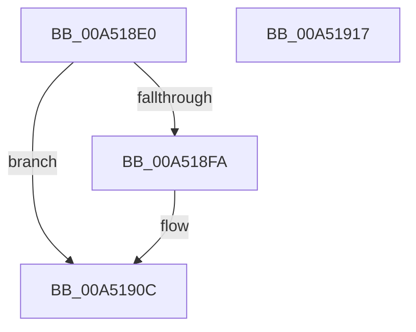

# PiMarkDeviceTreeForReenumeration

- RVA: `0x00A518E0`–`0x00A51918` (길이 `56` bytes)
- VA: `0x0000000140A518E0`
- 실행 섹션: `PAGE`
- PDB 이름 있음: `예`; PDB Function 태그: `아니요`
- unwind 정보 RVA: `0x0005CAAC`
- 디코드: `18`개 명령, `56/56` bytes 표시
- 미해석 바이트: `0` (있으면 어셈블리에 `.byte`로 보존)

> 이 문서는 커널 이미지의 기계어와 PDB 기호를 분석해 생성했습니다. 4번과 5번은 함수 원형과 자료형을 바이너리 사용 방식에서 추정한 C 해석이며 원본 소스 복구 결과는 아닙니다.

## 1. Dependencies

- 직접 호출 지점: **2**; 고유 호출 대상: **2**
- 직접 호출자로 확인된 함수: **2**
- RIP 상대 이미지 참조: **1**

### Outgoing calls
- `0x00A518F1` → [PiMarkDeviceTreeForReenumerationWorker](../8F/PiMarkDeviceTreeForReenumerationWorker_function_008FC020.md) (function, `0x008FC020`)
- `0x00A51907` → [PipForDeviceNodeSubtree](PipForDeviceNodeSubtree_function_00A51920.md) (function, `0x00A51920`)

### Direct callers
- [PiCollapseEnumRequests](../../text/4E/PiCollapseEnumRequests_function_004E8890.md) at `0x004E895A`
- [PiProcessReenumeration](PiProcessReenumeration_function_00A51818.md) at `0x00A5187E`

### Static image references
- `0x00A518FD` → RVA `0x008FC020` (`PiMarkDeviceTreeForReenumerationWorker`; read)

## 2. Other-region calls and transfers

- 다른 실행 섹션으로 향하는 call: **0**
- 별도 외부 분기/꼬리 이동을 확인하지 못했습니다.

## 3. Assembly (complete function range)

```asm
00A518E0  48 89 5C 24 08                  mov qword ptr [rsp + 8], rbx
00A518E5  57                              push rdi
00A518E6  48 83 EC 20                     sub rsp, 0x20
00A518EA  8A DA                           mov bl, dl
00A518EC  48 8B F9                        mov rdi, rcx
00A518EF  33 D2                           xor edx, edx
00A518F1  E8 2A A7 EA FF                  call 0x1408fc020
00A518F6  84 DB                           test bl, bl
00A518F8  74 12                           je 0x140a5190c
00A518FA  45 33 C0                        xor r8d, r8d
00A518FD  48 8D 15 1C A7 EA FF            lea rdx, [rip - 0x1558e4]
00A51904  48 8B CF                        mov rcx, rdi
00A51907  E8 14 00 00 00                  call 0x140a51920
00A5190C  48 8B 5C 24 30                  mov rbx, qword ptr [rsp + 0x30]
00A51911  48 83 C4 20                     add rsp, 0x20
00A51915  5F                              pop rdi
00A51916  C3                              ret
00A51917  CC                              int3
```

## 4. C-style interpretation (structured pseudocode)

```c
__int64 __fastcall PiMarkDeviceTreeForReenumeration(__int64 a1, int a2, int a3)
{
    __int64 result;
    __int64 v_rsp;
    unsigned __int64 v_stack_p8;

    v_stack_p8 = v_rbx;
    v_rsp = (v_rsp) - (32);
    a2 = 0;
    result = PiMarkDeviceTreeForReenumerationWorker(a1, a2, a3, a4);
    if ((unsigned __int8)((unsigned __int8)(a2)) != 0) {
        a3 = 0;
        a2 = v_rip - 1399012;
        a1 = a1;
        result = PipForDeviceNodeSubtree(a1, a2, a3, a4);
    }
    v_rsp = (v_rsp) + (32);
    return result;
}
```

## 5. (Beta) C Style

```c
int64_t PiMarkDeviceTreeForReenumeration(int64_t Arg1, int32_t Arg2, int32_t Arg3)
{
    int64_t result;
    int64_t local_rsp;
    uint64_t v_stack_p8;

    v_stack_p8 = local_rbx;
    local_rsp = (local_rsp) - (32);
    Arg2 = 0;
    result = PiMarkDeviceTreeForReenumerationWorker(Arg1, Arg2, Arg3, a4);
    if ((uint8_t)((uint8_t)(Arg2)) != 0) {
        Arg3 = 0;
        Arg2 = v_rip - 1399012;
        Arg1 = Arg1;
        result = PipForDeviceNodeSubtree(Arg1, Arg2, Arg3, a4);
    }
    local_rsp = (local_rsp) + (32);
    return result;
}
```

## 6. Execution-region graph

[열기: 2D/3D 그래프와 함수 탐색 컨트롤 패널](../../../control-panel.html?section=page&rva=0x00A518E0&view=graph)

- 2D 그래프는 위에서 아래로 흐르고, 3D 그래프는 빈 공간을 드래그해 회전합니다. Shift+드래그는 이동, 휠은 확대·축소, 함수 노드 선택은 대상 보고서 이동입니다.

### Static fallback


