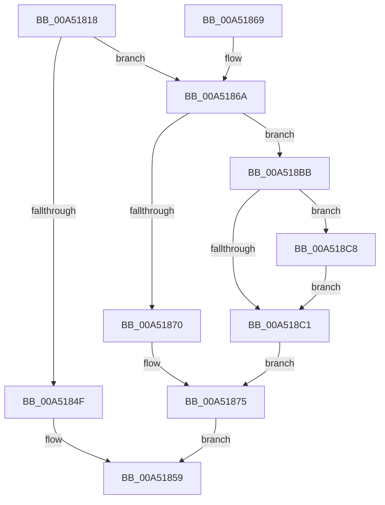

# PiProcessReenumeration

- RVA: `0x00A51818`–`0x00A518D7` (길이 `191` bytes)
- VA: `0x0000000140A51818`
- 실행 섹션: `PAGE`
- PDB 이름 있음: `예`; PDB Function 태그: `아니요`
- unwind 정보 RVA: `0x000B0C0C`
- 디코드: `49`개 명령, `191/191` bytes 표시
- 미해석 바이트: `0` (있으면 어셈블리에 `.byte`로 보존)

> 이 문서는 커널 이미지의 기계어와 PDB 기호를 분석해 생성했습니다. 4번과 5번은 함수 원형과 자료형을 바이너리 사용 방식에서 추정한 C 해석이며 원본 소스 복구 결과는 아닙니다.

## 1. Dependencies

- 직접 호출 지점: **4**; 고유 호출 대상: **4**
- 직접 호출자로 확인된 함수: **1**
- RIP 상대 이미지 참조: **1**

### Outgoing calls
- `0x00A5184F` → [ObfDereferenceObject](../../text/2F/ObfDereferenceObject_function_002F9350.md) (function, `0x002F9350`)
- `0x00A5187E` → [PiMarkDeviceTreeForReenumeration](PiMarkDeviceTreeForReenumeration_function_00A518E0.md) (function, `0x00A518E0`)
- `0x00A518B2` → [PipProcessDevNodeTree](../8F/PipProcessDevNodeTree_function_008F9068.md) (function, `0x008F9068`)
- `0x00A518D0` → [PipClearDevNodeFlags](../8F/PipClearDevNodeFlags_function_008F9F54.md) (function, `0x008F9F54`)

### Direct callers
- [PnpDeviceActionWorker](../../text/47/PnpDeviceActionWorker_function_00478400.md) at `0x00478A47`

### Static image references
- `0x00A51883` → RVA `0x00F8C5FA` (`.data`; read)

## 2. Other-region calls and transfers

- 다른 실행 섹션으로 향하는 call: **1**
  - `0x00A5184F` → [ObfDereferenceObject](../../text/2F/ObfDereferenceObject_function_002F9350.md) (`PAGE` → `.text`)
- 별도 외부 분기/꼬리 이동을 확인하지 못했습니다.

## 3. Assembly (complete function range)

```asm
00A51818  48 89 5C 24 10                  mov qword ptr [rsp + 0x10], rbx
00A5181D  48 89 74 24 18                  mov qword ptr [rsp + 0x18], rsi
00A51822  57                              push rdi
00A51823  48 83 EC 40                     sub rsp, 0x40
00A51827  48 83 64 24 50 00               and qword ptr [rsp + 0x50], 0
00A5182D  48 8B D9                        mov rbx, rcx
00A51830  48 8B 49 10                     mov rcx, qword ptr [rcx + 0x10]
00A51834  48 8B 81 38 01 00 00            mov rax, qword ptr [rcx + 0x138]
00A5183B  48 8B 78 28                     mov rdi, qword ptr [rax + 0x28]
00A5183F  8B 87 2C 01 00 00               mov eax, dword ptr [rdi + 0x12c]
00A51845  2D 15 03 00 00                  sub eax, 0x315
00A5184A  83 F8 01                        cmp eax, 1
00A5184D  77 1B                           ja 0x140a5186a
00A5184F  E8 FC 7A 8A FF                  call 0x1402f9350
00A51854  B8 56 00 00 C0                  mov eax, 0xc0000056
00A51859  48 8B 5C 24 58                  mov rbx, qword ptr [rsp + 0x58]
00A5185E  48 8B 74 24 60                  mov rsi, qword ptr [rsp + 0x60]
00A51863  48 83 C4 40                     add rsp, 0x40
00A51867  5F                              pop rdi
00A51868  C3                              ret
00A51869  CC                              int3
00A5186A  83 7B 18 08                     cmp dword ptr [rbx + 0x18], 8
00A5186E  74 4B                           je 0x140a518bb
00A51870  BE 02 00 00 00                  mov esi, 2
00A51875  83 FE 01                        cmp esi, 1
00A51878  48 8B CF                        mov rcx, rdi
00A5187B  0F 95 C2                        setne dl
00A5187E  E8 5D 00 00 00                  call 0x140a518e0
00A51883  8A 05 71 AD 53 00               mov al, byte ptr [rip + 0x53ad71]
00A51889  4C 8D 44 24 50                  lea r8, [rsp + 0x50]
00A5188E  C6 44 24 30 00                  mov byte ptr [rsp + 0x30], 0
00A51893  44 8B CE                        mov r9d, esi
00A51896  C6 44 24 28 00                  mov byte ptr [rsp + 0x28], 0
00A5189B  48 8B D3                        mov rdx, rbx
00A5189E  48 8B CF                        mov rcx, rdi
00A518A1  88 44 24 54                     mov byte ptr [rsp + 0x54], al
00A518A5  C7 44 24 50 03 00 00 00         mov dword ptr [rsp + 0x50], 3
00A518AD  C6 44 24 20 00                  mov byte ptr [rsp + 0x20], 0
00A518B2  E8 B1 77 EA FF                  call 0x1408f9068
00A518B7  33 C0                           xor eax, eax
00A518B9  EB 9E                           jmp 0x140a51859
00A518BB  80 7B 28 00                     cmp byte ptr [rbx + 0x28], 0
00A518BF  75 07                           jne 0x140a518c8
00A518C1  BE 01 00 00 00                  mov esi, 1
00A518C6  EB AD                           jmp 0x140a51875
00A518C8  BA 00 00 00 80                  mov edx, 0x80000000
00A518CD  48 8B CF                        mov rcx, rdi
00A518D0  E8 7F 86 EA FF                  call 0x1408f9f54
00A518D5  EB EA                           jmp 0x140a518c1
```

## 4. C-style interpretation (structured pseudocode)

```c
__int64 __fastcall PiProcessReenumeration(__int64 a1)
{
    __int64 result;
    __int64 v_rsp;
    unsigned __int64 v_stack_p10;
    unsigned __int64 v_stack_p18;
    unsigned __int8 v_stack_p20;
    unsigned __int8 v_stack_p28;
    unsigned __int8 v_stack_p30;
    unsigned __int64 v_stack_p50;
    unsigned __int8 v_stack_p54;
    unsigned __int64 v_stack_p8;

    v_stack_p10 = v_rbx;
    v_stack_p18 = v_rsi;
    v_rsp = (v_rsp) - (64);
    result = (unsigned int)(((unsigned int)(*(unsigned int *)(*(unsigned __int64 *)(*(unsigned __int64 *)(*(unsigned __int64 *)(a1 + 16) + 312) + 40) + 300))) - (789));
    if (((unsigned int)(result)) > 1) goto loc_00A5186A;
    result = ObfDereferenceObject(*(unsigned __int64 *)(a1 + 16), a2, a3, a4);
loc_00A51859:
    v_rsp = (v_rsp) + (64);
    return (unsigned int)(0xC0000056ULL);
loc_00A5186A:
    if ((*(unsigned int *)(v_stack_p10 + 24)) == 8) goto loc_00A518BB;
loc_00A51875:
    a2 = (2 != 1) ? 1 : 0;
    result = PiMarkDeviceTreeForReenumeration(*(unsigned __int64 *)(*(unsigned __int64 *)(*(unsigned __int64 *)(a1 + 16) + 312) + 40), a2, a3, a4);
    v_stack_p30 = 0;
    v_stack_p28 = 0;
    v_stack_p54 = (unsigned __int8)(*(unsigned __int8 *)(v_rip + 5483889));
    v_stack_p50 = 3;
    v_stack_p20 = 0;
    result = PipProcessDevNodeTree(*(unsigned __int64 *)(*(unsigned __int64 *)(*(unsigned __int64 *)(a1 + 16) + 312) + 40), v_stack_p10, v_stack_p50, 2);
    result = 0;
    goto loc_00A51859;
loc_00A518BB:
    if ((*(unsigned __int8 *)(v_stack_p10 + 40)) != 0) goto loc_00A518C8;
loc_00A518C1:
    goto loc_00A51875;
loc_00A518C8:
    result = PipClearDevNodeFlags(*(unsigned __int64 *)(*(unsigned __int64 *)(*(unsigned __int64 *)(a1 + 16) + 312) + 40), (unsigned int)(0x80000000ULL), v_stack_p50, 2);
    goto loc_00A518C1;
}
```

## 5. (Beta) C Style

```c
int64_t PiProcessReenumeration(void *Arg1)
{
    uint8_t *arg1 = (uint8_t *)Arg1;

    int64_t result;
    int64_t local_rsp;
    uint64_t v_stack_p10;
    uint64_t v_stack_p18;
    uint8_t v_stack_p20;
    uint8_t v_stack_p28;
    uint8_t v_stack_p30;
    uint64_t v_stack_p50;
    uint8_t v_stack_p54;
    uint64_t v_stack_p8;

    v_stack_p10 = local_rbx;
    v_stack_p18 = local_rsi;
    local_rsp = (local_rsp) - (64);
    result = (uint32_t)(((uint32_t)(*(uint32_t *)(*(uint64_t *)(*(uint64_t *)(*(uint64_t *)(arg1 + 0x10) + 0x138) + 0x28) + 0x12C))) - (789));
    if (((uint32_t)(result)) > 1) goto loc_00A5186A;
    result = ObfDereferenceObject(*(uint64_t *)(arg1 + 0x10), a2, a3, a4);
loc_00A51859:
    local_rsp = (local_rsp) + (64);
    return (uint32_t)(0xC0000056ULL);
loc_00A5186A:
    if ((*(uint32_t *)(v_stack_p10 + 0x18)) == 8) goto loc_00A518BB;
loc_00A51875:
    a2 = (2 != 1) ? 1 : 0;
    result = PiMarkDeviceTreeForReenumeration(*(uint64_t *)(*(uint64_t *)(*(uint64_t *)(arg1 + 0x10) + 0x138) + 0x28), a2, a3, a4);
    v_stack_p30 = 0;
    v_stack_p28 = 0;
    v_stack_p54 = (uint8_t)(*(uint8_t *)(v_rip + 0x53AD71));
    v_stack_p50 = 3;
    v_stack_p20 = 0;
    result = PipProcessDevNodeTree(*(uint64_t *)(*(uint64_t *)(*(uint64_t *)(arg1 + 0x10) + 0x138) + 0x28), v_stack_p10, v_stack_p50, 2);
    result = 0;
    goto loc_00A51859;
loc_00A518BB:
    if ((*(uint8_t *)(v_stack_p10 + 0x28)) != 0) goto loc_00A518C8;
loc_00A518C1:
    goto loc_00A51875;
loc_00A518C8:
    result = PipClearDevNodeFlags(*(uint64_t *)(*(uint64_t *)(*(uint64_t *)(arg1 + 0x10) + 0x138) + 0x28), (uint32_t)(0x80000000ULL), v_stack_p50, 2);
    goto loc_00A518C1;
}
```

### 관측된 메모리 오프셋

구조체 형식이 확인되지 않은 접근은 인자 기준의 오프셋으로만 기록했습니다.

| 기준 인자 | 오프셋 표현 | 폭 (bit) | 접근 |
|---|---:|---:|---|
| `Arg1` | `+ 0x10` | `64` | `R` |
| `Arg1` | `+ 0x18` | `32` | `R` |
| `Arg1` | `+ 0x28` | `8` | `R` |

## 6. Execution-region graph

[열기: 2D/3D 그래프와 함수 탐색 컨트롤 패널](../../../control-panel.html?section=page&rva=0x00A51818&view=graph)

- 2D 그래프는 위에서 아래로 흐르고, 3D 그래프는 빈 공간을 드래그해 회전합니다. Shift+드래그는 이동, 휠은 확대·축소, 함수 노드 선택은 대상 보고서 이동입니다.

### Static fallback


