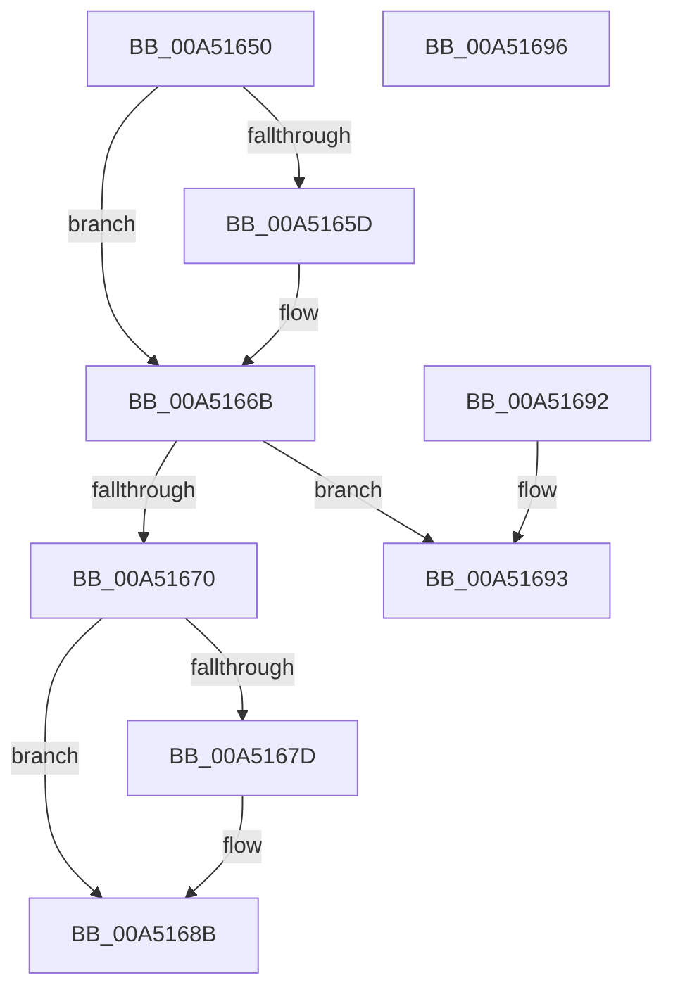

# PiUEventIsDeviceEventVetoable

- RVA: `0x00A51650`–`0x00A51697` (길이 `71` bytes)
- VA: `0x0000000140A51650`
- 실행 섹션: `PAGE`
- PDB 이름 있음: `예`; PDB Function 태그: `아니요`
- unwind 정보 RVA: `0x000DB714`
- 디코드: `19`개 명령, `71/71` bytes 표시
- 미해석 바이트: `0` (있으면 어셈블리에 `.byte`로 보존)

> 이 문서는 커널 이미지의 기계어와 PDB 기호를 분석해 생성했습니다. 4번과 5번은 함수 원형과 자료형을 바이너리 사용 방식에서 추정한 C 해석이며 원본 소스 복구 결과는 아닙니다.

## 1. Dependencies

- 직접 호출 지점: **0**; 고유 호출 대상: **0**
- 직접 호출자로 확인된 함수: **1**
- RIP 상대 이미지 참조: **4**

### Outgoing calls
- 직접 디코드된 call 명령이 없습니다.

### Direct callers
- [PiUEventNotifyUserMode](../95/PiUEventNotifyUserMode_function_00954CB4.md) at `0x00954D7E`

### Static image references
- `0x00A51654` → RVA `0x0001A210` (`.rdata`; read)
- `0x00A51664` → RVA `0x0001A218` (`.rdata`; read)
- `0x00A51674` → RVA `0x0001A678` (`.rdata`; read)
- `0x00A51684` → RVA `0x0001A680` (`.rdata`; read)

## 2. Other-region calls and transfers

- 다른 실행 섹션으로 향하는 call: **0**
- 별도 외부 분기/꼬리 이동을 확인하지 못했습니다.

## 3. Assembly (complete function range)

```asm
00A51650  48 8B 41 78                     mov rax, qword ptr [rcx + 0x78]
00A51654  48 2B 05 B5 8B 5C FF            sub rax, qword ptr [rip - 0xa3744b]
00A5165B  75 0E                           jne 0x140a5166b
00A5165D  48 8B 81 80 00 00 00            mov rax, qword ptr [rcx + 0x80]
00A51664  48 2B 05 AD 8B 5C FF            sub rax, qword ptr [rip - 0xa37453]
00A5166B  48 85 C0                        test rax, rax
00A5166E  74 23                           je 0x140a51693
00A51670  48 8B 41 78                     mov rax, qword ptr [rcx + 0x78]
00A51674  48 2B 05 FD 8F 5C FF            sub rax, qword ptr [rip - 0xa37003]
00A5167B  75 0E                           jne 0x140a5168b
00A5167D  48 8B 81 80 00 00 00            mov rax, qword ptr [rcx + 0x80]
00A51684  48 2B 05 F5 8F 5C FF            sub rax, qword ptr [rip - 0xa3700b]
00A5168B  48 85 C0                        test rax, rax
00A5168E  0F 94 C0                        sete al
00A51691  C3                              ret
00A51692  CC                              int3
00A51693  B0 01                           mov al, 1
00A51695  C3                              ret
00A51696  CC                              int3
```

## 4. C-style interpretation (structured pseudocode)

```c
__int64 __fastcall PiUEventIsDeviceEventVetoable(__int64 a1)
{
    __int64 result;

    result = (*(unsigned __int64 *)(a1 + 120)) - (*(unsigned __int64 *)(v_rip - 10712139));
    if (!(condition_is_not_equal)) {
        result = *(unsigned __int64 *)(a1 + 128);
        result = (result) - (*(unsigned __int64 *)(v_rip - 10712147));
    }
    if (result == 0) goto loc_00A51693;
    result = (*(unsigned __int64 *)(a1 + 120)) - (*(unsigned __int64 *)(v_rip - 10711043));
    if (!(condition_is_not_equal)) {
        result = *(unsigned __int64 *)(a1 + 128);
        result = (result) - (*(unsigned __int64 *)(v_rip - 10711051));
    }
    result = (result == 0) ? 1 : 0;
    return result;
loc_00A51693:
    return 1;
}
```

## 5. (Beta) C Style

```c
int64_t PiUEventIsDeviceEventVetoable(void *Arg1)
{
    uint8_t *arg1 = (uint8_t *)Arg1;

    int64_t result;

    result = (*(uint64_t *)(arg1 + 0x78)) - (*(uint64_t *)(v_rip - 0xA3744B));
    if (!(condition_is_not_equal)) {
        result = *(uint64_t *)(arg1 + 0x80);
        result = (result) - (*(uint64_t *)(v_rip - 0xA37453));
    }
    if (result == 0) goto loc_00A51693;
    result = (*(uint64_t *)(arg1 + 0x78)) - (*(uint64_t *)(v_rip - 0xA37003));
    if (!(condition_is_not_equal)) {
        result = *(uint64_t *)(arg1 + 0x80);
        result = (result) - (*(uint64_t *)(v_rip - 0xA3700B));
    }
    result = (result == 0) ? 1 : 0;
    return result;
loc_00A51693:
    return 1;
}
```

### 관측된 메모리 오프셋

구조체 형식이 확인되지 않은 접근은 인자 기준의 오프셋으로만 기록했습니다.

| 기준 인자 | 오프셋 표현 | 폭 (bit) | 접근 |
|---|---:|---:|---|
| `Arg1` | `+ 0x78` | `64` | `R` |
| `Arg1` | `+ 0x80` | `64` | `R` |

## 6. Execution-region graph

[열기: 2D/3D 그래프와 함수 탐색 컨트롤 패널](../../../control-panel.html?section=page&rva=0x00A51650&view=graph)

- 2D 그래프는 위에서 아래로 흐르고, 3D 그래프는 빈 공간을 드래그해 회전합니다. Shift+드래그는 이동, 휠은 확대·축소, 함수 노드 선택은 대상 보고서 이동입니다.

### Static fallback


