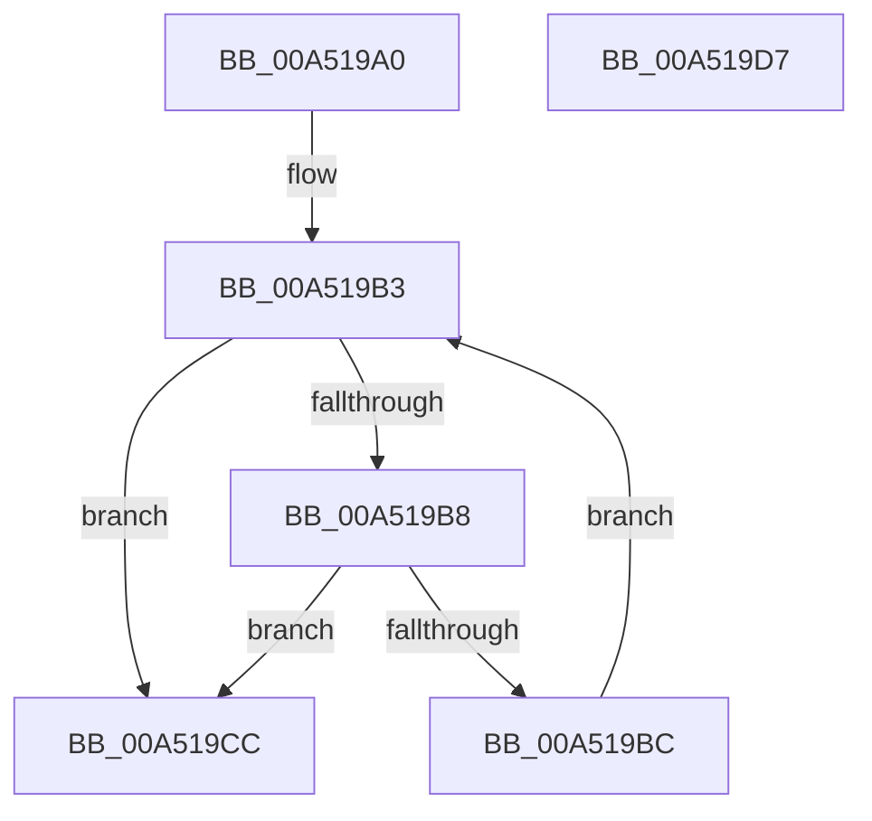

# PipForAllChildDeviceNodes

- RVA: `0x00A519A0`–`0x00A519D8` (길이 `56` bytes)
- VA: `0x0000000140A519A0`
- 실행 섹션: `PAGE`
- PDB 이름 있음: `예`; PDB Function 태그: `아니요`
- unwind 정보 RVA: `0x0005CAAC`
- 디코드: `20`개 명령, `56/56` bytes 표시
- 미해석 바이트: `0` (있으면 어셈블리에 `.byte`로 보존)

> 이 문서는 커널 이미지의 기계어와 PDB 기호를 분석해 생성했습니다. 4번과 5번은 함수 원형과 자료형을 바이너리 사용 방식에서 추정한 C 해석이며 원본 소스 복구 결과는 아닙니다.

## 1. Dependencies

- 직접 호출 지점: **1**; 고유 호출 대상: **1**
- 직접 호출자로 확인된 함수: **2**
- RIP 상대 이미지 참조: **0**

### Outgoing calls
- `0x00A519C5` → [PipForAllDeviceNodesCallback](PipForAllDeviceNodesCallback_function_00A519E0.md) (function, `0x00A519E0`)

### Direct callers
- [PnprCollectResources](../73/PnprCollectResources_function_00739550.md) at `0x007396D0`
- [PnprCollectResources](../73/PnprCollectResources_function_00739550.md) at `0x00739732`
- [PipForAllDeviceNodesCallback](PipForAllDeviceNodesCallback_function_00A519E0.md) at `0x00A51A0D`

### Static image references
- 디코드된 RIP-relative 메모리 참조가 없습니다.

## 2. Other-region calls and transfers

- 다른 실행 섹션으로 향하는 call: **0**
- 별도 외부 분기/꼬리 이동을 확인하지 못했습니다.

## 3. Assembly (complete function range)

```asm
00A519A0  48 89 5C 24 08                  mov qword ptr [rsp + 8], rbx
00A519A5  57                              push rdi
00A519A6  48 83 EC 20                     sub rsp, 0x20
00A519AA  48 8B 59 08                     mov rbx, qword ptr [rcx + 8]
00A519AE  49 8B F8                        mov rdi, r8
00A519B1  33 C0                           xor eax, eax
00A519B3  48 85 DB                        test rbx, rbx
00A519B6  74 14                           je 0x140a519cc
00A519B8  85 C0                           test eax, eax
00A519BA  78 10                           js 0x140a519cc
00A519BC  48 8B CB                        mov rcx, rbx
00A519BF  48 8B D7                        mov rdx, rdi
00A519C2  48 8B 1B                        mov rbx, qword ptr [rbx]
00A519C5  E8 16 00 00 00                  call 0x140a519e0
00A519CA  EB E7                           jmp 0x140a519b3
00A519CC  48 8B 5C 24 30                  mov rbx, qword ptr [rsp + 0x30]
00A519D1  48 83 C4 20                     add rsp, 0x20
00A519D5  5F                              pop rdi
00A519D6  C3                              ret
00A519D7  CC                              int3
```

## 4. C-style interpretation (structured pseudocode)

```c
__int64 __fastcall PipForAllChildDeviceNodes(__int64 a1, __int64 a2, __int64 a3)
{
    __int64 result;
    __int64 v_rsp;
    unsigned __int64 v_stack_p8;

    v_stack_p8 = v_rbx;
    v_rsp = (v_rsp) - (32);
    result = 0;
loc_00A519B3:
    if (*(unsigned __int64 *)(a1 + 8) == 0) goto loc_00A519CC;
    if (sign_flag) goto loc_00A519CC;
    result = PipForAllDeviceNodesCallback(*(unsigned __int64 *)(a1 + 8), a3, a3, a4);
    goto loc_00A519B3;
loc_00A519CC:
    v_rsp = (v_rsp) + (32);
    return result;
}
```

## 5. (Beta) C Style

```c
int64_t PipForAllChildDeviceNodes(void *Arg1, int64_t Arg2, int64_t Arg3)
{
    uint8_t *arg1 = (uint8_t *)Arg1;

    int64_t result;
    int64_t local_rsp;
    uint64_t v_stack_p8;

    v_stack_p8 = local_rbx;
    local_rsp = (local_rsp) - (32);
    result = 0;
loc_00A519B3:
    if (*(uint64_t *)(arg1 + 0x8) == 0) goto loc_00A519CC;
    if (sign_flag) goto loc_00A519CC;
    result = PipForAllDeviceNodesCallback(*(uint64_t *)(arg1 + 0x8), Arg3, Arg3, a4);
    goto loc_00A519B3;
loc_00A519CC:
    local_rsp = (local_rsp) + (32);
    return result;
}
```

### 관측된 메모리 오프셋

구조체 형식이 확인되지 않은 접근은 인자 기준의 오프셋으로만 기록했습니다.

| 기준 인자 | 오프셋 표현 | 폭 (bit) | 접근 |
|---|---:|---:|---|
| `Arg1` | `+ 0x8` | `64` | `R` |

## 6. Execution-region graph

[열기: 2D/3D 그래프와 함수 탐색 컨트롤 패널](../../../control-panel.html?section=page&rva=0x00A519A0&view=graph)

- 2D 그래프는 위에서 아래로 흐르고, 3D 그래프는 빈 공간을 드래그해 회전합니다. Shift+드래그는 이동, 휠은 확대·축소, 함수 노드 선택은 대상 보고서 이동입니다.

### Static fallback


