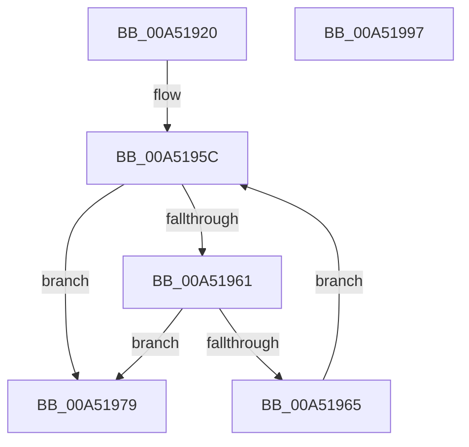

# PipForDeviceNodeSubtree

- RVA: `0x00A51920`–`0x00A51998` (길이 `120` bytes)
- VA: `0x0000000140A51920`
- 실행 섹션: `PAGE`
- PDB 이름 있음: `예`; PDB Function 태그: `아니요`
- unwind 정보 RVA: `0x0006E5F8`
- 디코드: `33`개 명령, `120/120` bytes 표시
- 미해석 바이트: `0` (있으면 어셈블리에 `.byte`로 보존)

> 이 문서는 커널 이미지의 기계어와 PDB 기호를 분석해 생성했습니다. 4번과 5번은 함수 원형과 자료형을 바이너리 사용 방식에서 추정한 C 해석이며 원본 소스 복구 결과는 아닙니다.

## 1. Dependencies

- 직접 호출 지점: **4**; 고유 호출 대상: **4**
- 직접 호출자로 확인된 함수: **7**
- RIP 상대 이미지 참조: **1**

### Outgoing calls
- `0x00A51951` → [ExAcquireResourceSharedLite](../../text/21/ExAcquireResourceSharedLite_function_00211BC0.md) (function, `0x00211BC0`)
- `0x00A51970` → [PipForAllDeviceNodesCallback](PipForAllDeviceNodesCallback_function_00A519E0.md) (function, `0x00A519E0`)
- `0x00A51980` → [ExReleaseResourceLite](../../text/25/ExReleaseResourceLite_function_0025FA10.md) (function, `0x0025FA10`)
- `0x00A51985` → [KeLeaveCriticalRegion](../../text/25/KeLeaveCriticalRegion_function_0025D8B0.md) (function, `0x0025D8B0`)

### Direct callers
- [PpProcessClearProblem](../../text/47/PpProcessClearProblem_function_00478E0C.md) at `0x00478E75`
- [PpSystemHiveLimitCallback](../72/PpSystemHiveLimitCallback_function_0072C310.md) at `0x0072C36C`
- [PpDevCfgProcessDevices](../73/PpDevCfgProcessDevices_function_007373C0.md) at `0x00737415`
- [PiProfileUpdateDeviceTreeWorker](../73/PiProfileUpdateDeviceTreeWorker_function_007376F0.md) at `0x00737714`
- [PnpDiagRundownRegisterCallback](PnpDiagRundownRegisterCallback_function_00A516A0.md) at `0x00A5174C`
- [PnpDiagRundownRegisterCallback](PnpDiagRundownRegisterCallback_function_00A516A0.md) at `0x00A5178C`
- [PnpDiagRundownRegisterCallback](PnpDiagRundownRegisterCallback_function_00A516A0.md) at `0x00A517CF`
- [PnpDiagRundownRegisterCallback](PnpDiagRundownRegisterCallback_function_00A516A0.md) at `0x00A517FE`
- [PiMarkDeviceTreeForReenumeration](PiMarkDeviceTreeForReenumeration_function_00A518E0.md) at `0x00A51907`
- [PnpGetSystemPdoList](../AC/PnpGetSystemPdoList_function_00AC0780.md) at `0x00AC07D2`

### Static image references
- `0x00A51937` → RVA `0x00F8C560` (`.data`; read)

## 2. Other-region calls and transfers

- 다른 실행 섹션으로 향하는 call: **3**
  - `0x00A51951` → [ExAcquireResourceSharedLite](../../text/21/ExAcquireResourceSharedLite_function_00211BC0.md) (`PAGE` → `.text`)
  - `0x00A51980` → [ExReleaseResourceLite](../../text/25/ExReleaseResourceLite_function_0025FA10.md) (`PAGE` → `.text`)
  - `0x00A51985` → [KeLeaveCriticalRegion](../../text/25/KeLeaveCriticalRegion_function_0025D8B0.md) (`PAGE` → `.text`)
- 별도 외부 분기/꼬리 이동을 확인하지 못했습니다.

## 3. Assembly (complete function range)

```asm
00A51920  48 89 5C 24 08                  mov qword ptr [rsp + 8], rbx
00A51925  57                              push rdi
00A51926  48 83 EC 30                     sub rsp, 0x30
00A5192A  48 89 54 24 20                  mov qword ptr [rsp + 0x20], rdx
00A5192F  48 8B D9                        mov rbx, rcx
00A51932  4C 89 44 24 28                  mov qword ptr [rsp + 0x28], r8
00A51937  48 8D 0D 22 AC 53 00            lea rcx, [rip + 0x53ac22]
00A5193E  65 48 8B 04 25 88 01 00 00      mov rax, qword ptr gs:[0x188]
00A51947  B2 01                           mov dl, 1
00A51949  66 FF 88 E4 01 00 00            dec word ptr [rax + 0x1e4]
00A51950  90                              nop
00A51951  E8 6A 02 7C FF                  call 0x140211bc0
00A51956  48 8B 5B 08                     mov rbx, qword ptr [rbx + 8]
00A5195A  33 FF                           xor edi, edi
00A5195C  48 85 DB                        test rbx, rbx
00A5195F  74 18                           je 0x140a51979
00A51961  85 FF                           test edi, edi
00A51963  78 14                           js 0x140a51979
00A51965  48 8B CB                        mov rcx, rbx
00A51968  48 8D 54 24 20                  lea rdx, [rsp + 0x20]
00A5196D  48 8B 1B                        mov rbx, qword ptr [rbx]
00A51970  E8 6B 00 00 00                  call 0x140a519e0
00A51975  8B F8                           mov edi, eax
00A51977  EB E3                           jmp 0x140a5195c
00A51979  48 8D 0D E0 AB 53 00            lea rcx, [rip + 0x53abe0]
00A51980  E8 8B E0 80 FF                  call 0x14025fa10
00A51985  E8 26 BF 80 FF                  call 0x14025d8b0
00A5198A  48 8B 5C 24 40                  mov rbx, qword ptr [rsp + 0x40]
00A5198F  8B C7                           mov eax, edi
00A51991  48 83 C4 30                     add rsp, 0x30
00A51995  5F                              pop rdi
00A51996  C3                              ret
00A51997  CC                              int3
```

## 4. C-style interpretation (structured pseudocode)

```c
__int64 __fastcall PipForDeviceNodeSubtree(__int64 a1, __int64 a2, __int64 a3)
{
    __int64 result;
    __int64 v_rdi;
    __int64 v_rsp;
    unsigned __int64 v_stack_m10;
    unsigned __int64 v_stack_m18;
    unsigned __int64 v_stack_p8;

    v_stack_p8 = v_rbx;
    v_rsp = (v_rsp) - (48);
    v_stack_m18 = a2;
    v_stack_m10 = a3;
    result = ExAcquireResourceSharedLite(v_rip + 5483554, 1, a3, a4);
    v_rdi = 0;
loc_00A5195C:
    if (*(unsigned __int64 *)(a1 + 8) == 0) goto loc_00A51979;
    if (sign_flag) goto loc_00A51979;
    result = PipForAllDeviceNodesCallback(*(unsigned __int64 *)(a1 + 8), v_stack_m18, a3, a4);
    goto loc_00A5195C;
loc_00A51979:
    result = ExReleaseResourceLite(v_rip + 5483488, v_stack_m18, a3, a4);
    result = KeLeaveCriticalRegion(v_rip + 5483488, v_stack_m18, a3, a4);
    v_rsp = (v_rsp) + (48);
    return (unsigned int)((unsigned int)((unsigned int)((unsigned int)(result))));
}
```

## 5. (Beta) C Style

```c
int64_t PipForDeviceNodeSubtree(void *Arg1, int64_t Arg2, int64_t Arg3)
{
    uint8_t *arg1 = (uint8_t *)Arg1;

    int64_t result;
    int64_t local_rdi;
    int64_t local_rsp;
    uint64_t v_stack_m10;
    uint64_t v_stack_m18;
    uint64_t v_stack_p8;

    v_stack_p8 = local_rbx;
    local_rsp = (local_rsp) - (48);
    v_stack_m18 = Arg2;
    v_stack_m10 = Arg3;
    result = ExAcquireResourceSharedLite(v_rip + 5483554, 1, Arg3, a4);
    local_rdi = 0;
loc_00A5195C:
    if (*(uint64_t *)(arg1 + 0x8) == 0) goto loc_00A51979;
    if (sign_flag) goto loc_00A51979;
    result = PipForAllDeviceNodesCallback(*(uint64_t *)(arg1 + 0x8), v_stack_m18, Arg3, a4);
    goto loc_00A5195C;
loc_00A51979:
    result = ExReleaseResourceLite(v_rip + 5483488, v_stack_m18, Arg3, a4);
    result = KeLeaveCriticalRegion(v_rip + 5483488, v_stack_m18, Arg3, a4);
    local_rsp = (local_rsp) + (48);
    return (uint32_t)((uint32_t)((uint32_t)((uint32_t)(result))));
}
```

### 관측된 메모리 오프셋

구조체 형식이 확인되지 않은 접근은 인자 기준의 오프셋으로만 기록했습니다.

| 기준 인자 | 오프셋 표현 | 폭 (bit) | 접근 |
|---|---:|---:|---|
| `Arg1` | `+ 0x8` | `64` | `R` |

## 6. Execution-region graph

[열기: 2D/3D 그래프와 함수 탐색 컨트롤 패널](../../../control-panel.html?section=page&rva=0x00A51920&view=graph)

- 2D 그래프는 위에서 아래로 흐르고, 3D 그래프는 빈 공간을 드래그해 회전합니다. Shift+드래그는 이동, 휠은 확대·축소, 함수 노드 선택은 대상 보고서 이동입니다.

### Static fallback


