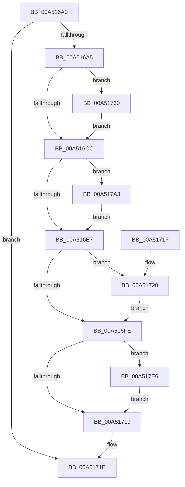

# PnpDiagRundownRegisterCallback

- RVA: `0x00A516A0`–`0x00A5180F` (길이 `367` bytes)
- VA: `0x0000000140A516A0`
- 실행 섹션: `PAGE`
- PDB 이름 있음: `예`; PDB Function 태그: `아니요`
- unwind 정보 RVA: `0x000B0C00`
- 디코드: `80`개 명령, `367/367` bytes 표시
- 미해석 바이트: `0` (있으면 어셈블리에 `.byte`로 보존)

> 이 문서는 커널 이미지의 기계어와 PDB 기호를 분석해 생성했습니다. 4번과 5번은 함수 원형과 자료형을 바이너리 사용 방식에서 추정한 C 해석이며 원본 소스 복구 결과는 아닙니다.

## 1. Dependencies

- 직접 호출 지점: **19**; 고유 호출 대상: **7**
- 직접 호출자로 확인된 함수: **0**
- RIP 상대 이미지 참조: **11**

### Outgoing calls
- `0x00A516B8` → [EtwEventEnabled](../../text/39/EtwEventEnabled_function_00392450.md) (function, `0x00392450`)
- `0x00A516DA` → [EtwEventEnabled](../../text/39/EtwEventEnabled_function_00392450.md) (function, `0x00392450`)
- `0x00A516F5` → [EtwEventEnabled](../../text/39/EtwEventEnabled_function_00392450.md) (function, `0x00392450`)
- `0x00A5170C` → [EtwEventEnabled](../../text/39/EtwEventEnabled_function_00392450.md) (function, `0x00392450`)
- `0x00A51736` → [ExAcquireResourceSharedLite](../../text/21/ExAcquireResourceSharedLite_function_00211BC0.md) (function, `0x00211BC0`)
- `0x00A5174C` → [PipForDeviceNodeSubtree](PipForDeviceNodeSubtree_function_00A51920.md) (function, `0x00A51920`)
- `0x00A51754` → [ExReleaseResourceLite](../../text/25/ExReleaseResourceLite_function_0025FA10.md) (function, `0x0025FA10`)
- `0x00A51759` → [KeLeaveCriticalRegion](../../text/25/KeLeaveCriticalRegion_function_0025D8B0.md) (function, `0x0025D8B0`)
- `0x00A51776` → [ExAcquireResourceSharedLite](../../text/21/ExAcquireResourceSharedLite_function_00211BC0.md) (function, `0x00211BC0`)
- `0x00A5178C` → [PipForDeviceNodeSubtree](PipForDeviceNodeSubtree_function_00A51920.md) (function, `0x00A51920`)
- `0x00A51794` → [ExReleaseResourceLite](../../text/25/ExReleaseResourceLite_function_0025FA10.md) (function, `0x0025FA10`)
- `0x00A51799` → [KeLeaveCriticalRegion](../../text/25/KeLeaveCriticalRegion_function_0025D8B0.md) (function, `0x0025D8B0`)
- `0x00A517B9` → [ExAcquireResourceSharedLite](../../text/21/ExAcquireResourceSharedLite_function_00211BC0.md) (function, `0x00211BC0`)
- `0x00A517CF` → [PipForDeviceNodeSubtree](PipForDeviceNodeSubtree_function_00A51920.md) (function, `0x00A51920`)
- `0x00A517D7` → [ExReleaseResourceLite](../../text/25/ExReleaseResourceLite_function_0025FA10.md) (function, `0x0025FA10`)
- `0x00A517DC` → [KeLeaveCriticalRegion](../../text/25/KeLeaveCriticalRegion_function_0025D8B0.md) (function, `0x0025D8B0`)
- `0x00A517E8` → [PpDevNodeLockTree](../A1/PpDevNodeLockTree_function_00A19310.md) (function, `0x00A19310`)
- `0x00A517FE` → [PipForDeviceNodeSubtree](PipForDeviceNodeSubtree_function_00A51920.md) (function, `0x00A51920`)
- `0x00A51805` → [PpDevNodeUnlockTree](../A2/PpDevNodeUnlockTree_function_00A21290.md) (function, `0x00A21290`)

### Direct callers
- 이 함수 시작 RVA로 연결되는 직접 call은 확인되지 않았습니다. 간접 호출은 완전히 역산할 수 없습니다.

### Static image references
- `0x00A516AA` → RVA `0x00E662D0` (`.data`; read)
- `0x00A516B1` → RVA `0x00010AF8` (`.rdata`; read)
- `0x00A516BD` → RVA `0x00F8C560` (`.data`; read)
- `0x00A516D3` → RVA `0x00010B08` (`.rdata`; read)
- `0x00A516EE` → RVA `0x00010AE8` (`.rdata`; read)
- `0x00A51705` → RVA `0x0001A688` (`.rdata`; read)
- `0x00A5173B` → RVA `0x00F8C438` (`.data`; read)
- `0x00A51742` → RVA `0x00A7F920` (`PnpDiagRundownParentDevNodeForEachDevice`; read)
- `0x00A51782` → RVA `0x00A7B920` (`PnpDiagRundownConnectionResourceForEachDevice`; read)
- `0x00A517C5` → RVA `0x00A7FA90` (`PnpDiagRundownParentPdoForEachDevice`; read)
- `0x00A517F4` → RVA `0x0072B8F0` (`PnpDiagRundownInterruptResourceForEachDevice`; read)

## 2. Other-region calls and transfers

- 다른 실행 섹션으로 향하는 call: **13**
  - `0x00A516B8` → [EtwEventEnabled](../../text/39/EtwEventEnabled_function_00392450.md) (`PAGE` → `.text`)
  - `0x00A516DA` → [EtwEventEnabled](../../text/39/EtwEventEnabled_function_00392450.md) (`PAGE` → `.text`)
  - `0x00A516F5` → [EtwEventEnabled](../../text/39/EtwEventEnabled_function_00392450.md) (`PAGE` → `.text`)
  - `0x00A5170C` → [EtwEventEnabled](../../text/39/EtwEventEnabled_function_00392450.md) (`PAGE` → `.text`)
  - `0x00A51736` → [ExAcquireResourceSharedLite](../../text/21/ExAcquireResourceSharedLite_function_00211BC0.md) (`PAGE` → `.text`)
  - `0x00A51754` → [ExReleaseResourceLite](../../text/25/ExReleaseResourceLite_function_0025FA10.md) (`PAGE` → `.text`)
  - `0x00A51759` → [KeLeaveCriticalRegion](../../text/25/KeLeaveCriticalRegion_function_0025D8B0.md) (`PAGE` → `.text`)
  - `0x00A51776` → [ExAcquireResourceSharedLite](../../text/21/ExAcquireResourceSharedLite_function_00211BC0.md) (`PAGE` → `.text`)
  - `0x00A51794` → [ExReleaseResourceLite](../../text/25/ExReleaseResourceLite_function_0025FA10.md) (`PAGE` → `.text`)
  - `0x00A51799` → [KeLeaveCriticalRegion](../../text/25/KeLeaveCriticalRegion_function_0025D8B0.md) (`PAGE` → `.text`)
  - `0x00A517B9` → [ExAcquireResourceSharedLite](../../text/21/ExAcquireResourceSharedLite_function_00211BC0.md) (`PAGE` → `.text`)
  - `0x00A517D7` → [ExReleaseResourceLite](../../text/25/ExReleaseResourceLite_function_0025FA10.md) (`PAGE` → `.text`)
  - `0x00A517DC` → [KeLeaveCriticalRegion](../../text/25/KeLeaveCriticalRegion_function_0025D8B0.md) (`PAGE` → `.text`)
- 별도 외부 분기/꼬리 이동을 확인하지 못했습니다.

## 3. Assembly (complete function range)

```asm
00A516A0  83 FA 02                        cmp edx, 2
00A516A3  75 79                           jne 0x140a5171e
00A516A5  53                              push rbx
00A516A6  48 83 EC 20                     sub rsp, 0x20
00A516AA  48 8B 0D 1F 4C 41 00            mov rcx, qword ptr [rip + 0x414c1f]
00A516B1  48 8D 15 40 F4 5B FF            lea rdx, [rip - 0xa40bc0]
00A516B8  E8 93 0D 94 FF                  call 0x140392450
00A516BD  48 8D 1D 9C AE 53 00            lea rbx, [rip + 0x53ae9c]
00A516C4  84 C0                           test al, al
00A516C6  0F 85 94 00 00 00               jne 0x140a51760
00A516CC  48 8B 0D FD 4B 41 00            mov rcx, qword ptr [rip + 0x414bfd]
00A516D3  48 8D 15 2E F4 5B FF            lea rdx, [rip - 0xa40bd2]
00A516DA  E8 71 0D 94 FF                  call 0x140392450
00A516DF  84 C0                           test al, al
00A516E1  0F 85 BC 00 00 00               jne 0x140a517a3
00A516E7  48 8B 0D E2 4B 41 00            mov rcx, qword ptr [rip + 0x414be2]
00A516EE  48 8D 15 F3 F3 5B FF            lea rdx, [rip - 0xa40c0d]
00A516F5  E8 56 0D 94 FF                  call 0x140392450
00A516FA  84 C0                           test al, al
00A516FC  75 22                           jne 0x140a51720
00A516FE  48 8B 0D CB 4B 41 00            mov rcx, qword ptr [rip + 0x414bcb]
00A51705  48 8D 15 7C 8F 5C FF            lea rdx, [rip - 0xa37084]
00A5170C  E8 3F 0D 94 FF                  call 0x140392450
00A51711  84 C0                           test al, al
00A51713  0F 85 CD 00 00 00               jne 0x140a517e6
00A51719  48 83 C4 20                     add rsp, 0x20
00A5171D  5B                              pop rbx
00A5171E  C3                              ret
00A5171F  CC                              int3
00A51720  65 48 8B 04 25 88 01 00 00      mov rax, qword ptr gs:[0x188]
00A51729  B2 01                           mov dl, 1
00A5172B  48 8B CB                        mov rcx, rbx
00A5172E  66 FF 88 E4 01 00 00            dec word ptr [rax + 0x1e4]
00A51735  90                              nop
00A51736  E8 85 04 7C FF                  call 0x140211bc0
00A5173B  48 8B 0D F6 AC 53 00            mov rcx, qword ptr [rip + 0x53acf6]
00A51742  48 8D 15 D7 E1 02 00            lea rdx, [rip + 0x2e1d7]
00A51749  45 33 C0                        xor r8d, r8d
00A5174C  E8 CF 01 00 00                  call 0x140a51920
00A51751  48 8B CB                        mov rcx, rbx
00A51754  E8 B7 E2 80 FF                  call 0x14025fa10
00A51759  E8 52 C1 80 FF                  call 0x14025d8b0
00A5175E  EB 9E                           jmp 0x140a516fe
00A51760  65 48 8B 04 25 88 01 00 00      mov rax, qword ptr gs:[0x188]
00A51769  B2 01                           mov dl, 1
00A5176B  48 8B CB                        mov rcx, rbx
00A5176E  66 FF 88 E4 01 00 00            dec word ptr [rax + 0x1e4]
00A51775  90                              nop
00A51776  E8 45 04 7C FF                  call 0x140211bc0
00A5177B  48 8B 0D B6 AC 53 00            mov rcx, qword ptr [rip + 0x53acb6]
00A51782  48 8D 15 97 A1 02 00            lea rdx, [rip + 0x2a197]
00A51789  45 33 C0                        xor r8d, r8d
00A5178C  E8 8F 01 00 00                  call 0x140a51920
00A51791  48 8B CB                        mov rcx, rbx
00A51794  E8 77 E2 80 FF                  call 0x14025fa10
00A51799  E8 12 C1 80 FF                  call 0x14025d8b0
00A5179E  E9 29 FF FF FF                  jmp 0x140a516cc
00A517A3  65 48 8B 04 25 88 01 00 00      mov rax, qword ptr gs:[0x188]
00A517AC  B2 01                           mov dl, 1
00A517AE  48 8B CB                        mov rcx, rbx
00A517B1  66 FF 88 E4 01 00 00            dec word ptr [rax + 0x1e4]
00A517B8  90                              nop
00A517B9  E8 02 04 7C FF                  call 0x140211bc0
00A517BE  48 8B 0D 73 AC 53 00            mov rcx, qword ptr [rip + 0x53ac73]
00A517C5  48 8D 15 C4 E2 02 00            lea rdx, [rip + 0x2e2c4]
00A517CC  45 33 C0                        xor r8d, r8d
00A517CF  E8 4C 01 00 00                  call 0x140a51920
00A517D4  48 8B CB                        mov rcx, rbx
00A517D7  E8 34 E2 80 FF                  call 0x14025fa10
00A517DC  E8 CF C0 80 FF                  call 0x14025d8b0
00A517E1  E9 01 FF FF FF                  jmp 0x140a516e7
00A517E6  33 C9                           xor ecx, ecx
00A517E8  E8 23 7B FC FF                  call 0x140a19310
00A517ED  48 8B 0D 44 AC 53 00            mov rcx, qword ptr [rip + 0x53ac44]
00A517F4  48 8D 15 F5 A0 CD FF            lea rdx, [rip - 0x325f0b]
00A517FB  45 33 C0                        xor r8d, r8d
00A517FE  E8 1D 01 00 00                  call 0x140a51920
00A51803  33 C9                           xor ecx, ecx
00A51805  E8 86 FA FC FF                  call 0x140a21290
00A5180A  E9 0A FF FF FF                  jmp 0x140a51719
```

## 4. C-style interpretation (structured pseudocode)

```c
__int64 __fastcall PnpDiagRundownRegisterCallback(__int64 a1, int a2, int a3)
{
    __int64 result;
    __int64 v_rsp;

    if (a2 != 2) goto loc_00A5171E;
    v_rsp = (v_rsp) - (32);
    result = EtwEventEnabled(*(unsigned __int64 *)(v_rip + 4279327), v_rip - 10750912, a3, a4);
    if ((unsigned __int8)(result) != 0) goto loc_00A51760;
loc_00A516CC:
    result = EtwEventEnabled(*(unsigned __int64 *)(v_rip + 4279293), v_rip - 10750930, a3, a4);
    if ((unsigned __int8)(result) != 0) goto loc_00A517A3;
loc_00A516E7:
    result = EtwEventEnabled(*(unsigned __int64 *)(v_rip + 4279266), v_rip - 10750989, a3, a4);
    if ((unsigned __int8)(result) != 0) goto loc_00A51720;
loc_00A516FE:
    result = EtwEventEnabled(*(unsigned __int64 *)(v_rip + 4279243), v_rip - 10711172, a3, a4);
    if ((unsigned __int8)(result) != 0) goto loc_00A517E6;
loc_00A51719:
    v_rsp = (v_rsp) + (32);
loc_00A5171E:
    return result;
loc_00A51720:
    result = ExAcquireResourceSharedLite(v_rip + 5484188, 1, a3, a4);
    a3 = 0;
    result = PipForDeviceNodeSubtree(*(unsigned __int64 *)(v_rip + 5483766), v_rip + 188887, a3, a4);
    result = ExReleaseResourceLite(v_rip + 5484188, v_rip + 188887, a3, a4);
    result = KeLeaveCriticalRegion(v_rip + 5484188, v_rip + 188887, a3, a4);
    goto loc_00A516FE;
loc_00A51760:
    result = ExAcquireResourceSharedLite(v_rip + 5484188, 1, a3, a4);
    a3 = 0;
    result = PipForDeviceNodeSubtree(*(unsigned __int64 *)(v_rip + 5483702), v_rip + 172439, a3, a4);
    result = ExReleaseResourceLite(v_rip + 5484188, v_rip + 172439, a3, a4);
    result = KeLeaveCriticalRegion(v_rip + 5484188, v_rip + 172439, a3, a4);
    goto loc_00A516CC;
loc_00A517A3:
    result = ExAcquireResourceSharedLite(v_rip + 5484188, 1, a3, a4);
    a3 = 0;
    result = PipForDeviceNodeSubtree(*(unsigned __int64 *)(v_rip + 5483635), v_rip + 189124, a3, a4);
    result = ExReleaseResourceLite(v_rip + 5484188, v_rip + 189124, a3, a4);
    result = KeLeaveCriticalRegion(v_rip + 5484188, v_rip + 189124, a3, a4);
    goto loc_00A516E7;
loc_00A517E6:
    a1 = 0;
    result = PpDevNodeLockTree(a1, v_rip + 189124, a3, a4);
    a3 = 0;
    result = PipForDeviceNodeSubtree(*(unsigned __int64 *)(v_rip + 5483588), v_rip - 3301131, a3, a4);
    a1 = 0;
    result = PpDevNodeUnlockTree(a1, v_rip - 3301131, a3, a4);
    goto loc_00A51719;
}
```

## 5. (Beta) C Style

```c
int64_t PnpDiagRundownRegisterCallback(int64_t Arg1, int32_t Arg2, int32_t Arg3)
{
    int64_t result;
    int64_t local_rsp;

    if (Arg2 != 2) goto loc_00A5171E;
    local_rsp = (local_rsp) - (32);
    result = EtwEventEnabled(*(uint64_t *)(v_rip + 0x414C1F), v_rip - 10750912, Arg3, a4);
    if ((uint8_t)(result) != 0) goto loc_00A51760;
loc_00A516CC:
    result = EtwEventEnabled(*(uint64_t *)(v_rip + 0x414BFD), v_rip - 10750930, Arg3, a4);
    if ((uint8_t)(result) != 0) goto loc_00A517A3;
loc_00A516E7:
    result = EtwEventEnabled(*(uint64_t *)(v_rip + 0x414BE2), v_rip - 10750989, Arg3, a4);
    if ((uint8_t)(result) != 0) goto loc_00A51720;
loc_00A516FE:
    result = EtwEventEnabled(*(uint64_t *)(v_rip + 0x414BCB), v_rip - 10711172, Arg3, a4);
    if ((uint8_t)(result) != 0) goto loc_00A517E6;
loc_00A51719:
    local_rsp = (local_rsp) + (32);
loc_00A5171E:
    return result;
loc_00A51720:
    result = ExAcquireResourceSharedLite(v_rip + 5484188, 1, Arg3, a4);
    Arg3 = 0;
    result = PipForDeviceNodeSubtree(*(uint64_t *)(v_rip + 0x53ACF6), v_rip + 188887, Arg3, a4);
    result = ExReleaseResourceLite(v_rip + 5484188, v_rip + 188887, Arg3, a4);
    result = KeLeaveCriticalRegion(v_rip + 5484188, v_rip + 188887, Arg3, a4);
    goto loc_00A516FE;
loc_00A51760:
    result = ExAcquireResourceSharedLite(v_rip + 5484188, 1, Arg3, a4);
    Arg3 = 0;
    result = PipForDeviceNodeSubtree(*(uint64_t *)(v_rip + 0x53ACB6), v_rip + 172439, Arg3, a4);
    result = ExReleaseResourceLite(v_rip + 5484188, v_rip + 172439, Arg3, a4);
    result = KeLeaveCriticalRegion(v_rip + 5484188, v_rip + 172439, Arg3, a4);
    goto loc_00A516CC;
loc_00A517A3:
    result = ExAcquireResourceSharedLite(v_rip + 5484188, 1, Arg3, a4);
    Arg3 = 0;
    result = PipForDeviceNodeSubtree(*(uint64_t *)(v_rip + 0x53AC73), v_rip + 189124, Arg3, a4);
    result = ExReleaseResourceLite(v_rip + 5484188, v_rip + 189124, Arg3, a4);
    result = KeLeaveCriticalRegion(v_rip + 5484188, v_rip + 189124, Arg3, a4);
    goto loc_00A516E7;
loc_00A517E6:
    Arg1 = 0;
    result = PpDevNodeLockTree(Arg1, v_rip + 189124, Arg3, a4);
    Arg3 = 0;
    result = PipForDeviceNodeSubtree(*(uint64_t *)(v_rip + 0x53AC44), v_rip - 3301131, Arg3, a4);
    Arg1 = 0;
    result = PpDevNodeUnlockTree(Arg1, v_rip - 3301131, Arg3, a4);
    goto loc_00A51719;
}
```

## 6. Execution-region graph

[열기: 2D/3D 그래프와 함수 탐색 컨트롤 패널](../../../control-panel.html?section=page&rva=0x00A516A0&view=graph)

- 2D 그래프는 위에서 아래로 흐르고, 3D 그래프는 빈 공간을 드래그해 회전합니다. Shift+드래그는 이동, 휠은 확대·축소, 함수 노드 선택은 대상 보고서 이동입니다.

### Static fallback


