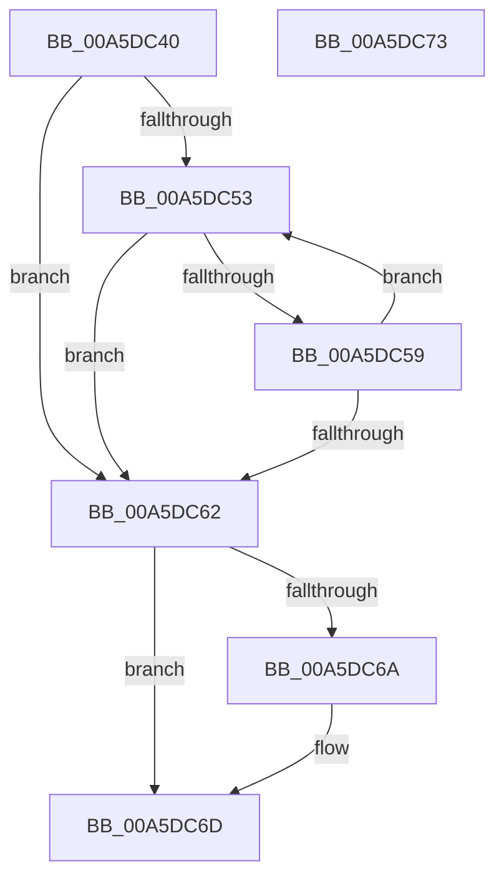

# PnpRegSzToString

- RVA: `0x00A5DC40`–`0x00A5DC74` (길이 `52` bytes)
- VA: `0x0000000140A5DC40`
- 실행 섹션: `PAGE`
- PDB 이름 있음: `예`; PDB Function 태그: `아니요`
- unwind 정보 RVA: `0x000DB714`
- 디코드: `19`개 명령, `52/52` bytes 표시
- 미해석 바이트: `0` (있으면 어셈블리에 `.byte`로 보존)

> 이 문서는 커널 이미지의 기계어와 PDB 기호를 분석해 생성했습니다. 4번과 5번은 함수 원형과 자료형을 바이너리 사용 방식에서 추정한 C 해석이며 원본 소스 복구 결과는 아닙니다.

## 1. Dependencies

- 직접 호출 지점: **0**; 고유 호출 대상: **0**
- 직접 호출자로 확인된 함수: **7**
- RIP 상대 이미지 참조: **0**

### Outgoing calls
- 직접 디코드된 call 명령이 없습니다.

### Direct callers
- [PipGetDriverKsrGuidRegistryValue](../72/PipGetDriverKsrGuidRegistryValue_function_007251C0.md) at `0x00725230`
- [PipApplyFunctionToServiceInstances](../72/PipApplyFunctionToServiceInstances_function_0072BF40.md) at `0x0072C079`
- [PipServiceInstanceToDeviceInstance](../72/PipServiceInstanceToDeviceInstance_function_0072C150.md) at `0x0072C233`
- [PiDevCfgMakeServiceBootStart](../73/PiDevCfgMakeServiceBootStart_function_00733BC8.md) at `0x00733CDD`
- [PiDevCfgResolveVariableKeyHandle](../AB/PiDevCfgResolveVariableKeyHandle_function_00AB2A24.md) at `0x00AB30BF`
- [PipGetDriverTagPriority](../../init/C3/PipGetDriverTagPriority_function_00C30A10.md) at `0x00C30AB5`
- [PpInitGetGroupOrderIndex](../../init/C7/PpInitGetGroupOrderIndex_function_00C77534.md) at `0x00C775B9`

### Static image references
- 디코드된 RIP-relative 메모리 참조가 없습니다.

## 2. Other-region calls and transfers

- 다른 실행 섹션으로 향하는 call: **0**
- 별도 외부 분기/꼬리 이동을 확인하지 못했습니다.

## 3. Assembly (complete function range)

```asm
00A5DC40  8B C2                           mov eax, edx
00A5DC42  4C 8B C9                        mov r9, rcx
00A5DC45  48 D1 E8                        shr rax, 1
00A5DC48  48 8D 14 41                     lea rdx, [rcx + rax*2]
00A5DC4C  33 C0                           xor eax, eax
00A5DC4E  48 3B CA                        cmp rcx, rdx
00A5DC51  73 0F                           jae 0x140a5dc62
00A5DC53  66 41 39 01                     cmp word ptr [r9], ax
00A5DC57  74 09                           je 0x140a5dc62
00A5DC59  49 83 C1 02                     add r9, 2
00A5DC5D  4C 3B CA                        cmp r9, rdx
00A5DC60  72 F1                           jb 0x140a5dc53
00A5DC62  44 2B C9                        sub r9d, ecx
00A5DC65  4D 85 C0                        test r8, r8
00A5DC68  74 03                           je 0x140a5dc6d
00A5DC6A  45 89 08                        mov dword ptr [r8], r9d
00A5DC6D  B8 01 00 00 00                  mov eax, 1
00A5DC72  C3                              ret
00A5DC73  CC                              int3
```

## 4. C-style interpretation (structured pseudocode)

```c
__int64 __fastcall PnpRegSzToString(__int64 a1, int a2, __int64 a3)
{
    __int64 result;

    result = ((unsigned int)(a2)) >> (1);
    result = 0;
    if (a1 >= (a1 + result * 2)) goto loc_00A5DC62;
loc_00A5DC53:
    if ((*(unsigned __int16 *)(a1)) == 0) goto loc_00A5DC62;
    a4 = (a1) + (2);
    if (a4 < (a1 + result * 2)) goto loc_00A5DC53;
loc_00A5DC62:
    a4 = (unsigned int)((a4) - ((unsigned int)(a1)));
    if (a3 != 0) {
        *(unsigned int *)(a3) = (unsigned int)(a4);
    }
    return 1;
}
```

## 5. (Beta) C Style

```c
int64_t PnpRegSzToString(void *Arg1, int32_t Arg2, int64_t Arg3)
{
    uint8_t *arg1 = (uint8_t *)Arg1;

    int64_t result;

    result = ((uint32_t)(Arg2)) >> (1);
    result = 0;
    if (Arg1 >= (Arg1 + result * 2)) goto loc_00A5DC62;
loc_00A5DC53:
    if ((*(uint16_t *)(arg1)) == 0) goto loc_00A5DC62;
    a4 = (Arg1) + (2);
    if (a4 < (Arg1 + result * 2)) goto loc_00A5DC53;
loc_00A5DC62:
    a4 = (uint32_t)((a4) - ((uint32_t)(Arg1)));
    if (Arg3 != 0) {
        *(uint32_t *)(Arg3) = (uint32_t)(a4);
    }
    return 1;
}
```

### 관측된 메모리 오프셋

구조체 형식이 확인되지 않은 접근은 인자 기준의 오프셋으로만 기록했습니다.

| 기준 인자 | 오프셋 표현 | 폭 (bit) | 접근 |
|---|---:|---:|---|
| `Arg1` | `+ 0x0 + rax*2` | `64` | `R` |

## 6. Execution-region graph

[열기: 2D/3D 그래프와 함수 탐색 컨트롤 패널](../../../control-panel.html?section=page&rva=0x00A5DC40&view=graph)

- 2D 그래프는 위에서 아래로 흐르고, 3D 그래프는 빈 공간을 드래그해 회전합니다. Shift+드래그는 이동, 휠은 확대·축소, 함수 노드 선택은 대상 보고서 이동입니다.

### Static fallback


