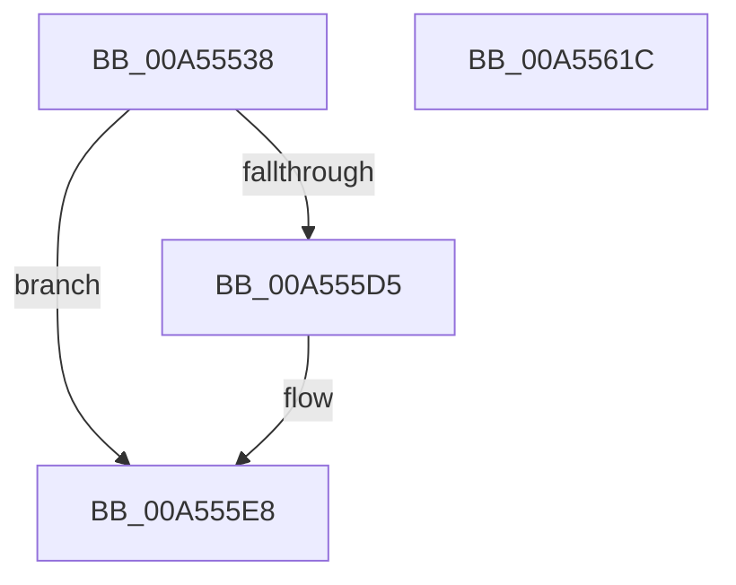

# PoDiagTraceDeviceRundown

- RVA: `0x00A55538`–`0x00A5561D` (길이 `229` bytes)
- VA: `0x0000000140A55538`
- 실행 섹션: `PAGE`
- PDB 이름 있음: `예`; PDB Function 태그: `아니요`
- unwind 정보 RVA: `0x000B11FC`
- 디코드: `55`개 명령, `229/229` bytes 표시
- 미해석 바이트: `0` (있으면 어셈블리에 `.byte`로 보존)

> 이 문서는 커널 이미지의 기계어와 PDB 기호를 분석해 생성했습니다. 4번과 5번은 함수 원형과 자료형을 바이너리 사용 방식에서 추정한 C 해석이며 원본 소스 복구 결과는 아닙니다.

## 1. Dependencies

- 직접 호출 지점: **2**; 고유 호출 대상: **2**
- 직접 호출자로 확인된 함수: **1**
- RIP 상대 이미지 참조: **3**

### Outgoing calls
- `0x00A55602` → [EtwWrite](../../text/41/EtwWrite_function_0041C720.md) (function, `0x0041C720`)
- `0x00A5560E` → [_security_check_cookie](../../text/6A/_security_check_cookie_function_006AC640.md) (function, `0x006AC640`)

### Direct callers
- [IoDiagTraceDevicesRundown](IoDiagTraceDevicesRundown_function_00A554C0.md) at `0x00A5550F`

### Static image references
- `0x00A5554A` → RVA `0x00E0A740` (`.data`; read)
- `0x00A555E8` → RVA `0x00F0B408` (`.data`; read)
- `0x00A555FB` → RVA `0x0001A6F8` (`.rdata`; read)

## 2. Other-region calls and transfers

- 다른 실행 섹션으로 향하는 call: **2**
  - `0x00A55602` → [EtwWrite](../../text/41/EtwWrite_function_0041C720.md) (`PAGE` → `.text`)
  - `0x00A5560E` → [_security_check_cookie](../../text/6A/_security_check_cookie_function_006AC640.md) (`PAGE` → `.text`)
- 별도 외부 분기/꼬리 이동을 확인하지 못했습니다.

## 3. Assembly (complete function range)

```asm
00A55538  48 89 4C 24 08                  mov qword ptr [rsp + 8], rcx
00A5553D  55                              push rbp
00A5553E  48 8D 6C 24 A9                  lea rbp, [rsp - 0x57]
00A55543  48 81 EC B0 00 00 00            sub rsp, 0xb0
00A5554A  48 8B 05 EF 51 3B 00            mov rax, qword ptr [rip + 0x3b51ef]
00A55551  48 33 C4                        xor rax, rsp
00A55554  48 89 45 47                     mov qword ptr [rbp + 0x47], rax
00A55558  0F B7 0A                        movzx ecx, word ptr [rdx]
00A5555B  48 8D 45 67                     lea rax, [rbp + 0x67]
00A5555F  48 89 45 E7                     mov qword ptr [rbp - 0x19], rax
00A55563  45 33 D2                        xor r10d, r10d
00A55566  48 8D 45 D7                     lea rax, [rbp - 0x29]
00A5556A  89 4D 1F                        mov dword ptr [rbp + 0x1f], ecx
00A5556D  48 89 45 F7                     mov qword ptr [rbp - 9], rax
00A55571  41 FE C9                        dec r9b
00A55574  0F B7 C1                        movzx eax, cx
00A55577  44 88 4D D7                     mov byte ptr [rbp - 0x29], r9b
00A5557B  41 0F B7 08                     movzx ecx, word ptr [r8]
00A5557F  45 8D 4A 05                     lea r9d, [r10 + 5]
00A55583  66 D1 E8                        shr ax, 1
00A55586  66 89 45 DB                     mov word ptr [rbp - 0x25], ax
00A5558A  48 8D 45 DB                     lea rax, [rbp - 0x25]
00A5558E  48 89 45 07                     mov qword ptr [rbp + 7], rax
00A55592  48 8B 42 08                     mov rax, qword ptr [rdx + 8]
00A55596  48 89 45 17                     mov qword ptr [rbp + 0x17], rax
00A5559A  0F B7 C1                        movzx eax, cx
00A5559D  66 D1 E8                        shr ax, 1
00A555A0  66 89 45 DF                     mov word ptr [rbp - 0x21], ax
00A555A4  48 8D 45 DF                     lea rax, [rbp - 0x21]
00A555A8  48 89 45 27                     mov qword ptr [rbp + 0x27], rax
00A555AC  48 C7 45 EF 08 00 00 00         mov qword ptr [rbp - 0x11], 8
00A555B4  48 C7 45 FF 01 00 00 00         mov qword ptr [rbp - 1], 1
00A555BC  48 C7 45 0F 02 00 00 00         mov qword ptr [rbp + 0xf], 2
00A555C4  44 89 55 23                     mov dword ptr [rbp + 0x23], r10d
00A555C8  48 C7 45 2F 02 00 00 00         mov qword ptr [rbp + 0x2f], 2
00A555D0  66 85 C9                        test cx, cx
00A555D3  74 13                           je 0x140a555e8
00A555D5  49 8B 40 08                     mov rax, qword ptr [r8 + 8]
00A555D9  45 8D 4A 06                     lea r9d, [r10 + 6]
00A555DD  48 89 45 37                     mov qword ptr [rbp + 0x37], rax
00A555E1  89 4D 3F                        mov dword ptr [rbp + 0x3f], ecx
00A555E4  44 89 55 43                     mov dword ptr [rbp + 0x43], r10d
00A555E8  48 8B 0D 19 5E 4B 00            mov rcx, qword ptr [rip + 0x4b5e19]
00A555EF  48 8D 45 E7                     lea rax, [rbp - 0x19]
00A555F3  45 33 C0                        xor r8d, r8d
00A555F6  48 89 44 24 20                  mov qword ptr [rsp + 0x20], rax
00A555FB  48 8D 15 F6 50 5C FF            lea rdx, [rip - 0xa3af0a]
00A55602  E8 19 71 9C FF                  call 0x14041c720
00A55607  48 8B 4D 47                     mov rcx, qword ptr [rbp + 0x47]
00A5560B  48 33 CC                        xor rcx, rsp
00A5560E  E8 2D 70 C5 FF                  call 0x1406ac640
00A55613  48 81 C4 B0 00 00 00            add rsp, 0xb0
00A5561A  5D                              pop rbp
00A5561B  C3                              ret
00A5561C  CC                              int3
```

## 4. C-style interpretation (structured pseudocode)

```c
__int64 __fastcall PoDiagTraceDeviceRundown(__int64 a1, __int64 a2, __int64 a3, unsigned __int8 a4)
{
    __int64 result;
    __int64 v_r10;
    __int64 v_rsp;
    unsigned __int64 v_stack_m18;
    unsigned int v_stack_m1C;
    unsigned int v_stack_m20;
    unsigned __int64 v_stack_m28;
    unsigned __int64 v_stack_m30;
    unsigned __int64 v_stack_m38;
    unsigned int v_stack_m3C;
    unsigned int v_stack_m40;
    unsigned __int64 v_stack_m48;
    unsigned __int64 v_stack_m50;
    unsigned __int64 v_stack_m58;
    unsigned __int64 v_stack_m5F;
    unsigned __int64 v_stack_m60;
    unsigned __int64 v_stack_m68;
    unsigned __int64 v_stack_m70;
    unsigned __int64 v_stack_m78;
    unsigned __int16 v_stack_m80;
    unsigned __int16 v_stack_m84;
    unsigned __int64 v_stack_m88;
    unsigned __int64 v_stack_m98;
    unsigned __int64 v_stack_p8;

    v_stack_p8 = a1;
    v_rsp = (v_rsp) - (176);
    result = (*(unsigned __int64 *)(v_rip + 3887599)) ^ (v_rsp);
    v_stack_m18 = result;
    v_stack_m78 = v_stack_p8;
    v_r10 = 0;
    v_stack_m40 = (unsigned int)(*(unsigned __int16 *)(a2));
    v_stack_m68 = v_stack_m88;
    a4 = (unsigned __int8)((a4) - 1);
    v_stack_m88 = a4;
    result = (unsigned __int16)(((unsigned __int16)(*(unsigned __int16 *)(a2))) >> (1));
    v_stack_m84 = (unsigned __int16)(result);
    v_stack_m58 = v_stack_m84;
    v_stack_m48 = *(unsigned __int64 *)(a2 + 8);
    result = (unsigned __int16)(((unsigned __int16)(*(unsigned __int16 *)(a3))) >> (1));
    v_stack_m80 = (unsigned __int16)(result);
    v_stack_m38 = v_stack_m80;
    v_stack_m70 = 8;
    v_stack_m60 = 1;
    v_stack_m50 = 2;
    v_stack_m3C = 0;
    v_stack_m30 = 2;
    result = v_stack_m80;
    if ((unsigned __int16)(*(unsigned __int16 *)(a3)) != 0) {
        result = *(unsigned __int64 *)(a3 + 8);
        a4 = v_r10 + 6;
        v_stack_m28 = result;
        v_stack_m20 = (unsigned int)(*(unsigned __int16 *)(a3));
        v_stack_m1C = 0;
    }
    a3 = 0;
    v_stack_m98 = v_stack_m78;
    result = EtwWrite(*(unsigned __int64 *)(v_rip + 4939289), v_rip - 10727178, a3, a4);
    a1 = (v_stack_m18) ^ (v_rsp);
    result = _security_check_cookie(a1, v_rip - 10727178, a3, a4);
    v_rsp = (v_rsp) + (176);
    return result;
}
```

## 5. (Beta) C Style

```c
int64_t PoDiagTraceDeviceRundown(int64_t Arg1, void *Arg2, void *Arg3, uint8_t Arg4)
{
    uint8_t *arg2 = (uint8_t *)Arg2;
    uint8_t *arg3 = (uint8_t *)Arg3;

    int64_t result;
    int64_t local_r10;
    int64_t local_rsp;
    uint64_t v_stack_m18;
    uint32_t v_stack_m1C;
    uint32_t v_stack_m20;
    uint64_t v_stack_m28;
    uint64_t v_stack_m30;
    uint64_t v_stack_m38;
    uint32_t v_stack_m3C;
    uint32_t v_stack_m40;
    uint64_t v_stack_m48;
    uint64_t v_stack_m50;
    uint64_t v_stack_m58;
    uint64_t v_stack_m5F;
    uint64_t v_stack_m60;
    uint64_t v_stack_m68;
    uint64_t v_stack_m70;
    uint64_t v_stack_m78;
    uint16_t v_stack_m80;
    uint16_t v_stack_m84;
    uint64_t v_stack_m88;
    uint64_t v_stack_m98;
    uint64_t v_stack_p8;

    v_stack_p8 = Arg1;
    local_rsp = (local_rsp) - (176);
    result = (*(uint64_t *)(v_rip + 0x3B51EF)) ^ (local_rsp);
    v_stack_m18 = result;
    v_stack_m78 = v_stack_p8;
    local_r10 = 0;
    v_stack_m40 = (uint32_t)(*(uint16_t *)(arg2));
    v_stack_m68 = v_stack_m88;
    Arg4 = (uint8_t)((Arg4) - 1);
    v_stack_m88 = Arg4;
    result = (uint16_t)(((uint16_t)(*(uint16_t *)(arg2))) >> (1));
    v_stack_m84 = (uint16_t)(result);
    v_stack_m58 = v_stack_m84;
    v_stack_m48 = *(uint64_t *)(arg2 + 0x8);
    result = (uint16_t)(((uint16_t)(*(uint16_t *)(arg3))) >> (1));
    v_stack_m80 = (uint16_t)(result);
    v_stack_m38 = v_stack_m80;
    v_stack_m70 = 8;
    v_stack_m60 = 1;
    v_stack_m50 = 2;
    v_stack_m3C = 0;
    v_stack_m30 = 2;
    result = v_stack_m80;
    if ((uint16_t)(*(uint16_t *)(arg3)) != 0) {
        result = *(uint64_t *)(arg3 + 0x8);
        Arg4 = local_r10 + 6;
        v_stack_m28 = result;
        v_stack_m20 = (uint32_t)(*(uint16_t *)(arg3));
        v_stack_m1C = 0;
    }
    Arg3 = 0;
    v_stack_m98 = v_stack_m78;
    result = EtwWrite(*(uint64_t *)(v_rip + 0x4B5E19), v_rip - 10727178, Arg3, Arg4);
    Arg1 = (v_stack_m18) ^ (local_rsp);
    result = _security_check_cookie(Arg1, v_rip - 10727178, Arg3, Arg4);
    local_rsp = (local_rsp) + (176);
    return result;
}
```

### 관측된 메모리 오프셋

구조체 형식이 확인되지 않은 접근은 인자 기준의 오프셋으로만 기록했습니다.

| 기준 인자 | 오프셋 표현 | 폭 (bit) | 접근 |
|---|---:|---:|---|
| `Arg2` | `+ 0x0` | `16` | `R` |
| `Arg2` | `+ 0x8` | `64` | `R` |
| `Arg3` | `+ 0x0` | `16` | `R` |
| `Arg3` | `+ 0x8` | `64` | `R` |

## 6. Execution-region graph

[열기: 2D/3D 그래프와 함수 탐색 컨트롤 패널](../../../control-panel.html?section=page&rva=0x00A55538&view=graph)

- 2D 그래프는 위에서 아래로 흐르고, 3D 그래프는 빈 공간을 드래그해 회전합니다. Shift+드래그는 이동, 휠은 확대·축소, 함수 노드 선택은 대상 보고서 이동입니다.

### Static fallback


