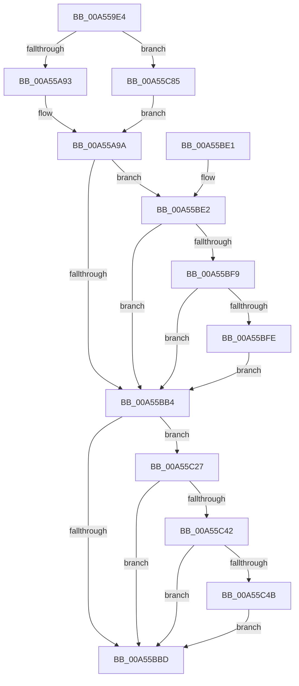

# PopDiagTraceDeviceVerboseRundown

- RVA: `0x00A559E4`–`0x00A55CA0` (길이 `700` bytes)
- VA: `0x0000000140A559E4`
- 실행 섹션: `PAGE`
- PDB 이름 있음: `예`; PDB Function 태그: `아니요`
- unwind 정보 RVA: `0x000B12AC`
- 디코드: `149`개 명령, `700/700` bytes 표시
- 미해석 바이트: `0` (있으면 어셈블리에 `.byte`로 보존)

> 이 문서는 커널 이미지의 기계어와 PDB 기호를 분석해 생성했습니다. 4번과 5번은 함수 원형과 자료형을 바이너리 사용 방식에서 추정한 C 해석이며 원본 소스 복구 결과는 아닙니다.

## 1. Dependencies

- 직접 호출 지점: **7**; 고유 호출 대상: **5**
- 직접 호출자로 확인된 함수: **1**
- RIP 상대 이미지 참조: **9**

### Outgoing calls
- `0x00A55A5B` → [PopPepGetDevicePlatformStateDependents](../../text/49/PopPepGetDevicePlatformStateDependents_function_0049CAB4.md) (function, `0x0049CAB4`)
- `0x00A55BC4` → [_security_check_cookie](../../text/6A/_security_check_cookie_function_006AC640.md) (function, `0x006AC640`)
- `0x00A55BF0` → [EtwEventEnabled](../../text/39/EtwEventEnabled_function_00392450.md) (function, `0x00392450`)
- `0x00A55C20` → [EtwWrite](../../text/41/EtwWrite_function_0041C720.md) (function, `0x0041C720`)
- `0x00A55C35` → [EtwEventEnabled](../../text/39/EtwEventEnabled_function_00392450.md) (function, `0x00392450`)
- `0x00A55C7B` → [EtwWrite](../../text/41/EtwWrite_function_0041C720.md) (function, `0x0041C720`)
- `0x00A55C91` → [RtlInitUnicodeString](../../text/42/RtlInitUnicodeString_function_0042A780.md) (function, `0x0042A780`)

### Direct callers
- [PopDiagTraceFxRundown](../../text/43/PopDiagTraceFxRundown_function_0043A028.md) at `0x0043A0CD`

### Static image references
- `0x00A559FE` → RVA `0x00E0A740` (`.data`; read)
- `0x00A55AAC` → RVA `0x00E67858` (`.data`; read)
- `0x00A55BB4` → RVA `0x00E67859` (`.data`; read)
- `0x00A55BE2` → RVA `0x00F0B408` (`.data`; read)
- `0x00A55BE9` → RVA `0x0001A708` (`.rdata`; read)
- `0x00A55C12` → RVA `0x00E67870` (`.data`; read)
- `0x00A55C2E` → RVA `0x0001A718` (`.rdata`; read)
- `0x00A55C4B` → RVA `0x00F0B6B8` (`.data`; read)
- `0x00A55C85` → RVA `0x00AFCAD0` (` ?? ::NNGAKEGL::`string'`; read)

## 2. Other-region calls and transfers

- 다른 실행 섹션으로 향하는 call: **7**
  - `0x00A55A5B` → [PopPepGetDevicePlatformStateDependents](../../text/49/PopPepGetDevicePlatformStateDependents_function_0049CAB4.md) (`PAGE` → `.text`)
  - `0x00A55BC4` → [_security_check_cookie](../../text/6A/_security_check_cookie_function_006AC640.md) (`PAGE` → `.text`)
  - `0x00A55BF0` → [EtwEventEnabled](../../text/39/EtwEventEnabled_function_00392450.md) (`PAGE` → `.text`)
  - `0x00A55C20` → [EtwWrite](../../text/41/EtwWrite_function_0041C720.md) (`PAGE` → `.text`)
  - `0x00A55C35` → [EtwEventEnabled](../../text/39/EtwEventEnabled_function_00392450.md) (`PAGE` → `.text`)
  - `0x00A55C7B` → [EtwWrite](../../text/41/EtwWrite_function_0041C720.md) (`PAGE` → `.text`)
  - `0x00A55C91` → [RtlInitUnicodeString](../../text/42/RtlInitUnicodeString_function_0042A780.md) (`PAGE` → `.text`)
- 별도 외부 분기/꼬리 이동을 확인하지 못했습니다.

## 3. Assembly (complete function range)

```asm
00A559E4  48 89 5C 24 10                  mov qword ptr [rsp + 0x10], rbx
00A559E9  48 89 74 24 18                  mov qword ptr [rsp + 0x18], rsi
00A559EE  55                              push rbp
00A559EF  57                              push rdi
00A559F0  41 56                           push r14
00A559F2  48 8D 6C 24 80                  lea rbp, [rsp - 0x80]
00A559F7  48 81 EC 80 01 00 00            sub rsp, 0x180
00A559FE  48 8B 05 3B 4D 3B 00            mov rax, qword ptr [rip + 0x3b4d3b]
00A55A05  48 33 C4                        xor rax, rsp
00A55A08  48 89 45 70                     mov qword ptr [rbp + 0x70], rax
00A55A0C  48 8B 71 30                     mov rsi, qword ptr [rcx + 0x30]
00A55A10  48 8B FA                        mov rdi, rdx
00A55A13  48 89 74 24 50                  mov qword ptr [rsp + 0x50], rsi
00A55A18  48 8D 54 24 40                  lea rdx, [rsp + 0x40]
00A55A1D  48 8B D9                        mov rbx, rcx
00A55A20  0F 57 C0                        xorps xmm0, xmm0
00A55A23  48 8B 49 38                     mov rcx, qword ptr [rcx + 0x38]
00A55A27  45 33 F6                        xor r14d, r14d
00A55A2A  44 89 74 24 40                  mov dword ptr [rsp + 0x40], r14d
00A55A2F  0F B7 86 80 00 00 00            movzx eax, word ptr [rsi + 0x80]
00A55A36  66 D1 E8                        shr ax, 1
00A55A39  66 89 44 24 30                  mov word ptr [rsp + 0x30], ax
00A55A3E  0F B7 46 28                     movzx eax, word ptr [rsi + 0x28]
00A55A42  66 D1 E8                        shr ax, 1
00A55A45  66 89 44 24 34                  mov word ptr [rsp + 0x34], ax
00A55A4A  0F B7 46 38                     movzx eax, word ptr [rsi + 0x38]
00A55A4E  66 D1 E8                        shr ax, 1
00A55A51  66 89 44 24 38                  mov word ptr [rsp + 0x38], ax
00A55A56  0F 11 44 24 68                  movups xmmword ptr [rsp + 0x68], xmm0
00A55A5B  E8 54 70 A4 FF                  call 0x14049cab4
00A55A60  48 8B 4C 24 50                  mov rcx, qword ptr [rsp + 0x50]
00A55A65  48 8B 41 10                     mov rax, qword ptr [rcx + 0x10]
00A55A69  48 89 44 24 60                  mov qword ptr [rsp + 0x60], rax
00A55A6E  48 8B 41 20                     mov rax, qword ptr [rcx + 0x20]
00A55A72  48 89 44 24 58                  mov qword ptr [rsp + 0x58], rax
00A55A77  33 C0                           xor eax, eax
00A55A79  F0 44 0F B1 B3 60 03 00 00      lock cmpxchg dword ptr [rbx + 0x360], r14d
00A55A82  89 44 24 44                     mov dword ptr [rsp + 0x44], eax
00A55A86  4C 39 B3 D8 04 00 00            cmp qword ptr [rbx + 0x4d8], r14
00A55A8D  0F 84 F2 01 00 00               je 0x140a55c85
00A55A93  4C 8D 83 D0 04 00 00            lea r8, [rbx + 0x4d0]
00A55A9A  41 0F B7 10                     movzx edx, word ptr [r8]
00A55A9E  48 C7 45 88 08 00 00 00         mov qword ptr [rbp - 0x78], 8
00A55AA6  0F B7 C2                        movzx eax, dx
00A55AA9  66 D1 E8                        shr ax, 1
00A55AAC  44 38 35 A5 1D 41 00            cmp byte ptr [rip + 0x411da5], r14b
00A55AB3  66 89 44 24 3C                  mov word ptr [rsp + 0x3c], ax
00A55AB8  8B 83 8C 02 00 00               mov eax, dword ptr [rbx + 0x28c]
00A55ABE  89 44 24 48                     mov dword ptr [rsp + 0x48], eax
00A55AC2  48 8D 44 24 50                  lea rax, [rsp + 0x50]
00A55AC7  48 89 45 80                     mov qword ptr [rbp - 0x80], rax
00A55ACB  48 8D 44 24 30                  lea rax, [rsp + 0x30]
00A55AD0  48 89 45 90                     mov qword ptr [rbp - 0x70], rax
00A55AD4  48 C7 45 98 02 00 00 00         mov qword ptr [rbp - 0x68], 2
00A55ADC  48 8B 86 88 00 00 00            mov rax, qword ptr [rsi + 0x88]
00A55AE3  0F B7 8E 80 00 00 00            movzx ecx, word ptr [rsi + 0x80]
00A55AEA  48 89 45 A0                     mov qword ptr [rbp - 0x60], rax
00A55AEE  48 8D 44 24 34                  lea rax, [rsp + 0x34]
00A55AF3  48 89 45 B0                     mov qword ptr [rbp - 0x50], rax
00A55AF7  89 4D A8                        mov dword ptr [rbp - 0x58], ecx
00A55AFA  44 89 75 AC                     mov dword ptr [rbp - 0x54], r14d
00A55AFE  48 C7 45 B8 02 00 00 00         mov qword ptr [rbp - 0x48], 2
00A55B06  48 8B 46 30                     mov rax, qword ptr [rsi + 0x30]
00A55B0A  0F B7 4E 28                     movzx ecx, word ptr [rsi + 0x28]
00A55B0E  48 89 45 C0                     mov qword ptr [rbp - 0x40], rax
00A55B12  48 8D 44 24 38                  lea rax, [rsp + 0x38]
00A55B17  48 89 45 D0                     mov qword ptr [rbp - 0x30], rax
00A55B1B  89 4D C8                        mov dword ptr [rbp - 0x38], ecx
00A55B1E  44 89 75 CC                     mov dword ptr [rbp - 0x34], r14d
00A55B22  48 C7 45 D8 02 00 00 00         mov qword ptr [rbp - 0x28], 2
00A55B2A  48 8B 46 40                     mov rax, qword ptr [rsi + 0x40]
00A55B2E  0F B7 4E 38                     movzx ecx, word ptr [rsi + 0x38]
00A55B32  48 89 45 E0                     mov qword ptr [rbp - 0x20], rax
00A55B36  48 8D 44 24 40                  lea rax, [rsp + 0x40]
00A55B3B  48 89 45 F0                     mov qword ptr [rbp - 0x10], rax
00A55B3F  48 8D 44 24 58                  lea rax, [rsp + 0x58]
00A55B44  48 89 45 00                     mov qword ptr [rbp], rax
00A55B48  48 8D 44 24 60                  lea rax, [rsp + 0x60]
00A55B4D  48 89 45 10                     mov qword ptr [rbp + 0x10], rax
00A55B51  48 8D 44 24 44                  lea rax, [rsp + 0x44]
00A55B56  48 89 45 20                     mov qword ptr [rbp + 0x20], rax
00A55B5A  48 8D 44 24 3C                  lea rax, [rsp + 0x3c]
00A55B5F  48 89 45 30                     mov qword ptr [rbp + 0x30], rax
00A55B63  49 8B 40 08                     mov rax, qword ptr [r8 + 8]
00A55B67  48 89 45 40                     mov qword ptr [rbp + 0x40], rax
00A55B6B  48 8D 44 24 48                  lea rax, [rsp + 0x48]
00A55B70  48 89 45 50                     mov qword ptr [rbp + 0x50], rax
00A55B74  89 4D E8                        mov dword ptr [rbp - 0x18], ecx
00A55B77  44 89 75 EC                     mov dword ptr [rbp - 0x14], r14d
00A55B7B  48 C7 45 F8 04 00 00 00         mov qword ptr [rbp - 8], 4
00A55B83  48 C7 45 08 08 00 00 00         mov qword ptr [rbp + 8], 8
00A55B8B  48 C7 45 18 08 00 00 00         mov qword ptr [rbp + 0x18], 8
00A55B93  48 C7 45 28 04 00 00 00         mov qword ptr [rbp + 0x28], 4
00A55B9B  48 C7 45 38 02 00 00 00         mov qword ptr [rbp + 0x38], 2
00A55BA3  89 55 48                        mov dword ptr [rbp + 0x48], edx
00A55BA6  44 89 75 4C                     mov dword ptr [rbp + 0x4c], r14d
00A55BAA  48 C7 45 58 04 00 00 00         mov qword ptr [rbp + 0x58], 4
00A55BB2  75 2E                           jne 0x140a55be2
00A55BB4  44 38 35 9E 1C 41 00            cmp byte ptr [rip + 0x411c9e], r14b
00A55BBB  75 6A                           jne 0x140a55c27
00A55BBD  48 8B 4D 70                     mov rcx, qword ptr [rbp + 0x70]
00A55BC1  48 33 CC                        xor rcx, rsp
00A55BC4  E8 77 6A C5 FF                  call 0x1406ac640
00A55BC9  4C 8D 9C 24 80 01 00 00         lea r11, [rsp + 0x180]
00A55BD1  49 8B 5B 28                     mov rbx, qword ptr [r11 + 0x28]
00A55BD5  49 8B 73 30                     mov rsi, qword ptr [r11 + 0x30]
00A55BD9  49 8B E3                        mov rsp, r11
00A55BDC  41 5E                           pop r14
00A55BDE  5F                              pop rdi
00A55BDF  5D                              pop rbp
00A55BE0  C3                              ret
00A55BE1  CC                              int3
00A55BE2  48 8B 0D 1F 58 4B 00            mov rcx, qword ptr [rip + 0x4b581f]
00A55BE9  48 8D 15 18 4B 5C FF            lea rdx, [rip - 0xa3b4e8]
00A55BF0  E8 5B C8 93 FF                  call 0x140392450
00A55BF5  84 C0                           test al, al
00A55BF7  74 BB                           je 0x140a55bb4
00A55BF9  48 85 FF                        test rdi, rdi
00A55BFC  75 B6                           jne 0x140a55bb4
00A55BFE  48 8B 0D 03 58 4B 00            mov rcx, qword ptr [rip + 0x4b5803]
00A55C05  48 8D 45 80                     lea rax, [rbp - 0x80]
00A55C09  44 8D 4F 0E                     lea r9d, [rdi + 0xe]
00A55C0D  48 89 44 24 20                  mov qword ptr [rsp + 0x20], rax
00A55C12  4C 8D 05 57 1C 41 00            lea r8, [rip + 0x411c57]
00A55C19  48 8D 15 E8 4A 5C FF            lea rdx, [rip - 0xa3b518]
00A55C20  E8 FB 6A 9C FF                  call 0x14041c720
00A55C25  EB 8D                           jmp 0x140a55bb4
00A55C27  48 8B 0D DA 57 4B 00            mov rcx, qword ptr [rip + 0x4b57da]
00A55C2E  48 8D 15 E3 4A 5C FF            lea rdx, [rip - 0xa3b51d]
00A55C35  E8 16 C8 93 FF                  call 0x140392450
00A55C3A  84 C0                           test al, al
00A55C3C  0F 84 7B FF FF FF               je 0x140a55bbd
00A55C42  48 85 FF                        test rdi, rdi
00A55C45  0F 84 72 FF FF FF               je 0x140a55bbd
00A55C4B  48 8B 0D 66 5A 4B 00            mov rcx, qword ptr [rip + 0x4b5a66]
00A55C52  48 8D 45 80                     lea rax, [rbp - 0x80]
00A55C56  41 B9 0F 00 00 00               mov r9d, 0xf
00A55C5C  48 89 44 24 20                  mov qword ptr [rsp + 0x20], rax
00A55C61  4C 8D 05 08 1C 41 00            lea r8, [rip + 0x411c08]
00A55C68  48 89 7D 60                     mov qword ptr [rbp + 0x60], rdi
00A55C6C  48 8D 15 A5 4A 5C FF            lea rdx, [rip - 0xa3b55b]
00A55C73  48 C7 45 68 08 00 00 00         mov qword ptr [rbp + 0x68], 8
00A55C7B  E8 A0 6A 9C FF                  call 0x14041c720
00A55C80  E9 38 FF FF FF                  jmp 0x140a55bbd
00A55C85  48 8D 15 44 6E 0A 00            lea rdx, [rip + 0xa6e44]
00A55C8C  48 8D 4C 24 68                  lea rcx, [rsp + 0x68]
00A55C91  E8 EA 4A 9D FF                  call 0x14042a780
00A55C96  4C 8D 44 24 68                  lea r8, [rsp + 0x68]
00A55C9B  E9 FA FD FF FF                  jmp 0x140a55a9a
```

## 4. C-style interpretation (structured pseudocode)

```c
__int64 __fastcall PopDiagTraceDeviceVerboseRundown(__int64 a1, __int64 a2)
{
    __int64 result;
    __int64 v_r14;
    __int64 v_rsp;
    unsigned __int64 v_stack_m100;
    unsigned __int64 v_stack_m108;
    unsigned __int64 v_stack_m110;
    unsigned __int64 v_stack_m118;
    unsigned __int64 v_stack_m130;
    unsigned __int64 v_stack_m138;
    unsigned __int64 v_stack_m140;
    unsigned __int64 v_stack_m148;
    unsigned int v_stack_m150;
    unsigned int v_stack_m154;
    unsigned __int64 v_stack_m158;
    unsigned __int16 v_stack_m15C;
    unsigned __int16 v_stack_m160;
    unsigned __int16 v_stack_m164;
    unsigned __int16 v_stack_m168;
    unsigned __int64 v_stack_m18;
    unsigned __int64 v_stack_m28;
    unsigned __int64 v_stack_m30;
    unsigned __int64 v_stack_m38;
    unsigned __int64 v_stack_m40;
    unsigned __int64 v_stack_m48;
    unsigned int v_stack_m4C;
    unsigned int v_stack_m50;
    unsigned __int64 v_stack_m58;
    unsigned __int64 v_stack_m60;
    unsigned __int64 v_stack_m68;
    unsigned __int64 v_stack_m70;
    unsigned __int64 v_stack_m78;
    unsigned __int64 v_stack_m80;
    unsigned __int64 v_stack_m88;
    unsigned __int64 v_stack_m90;
    unsigned __int64 v_stack_m98;
    unsigned __int64 v_stack_mA0;
    unsigned __int64 v_stack_mA8;
    unsigned int v_stack_mAC;
    unsigned int v_stack_mB0;
    unsigned __int64 v_stack_mB8;
    unsigned __int64 v_stack_mC0;
    unsigned __int64 v_stack_mC8;
    unsigned int v_stack_mCC;
    unsigned int v_stack_mD0;
    unsigned __int64 v_stack_mD8;
    unsigned __int64 v_stack_mE0;
    unsigned __int64 v_stack_mE8;
    unsigned int v_stack_mEC;
    unsigned int v_stack_mF0;
    unsigned __int64 v_stack_mF8;
    unsigned __int64 v_stack_p10;
    unsigned __int64 v_stack_p18;

    v_stack_p10 = v_rbx;
    v_stack_p18 = v_rsi;
    v_rsp = (v_rsp) - (384);
    result = (*(unsigned __int64 *)(v_rip + 3886395)) ^ (v_rsp);
    v_stack_m28 = result;
    v_stack_m148 = *(unsigned __int64 *)(a1 + 48);
    v_r14 = 0;
    v_stack_m158 = 0;
    result = (unsigned __int16)((*(unsigned __int16 *)(*(unsigned __int64 *)(a1 + 48) + 128)) >> (1));
    v_stack_m168 = (unsigned __int16)(result);
    result = (unsigned __int16)((*(unsigned __int16 *)(*(unsigned __int64 *)(a1 + 48) + 40)) >> (1));
    v_stack_m164 = (unsigned __int16)(result);
    result = (unsigned __int16)((*(unsigned __int16 *)(*(unsigned __int64 *)(a1 + 48) + 56)) >> (1));
    v_stack_m160 = (unsigned __int16)(result);
    v_stack_m130 = v_xmm0;
    result = PopPepGetDevicePlatformStateDependents(*(unsigned __int64 *)(a1 + 56), v_stack_m158, a3, a4);
    v_stack_m138 = *(unsigned __int64 *)(v_stack_m148 + 16);
    v_stack_m140 = *(unsigned __int64 *)(v_stack_m148 + 32);
    result = 0;
    v_stack_m154 = 0;
    if ((*(unsigned __int64 *)(a1 + 1240)) == 0) goto loc_00A55C85;
loc_00A55A9A:
    v_stack_m110 = 8;
    result = (unsigned __int16)(((unsigned __int16)(*(unsigned __int16 *)(a1 + 1232))) >> (1));
    v_stack_m15C = (unsigned __int16)(result);
    v_stack_m150 = (unsigned int)((unsigned int)(*(unsigned int *)(a1 + 652)));
    v_stack_m118 = v_stack_m148;
    v_stack_m108 = v_stack_m168;
    v_stack_m100 = 2;
    v_stack_mF8 = *(unsigned __int64 *)(*(unsigned __int64 *)(a1 + 48) + 136);
    v_stack_mE8 = v_stack_m164;
    v_stack_mF0 = (unsigned int)(*(unsigned __int16 *)(*(unsigned __int64 *)(a1 + 48) + 128));
    v_stack_mEC = 0;
    v_stack_mE0 = 2;
    v_stack_mD8 = *(unsigned __int64 *)(*(unsigned __int64 *)(a1 + 48) + 48);
    v_stack_mC8 = v_stack_m160;
    v_stack_mD0 = (unsigned int)(*(unsigned __int16 *)(*(unsigned __int64 *)(a1 + 48) + 40));
    v_stack_mCC = 0;
    v_stack_mC0 = 2;
    v_stack_mB8 = *(unsigned __int64 *)(*(unsigned __int64 *)(a1 + 48) + 64);
    v_stack_mA8 = v_stack_m158;
    v_stack_m98 = v_stack_m140;
    v_stack_m88 = v_stack_m138;
    v_stack_m78 = v_stack_m154;
    v_stack_m68 = v_stack_m15C;
    v_stack_m58 = *(unsigned __int64 *)(a1 + 1232 + 8);
    v_stack_m48 = v_stack_m150;
    v_stack_mB0 = (unsigned int)(*(unsigned __int16 *)(*(unsigned __int64 *)(a1 + 48) + 56));
    v_stack_mAC = 0;
    v_stack_mA0 = 4;
    v_stack_m90 = 8;
    v_stack_m80 = 8;
    v_stack_m70 = 4;
    v_stack_m60 = 2;
    v_stack_m50 = (unsigned int)(*(unsigned __int16 *)(a1 + 1232));
    v_stack_m4C = 0;
    v_stack_m40 = 4;
    if ((*(unsigned __int8 *)(v_rip + 4267429)) != 0) goto loc_00A55BE2;
loc_00A55BB4:
    if ((*(unsigned __int8 *)(v_rip + 4267166)) != 0) goto loc_00A55C27;
loc_00A55BBD:
    a1 = (v_stack_m28) ^ (v_rsp);
    result = _security_check_cookie(a1, *(unsigned __int16 *)(a1 + 1232), a1 + 1232, a4);
    return result;
loc_00A55BE2:
    result = EtwEventEnabled(*(unsigned __int64 *)(v_rip + 4937759), v_rip - 10728680, a1 + 1232, a4);
    if ((unsigned __int8)(result) == 0) goto loc_00A55BB4;
    if (a2 != 0) goto loc_00A55BB4;
    v_stack_m160 = v_stack_m118;
    result = EtwWrite(*(unsigned __int64 *)(v_rip + 4937731), v_rip - 10728728, v_rip + 4267095, a2 + 14);
    goto loc_00A55BB4;
loc_00A55C27:
    result = EtwEventEnabled(*(unsigned __int64 *)(v_rip + 4937690), v_rip - 10728733, v_rip + 4267095, a2 + 14);
    if ((unsigned __int8)(result) == 0) goto loc_00A55BBD;
    if (a2 == 0) goto loc_00A55BBD;
    v_stack_m160 = v_stack_m118;
    v_stack_m38 = a2;
    v_stack_m30 = 8;
    result = EtwWrite(*(unsigned __int64 *)(v_rip + 4938342), v_rip - 10728795, v_rip + 4267016, 15);
    goto loc_00A55BBD;
loc_00A55C85:
    result = RtlInitUnicodeString(v_stack_m118, v_rip + 683588, v_rip + 4267016, 15);
    goto loc_00A55A9A;
}
```

## 5. (Beta) C Style

```c
int64_t PopDiagTraceDeviceVerboseRundown(void *Arg1, int64_t Arg2)
{
    uint8_t *arg1 = (uint8_t *)Arg1;

    int64_t result;
    int64_t local_r14;
    int64_t local_rsp;
    uint64_t v_stack_m100;
    uint64_t v_stack_m108;
    uint64_t v_stack_m110;
    uint64_t v_stack_m118;
    uint64_t v_stack_m130;
    uint64_t v_stack_m138;
    uint64_t v_stack_m140;
    uint64_t v_stack_m148;
    uint32_t v_stack_m150;
    uint32_t v_stack_m154;
    uint64_t v_stack_m158;
    uint16_t v_stack_m15C;
    uint16_t v_stack_m160;
    uint16_t v_stack_m164;
    uint16_t v_stack_m168;
    uint64_t v_stack_m18;
    uint64_t v_stack_m28;
    uint64_t v_stack_m30;
    uint64_t v_stack_m38;
    uint64_t v_stack_m40;
    uint64_t v_stack_m48;
    uint32_t v_stack_m4C;
    uint32_t v_stack_m50;
    uint64_t v_stack_m58;
    uint64_t v_stack_m60;
    uint64_t v_stack_m68;
    uint64_t v_stack_m70;
    uint64_t v_stack_m78;
    uint64_t v_stack_m80;
    uint64_t v_stack_m88;
    uint64_t v_stack_m90;
    uint64_t v_stack_m98;
    uint64_t v_stack_mA0;
    uint64_t v_stack_mA8;
    uint32_t v_stack_mAC;
    uint32_t v_stack_mB0;
    uint64_t v_stack_mB8;
    uint64_t v_stack_mC0;
    uint64_t v_stack_mC8;
    uint32_t v_stack_mCC;
    uint32_t v_stack_mD0;
    uint64_t v_stack_mD8;
    uint64_t v_stack_mE0;
    uint64_t v_stack_mE8;
    uint32_t v_stack_mEC;
    uint32_t v_stack_mF0;
    uint64_t v_stack_mF8;
    uint64_t v_stack_p10;
    uint64_t v_stack_p18;

    v_stack_p10 = local_rbx;
    v_stack_p18 = local_rsi;
    local_rsp = (local_rsp) - (384);
    result = (*(uint64_t *)(v_rip + 0x3B4D3B)) ^ (local_rsp);
    v_stack_m28 = result;
    v_stack_m148 = *(uint64_t *)(arg1 + 0x30);
    local_r14 = 0;
    v_stack_m158 = 0;
    result = (uint16_t)((*(uint16_t *)(*(uint64_t *)(arg1 + 0x30) + 0x80)) >> (1));
    v_stack_m168 = (uint16_t)(result);
    result = (uint16_t)((*(uint16_t *)(*(uint64_t *)(arg1 + 0x30) + 0x28)) >> (1));
    v_stack_m164 = (uint16_t)(result);
    result = (uint16_t)((*(uint16_t *)(*(uint64_t *)(arg1 + 0x30) + 0x38)) >> (1));
    v_stack_m160 = (uint16_t)(result);
    v_stack_m130 = v_xmm0;
    result = PopPepGetDevicePlatformStateDependents(*(uint64_t *)(arg1 + 0x38), v_stack_m158, a3, a4);
    v_stack_m138 = *(uint64_t *)(v_stack_m148 + 0x10);
    v_stack_m140 = *(uint64_t *)(v_stack_m148 + 0x20);
    result = 0;
    v_stack_m154 = 0;
    if ((*(uint64_t *)(arg1 + 0x4D8)) == 0) goto loc_00A55C85;
loc_00A55A9A:
    v_stack_m110 = 8;
    result = (uint16_t)(((uint16_t)(*(uint16_t *)(arg1 + 0x4D0))) >> (1));
    v_stack_m15C = (uint16_t)(result);
    v_stack_m150 = (uint32_t)((uint32_t)(*(uint32_t *)(arg1 + 0x28C)));
    v_stack_m118 = v_stack_m148;
    v_stack_m108 = v_stack_m168;
    v_stack_m100 = 2;
    v_stack_mF8 = *(uint64_t *)(*(uint64_t *)(arg1 + 0x30) + 0x88);
    v_stack_mE8 = v_stack_m164;
    v_stack_mF0 = (uint32_t)(*(uint16_t *)(*(uint64_t *)(arg1 + 0x30) + 0x80));
    v_stack_mEC = 0;
    v_stack_mE0 = 2;
    v_stack_mD8 = *(uint64_t *)(*(uint64_t *)(arg1 + 0x30) + 0x30);
    v_stack_mC8 = v_stack_m160;
    v_stack_mD0 = (uint32_t)(*(uint16_t *)(*(uint64_t *)(arg1 + 0x30) + 0x28));
    v_stack_mCC = 0;
    v_stack_mC0 = 2;
    v_stack_mB8 = *(uint64_t *)(*(uint64_t *)(arg1 + 0x30) + 0x40);
    v_stack_mA8 = v_stack_m158;
    v_stack_m98 = v_stack_m140;
    v_stack_m88 = v_stack_m138;
    v_stack_m78 = v_stack_m154;
    v_stack_m68 = v_stack_m15C;
    v_stack_m58 = *(uint64_t *)(arg1 + 0x4D0 + 0x8);
    v_stack_m48 = v_stack_m150;
    v_stack_mB0 = (uint32_t)(*(uint16_t *)(*(uint64_t *)(arg1 + 0x30) + 0x38));
    v_stack_mAC = 0;
    v_stack_mA0 = 4;
    v_stack_m90 = 8;
    v_stack_m80 = 8;
    v_stack_m70 = 4;
    v_stack_m60 = 2;
    v_stack_m50 = (uint32_t)(*(uint16_t *)(arg1 + 0x4D0));
    v_stack_m4C = 0;
    v_stack_m40 = 4;
    if ((*(uint8_t *)(v_rip + 0x411DA5)) != 0) goto loc_00A55BE2;
loc_00A55BB4:
    if ((*(uint8_t *)(v_rip + 0x411C9E)) != 0) goto loc_00A55C27;
loc_00A55BBD:
    Arg1 = (v_stack_m28) ^ (local_rsp);
    result = _security_check_cookie(Arg1, *(uint16_t *)(arg1 + 0x4D0), Arg1 + 1232, a4);
    return result;
loc_00A55BE2:
    result = EtwEventEnabled(*(uint64_t *)(v_rip + 0x4B581F), v_rip - 10728680, Arg1 + 1232, a4);
    if ((uint8_t)(result) == 0) goto loc_00A55BB4;
    if (Arg2 != 0) goto loc_00A55BB4;
    v_stack_m160 = v_stack_m118;
    result = EtwWrite(*(uint64_t *)(v_rip + 0x4B5803), v_rip - 10728728, v_rip + 4267095, Arg2 + 14);
    goto loc_00A55BB4;
loc_00A55C27:
    result = EtwEventEnabled(*(uint64_t *)(v_rip + 0x4B57DA), v_rip - 10728733, v_rip + 4267095, Arg2 + 14);
    if ((uint8_t)(result) == 0) goto loc_00A55BBD;
    if (Arg2 == 0) goto loc_00A55BBD;
    v_stack_m160 = v_stack_m118;
    v_stack_m38 = Arg2;
    v_stack_m30 = 8;
    result = EtwWrite(*(uint64_t *)(v_rip + 0x4B5A66), v_rip - 10728795, v_rip + 4267016, 15);
    goto loc_00A55BBD;
loc_00A55C85:
    result = RtlInitUnicodeString(v_stack_m118, v_rip + 683588, v_rip + 4267016, 15);
    goto loc_00A55A9A;
}
```

### 관측된 메모리 오프셋

구조체 형식이 확인되지 않은 접근은 인자 기준의 오프셋으로만 기록했습니다.

| 기준 인자 | 오프셋 표현 | 폭 (bit) | 접근 |
|---|---:|---:|---|
| `Arg1` | `+ 0x30` | `64` | `R` |
| `Arg1` | `+ 0x38` | `64` | `R` |
| `Arg1` | `+ 0x28C` | `32` | `R` |
| `Arg1` | `+ 0x360` | `32` | `R` |
| `Arg1` | `+ 0x4D0` | `64` | `R` |
| `Arg1` | `+ 0x4D8` | `64` | `R` |

## 6. Execution-region graph

[열기: 2D/3D 그래프와 함수 탐색 컨트롤 패널](../../../control-panel.html?section=page&rva=0x00A559E4&view=graph)

- 2D 그래프는 위에서 아래로 흐르고, 3D 그래프는 빈 공간을 드래그해 회전합니다. Shift+드래그는 이동, 휠은 확대·축소, 함수 노드 선택은 대상 보고서 이동입니다.

### Static fallback


