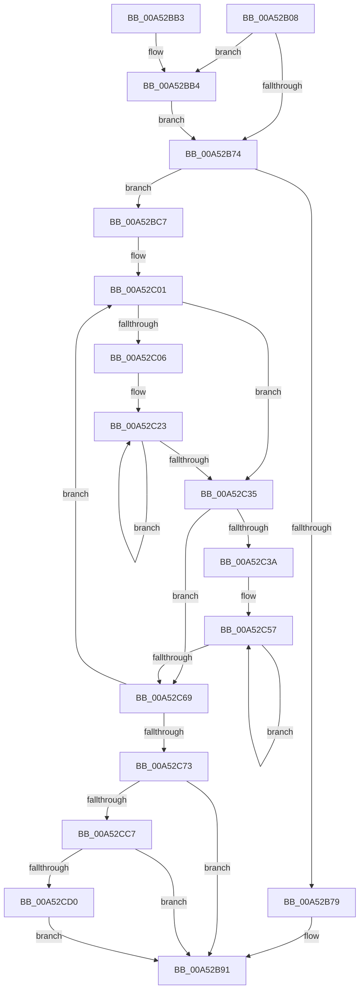

# PpmApplyProfile

- RVA: `0x00A52B08`–`0x00A52CE6` (길이 `478` bytes)
- VA: `0x0000000140A52B08`
- 실행 섹션: `PAGE`
- PDB 이름 있음: `예`; PDB Function 태그: `아니요`
- unwind 정보 RVA: `0x000B0D5C`
- 디코드: `115`개 명령, `478/478` bytes 표시
- 미해석 바이트: `0` (있으면 어셈블리에 `.byte`로 보존)

> 이 문서는 커널 이미지의 기계어와 PDB 기호를 분석해 생성했습니다. 4번과 5번은 함수 원형과 자료형을 바이너리 사용 방식에서 추정한 C 해석이며 원본 소스 복구 결과는 아닙니다.

## 1. Dependencies

- 직접 호출 지점: **10**; 고유 호출 대상: **9**
- 직접 호출자로 확인된 함수: **1**
- RIP 상대 이미지 참조: **10**

### Outgoing calls
- `0x00A52B42` → [PpmAcquireLock](../../text/2D/PpmAcquireLock_function_002D9AA4.md) (function, `0x002D9AA4`)
- `0x00A52B4E` → [PopAcquireRwLockExclusive](../../text/43/PopAcquireRwLockExclusive_function_00430B44.md) (function, `0x00430B44`)
- `0x00A52B80` → [PopReleaseRwLock](../../text/2D/PopReleaseRwLock_function_002DFBBC.md) (function, `0x002DFBBC`)
- `0x00A52B8C` → [PpmReleaseLock](../../text/2D/PpmReleaseLock_function_002DA428.md) (function, `0x002DA428`)
- `0x00A52B99` → [_security_check_cookie](../../text/6A/_security_check_cookie_function_006AC640.md) (function, `0x006AC640`)
- `0x00A52BDA` → [PpmEndProfileAccumulation](PpmEndProfileAccumulation_function_00A52FB8.md) (function, `0x00A52FB8`)
- `0x00A52CA7` → [PpmCompareAndApplyPolicySettings](PpmCompareAndApplyPolicySettings_function_00A52CEC.md) (function, `0x00A52CEC`)
- `0x00A52CB2` → [PpmEventTraceProfileChange](PpmEventTraceProfileChange_function_00A52F08.md) (function, `0x00A52F08`)
- `0x00A52CD7` → [PpmAcquireLock](../../text/2D/PpmAcquireLock_function_002D9AA4.md) (function, `0x002D9AA4`)
- `0x00A52CDC` → [PpmPostProcessMediaBuffering](PpmPostProcessMediaBuffering_function_00A53004.md) (function, `0x00A53004`)

### Direct callers
- [PdcPoPpmApplyProfile](PdcPoPpmApplyProfile_function_00A52AF0.md) at `0x00A52AF4`

### Static image references
- `0x00A52B1A` → RVA `0x00E0A740` (`.data`; read)
- `0x00A52B29` → RVA `0x00F0CE0C` (`.data`; read)
- `0x00A52B36` → RVA `0x00F0CC00` (`.data`; read)
- `0x00A52B47` → RVA `0x00F0CA70` (`.data`; read)
- `0x00A52B53` → RVA `0x00E08380` (`.data`; read)
- `0x00A52B5A` → RVA `0x00F077C0` (`.data`; read)
- `0x00A52B6B` → RVA `0x00F07778` (`.data`; read)
- `0x00A52BB4` → RVA `0x00F0E178` (`.data`; read)
- `0x00A52BF1` → RVA `0x00E08380` (`.data`; write)
- `0x00A52C73` → RVA `0x00F0B200` (`.data`; read)

## 2. Other-region calls and transfers

- 다른 실행 섹션으로 향하는 call: **6**
  - `0x00A52B42` → [PpmAcquireLock](../../text/2D/PpmAcquireLock_function_002D9AA4.md) (`PAGE` → `.text`)
  - `0x00A52B4E` → [PopAcquireRwLockExclusive](../../text/43/PopAcquireRwLockExclusive_function_00430B44.md) (`PAGE` → `.text`)
  - `0x00A52B80` → [PopReleaseRwLock](../../text/2D/PopReleaseRwLock_function_002DFBBC.md) (`PAGE` → `.text`)
  - `0x00A52B8C` → [PpmReleaseLock](../../text/2D/PpmReleaseLock_function_002DA428.md) (`PAGE` → `.text`)
  - `0x00A52B99` → [_security_check_cookie](../../text/6A/_security_check_cookie_function_006AC640.md) (`PAGE` → `.text`)
  - `0x00A52CD7` → [PpmAcquireLock](../../text/2D/PpmAcquireLock_function_002D9AA4.md) (`PAGE` → `.text`)
- 별도 외부 분기/꼬리 이동을 확인하지 못했습니다.

## 3. Assembly (complete function range)

```asm
00A52B08  48 89 5C 24 10                  mov qword ptr [rsp + 0x10], rbx
00A52B0D  48 89 6C 24 18                  mov qword ptr [rsp + 0x18], rbp
00A52B12  56                              push rsi
00A52B13  57                              push rdi
00A52B14  41 57                           push r15
00A52B16  48 83 EC 50                     sub rsp, 0x50
00A52B1A  48 8B 05 1F 7C 3B 00            mov rax, qword ptr [rip + 0x3b7c1f]
00A52B21  48 33 C4                        xor rax, rsp
00A52B24  48 89 44 24 40                  mov qword ptr [rsp + 0x40], rax
00A52B29  48 63 2D DC A2 4B 00            movsxd rbp, dword ptr [rip + 0x4ba2dc]
00A52B30  48 8B D9                        mov rbx, rcx
00A52B33  0F 57 C0                        xorps xmm0, xmm0
00A52B36  48 8D 0D C3 A0 4B 00            lea rcx, [rip + 0x4ba0c3]
00A52B3D  0F 11 44 24 20                  movups xmmword ptr [rsp + 0x20], xmm0
00A52B42  E8 5D 6F 88 FF                  call 0x1402d9aa4
00A52B47  48 8D 0D 22 9F 4B 00            lea rcx, [rip + 0x4b9f22]
00A52B4E  E8 F1 DF 9D FF                  call 0x140430b44
00A52B53  48 8B 35 26 58 3B 00            mov rsi, qword ptr [rip + 0x3b5826]
00A52B5A  4C 8D 3D 5F 4C 4B 00            lea r15, [rip + 0x4b4c5f]
00A52B61  48 85 DB                        test rbx, rbx
00A52B64  49 8B FF                        mov rdi, r15
00A52B67  48 0F 45 FB                     cmovne rdi, rbx
00A52B6B  48 3B 3D 06 4C 4B 00            cmp rdi, qword ptr [rip + 0x4b4c06]
00A52B72  74 40                           je 0x140a52bb4
00A52B74  48 3B F7                        cmp rsi, rdi
00A52B77  75 4E                           jne 0x140a52bc7
00A52B79  48 8D 0D F0 9E 4B 00            lea rcx, [rip + 0x4b9ef0]
00A52B80  E8 37 D0 88 FF                  call 0x1402dfbbc
00A52B85  48 8D 0D 74 A0 4B 00            lea rcx, [rip + 0x4ba074]
00A52B8C  E8 97 78 88 FF                  call 0x1402da428
00A52B91  48 8B 4C 24 40                  mov rcx, qword ptr [rsp + 0x40]
00A52B96  48 33 CC                        xor rcx, rsp
00A52B99  E8 A2 9A C5 FF                  call 0x1406ac640
00A52B9E  4C 8D 5C 24 50                  lea r11, [rsp + 0x50]
00A52BA3  49 8B 5B 28                     mov rbx, qword ptr [r11 + 0x28]
00A52BA7  49 8B 6B 30                     mov rbp, qword ptr [r11 + 0x30]
00A52BAB  49 8B E3                        mov rsp, r11
00A52BAE  41 5F                           pop r15
00A52BB0  5F                              pop rdi
00A52BB1  5E                              pop rsi
00A52BB2  C3                              ret
00A52BB3  CC                              int3
00A52BB4  80 3D BD B5 4B 00 00            cmp byte ptr [rip + 0x4bb5bd], 0
00A52BBB  48 8B C7                        mov rax, rdi
00A52BBE  49 8B FF                        mov rdi, r15
00A52BC1  48 0F 44 F8                     cmove rdi, rax
00A52BC5  EB AD                           jmp 0x140a52b74
00A52BC7  48 B8 08 00 00 00 80 F7 FF FF   movabs rax, 0xfffff78000000008
00A52BD1  48 8B CE                        mov rcx, rsi
00A52BD4  48 8B 00                        mov rax, qword ptr [rax]
00A52BD7  48 8B D0                        mov rdx, rax
00A52BDA  E8 D9 03 00 00                  call 0x140a52fb8
00A52BDF  BB 02 00 00 00                  mov ebx, 2
00A52BE4  4C 8B DD                        mov r11, rbp
00A52BE7  09 5F 1C                        or dword ptr [rdi + 0x1c], ebx
00A52BEA  44 8B D3                        mov r10d, ebx
00A52BED  83 66 1C FD                     and dword ptr [rsi + 0x1c], 0xfffffffd
00A52BF1  48 89 3D 88 57 3B 00            mov qword ptr [rip + 0x3b5788], rdi
00A52BF8  33 D2                           xor edx, edx
00A52BFA  48 89 87 F8 03 00 00            mov qword ptr [rdi + 0x3f8], rax
00A52C01  49 3B FF                        cmp rdi, r15
00A52C04  74 2F                           je 0x140a52c35
00A52C06  4D 69 CB E8 01 00 00            imul r9, r11, 0x1e8
00A52C0D  4C 8D 44 24 20                  lea r8, [rsp + 0x20]
00A52C12  4D 2B C8                        sub r9, r8
00A52C15  48 8D 4C 24 20                  lea rcx, [rsp + 0x20]
00A52C1A  4C 03 CA                        add r9, rdx
00A52C1D  4C 8B C3                        mov r8, rbx
00A52C20  4C 03 CF                        add r9, rdi
00A52C23  49 8B 44 09 28                  mov rax, qword ptr [r9 + rcx + 0x28]
00A52C28  48 09 01                        or qword ptr [rcx], rax
00A52C2B  48 8D 49 08                     lea rcx, [rcx + 8]
00A52C2F  49 83 E8 01                     sub r8, 1
00A52C33  75 EE                           jne 0x140a52c23
00A52C35  49 3B F7                        cmp rsi, r15
00A52C38  74 2F                           je 0x140a52c69
00A52C3A  4D 69 CB E8 01 00 00            imul r9, r11, 0x1e8
00A52C41  4C 8D 44 24 20                  lea r8, [rsp + 0x20]
00A52C46  4D 2B C8                        sub r9, r8
00A52C49  48 8D 4C 24 20                  lea rcx, [rsp + 0x20]
00A52C4E  4C 03 CA                        add r9, rdx
00A52C51  4C 8B C3                        mov r8, rbx
00A52C54  4C 03 CE                        add r9, rsi
00A52C57  49 8B 44 09 28                  mov rax, qword ptr [r9 + rcx + 0x28]
00A52C5C  48 09 01                        or qword ptr [rcx], rax
00A52C5F  48 8D 49 08                     lea rcx, [rcx + 8]
00A52C63  49 83 E8 01                     sub r8, 1
00A52C67  75 EE                           jne 0x140a52c57
00A52C69  48 83 C2 10                     add rdx, 0x10
00A52C6D  49 83 EA 01                     sub r10, 1
00A52C71  75 8E                           jne 0x140a52c01
00A52C73  F3 0F 6F 0D 85 85 4B 00         movdqu xmm1, xmmword ptr [rip + 0x4b8585]
00A52C7B  48 8D 56 28                     lea rdx, [rsi + 0x28]
00A52C7F  45 33 C9                        xor r9d, r9d
00A52C82  F3 0F 6F 44 24 20               movdqu xmm0, xmmword ptr [rsp + 0x20]
00A52C88  48 69 CD E8 01 00 00            imul rcx, rbp, 0x1e8
00A52C8F  0F 54 C8                        andps xmm1, xmm0
00A52C92  F3 0F 7F 4C 24 30               movdqu xmmword ptr [rsp + 0x30], xmm1
00A52C98  48 03 D1                        add rdx, rcx
00A52C9B  4C 8D 41 28                     lea r8, [rcx + 0x28]
00A52C9F  4C 03 C7                        add r8, rdi
00A52CA2  48 8D 4C 24 30                  lea rcx, [rsp + 0x30]
00A52CA7  E8 40 00 00 00                  call 0x140a52cec
00A52CAC  48 8B D7                        mov rdx, rdi
00A52CAF  48 8B CE                        mov rcx, rsi
00A52CB2  E8 51 02 00 00                  call 0x140a52f08
00A52CB7  48 8B 05 BA 4A 4B 00            mov rax, qword ptr [rip + 0x4b4aba]
00A52CBE  48 85 C0                        test rax, rax
00A52CC1  0F 84 CA FE FF FF               je 0x140a52b91
00A52CC7  48 3B F0                        cmp rsi, rax
00A52CCA  0F 85 C1 FE FF FF               jne 0x140a52b91
00A52CD0  48 8D 0D 29 9F 4B 00            lea rcx, [rip + 0x4b9f29]
00A52CD7  E8 C8 6D 88 FF                  call 0x1402d9aa4
00A52CDC  E8 23 03 00 00                  call 0x140a53004
00A52CE1  E9 AB FE FF FF                  jmp 0x140a52b91
```

## 4. C-style interpretation (structured pseudocode)

```c
__int64 __fastcall PpmApplyProfile(__int64 a1)
{
    __int64 result;
    __int64 v_r10;
    __int64 v_rdi;
    __int64 v_rsp;
    unsigned __int64 v_stack_m18;
    unsigned __int64 v_stack_m20;
    unsigned __int64 v_stack_m28;
    unsigned __int64 v_stack_m30;
    unsigned __int64 v_stack_m48;
    unsigned __int64 v_stack_p10;
    unsigned __int64 v_stack_p18;

    v_stack_p10 = v_rbx;
    v_stack_p18 = v_rbp;
    v_rsp = (v_rsp) - (80);
    result = (*(unsigned __int64 *)(v_rip + 3898399)) ^ (v_rsp);
    v_stack_m28 = result;
    v_stack_m48 = v_xmm0;
    result = PpmAcquireLock(v_rip + 4956355, a2, a3, a4);
    result = PopAcquireRwLockExclusive(v_rip + 4955938, a2, a3, a4);
    v_rdi = v_rip + 4934751;
    if (a1 != 0) { v_rdi = a1; }
    if (v_rdi == (*(unsigned __int64 *)(v_rip + 4934662))) goto loc_00A52BB4;
loc_00A52B74:
    if ((*(unsigned __int64 *)(v_rip + 3889190)) != v_rdi) goto loc_00A52BC7;
    result = PopReleaseRwLock(v_rip + 4955888, a2, a3, a4);
    result = PpmReleaseLock(v_rip + 4956276, a2, a3, a4);
loc_00A52B91:
    a1 = (v_stack_m28) ^ (v_rsp);
    result = _security_check_cookie(a1, a2, a3, a4);
    return result;
loc_00A52BB4:
    v_rdi = v_rip + 4934751;
    if ((*(unsigned __int8 *)(v_rip + 4961725)) == 0) { v_rdi = v_rdi; }
    goto loc_00A52B74;
loc_00A52BC7:
    result = PpmEndProfileAccumulation(*(unsigned __int64 *)(v_rip + 3889190), *(unsigned __int64 *)(v_rdi), a3, a4);
    *(unsigned __int64 *)(v_rip + 3889032) = v_rdi;
    a2 = 0;
    *(unsigned __int64 *)(v_rdi + 1016) = result;
loc_00A52C01:
    if (v_rdi == (v_rip + 4934751)) goto loc_00A52C35;
    a4 = (a4) * (*(unsigned __int64 *)(v_stack_m18 + 48));
    a4 = (a4) - (v_stack_m30);
    a4 = (a4) + (0);
    a4 = (a4) + (v_rdi);
loc_00A52C23:
    a3 = (2) - (1);
    if (condition_is_not_equal) goto loc_00A52C23;
loc_00A52C35:
    if ((*(unsigned __int64 *)(v_rip + 3889190)) == (v_rip + 4934751)) goto loc_00A52C69;
    a4 = (a4) * (*(unsigned __int64 *)(v_stack_m18 + 48));
    a4 = (a4) - (v_stack_m30);
    a4 = (a4) + (0);
    a4 = (a4) + (*(unsigned __int64 *)(v_rip + 3889190));
loc_00A52C57:
    a3 = (2) - (1);
    if (condition_is_not_equal) goto loc_00A52C57;
loc_00A52C69:
    a2 = (a2) + (16);
    v_r10 = (2) - (1);
    if (condition_is_not_equal) goto loc_00A52C01;
    a4 = 0;
    a1 = (v_stack_m30 + 8) * (*(unsigned __int64 *)(v_stack_m18 + 48));
    v_stack_m20 = v_xmm1;
    a2 = (*(unsigned __int64 *)(v_rip + 3889190) + 40) + (a1);
    a3 = (a1 + 40) + (v_rdi);
    result = PpmCompareAndApplyPolicySettings(v_stack_m20, a2, a3, a4);
    result = PpmEventTraceProfileChange(*(unsigned __int64 *)(v_rip + 3889190), v_rdi, a3, a4);
    if (*(unsigned __int64 *)(v_rip + 4934330) == 0) goto loc_00A52B91;
    if ((*(unsigned __int64 *)(v_rip + 3889190)) != (*(unsigned __int64 *)(v_rip + 4934330))) goto loc_00A52B91;
    result = PpmAcquireLock(v_rip + 4955945, v_rdi, a3, a4);
    result = PpmPostProcessMediaBuffering(v_rip + 4955945, v_rdi, a3, a4);
    goto loc_00A52B91;
}
```

## 5. (Beta) C Style

```c
int64_t PpmApplyProfile(int64_t Arg1)
{
    int64_t result;
    int64_t local_r10;
    int64_t local_rdi;
    int64_t local_rsp;
    uint64_t v_stack_m18;
    uint64_t v_stack_m20;
    uint64_t v_stack_m28;
    uint64_t v_stack_m30;
    uint64_t v_stack_m48;
    uint64_t v_stack_p10;
    uint64_t v_stack_p18;

    v_stack_p10 = local_rbx;
    v_stack_p18 = local_rbp;
    local_rsp = (local_rsp) - (80);
    result = (*(uint64_t *)(v_rip + 0x3B7C1F)) ^ (local_rsp);
    v_stack_m28 = result;
    v_stack_m48 = v_xmm0;
    result = PpmAcquireLock(v_rip + 4956355, a2, a3, a4);
    result = PopAcquireRwLockExclusive(v_rip + 4955938, a2, a3, a4);
    local_rdi = v_rip + 4934751;
    if (Arg1 != 0) { local_rdi = Arg1; }
    if (local_rdi == (*(uint64_t *)(v_rip + 0x4B4C06))) goto loc_00A52BB4;
loc_00A52B74:
    if ((*(uint64_t *)(v_rip + 0x3B5826)) != local_rdi) goto loc_00A52BC7;
    result = PopReleaseRwLock(v_rip + 4955888, a2, a3, a4);
    result = PpmReleaseLock(v_rip + 4956276, a2, a3, a4);
loc_00A52B91:
    Arg1 = (v_stack_m28) ^ (local_rsp);
    result = _security_check_cookie(Arg1, a2, a3, a4);
    return result;
loc_00A52BB4:
    local_rdi = v_rip + 4934751;
    if ((*(uint8_t *)(v_rip + 0x4BB5BD)) == 0) { local_rdi = local_rdi; }
    goto loc_00A52B74;
loc_00A52BC7:
    result = PpmEndProfileAccumulation(*(uint64_t *)(v_rip + 0x3B5826), *(uint64_t *)(local_rdi), a3, a4);
    *(uint64_t *)(v_rip + 0x3B5788) = local_rdi;
    a2 = 0;
    *(uint64_t *)(local_rdi + 0x3F8) = result;
loc_00A52C01:
    if (local_rdi == (v_rip + 4934751)) goto loc_00A52C35;
    a4 = (a4) * (*(uint64_t *)(v_stack_m18 + 0x30));
    a4 = (a4) - (v_stack_m30);
    a4 = (a4) + (0);
    a4 = (a4) + (local_rdi);
loc_00A52C23:
    a3 = (2) - (1);
    if (condition_is_not_equal) goto loc_00A52C23;
loc_00A52C35:
    if ((*(uint64_t *)(v_rip + 0x3B5826)) == (v_rip + 4934751)) goto loc_00A52C69;
    a4 = (a4) * (*(uint64_t *)(v_stack_m18 + 0x30));
    a4 = (a4) - (v_stack_m30);
    a4 = (a4) + (0);
    a4 = (a4) + (*(uint64_t *)(v_rip + 0x3B5826));
loc_00A52C57:
    a3 = (2) - (1);
    if (condition_is_not_equal) goto loc_00A52C57;
loc_00A52C69:
    a2 = (a2) + (16);
    local_r10 = (2) - (1);
    if (condition_is_not_equal) goto loc_00A52C01;
    a4 = 0;
    Arg1 = (v_stack_m30 + 8) * (*(uint64_t *)(v_stack_m18 + 0x30));
    v_stack_m20 = v_xmm1;
    a2 = (*(uint64_t *)(v_rip + 0x3B5826) + 40) + (Arg1);
    a3 = (Arg1 + 40) + (local_rdi);
    result = PpmCompareAndApplyPolicySettings(v_stack_m20, a2, a3, a4);
    result = PpmEventTraceProfileChange(*(uint64_t *)(v_rip + 0x3B5826), local_rdi, a3, a4);
    if (*(uint64_t *)(v_rip + 0x4B4ABA) == 0) goto loc_00A52B91;
    if ((*(uint64_t *)(v_rip + 0x3B5826)) != (*(uint64_t *)(v_rip + 0x4B4ABA))) goto loc_00A52B91;
    result = PpmAcquireLock(v_rip + 4955945, local_rdi, a3, a4);
    result = PpmPostProcessMediaBuffering(v_rip + 4955945, local_rdi, a3, a4);
    goto loc_00A52B91;
}
```

## 6. Execution-region graph

[열기: 2D/3D 그래프와 함수 탐색 컨트롤 패널](../../../control-panel.html?section=page&rva=0x00A52B08&view=graph)

- 2D 그래프는 위에서 아래로 흐르고, 3D 그래프는 빈 공간을 드래그해 회전합니다. Shift+드래그는 이동, 휠은 확대·축소, 함수 노드 선택은 대상 보고서 이동입니다.

### Static fallback


