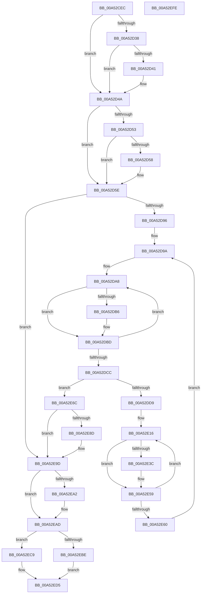

# PpmCompareAndApplyPolicySettings

- RVA: `0x00A52CEC`–`0x00A52EFF` (길이 `531` bytes)
- VA: `0x0000000140A52CEC`
- 실행 섹션: `PAGE`
- PDB 이름 있음: `예`; PDB Function 태그: `아니요`
- unwind 정보 RVA: `0x000B0D7C`
- 디코드: `149`개 명령, `531/531` bytes 표시
- 미해석 바이트: `0` (있으면 어셈블리에 `.byte`로 보존)

> 이 문서는 커널 이미지의 기계어와 PDB 기호를 분석해 생성했습니다. 4번과 5번은 함수 원형과 자료형을 바이너리 사용 방식에서 추정한 C 해석이며 원본 소스 복구 결과는 아닙니다.

## 1. Dependencies

- 직접 호출 지점: **8**; 고유 호출 대상: **8**
- 직접 호출자로 확인된 함수: **2**
- RIP 상대 이미지 참조: **7**

### Outgoing calls
- `0x00A52D4A` → [Feature_DisableUserPresenceQosByPolicy__private_IsEnabledDeviceUsageNoInline](../../text/4F/Feature_DisableUserPresenceQosByPolicy__private_IsEnabledDeviceUsageNoInline_function_004F42EC.md) (function, `0x004F42EC`)
- `0x00A52E32` → [RtlCompareMemory](../../text/6B/RtlCompareMemory_function_006BA670.md) (function, `0x006BA670`)
- `0x00A52E95` → [PpmGetPolicyAction](../A8/PpmGetPolicyAction_function_00A87C44.md) (function, `0x00A87C44`)
- `0x00A52EA2` → [PpmReapplyIdlePolicy](../AA/PpmReapplyIdlePolicy_function_00AAFA90.md) (function, `0x00AAFA90`)
- `0x00A52EB4` → [PopReleaseRwLock](../../text/2D/PopReleaseRwLock_function_002DFBBC.md) (function, `0x002DFBBC`)
- `0x00A52EC2` → [PpmReapplyPerfPolicy](PpmReapplyPerfPolicy_function_00A53148.md) (function, `0x00A53148`)
- `0x00A52ED0` → [PpmReleaseLock](../../text/2D/PpmReleaseLock_function_002DA428.md) (function, `0x002DA428`)
- `0x00A52EDC` → [_security_check_cookie](../../text/6A/_security_check_cookie_function_006AC640.md) (function, `0x006AC640`)

### Direct callers
- [PpmProfileAcDcUpdate](PpmProfileAcDcUpdate_function_00A5280C.md) at `0x00A52880`
- [PpmApplyProfile](PpmApplyProfile_function_00A52B08.md) at `0x00A52CA7`

### Static image references
- `0x00A52D08` → RVA `0x00E0A740` (`.data`; read)
- `0x00A52D1D` → RVA `0x00FC6B40` (`ALMOSTRO`; read)
- `0x00A52D38` → RVA `0x00FC6ADC` (`ALMOSTRO`; read)
- `0x00A52D6C` → RVA `0x00F0B200` (`.data`; read)
- `0x00A52DE9` → RVA `0x00FC5F50` (`ALMOSTRO`; read)
- `0x00A52EAD` → RVA `0x00F0CA70` (`.data`; read)
- `0x00A52EC9` → RVA `0x00F0CC00` (`.data`; read)

## 2. Other-region calls and transfers

- 다른 실행 섹션으로 향하는 call: **5**
  - `0x00A52D4A` → [Feature_DisableUserPresenceQosByPolicy__private_IsEnabledDeviceUsageNoInline](../../text/4F/Feature_DisableUserPresenceQosByPolicy__private_IsEnabledDeviceUsageNoInline_function_004F42EC.md) (`PAGE` → `.text`)
  - `0x00A52E32` → [RtlCompareMemory](../../text/6B/RtlCompareMemory_function_006BA670.md) (`PAGE` → `.text`)
  - `0x00A52EB4` → [PopReleaseRwLock](../../text/2D/PopReleaseRwLock_function_002DFBBC.md) (`PAGE` → `.text`)
  - `0x00A52ED0` → [PpmReleaseLock](../../text/2D/PpmReleaseLock_function_002DA428.md) (`PAGE` → `.text`)
  - `0x00A52EDC` → [_security_check_cookie](../../text/6A/_security_check_cookie_function_006AC640.md) (`PAGE` → `.text`)
- 별도 외부 분기/꼬리 이동을 확인하지 못했습니다.

## 3. Assembly (complete function range)

```asm
00A52CEC  48 89 5C 24 08                  mov qword ptr [rsp + 8], rbx
00A52CF1  55                              push rbp
00A52CF2  56                              push rsi
00A52CF3  57                              push rdi
00A52CF4  41 54                           push r12
00A52CF6  41 55                           push r13
00A52CF8  41 56                           push r14
00A52CFA  41 57                           push r15
00A52CFC  48 8B EC                        mov rbp, rsp
00A52CFF  48 83 EC 70                     sub rsp, 0x70
00A52D03  0F 29 74 24 60                  movaps xmmword ptr [rsp + 0x60], xmm6
00A52D08  48 8B 05 31 7A 3B 00            mov rax, qword ptr [rip + 0x3b7a31]
00A52D0F  48 33 C4                        xor rax, rsp
00A52D12  48 89 45 E0                     mov qword ptr [rbp - 0x20], rax
00A52D16  45 33 F6                        xor r14d, r14d
00A52D19  4C 89 45 B8                     mov qword ptr [rbp - 0x48], r8
00A52D1D  44 39 35 1C 3E 57 00            cmp dword ptr [rip + 0x573e1c], r14d
00A52D24  41 8B DE                        mov ebx, r14d
00A52D27  89 5D B0                        mov dword ptr [rbp - 0x50], ebx
00A52D2A  41 8A F9                        mov dil, r9b
00A52D2D  4C 8B EA                        mov r13, rdx
00A52D30  48 8B F1                        mov rsi, rcx
00A52D33  45 8B E6                        mov r12d, r14d
00A52D36  74 12                           je 0x140a52d4a
00A52D38  44 38 35 9D 3D 57 00            cmp byte ptr [rip + 0x573d9d], r14b
00A52D3F  74 09                           je 0x140a52d4a
00A52D41  81 CB 02 10 00 00               or ebx, 0x1002
00A52D47  89 5D B0                        mov dword ptr [rbp - 0x50], ebx
00A52D4A  E8 9D 15 AA FF                  call 0x1404f42ec
00A52D4F  85 C0                           test eax, eax
00A52D51  74 0B                           je 0x140a52d5e
00A52D53  40 84 FF                        test dil, dil
00A52D56  74 06                           je 0x140a52d5e
00A52D58  83 CB 02                        or ebx, 2
00A52D5B  89 5D B0                        mov dword ptr [rbp - 0x50], ebx
00A52D5E  F3 0F 6F 0E                     movdqu xmm1, xmmword ptr [rsi]
00A52D62  0F 57 C0                        xorps xmm0, xmm0
00A52D65  0F 57 F6                        xorps xmm6, xmm6
00A52D68  0F 11 45 C0                     movups xmmword ptr [rbp - 0x40], xmm0
00A52D6C  F3 0F 6F 05 8C 84 4B 00         movdqu xmm0, xmmword ptr [rip + 0x4b848c]
00A52D74  0F 54 C8                        andps xmm1, xmm0
00A52D77  66 0F 6F C1                     movdqa xmm0, xmm1
00A52D7B  66 0F 73 D8 08                  psrldq xmm0, 8
00A52D80  F3 0F 7F 4D D0                  movdqu xmmword ptr [rbp - 0x30], xmm1
00A52D85  0F 56 C8                        orps xmm1, xmm0
00A52D88  66 48 0F 7E C8                  movq rax, xmm1
00A52D8D  48 85 C0                        test rax, rax
00A52D90  0F 84 07 01 00 00               je 0x140a52e9d
00A52D96  48 8B 5D B8                     mov rbx, qword ptr [rbp - 0x48]
00A52D9A  44 89 75 B4                     mov dword ptr [rbp - 0x4c], r14d
00A52D9E  48 8D 55 D0                     lea rdx, [rbp - 0x30]
00A52DA2  45 8A C6                        mov r8b, r14b
00A52DA5  41 8B CE                        mov ecx, r14d
00A52DA8  48 8B 02                        mov rax, qword ptr [rdx]
00A52DAB  4C 0F BC C8                     bsf r9, rax
00A52DAF  0F 95 C0                        setne al
00A52DB2  84 C0                           test al, al
00A52DB4  74 07                           je 0x140a52dbd
00A52DB6  41 B0 01                        mov r8b, 1
00A52DB9  46 8D 24 09                     lea r12d, [rcx + r9]
00A52DBD  83 C1 40                        add ecx, 0x40
00A52DC0  48 83 C2 08                     add rdx, 8
00A52DC4  81 F9 80 00 00 00               cmp ecx, 0x80
00A52DCA  72 DC                           jb 0x140a52da8
00A52DCC  44 89 65 B4                     mov dword ptr [rbp - 0x4c], r12d
00A52DD0  45 84 C0                        test r8b, r8b
00A52DD3  0F 84 93 00 00 00               je 0x140a52e6c
00A52DD9  41 8B CC                        mov ecx, r12d
00A52DDC  83 E1 3F                        and ecx, 0x3f
00A52DDF  41 8B D4                        mov edx, r12d
00A52DE2  48 C1 EA 06                     shr rdx, 6
00A52DE6  45 8B C4                        mov r8d, r12d
00A52DE9  4C 8D 25 60 31 57 00            lea r12, [rip + 0x573160]
00A52DF0  48 8B 44 D5 D0                  mov rax, qword ptr [rbp + rdx*8 - 0x30]
00A52DF5  48 0F B3 C8                     btr rax, rcx
00A52DF9  48 89 44 D5 D0                  mov qword ptr [rbp + rdx*8 - 0x30], rax
00A52DFE  4F 8D 3C 80                     lea r15, [r8 + r8*4]
00A52E02  43 8A 44 FC 25                  mov al, byte ptr [r12 + r15*8 + 0x25]
00A52E07  24 04                           and al, 4
00A52E09  F6 D8                           neg al
00A52E0B  45 1B F6                        sbb r14d, r14d
00A52E0E  41 F7 DE                        neg r14d
00A52E11  41 FF C6                        inc r14d
00A52E14  33 F6                           xor esi, esi
00A52E16  43 8B 7C FC 20                  mov edi, dword ptr [r12 + r15*8 + 0x20]
00A52E1B  44 8B C7                        mov r8d, edi
00A52E1E  44 0F AF C6                     imul r8d, esi
00A52E22  4F 03 44 FC 18                  add r8, qword ptr [r12 + r15*8 + 0x18]
00A52E27  49 8D 14 18                     lea rdx, [r8 + rbx]
00A52E2B  4B 8D 0C 28                     lea rcx, [r8 + r13]
00A52E2F  44 8B C7                        mov r8d, edi
00A52E32  E8 39 78 C6 FF                  call 0x1406ba670
00A52E37  48 3B C7                        cmp rax, rdi
00A52E3A  74 1D                           je 0x140a52e59
00A52E3C  43 0F B6 54 FC 24               movzx edx, byte ptr [r12 + r15*8 + 0x24]
00A52E42  8B CA                           mov ecx, edx
00A52E44  83 E2 3F                        and edx, 0x3f
00A52E47  48 C1 E9 06                     shr rcx, 6
00A52E4B  48 8B 44 CD C0                  mov rax, qword ptr [rbp + rcx*8 - 0x40]
00A52E50  48 0F AB D0                     bts rax, rdx
00A52E54  48 89 44 CD C0                  mov qword ptr [rbp + rcx*8 - 0x40], rax
00A52E59  FF C6                           inc esi
00A52E5B  41 3B F6                        cmp esi, r14d
00A52E5E  72 B6                           jb 0x140a52e16
00A52E60  44 8B 65 B4                     mov r12d, dword ptr [rbp - 0x4c]
00A52E64  45 33 F6                        xor r14d, r14d
00A52E67  E9 2E FF FF FF                  jmp 0x140a52d9a
00A52E6C  F3 0F 6F 45 C0                  movdqu xmm0, xmmword ptr [rbp - 0x40]
00A52E71  8B 5D B0                        mov ebx, dword ptr [rbp - 0x50]
00A52E74  0F 56 F0                        orps xmm6, xmm0
00A52E77  66 0F 6F C6                     movdqa xmm0, xmm6
00A52E7B  66 0F 73 D8 08                  psrldq xmm0, 8
00A52E80  0F 56 F0                        orps xmm6, xmm0
00A52E83  66 48 0F 7E F0                  movq rax, xmm6
00A52E88  48 85 C0                        test rax, rax
00A52E8B  74 10                           je 0x140a52e9d
00A52E8D  48 8D 55 B0                     lea rdx, [rbp - 0x50]
00A52E91  48 8D 4D C0                     lea rcx, [rbp - 0x40]
00A52E95  E8 AA 4D 03 00                  call 0x140a87c44
00A52E9A  8B 5D B0                        mov ebx, dword ptr [rbp - 0x50]
00A52E9D  F6 C3 01                        test bl, 1
00A52EA0  74 0B                           je 0x140a52ead
00A52EA2  E8 E9 CB 05 00                  call 0x140aafa90
00A52EA7  83 E3 FE                        and ebx, 0xfffffffe
00A52EAA  89 5D B0                        mov dword ptr [rbp - 0x50], ebx
00A52EAD  48 8D 0D BC 9B 4B 00            lea rcx, [rip + 0x4b9bbc]
00A52EB4  E8 03 CD 88 FF                  call 0x1402dfbbc
00A52EB9  66 85 DB                        test bx, bx
00A52EBC  74 0B                           je 0x140a52ec9
00A52EBE  48 8D 4D B0                     lea rcx, [rbp - 0x50]
00A52EC2  E8 81 02 00 00                  call 0x140a53148
00A52EC7  EB 0C                           jmp 0x140a52ed5
00A52EC9  48 8D 0D 30 9D 4B 00            lea rcx, [rip + 0x4b9d30]
00A52ED0  E8 53 75 88 FF                  call 0x1402da428
00A52ED5  48 8B 4D E0                     mov rcx, qword ptr [rbp - 0x20]
00A52ED9  48 33 CC                        xor rcx, rsp
00A52EDC  E8 5F 97 C5 FF                  call 0x1406ac640
00A52EE1  48 8B 9C 24 B0 00 00 00         mov rbx, qword ptr [rsp + 0xb0]
00A52EE9  0F 28 74 24 60                  movaps xmm6, xmmword ptr [rsp + 0x60]
00A52EEE  48 83 C4 70                     add rsp, 0x70
00A52EF2  41 5F                           pop r15
00A52EF4  41 5E                           pop r14
00A52EF6  41 5D                           pop r13
00A52EF8  41 5C                           pop r12
00A52EFA  5F                              pop rdi
00A52EFB  5E                              pop rsi
00A52EFC  5D                              pop rbp
00A52EFD  C3                              ret
00A52EFE  CC                              int3
```

## 4. C-style interpretation (structured pseudocode)

```c
__int64 __fastcall PpmCompareAndApplyPolicySettings(__int64 a1, __int64 a2, __int64 a3, unsigned __int8 a4)
{
    __int64 result;
    __int64 v_r12;
    __int64 v_r14;
    __int64 v_rbx;
    __int64 v_rsi;
    __int64 v_rsp;
    unsigned __int64 v_stack_m48;
    unsigned __int64 v_stack_m58;
    unsigned __int64 v_stack_m68;
    unsigned __int64 v_stack_m78;
    unsigned __int64 v_stack_m80;
    unsigned int v_stack_m84;
    unsigned int v_stack_m88;
    unsigned __int64 v_stack_p8;

    v_stack_p8 = v_rbx;
    v_rsp = (v_rsp) - (112);
    v_stack_m48 = v_xmm6;
    result = (*(unsigned __int64 *)(v_rip + 3897905)) ^ (v_rsp);
    v_stack_m58 = result;
    v_r14 = 0;
    v_stack_m80 = a3;
    v_stack_m88 = 0;
    if ((*(unsigned int *)(v_rip + 5717532)) == 0) goto loc_00A52D4A;
    v_rbx = 0;
    if ((*(unsigned __int8 *)(v_rip + 5717405)) != 0) {
        v_rbx = (unsigned int)((0) | (0x1002ULL));
        v_stack_m88 = (unsigned int)(v_rbx);
    }
    result = Feature_DisableUserPresenceQosByPolicy__private_IsEnabledDeviceUsageNoInline(a1, a2, a3, a4);
    if ((unsigned int)(result) == 0) goto loc_00A52D5E;
    if (a4 != 0) {
        v_rbx = (unsigned int)((v_rbx) | (2));
        v_stack_m88 = (unsigned int)(v_rbx);
    }
    v_stack_m78 = v_xmm0;
    v_stack_m68 = v_xmm1;
    if (result == 0) goto loc_00A52E9D;
loc_00A52D9A:
    v_stack_m84 = 0;
loc_00A52DA8:
    result = (result != 0) ? 1 : 0;
    v_r12 = 0;
    if ((unsigned __int8)(result) != 0) {
        a3 = 1;
        v_r12 = 0 + a4 * 1;
    }
    a1 = (unsigned int)((0) + (64));
    a2 = (v_stack_m68) + (8);
    if (((unsigned int)(a1)) < 128) goto loc_00A52DA8;
    v_stack_m84 = (unsigned int)(v_r12);
    if ((unsigned __int8)(a3) == 0) goto loc_00A52E6C;
    a1 = (unsigned int)(((unsigned int)((unsigned int)(v_r12))) & (63));
    a2 = ((unsigned int)((unsigned int)(v_r12))) >> (6);
    *(unsigned __int64 *)(v_rsp + a2 * 8 - 48) = *(unsigned __int64 *)(v_rsp + a2 * 8 - 48);
    result = (unsigned __int8)((*(unsigned __int8 *)(v_rip + 5714272 + (unsigned int)((unsigned int)(v_r12)) + (unsigned int)((unsigned int)(v_r12)) * 4 * 8 + 37)) & (4));
    result = (unsigned __int8)(-(result));
    v_r14 = (unsigned int)(-(v_r14));
    v_r14 = (unsigned int)((v_r14) + 1);
    v_rsi = 0;
loc_00A52E16:
    a3 = (unsigned int)(((unsigned int)((unsigned int)((unsigned int)(*(unsigned int *)(v_rip + 5714272 + (unsigned int)((unsigned int)(v_r12)) + (unsigned int)((unsigned int)(v_r12)) * 4 * 8 + 32))))) * (0));
    a3 = (a3) + (*(unsigned __int64 *)(v_rip + 5714272 + (unsigned int)((unsigned int)(v_r12)) + (unsigned int)((unsigned int)(v_r12)) * 4 * 8 + 24));
    result = RtlCompareMemory(a3 + a2 * 1, a3 + v_stack_m80 * 1, (unsigned int)((unsigned int)((unsigned int)(*(unsigned int *)(v_rip + 5714272 + (unsigned int)((unsigned int)(v_r12)) + (unsigned int)((unsigned int)(v_r12)) * 4 * 8 + 32)))), a4);
    if (result != ((unsigned int)(*(unsigned int *)(v_rip + 5714272 + (unsigned int)((unsigned int)(v_r12)) + (unsigned int)((unsigned int)(v_r12)) * 4 * 8 + 32)))) {
        a2 = *(unsigned __int8 *)(v_rip + 5714272 + (unsigned int)((unsigned int)(v_r12)) + (unsigned int)((unsigned int)(v_r12)) * 4 * 8 + 36);
        a1 = (unsigned int)(a2);
        a2 = (unsigned int)((a2) & (63));
        a1 = (a1) >> (6);
        result = *(unsigned __int64 *)(v_rsp + a1 * 8 - 64);
        *(unsigned __int64 *)(v_rsp + a1 * 8 - 64) = result;
    }
    v_rsi = (unsigned int)((v_rsi) + 1);
    if (((unsigned int)(v_rsi)) < ((unsigned int)(v_r14))) goto loc_00A52E16;
    v_r14 = 0;
    goto loc_00A52D9A;
loc_00A52E6C:
    v_rbx = (unsigned int)(v_stack_m88);
    if (result != 0) {
        a2 = v_stack_m88;
        a1 = v_stack_m78;
        result = PpmGetPolicyAction(a1, a2, (unsigned int)((unsigned int)((unsigned int)(*(unsigned int *)(v_rip + 5714272 + (unsigned int)((unsigned int)(v_r12)) + (unsigned int)((unsigned int)(v_r12)) * 4 * 8 + 32)))), a4);
        v_rbx = v_stack_m88;
    }
    if ((((unsigned __int8)(v_rbx)) & (1)) != 0) {
        result = PpmReapplyIdlePolicy(a1, a2, (unsigned int)((unsigned int)((unsigned int)(*(unsigned int *)(v_rip + 5714272 + (unsigned int)((unsigned int)(v_r12)) + (unsigned int)((unsigned int)(v_r12)) * 4 * 8 + 32)))), a4);
        v_rbx = (unsigned int)((v_rbx) & (0xFFFFFFFEULL));
        v_stack_m88 = (unsigned int)(v_rbx);
    }
    result = PopReleaseRwLock(v_rip + 4955068, a2, (unsigned int)((unsigned int)((unsigned int)(*(unsigned int *)(v_rip + 5714272 + (unsigned int)((unsigned int)(v_r12)) + (unsigned int)((unsigned int)(v_r12)) * 4 * 8 + 32)))), a4);
    if ((unsigned __int16)(v_rbx) == 0) goto loc_00A52EC9;
    result = PpmReapplyPerfPolicy(v_stack_m88, a2, (unsigned int)((unsigned int)((unsigned int)(*(unsigned int *)(v_rip + 5714272 + (unsigned int)((unsigned int)(v_r12)) + (unsigned int)((unsigned int)(v_r12)) * 4 * 8 + 32)))), a4);
    goto loc_00A52ED5;
loc_00A52EC9:
    result = PpmReleaseLock(v_rip + 4955440, a2, (unsigned int)((unsigned int)((unsigned int)(*(unsigned int *)(v_rip + 5714272 + (unsigned int)((unsigned int)(v_r12)) + (unsigned int)((unsigned int)(v_r12)) * 4 * 8 + 32)))), a4);
loc_00A52ED5:
    a1 = (v_stack_m58) ^ (v_rsp);
    result = _security_check_cookie(a1, a2, (unsigned int)((unsigned int)((unsigned int)(*(unsigned int *)(v_rip + 5714272 + (unsigned int)((unsigned int)(v_r12)) + (unsigned int)((unsigned int)(v_r12)) * 4 * 8 + 32)))), a4);
    v_rsp = (v_rsp) + (112);
    return result;
}
```

## 5. (Beta) C Style

```c
int64_t PpmCompareAndApplyPolicySettings(void *Arg1, int64_t Arg2, int64_t Arg3, uint8_t Arg4)
{
    uint8_t *arg1 = (uint8_t *)Arg1;

    int64_t result;
    int64_t local_r12;
    int64_t local_r14;
    int64_t local_rbx;
    int64_t local_rsi;
    int64_t local_rsp;
    uint64_t v_stack_m48;
    uint64_t v_stack_m58;
    uint64_t v_stack_m68;
    uint64_t v_stack_m78;
    uint64_t v_stack_m80;
    uint32_t v_stack_m84;
    uint32_t v_stack_m88;
    uint64_t v_stack_p8;

    v_stack_p8 = local_rbx;
    local_rsp = (local_rsp) - (112);
    v_stack_m48 = v_xmm6;
    result = (*(uint64_t *)(v_rip + 0x3B7A31)) ^ (local_rsp);
    v_stack_m58 = result;
    local_r14 = 0;
    v_stack_m80 = Arg3;
    v_stack_m88 = 0;
    if ((*(uint32_t *)(v_rip + 0x573E1C)) == 0) goto loc_00A52D4A;
    local_rbx = 0;
    if ((*(uint8_t *)(v_rip + 0x573D9D)) != 0) {
        local_rbx = (uint32_t)((0) | (0x1002ULL));
        v_stack_m88 = (uint32_t)(local_rbx);
    }
    result = Feature_DisableUserPresenceQosByPolicy__private_IsEnabledDeviceUsageNoInline(Arg1, Arg2, Arg3, Arg4);
    if ((uint32_t)(result) == 0) goto loc_00A52D5E;
    if (Arg4 != 0) {
        local_rbx = (uint32_t)((local_rbx) | (2));
        v_stack_m88 = (uint32_t)(local_rbx);
    }
    v_stack_m78 = v_xmm0;
    v_stack_m68 = v_xmm1;
    if (result == 0) goto loc_00A52E9D;
loc_00A52D9A:
    v_stack_m84 = 0;
loc_00A52DA8:
    result = (result != 0) ? 1 : 0;
    local_r12 = 0;
    if ((uint8_t)(result) != 0) {
        Arg3 = 1;
        local_r12 = 0 + Arg4 * 1;
    }
    Arg1 = (uint32_t)((0) + (64));
    Arg2 = (v_stack_m68) + (8);
    if (((uint32_t)(Arg1)) < 128) goto loc_00A52DA8;
    v_stack_m84 = (uint32_t)(local_r12);
    if ((uint8_t)(Arg3) == 0) goto loc_00A52E6C;
    Arg1 = (uint32_t)(((uint32_t)((uint32_t)(local_r12))) & (63));
    Arg2 = ((uint32_t)((uint32_t)(local_r12))) >> (6);
    *(uint64_t *)(local_rsp + Arg2 * 8 - 0x30) = *(uint64_t *)(local_rsp + Arg2 * 8 - 0x30);
    result = (uint8_t)((*(uint8_t *)(v_rip + 0x573160 + (uint32_t)((uint32_t)(local_r12)) + (uint32_t)((uint32_t)(local_r12)) * 4 * 8 + 0x25)) & (4));
    result = (uint8_t)(-(result));
    local_r14 = (uint32_t)(-(local_r14));
    local_r14 = (uint32_t)((local_r14) + 1);
    local_rsi = 0;
loc_00A52E16:
    Arg3 = (uint32_t)(((uint32_t)((uint32_t)((uint32_t)(*(uint32_t *)(v_rip + 0x573160 + (uint32_t)((uint32_t)(local_r12)) + (uint32_t)((uint32_t)(local_r12)) * 4 * 8 + 0x20))))) * (0));
    Arg3 = (Arg3) + (*(uint64_t *)(v_rip + 0x573160 + (uint32_t)((uint32_t)(local_r12)) + (uint32_t)((uint32_t)(local_r12)) * 4 * 8 + 0x18));
    result = RtlCompareMemory(Arg3 + Arg2 * 1, Arg3 + v_stack_m80 * 1, (uint32_t)((uint32_t)((uint32_t)(*(uint32_t *)(v_rip + 0x573160 + (uint32_t)((uint32_t)(local_r12)) + (uint32_t)((uint32_t)(local_r12)) * 4 * 8 + 0x20)))), Arg4);
    if (result != ((uint32_t)(*(uint32_t *)(v_rip + 0x573160 + (uint32_t)((uint32_t)(local_r12)) + (uint32_t)((uint32_t)(local_r12)) * 4 * 8 + 0x20)))) {
        Arg2 = *(uint8_t *)(v_rip + 0x573160 + (uint32_t)((uint32_t)(local_r12)) + (uint32_t)((uint32_t)(local_r12)) * 4 * 8 + 0x24);
        Arg1 = (uint32_t)(Arg2);
        Arg2 = (uint32_t)((Arg2) & (63));
        Arg1 = (Arg1) >> (6);
        result = *(uint64_t *)(local_rsp + arg1 * 8 - 0x40);
        *(uint64_t *)(local_rsp + arg1 * 8 - 0x40) = result;
    }
    local_rsi = (uint32_t)((local_rsi) + 1);
    if (((uint32_t)(local_rsi)) < ((uint32_t)(local_r14))) goto loc_00A52E16;
    local_r14 = 0;
    goto loc_00A52D9A;
loc_00A52E6C:
    local_rbx = (uint32_t)(v_stack_m88);
    if (result != 0) {
        Arg2 = v_stack_m88;
        Arg1 = v_stack_m78;
        result = PpmGetPolicyAction(Arg1, Arg2, (uint32_t)((uint32_t)((uint32_t)(*(uint32_t *)(v_rip + 0x573160 + (uint32_t)((uint32_t)(local_r12)) + (uint32_t)((uint32_t)(local_r12)) * 4 * 8 + 0x20)))), Arg4);
        local_rbx = v_stack_m88;
    }
    if ((((uint8_t)(local_rbx)) & (1)) != 0) {
        result = PpmReapplyIdlePolicy(Arg1, Arg2, (uint32_t)((uint32_t)((uint32_t)(*(uint32_t *)(v_rip + 0x573160 + (uint32_t)((uint32_t)(local_r12)) + (uint32_t)((uint32_t)(local_r12)) * 4 * 8 + 0x20)))), Arg4);
        local_rbx = (uint32_t)((local_rbx) & (0xFFFFFFFEULL));
        v_stack_m88 = (uint32_t)(local_rbx);
    }
    result = PopReleaseRwLock(v_rip + 4955068, Arg2, (uint32_t)((uint32_t)((uint32_t)(*(uint32_t *)(v_rip + 0x573160 + (uint32_t)((uint32_t)(local_r12)) + (uint32_t)((uint32_t)(local_r12)) * 4 * 8 + 0x20)))), Arg4);
    if ((uint16_t)(local_rbx) == 0) goto loc_00A52EC9;
    result = PpmReapplyPerfPolicy(v_stack_m88, Arg2, (uint32_t)((uint32_t)((uint32_t)(*(uint32_t *)(v_rip + 0x573160 + (uint32_t)((uint32_t)(local_r12)) + (uint32_t)((uint32_t)(local_r12)) * 4 * 8 + 0x20)))), Arg4);
    goto loc_00A52ED5;
loc_00A52EC9:
    result = PpmReleaseLock(v_rip + 4955440, Arg2, (uint32_t)((uint32_t)((uint32_t)(*(uint32_t *)(v_rip + 0x573160 + (uint32_t)((uint32_t)(local_r12)) + (uint32_t)((uint32_t)(local_r12)) * 4 * 8 + 0x20)))), Arg4);
loc_00A52ED5:
    Arg1 = (v_stack_m58) ^ (local_rsp);
    result = _security_check_cookie(Arg1, Arg2, (uint32_t)((uint32_t)((uint32_t)(*(uint32_t *)(v_rip + 0x573160 + (uint32_t)((uint32_t)(local_r12)) + (uint32_t)((uint32_t)(local_r12)) * 4 * 8 + 0x20)))), Arg4);
    local_rsp = (local_rsp) + (112);
    return result;
}
```

### 관측된 메모리 오프셋

구조체 형식이 확인되지 않은 접근은 인자 기준의 오프셋으로만 기록했습니다.

| 기준 인자 | 오프셋 표현 | 폭 (bit) | 접근 |
|---|---:|---:|---|
| `Arg1` | `+ 0x0` | `128` | `R` |

## 6. Execution-region graph

[열기: 2D/3D 그래프와 함수 탐색 컨트롤 패널](../../../control-panel.html?section=page&rva=0x00A52CEC&view=graph)

- 2D 그래프는 위에서 아래로 흐르고, 3D 그래프는 빈 공간을 드래그해 회전합니다. Shift+드래그는 이동, 휠은 확대·축소, 함수 노드 선택은 대상 보고서 이동입니다.

### Static fallback


