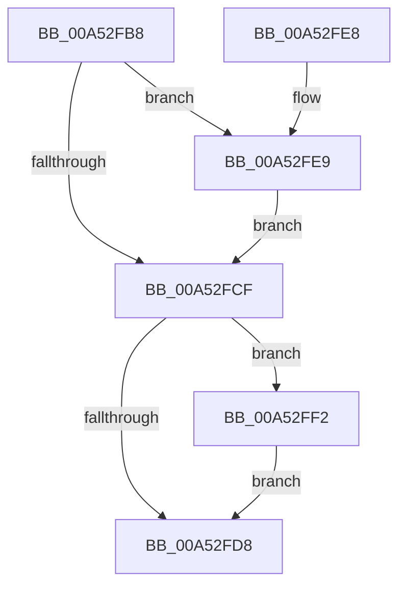

# PpmEndProfileAccumulation

- RVA: `0x00A52FB8`–`0x00A52FFB` (길이 `67` bytes)
- VA: `0x0000000140A52FB8`
- 실행 섹션: `PAGE`
- PDB 이름 있음: `예`; PDB Function 태그: `아니요`
- unwind 정보 RVA: `0x000DB714`
- 디코드: `14`개 명령, `67/67` bytes 표시
- 미해석 바이트: `0` (있으면 어셈블리에 `.byte`로 보존)

> 이 문서는 커널 이미지의 기계어와 PDB 기호를 분석해 생성했습니다. 4번과 5번은 함수 원형과 자료형을 바이너리 사용 방식에서 추정한 C 해석이며 원본 소스 복구 결과는 아닙니다.

## 1. Dependencies

- 직접 호출 지점: **0**; 고유 호출 대상: **0**
- 직접 호출자로 확인된 함수: **2**
- RIP 상대 이미지 참조: **0**

### Outgoing calls
- 직접 디코드된 call 명령이 없습니다.

### Direct callers
- [PpmEventTraceProfiles](PpmEventTraceProfiles_function_00A528A0.md) at `0x00A5295A`
- [PpmApplyProfile](PpmApplyProfile_function_00A52B08.md) at `0x00A52BDA`

### Static image references
- 디코드된 RIP-relative 메모리 참조가 없습니다.

## 2. Other-region calls and transfers

- 다른 실행 섹션으로 향하는 call: **0**
- 별도 외부 분기/꼬리 이동을 확인하지 못했습니다.

## 3. Assembly (complete function range)

```asm
00A52FB8  48 2B 91 F8 03 00 00            sub rdx, qword ptr [rcx + 0x3f8]
00A52FBF  48 01 91 18 04 00 00            add qword ptr [rcx + 0x418], rdx
00A52FC6  48 39 91 08 04 00 00            cmp qword ptr [rcx + 0x408], rdx
00A52FCD  72 1A                           jb 0x140a52fe9
00A52FCF  48 39 91 10 04 00 00            cmp qword ptr [rcx + 0x410], rdx
00A52FD6  77 1A                           ja 0x140a52ff2
00A52FD8  48 FF 81 00 04 00 00            inc qword ptr [rcx + 0x400]
00A52FDF  48 83 A1 F8 03 00 00 00         and qword ptr [rcx + 0x3f8], 0
00A52FE7  C3                              ret
00A52FE8  CC                              int3
00A52FE9  48 89 91 08 04 00 00            mov qword ptr [rcx + 0x408], rdx
00A52FF0  EB DD                           jmp 0x140a52fcf
00A52FF2  48 89 91 10 04 00 00            mov qword ptr [rcx + 0x410], rdx
00A52FF9  EB DD                           jmp 0x140a52fd8
```

## 4. C-style interpretation (structured pseudocode)

```c
void __fastcall PpmEndProfileAccumulation(__int64 a1, __int64 a2)
{
    a2 = (a2) - (*(unsigned __int64 *)(a1 + 1016));
    if ((*(unsigned __int64 *)(a1 + 1032)) < a2) goto loc_00A52FE9;
loc_00A52FCF:
    if ((*(unsigned __int64 *)(a1 + 1040)) > a2) goto loc_00A52FF2;
loc_00A52FD8:
    return;
loc_00A52FE9:
    *(unsigned __int64 *)(a1 + 1032) = a2;
    goto loc_00A52FCF;
loc_00A52FF2:
    *(unsigned __int64 *)(a1 + 1040) = a2;
    goto loc_00A52FD8;
}
```

## 5. (Beta) C Style

```c
void PpmEndProfileAccumulation(void *Arg1, int64_t Arg2)
{
    uint8_t *arg1 = (uint8_t *)Arg1;

    Arg2 = (Arg2) - (*(uint64_t *)(arg1 + 0x3F8));
    if ((*(uint64_t *)(arg1 + 0x408)) < Arg2) goto loc_00A52FE9;
loc_00A52FCF:
    if ((*(uint64_t *)(arg1 + 0x410)) > Arg2) goto loc_00A52FF2;
loc_00A52FD8:
    return;
loc_00A52FE9:
    *(uint64_t *)(arg1 + 0x408) = Arg2;
    goto loc_00A52FCF;
loc_00A52FF2:
    *(uint64_t *)(arg1 + 0x410) = Arg2;
    goto loc_00A52FD8;
}
```

### 관측된 메모리 오프셋

구조체 형식이 확인되지 않은 접근은 인자 기준의 오프셋으로만 기록했습니다.

| 기준 인자 | 오프셋 표현 | 폭 (bit) | 접근 |
|---|---:|---:|---|
| `Arg1` | `+ 0x3F8` | `64` | `R` |
| `Arg1` | `+ 0x3F8` | `64` | `R/W` |
| `Arg1` | `+ 0x400` | `64` | `R/W` |
| `Arg1` | `+ 0x408` | `64` | `R` |
| `Arg1` | `+ 0x408` | `64` | `W` |
| `Arg1` | `+ 0x410` | `64` | `R` |
| `Arg1` | `+ 0x410` | `64` | `W` |
| `Arg1` | `+ 0x418` | `64` | `R/W` |

## 6. Execution-region graph

[열기: 2D/3D 그래프와 함수 탐색 컨트롤 패널](../../../control-panel.html?section=page&rva=0x00A52FB8&view=graph)

- 2D 그래프는 위에서 아래로 흐르고, 3D 그래프는 빈 공간을 드래그해 회전합니다. Shift+드래그는 이동, 휠은 확대·축소, 함수 노드 선택은 대상 보고서 이동입니다.

### Static fallback


