# PpmEventTraceControlCallback

- RVA: `0x00A51F60`–`0x00A52376` (길이 `1,046` bytes)
- VA: `0x0000000140A51F60`
- 실행 섹션: `PAGE`
- PDB 이름 있음: `예`; PDB Function 태그: `아니요`
- unwind 정보 RVA: `0x000B0CE4`
- 디코드: `249`개 명령, `1,046/1,046` bytes 표시
- 미해석 바이트: `0` (있으면 어셈블리에 `.byte`로 보존)

> 이 문서는 커널 이미지의 기계어와 PDB 기호를 분석해 생성했습니다. 4번과 5번은 함수 원형과 자료형을 바이너리 사용 방식에서 추정한 C 해석이며 원본 소스 복구 결과는 아닙니다.

## 1. Dependencies

- 직접 호출 지점: **50**; 고유 호출 대상: **47**
- 직접 호출자로 확인된 함수: **0**
- RIP 상대 이미지 참조: **18**

### Outgoing calls
- `0x00A51FB8` → [memset](../../text/6C/memset_function_006C6C40.md) (function, `0x006C6C40`)
- `0x00A51FD5` → [PpmAcquireLock](../../text/2D/PpmAcquireLock_function_002D9AA4.md) (function, `0x002D9AA4`)
- `0x00A52042` → [KeGetPrcb](../../text/2D/KeGetPrcb_function_002D85D0.md) (function, `0x002D85D0`)
- `0x00A5204A` → [PpmEventTraceProcessorPerformance](PpmEventTraceProcessorPerformance_function_00A5237C.md) (function, `0x00A5237C`)
- `0x00A52069` → [PpmEventTraceProcessorPerformanceDomainRundown](../A8/PpmEventTraceProcessorPerformanceDomainRundown_function_00A8FCC4.md) (function, `0x00A8FCC4`)
- `0x00A52074` → [PpmEventQosClassPolicy](../A7/PpmEventQosClassPolicy_function_00A76108.md) (function, `0x00A76108`)
- `0x00A5207F` → [PpmEventQosClassPerfSelection](../../text/49/PpmEventQosClassPerfSelection_function_0049F7AC.md) (function, `0x0049F7AC`)
- `0x00A520A9` → [PpmEventTraceProcessorPerformanceRundownHv](../76/PpmEventTraceProcessorPerformanceRundownHv_function_0076A718.md) (function, `0x0076A718`)
- `0x00A520CA` → [PpmEventTraceLPIState](../../text/4C/PpmEventTraceLPIState_function_004C6494.md) (function, `0x004C6494`)
- `0x00A520CF` → [PpmEventStaticPolicyRundown](../76/PpmEventStaticPolicyRundown_function_0076A528.md) (function, `0x0076A528`)
- `0x00A520D7` → [PpmEventQosSupport](../AA/PpmEventQosSupport_function_00AA3B50.md) (function, `0x00AA3B50`)
- `0x00A520DF` → [PpmEventHeteroPolicy](../A9/PpmEventHeteroPolicy_function_00A97794.md) (function, `0x00A97794`)
- `0x00A520F1` → [PpmEventSoftParkLatencyUpdate](../../text/4F/PpmEventSoftParkLatencyUpdate_function_004F3950.md) (function, `0x004F3950`)
- `0x00A520F8` → [PpmEventTraceHeteroSets](../../text/42/PpmEventTraceHeteroSets_function_00426DB4.md) (function, `0x00426DB4`)
- `0x00A52116` → [PpmEventHgsHardwareTable](../../text/3B/PpmEventHgsHardwareTable_function_003BF110.md) (function, `0x003BF110`)
- `0x00A5211B` → [PpmEventHgsNormalizedTable](../../text/4C/PpmEventHgsNormalizedTable_function_004CC7BC.md) (function, `0x004CC7BC`)
- `0x00A5212C` → [PpmEventHgsHardwareTableResonChanged](../../text/4D/PpmEventHgsHardwareTableResonChanged_function_004D6D5C.md) (function, `0x004D6D5C`)
- `0x00A52131` → [PpmEventHgsHardwareTableResonMapTable](../../text/4C/PpmEventHgsHardwareTableResonMapTable_function_004CDEEC.md) (function, `0x004CDEEC`)
- `0x00A5216A` → [PpmEventHgsContainmentGroupInfo](../../text/5D/PpmEventHgsContainmentGroupInfo_function_005DA8DC.md) (function, `0x005DA8DC`)
- `0x00A5217C` → [PpmHeteroHgsEvaluateContainmentMinPolicyDecision](../../text/4C/PpmHeteroHgsEvaluateContainmentMinPolicyDecision_function_004C8638.md) (function, `0x004C8638`)
- `0x00A521A4` → [PpmEventHgsContainmentPolicyChange](../../text/5D/PpmEventHgsContainmentPolicyChange_function_005DAA94.md) (function, `0x005DAA94`)
- `0x00A521BF` → [memset](../../text/6C/memset_function_006C6C40.md) (function, `0x006C6C40`)
- `0x00A521E0` → [PpmHeteroHgsGetWpsHint](../../text/5D/PpmHeteroHgsGetWpsHint_function_005D8BB0.md) (function, `0x005D8BB0`)
- `0x00A521F2` → [PpmEventHgsContainmentHwUpdate](../../text/4D/PpmEventHgsContainmentHwUpdate_function_004D5FFC.md) (function, `0x004D5FFC`)
- `0x00A52222` → [Feature_PpmParkEx__private_IsEnabledDeviceUsageNoInline](../../text/4F/Feature_PpmParkEx__private_IsEnabledDeviceUsageNoInline_function_004F135C.md) (function, `0x004F135C`)
- `0x00A5222E` → [PpmEventTraceParkNodeRundown](../A8/PpmEventTraceParkNodeRundown_function_00A8A8D0.md) (function, `0x00A8A8D0`)
- `0x00A5223B` → [PpmEventTraceParkNodeRundownEx](../77/PpmEventTraceParkNodeRundownEx_function_00772E5C.md) (function, `0x00772E5C`)
- `0x00A52246` → [PpmEventParkNodeRestriction](../../text/5D/PpmEventParkNodeRestriction_function_005DB0E8.md) (function, `0x005DB0E8`)
- `0x00A52260` → [PopAcquireRwLockExclusive](../../text/43/PopAcquireRwLockExclusive_function_00430B44.md) (function, `0x00430B44`)
- `0x00A52265` → [PpmEventTracePpmProfileStatusRundown](PpmEventTracePpmProfileStatusRundown_function_00A5277C.md) (function, `0x00A5277C`)
- `0x00A5226D` → [PpmEventTraceProfiles](PpmEventTraceProfiles_function_00A528A0.md) (function, `0x00A528A0`)
- `0x00A52289` → [EtwEventEnabled](../../text/39/EtwEventEnabled_function_00392450.md) (function, `0x00392450`)
- `0x00A52292` → [PpmInfoTraceProfileSettings](../A6/PpmInfoTraceProfileSettings_function_00A6E854.md) (function, `0x00A6E854`)
- `0x00A5229A` → [PopReleaseRwLock](../../text/2D/PopReleaseRwLock_function_002DFBBC.md) (function, `0x002DFBBC`)
- `0x00A522A6` → [PpmReleaseLock](../../text/2D/PpmReleaseLock_function_002DA428.md) (function, `0x002DA428`)
- `0x00A522B4` → [PpmEventTraceAccountingBucketIntervalsRundown](../AB/PpmEventTraceAccountingBucketIntervalsRundown_function_00AB137C.md) (function, `0x00AB137C`)
- `0x00A522BC` → [PopAcquireRwLockShared](../../text/2D/PopAcquireRwLockShared_function_002D9A40.md) (function, `0x002D9A40`)
- `0x00A522C1` → [PpmEventTraceCoordinatedIdleStates](../AB/PpmEventTraceCoordinatedIdleStates_function_00ABBF5C.md) (function, `0x00ABBF5C`)
- `0x00A522C6` → [PpmEventTracePlatformIdleAccounting](../AB/PpmEventTracePlatformIdleAccounting_function_00AB6128.md) (function, `0x00AB6128`)
- `0x00A522CB` → [PpmEventVetoReasonRundown](../../text/4B/PpmEventVetoReasonRundown_function_004B686C.md) (function, `0x004B686C`)
- `0x00A522D0` → [PpmEventPlatformVetoRundown](../../text/49/PpmEventPlatformVetoRundown_function_00490C38.md) (function, `0x00490C38`)
- `0x00A522F2` → [KeGetPrcb](../../text/2D/KeGetPrcb_function_002D85D0.md) (function, `0x002D85D0`)
- `0x00A522FD` → [PpmEventProcessorVetoRundown](../../text/49/PpmEventProcessorVetoRundown_function_00490D88.md) (function, `0x00490D88`)
- `0x00A52305` → [PpmEventTraceProcessorIdle](../A8/PpmEventTraceProcessorIdle_function_00A857D4.md) (function, `0x00A857D4`)
- `0x00A52314` → [KeEnumerateNextProcessor](../../text/41/KeEnumerateNextProcessor_function_00415480.md) (function, `0x00415480`)
- `0x00A5232D` → [PopExecuteOnTargetProcessors](../../text/2D/PopExecuteOnTargetProcessors_function_002DD834.md) (function, `0x002DD834`)
- `0x00A52335` → [PopReleaseRwLock](../../text/2D/PopReleaseRwLock_function_002DFBBC.md) (function, `0x002DFBBC`)
- `0x00A5233A` → [PoEnergyEstimationEnabled](../../text/45/PoEnergyEstimationEnabled_function_00450000.md) (function, `0x00450000`)
- `0x00A52343` → [PpmEventEnergyEstimationRundown](../AB/PpmEventEnergyEstimationRundown_function_00ABF478.md) (function, `0x00ABF478`)
- `0x00A5234F` → [_security_check_cookie](../../text/6A/_security_check_cookie_function_006AC640.md) (function, `0x006AC640`)

### Direct callers
- 이 함수 시작 RVA로 연결되는 직접 call은 확인되지 않았습니다. 간접 호출은 완전히 역산할 수 없습니다.

### Static image references
- `0x00A51F84` → RVA `0x00E0A740` (`.data`; read)
- `0x00A51FCE` → RVA `0x00F0CC00` (`.data`; read)
- `0x00A51FDA` → RVA `0x00FC7128` (`ALMOSTRO`; read)
- `0x00A51FE1` → RVA `0x00FC7120` (`ALMOSTRO`; read)
- `0x00A52034` → RVA `0x00F231B8` (`.data`; read)
- `0x00A52051` → RVA `0x00FC6BA8` (`ALMOSTRO`; read)
- `0x00A520E4` → RVA `0x00FC5094` (`ALMOSTRO`; read)
- `0x00A520FD` → RVA `0x00FC6A94` (`ALMOSTRO`; read)
- `0x00A52106` → RVA `0x00FC6A96` (`ALMOSTRO`; read)
- `0x00A52120` → RVA `0x00FC6AEE` (`ALMOSTRO`; read)
- `0x00A52136` → RVA `0x00FC501C` (`ALMOSTRO`; read)
- `0x00A52144` → RVA `0x00F083E0` (`.data`; read)
- `0x00A52154` → RVA `0x00F083D8` (`.data`; read)
- `0x00A52256` → RVA `0x00F0CA70` (`.data`; read)
- `0x00A52272` → RVA `0x00E67A39` (`.data`; read)
- `0x00A5227B` → RVA `0x00F083E8` (`.data`; read)
- `0x00A52282` → RVA `0x0001AB90` (`.rdata`; read)
- `0x00A52320` → RVA `0x0043A6D0` (`PpmEventTraceProcessorIdleAccounting`; read)

## 2. Other-region calls and transfers

- 다른 실행 섹션으로 향하는 call: **33**
  - `0x00A51FB8` → [memset](../../text/6C/memset_function_006C6C40.md) (`PAGE` → `.text`)
  - `0x00A51FD5` → [PpmAcquireLock](../../text/2D/PpmAcquireLock_function_002D9AA4.md) (`PAGE` → `.text`)
  - `0x00A52042` → [KeGetPrcb](../../text/2D/KeGetPrcb_function_002D85D0.md) (`PAGE` → `.text`)
  - `0x00A5207F` → [PpmEventQosClassPerfSelection](../../text/49/PpmEventQosClassPerfSelection_function_0049F7AC.md) (`PAGE` → `.text`)
  - `0x00A520CA` → [PpmEventTraceLPIState](../../text/4C/PpmEventTraceLPIState_function_004C6494.md) (`PAGE` → `.text`)
  - `0x00A520F1` → [PpmEventSoftParkLatencyUpdate](../../text/4F/PpmEventSoftParkLatencyUpdate_function_004F3950.md) (`PAGE` → `.text`)
  - `0x00A520F8` → [PpmEventTraceHeteroSets](../../text/42/PpmEventTraceHeteroSets_function_00426DB4.md) (`PAGE` → `.text`)
  - `0x00A52116` → [PpmEventHgsHardwareTable](../../text/3B/PpmEventHgsHardwareTable_function_003BF110.md) (`PAGE` → `.text`)
  - `0x00A5211B` → [PpmEventHgsNormalizedTable](../../text/4C/PpmEventHgsNormalizedTable_function_004CC7BC.md) (`PAGE` → `.text`)
  - `0x00A5212C` → [PpmEventHgsHardwareTableResonChanged](../../text/4D/PpmEventHgsHardwareTableResonChanged_function_004D6D5C.md) (`PAGE` → `.text`)
  - `0x00A52131` → [PpmEventHgsHardwareTableResonMapTable](../../text/4C/PpmEventHgsHardwareTableResonMapTable_function_004CDEEC.md) (`PAGE` → `.text`)
  - `0x00A5216A` → [PpmEventHgsContainmentGroupInfo](../../text/5D/PpmEventHgsContainmentGroupInfo_function_005DA8DC.md) (`PAGE` → `.text`)
  - `0x00A5217C` → [PpmHeteroHgsEvaluateContainmentMinPolicyDecision](../../text/4C/PpmHeteroHgsEvaluateContainmentMinPolicyDecision_function_004C8638.md) (`PAGE` → `.text`)
  - `0x00A521A4` → [PpmEventHgsContainmentPolicyChange](../../text/5D/PpmEventHgsContainmentPolicyChange_function_005DAA94.md) (`PAGE` → `.text`)
  - `0x00A521BF` → [memset](../../text/6C/memset_function_006C6C40.md) (`PAGE` → `.text`)
  - `0x00A521E0` → [PpmHeteroHgsGetWpsHint](../../text/5D/PpmHeteroHgsGetWpsHint_function_005D8BB0.md) (`PAGE` → `.text`)
  - `0x00A521F2` → [PpmEventHgsContainmentHwUpdate](../../text/4D/PpmEventHgsContainmentHwUpdate_function_004D5FFC.md) (`PAGE` → `.text`)
  - `0x00A52222` → [Feature_PpmParkEx__private_IsEnabledDeviceUsageNoInline](../../text/4F/Feature_PpmParkEx__private_IsEnabledDeviceUsageNoInline_function_004F135C.md) (`PAGE` → `.text`)
  - `0x00A52246` → [PpmEventParkNodeRestriction](../../text/5D/PpmEventParkNodeRestriction_function_005DB0E8.md) (`PAGE` → `.text`)
  - `0x00A52260` → [PopAcquireRwLockExclusive](../../text/43/PopAcquireRwLockExclusive_function_00430B44.md) (`PAGE` → `.text`)
  - `0x00A52289` → [EtwEventEnabled](../../text/39/EtwEventEnabled_function_00392450.md) (`PAGE` → `.text`)
  - `0x00A5229A` → [PopReleaseRwLock](../../text/2D/PopReleaseRwLock_function_002DFBBC.md) (`PAGE` → `.text`)
  - `0x00A522A6` → [PpmReleaseLock](../../text/2D/PpmReleaseLock_function_002DA428.md) (`PAGE` → `.text`)
  - `0x00A522BC` → [PopAcquireRwLockShared](../../text/2D/PopAcquireRwLockShared_function_002D9A40.md) (`PAGE` → `.text`)
  - `0x00A522CB` → [PpmEventVetoReasonRundown](../../text/4B/PpmEventVetoReasonRundown_function_004B686C.md) (`PAGE` → `.text`)
  - `0x00A522D0` → [PpmEventPlatformVetoRundown](../../text/49/PpmEventPlatformVetoRundown_function_00490C38.md) (`PAGE` → `.text`)
  - `0x00A522F2` → [KeGetPrcb](../../text/2D/KeGetPrcb_function_002D85D0.md) (`PAGE` → `.text`)
  - `0x00A522FD` → [PpmEventProcessorVetoRundown](../../text/49/PpmEventProcessorVetoRundown_function_00490D88.md) (`PAGE` → `.text`)
  - `0x00A52314` → [KeEnumerateNextProcessor](../../text/41/KeEnumerateNextProcessor_function_00415480.md) (`PAGE` → `.text`)
  - `0x00A5232D` → [PopExecuteOnTargetProcessors](../../text/2D/PopExecuteOnTargetProcessors_function_002DD834.md) (`PAGE` → `.text`)
  - `0x00A52335` → [PopReleaseRwLock](../../text/2D/PopReleaseRwLock_function_002DFBBC.md) (`PAGE` → `.text`)
  - `0x00A5233A` → [PoEnergyEstimationEnabled](../../text/45/PoEnergyEstimationEnabled_function_00450000.md) (`PAGE` → `.text`)
  - `0x00A5234F` → [_security_check_cookie](../../text/6A/_security_check_cookie_function_006AC640.md) (`PAGE` → `.text`)
- 별도 외부 분기/꼬리 이동을 확인하지 못했습니다.

## 3. Assembly (complete function range)

```asm
00A51F60  48 89 5C 24 08                  mov qword ptr [rsp + 8], rbx
00A51F65  48 89 74 24 10                  mov qword ptr [rsp + 0x10], rsi
00A51F6A  48 89 7C 24 18                  mov qword ptr [rsp + 0x18], rdi
00A51F6F  55                              push rbp
00A51F70  41 54                           push r12
00A51F72  41 55                           push r13
00A51F74  41 56                           push r14
00A51F76  41 57                           push r15
00A51F78  48 8D 6C 24 80                  lea rbp, [rsp - 0x80]
00A51F7D  48 81 EC 80 01 00 00            sub rsp, 0x180
00A51F84  48 8B 05 B5 87 3B 00            mov rax, qword ptr [rip + 0x3b87b5]
00A51F8B  48 33 C4                        xor rax, rsp
00A51F8E  48 89 45 70                     mov qword ptr [rbp + 0x70], rax
00A51F92  8B F2                           mov esi, edx
00A51F94  48 8D 4C 24 60                  lea rcx, [rsp + 0x60]
00A51F99  0F 57 C0                        xorps xmm0, xmm0
00A51F9C  33 C0                           xor eax, eax
00A51F9E  45 33 F6                        xor r14d, r14d
00A51FA1  48 89 44 24 48                  mov qword ptr [rsp + 0x48], rax
00A51FA6  33 D2                           xor edx, edx
00A51FA8  44 89 74 24 30                  mov dword ptr [rsp + 0x30], r14d
00A51FAD  41 B8 08 01 00 00               mov r8d, 0x108
00A51FB3  0F 11 44 24 38                  movups xmmword ptr [rsp + 0x38], xmm0
00A51FB8  E8 83 4C C7 FF                  call 0x1406c6c40
00A51FBD  44 89 74 24 34                  mov dword ptr [rsp + 0x34], r14d
00A51FC2  F7 C6 FD FF FF FF               test esi, 0xfffffffd
00A51FC8  0F 85 7A 03 00 00               jne 0x140a52348
00A51FCE  48 8D 0D 2B AC 4B 00            lea rcx, [rip + 0x4bac2b]
00A51FD5  E8 CA 7A 88 FF                  call 0x1402d9aa4
00A51FDA  48 8B 3D 47 51 57 00            mov rdi, qword ptr [rip + 0x575147]
00A51FE1  4C 8D 2D 38 51 57 00            lea r13, [rip + 0x575138]
00A51FE8  0F B7 5C 24 48                  movzx ebx, word ptr [rsp + 0x48]
00A51FED  45 8D 7E 01                     lea r15d, [r14 + 1]
00A51FF1  4C 89 6C 24 38                  mov qword ptr [rsp + 0x38], r13
00A51FF6  0F B7 0D 23 51 57 00            movzx ecx, word ptr [rip + 0x575123]
00A51FFD  48 85 FF                        test rdi, rdi
00A52000  75 1C                           jne 0x140a5201e
00A52002  66 41 03 DF                     add bx, r15w
00A52006  0F B7 C3                        movzx eax, bx
00A52009  66 89 44 24 48                  mov word ptr [rsp + 0x48], ax
00A5200E  3B C1                           cmp eax, ecx
00A52010  73 3F                           jae 0x140a52051
00A52012  49 8B 7C C5 08                  mov rdi, qword ptr [r13 + rax*8 + 8]
00A52017  0F B7 5C 24 48                  movzx ebx, word ptr [rsp + 0x48]
00A5201C  EB DF                           jmp 0x140a51ffd
00A5201E  48 0F BC D7                     bsf rdx, rdi
00A52022  0F B7 CB                        movzx ecx, bx
00A52025  0F B6 C2                        movzx eax, dl
00A52028  48 0F B3 C7                     btr rdi, rax
00A5202C  C1 E1 06                        shl ecx, 6
00A5202F  0F B6 C2                        movzx eax, dl
00A52032  03 C8                           add ecx, eax
00A52034  48 8B 05 7D 11 4D 00            mov rax, qword ptr [rip + 0x4d117d]
00A5203B  8B 0C 88                        mov ecx, dword ptr [rax + rcx*4]
00A5203E  89 4C 24 30                     mov dword ptr [rsp + 0x30], ecx
00A52042  E8 89 65 88 FF                  call 0x1402d85d0
00A52047  48 8B C8                        mov rcx, rax
00A5204A  E8 2D 03 00 00                  call 0x140a5237c
00A5204F  EB A5                           jmp 0x140a51ff6
00A52051  48 8B 1D 50 4B 57 00            mov rbx, qword ptr [rip + 0x574b50]
00A52058  4C 8D 25 49 4B 57 00            lea r12, [rip + 0x574b49]
00A5205F  EB 5B                           jmp 0x140a520bc
00A52061  83 FE 02                        cmp esi, 2
00A52064  75 1E                           jne 0x140a52084
00A52066  48 8B CB                        mov rcx, rbx
00A52069  E8 56 DC 03 00                  call 0x140a8fcc4
00A5206E  41 8A D7                        mov dl, r15b
00A52071  48 8B CB                        mov rcx, rbx
00A52074  E8 8F 40 02 00                  call 0x140a76108
00A52079  41 8A D7                        mov dl, r15b
00A5207C  48 8B CB                        mov rcx, rbx
00A5207F  E8 28 D7 A4 FF                  call 0x14049f7ac
00A52084  41 8B FE                        mov edi, r14d
00A52087  44 39 B3 28 01 00 00            cmp dword ptr [rbx + 0x128], r14d
00A5208E  76 29                           jbe 0x140a520b9
00A52090  8B C7                           mov eax, edi
00A52092  48 69 C8 A8 04 00 00            imul rcx, rax, 0x4a8
00A52099  48 03 8B 38 01 00 00            add rcx, qword ptr [rbx + 0x138]
00A520A0  44 39 79 10                     cmp dword ptr [rcx + 0x10], r15d
00A520A4  75 08                           jne 0x140a520ae
00A520A6  48 8B 09                        mov rcx, qword ptr [rcx]
00A520A9  E8 6A 86 D1 FF                  call 0x14076a718
00A520AE  41 03 FF                        add edi, r15d
00A520B1  3B BB 28 01 00 00               cmp edi, dword ptr [rbx + 0x128]
00A520B7  72 D7                           jb 0x140a52090
00A520B9  48 8B 1B                        mov rbx, qword ptr [rbx]
00A520BC  49 3B DC                        cmp rbx, r12
00A520BF  75 A0                           jne 0x140a52061
00A520C1  83 FE 02                        cmp esi, 2
00A520C4  0F 85 3C 01 00 00               jne 0x140a52206
00A520CA  E8 C5 43 A7 FF                  call 0x1404c6494
00A520CF  E8 54 84 D1 FF                  call 0x14076a528
00A520D4  41 8A CF                        mov cl, r15b
00A520D7  E8 74 1A 05 00                  call 0x140aa3b50
00A520DC  41 8A CF                        mov cl, r15b
00A520DF  E8 B0 56 04 00                  call 0x140a97794
00A520E4  44 8B 05 A9 2F 57 00            mov r8d, dword ptr [rip + 0x572fa9]
00A520EB  41 8A D7                        mov dl, r15b
00A520EE  41 8A CF                        mov cl, r15b
00A520F1  E8 5A 18 AA FF                  call 0x1404f3950
00A520F6  33 C9                           xor ecx, ecx
00A520F8  E8 B7 4C 9D FF                  call 0x140426db4
00A520FD  44 38 35 90 49 57 00            cmp byte ptr [rip + 0x574990], r14b
00A52104  75 0D                           jne 0x140a52113
00A52106  44 38 35 89 49 57 00            cmp byte ptr [rip + 0x574989], r14b
00A5210D  0F 84 F3 00 00 00               je 0x140a52206
00A52113  41 8A CF                        mov cl, r15b
00A52116  E8 F5 CF 96 FF                  call 0x1403bf110
00A5211B  E8 9C A6 A7 FF                  call 0x1404cc7bc
00A52120  44 38 35 C7 49 57 00            cmp byte ptr [rip + 0x5749c7], r14b
00A52127  74 0D                           je 0x140a52136
00A52129  41 8A CF                        mov cl, r15b
00A5212C  E8 2B 4C A8 FF                  call 0x1404d6d5c
00A52131  E8 B6 BD A7 FF                  call 0x1404cdeec
00A52136  8B 05 E0 2E 57 00               mov eax, dword ptr [rip + 0x572ee0]
00A5213C  A8 04                           test al, 4
00A5213E  0F 84 C2 00 00 00               je 0x140a52206
00A52144  44 39 35 95 62 4B 00            cmp dword ptr [rip + 0x4b6295], r14d
00A5214B  41 8B DE                        mov ebx, r14d
00A5214E  0F 86 B2 00 00 00               jbe 0x140a52206
00A52154  48 8B 0D 7D 62 4B 00            mov rcx, qword ptr [rip + 0x4b627d]
00A5215B  41 8A D7                        mov dl, r15b
00A5215E  8B C3                           mov eax, ebx
00A52160  48 69 F8 10 05 00 00            imul rdi, rax, 0x510
00A52167  48 03 CF                        add rcx, rdi
00A5216A  E8 6D 87 B8 FF                  call 0x1405da8dc
00A5216F  4C 8B 15 62 62 4B 00            mov r10, qword ptr [rip + 0x4b6262]
00A52176  4C 03 D7                        add r10, rdi
00A52179  49 8B CA                        mov rcx, r10
00A5217C  E8 B7 64 A7 FF                  call 0x1404c8638
00A52181  49 8B 8A 00 05 00 00            mov rcx, qword ptr [r10 + 0x500]
00A52188  48 85 C9                        test rcx, rcx
00A5218B  74 08                           je 0x140a52195
00A5218D  8A 89 3B 03 00 00               mov cl, byte ptr [rcx + 0x33b]
00A52193  EB 03                           jmp 0x140a52198
00A52195  41 8A CE                        mov cl, r14b
00A52198  44 88 7C 24 28                  mov byte ptr [rsp + 0x28], r15b
00A5219D  44 8A C8                        mov r9b, al
00A521A0  88 4C 24 20                     mov byte ptr [rsp + 0x20], cl
00A521A4  E8 EB 88 B8 FF                  call 0x1405daa94
00A521A9  33 D2                           xor edx, edx
00A521AB  48 C7 44 24 60 01 00 20 00      mov qword ptr [rsp + 0x60], 0x200001
00A521B4  41 B8 00 01 00 00               mov r8d, 0x100
00A521BA  48 8D 4C 24 68                  lea rcx, [rsp + 0x68]
00A521BF  E8 7C 4A C7 FF                  call 0x1406c6c40
00A521C4  48 8B 0D 0D 62 4B 00            mov rcx, qword ptr [rip + 0x4b620d]
00A521CB  4C 8D 44 24 34                  lea r8, [rsp + 0x34]
00A521D0  48 03 CF                        add rcx, rdi
00A521D3  C7 44 24 34 03 00 00 00         mov dword ptr [rsp + 0x34], 3
00A521DB  48 8D 54 24 60                  lea rdx, [rsp + 0x60]
00A521E0  E8 CB 69 B8 FF                  call 0x1405d8bb0
00A521E5  45 8A C7                        mov r8b, r15b
00A521E8  48 8D 54 24 34                  lea rdx, [rsp + 0x34]
00A521ED  48 8D 4C 24 60                  lea rcx, [rsp + 0x60]
00A521F2  E8 05 3E A8 FF                  call 0x1404d5ffc
00A521F7  41 03 DF                        add ebx, r15d
00A521FA  3B 1D E0 61 4B 00               cmp ebx, dword ptr [rip + 0x4b61e0]
00A52200  0F 82 4E FF FF FF               jb 0x140a52154
00A52206  44 39 35 D3 61 4B 00            cmp dword ptr [rip + 0x4b61d3], r14d
00A5220D  41 8B DE                        mov ebx, r14d
00A52210  76 44                           jbe 0x140a52256
00A52212  8B C3                           mov eax, ebx
00A52214  48 69 F8 10 05 00 00            imul rdi, rax, 0x510
00A5221B  48 03 3D B6 61 4B 00            add rdi, qword ptr [rip + 0x4b61b6]
00A52222  E8 35 F1 A9 FF                  call 0x1404f135c
00A52227  85 C0                           test eax, eax
00A52229  75 0A                           jne 0x140a52235
00A5222B  48 8B CF                        mov rcx, rdi
00A5222E  E8 9D 86 03 00                  call 0x140a8a8d0
00A52233  EB 0B                           jmp 0x140a52240
00A52235  48 8B D7                        mov rdx, rdi
00A52238  0F B7 CB                        movzx ecx, bx
00A5223B  E8 1C 0C D2 FF                  call 0x140772e5c
00A52240  48 8B D7                        mov rdx, rdi
00A52243  41 8A CF                        mov cl, r15b
00A52246  E8 9D 8E B8 FF                  call 0x1405db0e8
00A5224B  41 03 DF                        add ebx, r15d
00A5224E  3B 1D 8C 61 4B 00               cmp ebx, dword ptr [rip + 0x4b618c]
00A52254  72 BC                           jb 0x140a52212
00A52256  48 8D 3D 13 A8 4B 00            lea rdi, [rip + 0x4ba813]
00A5225D  48 8B CF                        mov rcx, rdi
00A52260  E8 DF E8 9D FF                  call 0x140430b44
00A52265  E8 12 05 00 00                  call 0x140a5277c
00A5226A  41 8A CF                        mov cl, r15b
00A5226D  E8 2E 06 00 00                  call 0x140a528a0
00A52272  44 38 35 C0 57 41 00            cmp byte ptr [rip + 0x4157c0], r14b
00A52279  74 1C                           je 0x140a52297
00A5227B  48 8B 0D 66 61 4B 00            mov rcx, qword ptr [rip + 0x4b6166]
00A52282  48 8D 15 07 89 5C FF            lea rdx, [rip - 0xa376f9]
00A52289  E8 C2 01 94 FF                  call 0x140392450
00A5228E  84 C0                           test al, al
00A52290  74 05                           je 0x140a52297
00A52292  E8 BD C5 01 00                  call 0x140a6e854
00A52297  48 8B CF                        mov rcx, rdi
00A5229A  E8 1D D9 88 FF                  call 0x1402dfbbc
00A5229F  48 8D 0D 5A A9 4B 00            lea rcx, [rip + 0x4ba95a]
00A522A6  E8 7D 81 88 FF                  call 0x1402da428
00A522AB  83 FE 02                        cmp esi, 2
00A522AE  0F 85 94 00 00 00               jne 0x140a52348
00A522B4  E8 C3 F0 05 00                  call 0x140ab137c
00A522B9  48 8B CF                        mov rcx, rdi
00A522BC  E8 7F 77 88 FF                  call 0x1402d9a40
00A522C1  E8 96 9C 06 00                  call 0x140abbf5c
00A522C6  E8 5D 3E 06 00                  call 0x140ab6128
00A522CB  E8 9C 45 A6 FF                  call 0x1404b686c
00A522D0  E8 63 E9 A3 FF                  call 0x140490c38
00A522D5  48 8B 05 4C 4E 57 00            mov rax, qword ptr [rip + 0x574e4c]
00A522DC  48 89 44 24 40                  mov qword ptr [rsp + 0x40], rax
00A522E1  66 44 89 74 24 48               mov word ptr [rsp + 0x48], r14w
00A522E7  4C 89 6C 24 38                  mov qword ptr [rsp + 0x38], r13
00A522EC  EB 1C                           jmp 0x140a5230a
00A522EE  8B 4C 24 30                     mov ecx, dword ptr [rsp + 0x30]
00A522F2  E8 D9 62 88 FF                  call 0x1402d85d0
00A522F7  48 8B C8                        mov rcx, rax
00A522FA  48 8B D8                        mov rbx, rax
00A522FD  E8 86 EA A3 FF                  call 0x140490d88
00A52302  48 8B CB                        mov rcx, rbx
00A52305  E8 CA 34 03 00                  call 0x140a857d4
00A5230A  48 8D 54 24 38                  lea rdx, [rsp + 0x38]
00A5230F  48 8D 4C 24 30                  lea rcx, [rsp + 0x30]
00A52314  E8 67 31 9C FF                  call 0x140415480
00A52319  85 C0                           test eax, eax
00A5231B  74 D1                           je 0x140a522ee
00A5231D  45 33 C9                        xor r9d, r9d
00A52320  48 8D 15 A9 83 9E FF            lea rdx, [rip - 0x617c57]
00A52327  45 33 C0                        xor r8d, r8d
00A5232A  49 8B CD                        mov rcx, r13
00A5232D  E8 02 B5 88 FF                  call 0x1402dd834
00A52332  48 8B CF                        mov rcx, rdi
00A52335  E8 82 D8 88 FF                  call 0x1402dfbbc
00A5233A  E8 C1 DC 9F FF                  call 0x140450000
00A5233F  84 C0                           test al, al
00A52341  74 05                           je 0x140a52348
00A52343  E8 30 D1 06 00                  call 0x140abf478
00A52348  48 8B 4D 70                     mov rcx, qword ptr [rbp + 0x70]
00A5234C  48 33 CC                        xor rcx, rsp
00A5234F  E8 EC A2 C5 FF                  call 0x1406ac640
00A52354  4C 8D 9C 24 80 01 00 00         lea r11, [rsp + 0x180]
00A5235C  49 8B 5B 30                     mov rbx, qword ptr [r11 + 0x30]
00A52360  49 8B 73 38                     mov rsi, qword ptr [r11 + 0x38]
00A52364  49 8B 7B 40                     mov rdi, qword ptr [r11 + 0x40]
00A52368  49 8B E3                        mov rsp, r11
00A5236B  41 5F                           pop r15
00A5236D  41 5E                           pop r14
00A5236F  41 5D                           pop r13
00A52371  41 5C                           pop r12
00A52373  5D                              pop rbp
00A52374  C3                              ret
00A52375  CC                              int3
```

## 4. C-style interpretation (structured pseudocode)

```c
__int64 __fastcall PpmEventTraceControlCallback(__int64 a1, int a2)
{
    __int64 result;
    __int64 v_r10;
    __int64 v_r14;
    __int64 v_rbx;
    __int64 v_rdi;
    __int64 v_rsp;
    unsigned __int64 v_stack_m140;
    unsigned __int64 v_stack_m148;
    unsigned __int64 v_stack_m160;
    unsigned __int64 v_stack_m168;
    unsigned __int64 v_stack_m170;
    unsigned int v_stack_m174;
    unsigned int v_stack_m178;
    unsigned __int8 v_stack_m180;
    unsigned __int8 v_stack_m188;
    unsigned __int64 v_stack_m28;
    unsigned __int64 v_stack_m38;
    unsigned __int64 v_stack_mA8;
    unsigned __int64 v_stack_p10;
    unsigned __int64 v_stack_p18;
    unsigned __int64 v_stack_p8;

    v_stack_p8 = v_rbx;
    v_stack_p10 = v_rsi;
    v_stack_p18 = v_rdi;
    v_rsp = (v_rsp) - (384);
    result = (*(unsigned __int64 *)(v_rip + 3901365)) ^ (v_rsp);
    v_stack_m38 = result;
    result = 0;
    v_r14 = 0;
    v_stack_m160 = 0;
    a2 = 0;
    v_stack_m178 = 0;
    v_stack_m170 = v_xmm0;
    result = memset(v_stack_m148, a2, 264, a4);
    v_stack_m174 = 0;
    if ((((unsigned int)((unsigned int)(a2))) & (0xFFFFFFFDULL)) != 0) goto loc_00A52348;
    result = PpmAcquireLock(v_rip + 4959275, a2, 264, a4);
    v_stack_m170 = v_rip + 5722424;
loc_00A51FF6:
loc_00A51FFD:
    if (*(unsigned __int64 *)(v_rip + 5722439) != 0) goto loc_00A5201E;
    v_rbx = (unsigned __int16)((v_stack_m160) + ((unsigned __int16)(v_r14 + 1)));
    v_stack_m160 = (unsigned __int16)((unsigned __int16)(v_rbx));
    if (((unsigned int)((unsigned __int16)(v_rbx))) >= ((unsigned int)(*(unsigned __int16 *)(v_rip + 5722403)))) goto loc_00A52051;
    goto loc_00A51FFD;
loc_00A5201E:
    a1 = (unsigned int)(((unsigned __int16)(v_stack_m160)) << (6));
    a1 = (unsigned int)((a1) + (0));
    v_stack_m178 = (unsigned int)((unsigned int)(*(unsigned int *)(*(unsigned __int64 *)(v_rip + 5050749) + a1 * 4)));
    result = KeGetPrcb((unsigned int)(*(unsigned int *)(*(unsigned __int64 *)(v_rip + 5050749) + a1 * 4)), a2, 264, a4);
    result = PpmEventTraceProcessorPerformance(result, a2, 264, a4);
    goto loc_00A51FF6;
loc_00A52051:
    goto loc_00A520BC;
loc_00A52061:
    if (((unsigned int)((unsigned int)(a2))) == 2) {
        a1 = *(unsigned __int64 *)(v_rip + 5720912);
        result = PpmEventTraceProcessorPerformanceDomainRundown(a1, a2, 264, a4);
        a2 = (unsigned __int8)(v_r14 + 1);
        a1 = *(unsigned __int64 *)(v_rip + 5720912);
        result = PpmEventQosClassPolicy(a1, a2, 264, a4);
        a2 = (unsigned __int8)(v_r14 + 1);
        a1 = *(unsigned __int64 *)(v_rip + 5720912);
        result = PpmEventQosClassPerfSelection(a1, a2, 264, a4);
    }
    if ((*(unsigned int *)(*(unsigned __int64 *)(v_rip + 5720912) + 296)) <= 0) goto loc_00A520B9;
loc_00A52090:
    a1 = (a1) * (0);
    a1 = (a1) + (*(unsigned __int64 *)(*(unsigned __int64 *)(v_rip + 5720912) + 312));
    result = 0;
    if ((*(unsigned int *)(a1 + 16)) == ((unsigned int)(v_r14 + 1))) {
        a1 = *(unsigned __int64 *)(a1);
        result = PpmEventTraceProcessorPerformanceRundownHv(a1, a2, 264, a4);
    }
    v_rdi = (unsigned int)((0) + ((unsigned int)(v_r14 + 1)));
    if (((unsigned int)(v_rdi)) < (*(unsigned int *)(*(unsigned __int64 *)(v_rip + 5720912) + 296))) goto loc_00A52090;
loc_00A520B9:
loc_00A520BC:
    if ((*(unsigned __int64 *)(*(unsigned __int64 *)(v_rip + 5720912))) != (v_rip + 5720905)) goto loc_00A52061;
    if (((unsigned int)((unsigned int)(a2))) != 2) goto loc_00A52206;
    result = PpmEventTraceLPIState(a1, a2, 264, a4);
    result = PpmEventStaticPolicyRundown(a1, a2, 264, a4);
    result = PpmEventQosSupport((unsigned __int8)(v_r14 + 1), a2, 264, a4);
    result = PpmEventHeteroPolicy((unsigned __int8)(v_r14 + 1), a2, 264, a4);
    result = PpmEventSoftParkLatencyUpdate((unsigned __int8)(v_r14 + 1), (unsigned __int8)(v_r14 + 1), (unsigned int)(*(unsigned int *)(v_rip + 5713833)), a4);
    a1 = 0;
    result = PpmEventTraceHeteroSets(a1, (unsigned __int8)(v_r14 + 1), (unsigned int)(*(unsigned int *)(v_rip + 5713833)), a4);
    if ((*(unsigned __int8 *)(v_rip + 5720464)) != 0) goto loc_00A52113;
    if ((*(unsigned __int8 *)(v_rip + 5720457)) == 0) goto loc_00A52206;
loc_00A52113:
    result = PpmEventHgsHardwareTable((unsigned __int8)(v_r14 + 1), (unsigned __int8)(v_r14 + 1), (unsigned int)(*(unsigned int *)(v_rip + 5713833)), a4);
    result = PpmEventHgsNormalizedTable((unsigned __int8)(v_r14 + 1), (unsigned __int8)(v_r14 + 1), (unsigned int)(*(unsigned int *)(v_rip + 5713833)), a4);
    if ((*(unsigned __int8 *)(v_rip + 5720519)) != 0) {
        a1 = (unsigned __int8)(v_r14 + 1);
        result = PpmEventHgsHardwareTableResonChanged(a1, (unsigned __int8)(v_r14 + 1), (unsigned int)(*(unsigned int *)(v_rip + 5713833)), a4);
        result = PpmEventHgsHardwareTableResonMapTable(a1, (unsigned __int8)(v_r14 + 1), (unsigned int)(*(unsigned int *)(v_rip + 5713833)), a4);
    }
    if ((((unsigned __int8)((unsigned int)(*(unsigned int *)(v_rip + 5713632)))) & (4)) == 0) goto loc_00A52206;
    if ((*(unsigned int *)(v_rip + 4940437)) <= 0) goto loc_00A52206;
loc_00A52154:
    v_rdi = (v_rdi) * (0);
    a1 = (*(unsigned __int64 *)(v_rip + 4940413)) + (v_rdi);
    result = PpmEventHgsContainmentGroupInfo(a1, (unsigned __int8)(v_r14 + 1), (unsigned int)(*(unsigned int *)(v_rip + 5713833)), a4);
    v_r10 = (*(unsigned __int64 *)(v_rip + 4940386)) + (v_rdi);
    result = PpmHeteroHgsEvaluateContainmentMinPolicyDecision(v_r10, (unsigned __int8)(v_r14 + 1), (unsigned int)(*(unsigned int *)(v_rip + 5713833)), a4);
    if (*(unsigned __int64 *)(v_r10 + 1280) == 0) goto loc_00A52195;
    goto loc_00A52198;
loc_00A52195:
loc_00A52198:
    v_stack_m180 = (unsigned __int8)(v_r14 + 1);
    v_stack_m188 = 0;
    result = PpmEventHgsContainmentPolicyChange(0, (unsigned __int8)(v_r14 + 1), (unsigned int)(*(unsigned int *)(v_rip + 5713833)), (unsigned __int8)(result));
    a2 = 0;
    v_stack_m148 = 0x200001ULL;
    result = memset(v_stack_m140, a2, 256, (unsigned __int8)(result));
    a1 = (*(unsigned __int64 *)(v_rip + 4940301)) + (v_rdi);
    v_stack_m174 = 3;
    result = PpmHeteroHgsGetWpsHint(a1, v_stack_m148, v_stack_m174, (unsigned __int8)(result));
    result = PpmEventHgsContainmentHwUpdate(v_stack_m148, v_stack_m174, (unsigned __int8)(v_r14 + 1), (unsigned __int8)(result));
    v_rbx = (unsigned int)((0) + ((unsigned int)(v_r14 + 1)));
    if (((unsigned int)(v_rbx)) < (*(unsigned int *)(v_rip + 4940256))) goto loc_00A52154;
loc_00A52206:
    if ((*(unsigned int *)(v_rip + 4940243)) <= 0) goto loc_00A52256;
loc_00A52212:
    v_rdi = (v_rdi) * (0);
    v_rdi = (v_rdi) + (*(unsigned __int64 *)(v_rip + 4940214));
    result = Feature_PpmParkEx__private_IsEnabledDeviceUsageNoInline(v_stack_m148, v_stack_m174, (unsigned __int8)(v_r14 + 1), (unsigned __int8)(result));
    if ((unsigned int)(result) != 0) goto loc_00A52235;
    result = PpmEventTraceParkNodeRundown(v_rdi, v_stack_m174, (unsigned __int8)(v_r14 + 1), (unsigned __int8)(result));
    goto loc_00A52240;
loc_00A52235:
    result = PpmEventTraceParkNodeRundownEx(0, v_rdi, (unsigned __int8)(v_r14 + 1), (unsigned __int8)(result));
loc_00A52240:
    result = PpmEventParkNodeRestriction((unsigned __int8)(v_r14 + 1), v_rdi, (unsigned __int8)(v_r14 + 1), (unsigned __int8)(result));
    v_rbx = (unsigned int)((0) + ((unsigned int)(v_r14 + 1)));
    if (((unsigned int)(v_rbx)) < (*(unsigned int *)(v_rip + 4940172))) goto loc_00A52212;
loc_00A52256:
    result = PopAcquireRwLockExclusive(v_rip + 4958227, v_rdi, (unsigned __int8)(v_r14 + 1), (unsigned __int8)(result));
    result = PpmEventTracePpmProfileStatusRundown(v_rip + 4958227, v_rdi, (unsigned __int8)(v_r14 + 1), (unsigned __int8)(result));
    result = PpmEventTraceProfiles((unsigned __int8)(v_r14 + 1), v_rdi, (unsigned __int8)(v_r14 + 1), (unsigned __int8)(result));
    if ((*(unsigned __int8 *)(v_rip + 4282304)) == 0) goto loc_00A52297;
    result = EtwEventEnabled(*(unsigned __int64 *)(v_rip + 4940134), v_rip - 10712825, (unsigned __int8)(v_r14 + 1), (unsigned __int8)(result));
    if ((unsigned __int8)(result) != 0) {
        result = PpmInfoTraceProfileSettings(*(unsigned __int64 *)(v_rip + 4940134), v_rip - 10712825, (unsigned __int8)(v_r14 + 1), (unsigned __int8)(result));
    }
    result = PopReleaseRwLock(v_rip + 4958227, v_rip - 10712825, (unsigned __int8)(v_r14 + 1), (unsigned __int8)(result));
    result = PpmReleaseLock(v_rip + 4958554, v_rip - 10712825, (unsigned __int8)(v_r14 + 1), (unsigned __int8)(result));
    if (((unsigned int)((unsigned int)(a2))) != 2) goto loc_00A52348;
    result = PpmEventTraceAccountingBucketIntervalsRundown(v_rip + 4958554, v_rip - 10712825, (unsigned __int8)(v_r14 + 1), (unsigned __int8)(result));
    result = PopAcquireRwLockShared(v_rip + 4958227, v_rip - 10712825, (unsigned __int8)(v_r14 + 1), (unsigned __int8)(result));
    result = PpmEventTraceCoordinatedIdleStates(v_rip + 4958227, v_rip - 10712825, (unsigned __int8)(v_r14 + 1), (unsigned __int8)(result));
    result = PpmEventTracePlatformIdleAccounting(v_rip + 4958227, v_rip - 10712825, (unsigned __int8)(v_r14 + 1), (unsigned __int8)(result));
    result = PpmEventVetoReasonRundown(v_rip + 4958227, v_rip - 10712825, (unsigned __int8)(v_r14 + 1), (unsigned __int8)(result));
    result = PpmEventPlatformVetoRundown(v_rip + 4958227, v_rip - 10712825, (unsigned __int8)(v_r14 + 1), (unsigned __int8)(result));
    v_stack_m168 = *(unsigned __int64 *)(v_rip + 5721676);
    v_stack_m160 = 0;
    v_stack_m170 = v_rip + 5722424;
    goto loc_00A5230A;
loc_00A522EE:
    result = KeGetPrcb((unsigned int)(v_stack_m178), v_rip - 10712825, (unsigned __int8)(v_r14 + 1), (unsigned __int8)(result));
    result = PpmEventProcessorVetoRundown(result, v_rip - 10712825, (unsigned __int8)(v_r14 + 1), (unsigned __int8)(result));
    result = PpmEventTraceProcessorIdle(result, v_rip - 10712825, (unsigned __int8)(v_r14 + 1), (unsigned __int8)(result));
loc_00A5230A:
    result = KeEnumerateNextProcessor(v_stack_m178, v_stack_m170, (unsigned __int8)(v_r14 + 1), (unsigned __int8)(result));
    if ((unsigned int)(result) == 0) goto loc_00A522EE;
    a4 = 0;
    a3 = 0;
    result = PopExecuteOnTargetProcessors(v_rip + 5722424, v_rip - 6388823, a3, a4);
    result = PopReleaseRwLock(v_rip + 4958227, v_rip - 6388823, a3, a4);
    result = PoEnergyEstimationEnabled(v_rip + 4958227, v_rip - 6388823, a3, a4);
    if ((unsigned __int8)(result) != 0) {
        result = PpmEventEnergyEstimationRundown(v_rip + 4958227, v_rip - 6388823, a3, a4);
    }
    a1 = (v_stack_m38) ^ (v_rsp);
    result = _security_check_cookie(a1, v_rip - 6388823, a3, a4);
    return result;
}
```

## 5. (Beta) C Style

```c
int64_t PpmEventTraceControlCallback(int64_t Arg1, int32_t Arg2)
{
    int64_t result;
    int64_t local_r10;
    int64_t local_r14;
    int64_t local_rbx;
    int64_t local_rdi;
    int64_t local_rsp;
    uint64_t v_stack_m140;
    uint64_t v_stack_m148;
    uint64_t v_stack_m160;
    uint64_t v_stack_m168;
    uint64_t v_stack_m170;
    uint32_t v_stack_m174;
    uint32_t v_stack_m178;
    uint8_t v_stack_m180;
    uint8_t v_stack_m188;
    uint64_t v_stack_m28;
    uint64_t v_stack_m38;
    uint64_t v_stack_mA8;
    uint64_t v_stack_p10;
    uint64_t v_stack_p18;
    uint64_t v_stack_p8;

    v_stack_p8 = local_rbx;
    v_stack_p10 = local_rsi;
    v_stack_p18 = local_rdi;
    local_rsp = (local_rsp) - (384);
    result = (*(uint64_t *)(v_rip + 0x3B87B5)) ^ (local_rsp);
    v_stack_m38 = result;
    result = 0;
    local_r14 = 0;
    v_stack_m160 = 0;
    Arg2 = 0;
    v_stack_m178 = 0;
    v_stack_m170 = v_xmm0;
    result = memset(v_stack_m148, Arg2, 264, a4);
    v_stack_m174 = 0;
    if ((((uint32_t)((uint32_t)(Arg2))) & (0xFFFFFFFDULL)) != 0) goto loc_00A52348;
    result = PpmAcquireLock(v_rip + 4959275, Arg2, 264, a4);
    v_stack_m170 = v_rip + 5722424;
loc_00A51FF6:
loc_00A51FFD:
    if (*(uint64_t *)(v_rip + 0x575147) != 0) goto loc_00A5201E;
    local_rbx = (uint16_t)((v_stack_m160) + ((uint16_t)(local_r14 + 1)));
    v_stack_m160 = (uint16_t)((uint16_t)(local_rbx));
    if (((uint32_t)((uint16_t)(local_rbx))) >= ((uint32_t)(*(uint16_t *)(v_rip + 0x575123)))) goto loc_00A52051;
    goto loc_00A51FFD;
loc_00A5201E:
    Arg1 = (uint32_t)(((uint16_t)(v_stack_m160)) << (6));
    Arg1 = (uint32_t)((Arg1) + (0));
    v_stack_m178 = (uint32_t)((uint32_t)(*(uint32_t *)(*(uint64_t *)(v_rip + 0x4D117D) + Arg1 * 4)));
    result = KeGetPrcb((uint32_t)(*(uint32_t *)(*(uint64_t *)(v_rip + 0x4D117D) + Arg1 * 4)), Arg2, 264, a4);
    result = PpmEventTraceProcessorPerformance(result, Arg2, 264, a4);
    goto loc_00A51FF6;
loc_00A52051:
    goto loc_00A520BC;
loc_00A52061:
    if (((uint32_t)((uint32_t)(Arg2))) == 2) {
        Arg1 = *(uint64_t *)(v_rip + 0x574B50);
        result = PpmEventTraceProcessorPerformanceDomainRundown(Arg1, Arg2, 264, a4);
        Arg2 = (uint8_t)(local_r14 + 1);
        Arg1 = *(uint64_t *)(v_rip + 0x574B50);
        result = PpmEventQosClassPolicy(Arg1, Arg2, 264, a4);
        Arg2 = (uint8_t)(local_r14 + 1);
        Arg1 = *(uint64_t *)(v_rip + 0x574B50);
        result = PpmEventQosClassPerfSelection(Arg1, Arg2, 264, a4);
    }
    if ((*(uint32_t *)(*(uint64_t *)(v_rip + 0x574B50) + 0x128)) <= 0) goto loc_00A520B9;
loc_00A52090:
    Arg1 = (Arg1) * (0);
    Arg1 = (Arg1) + (*(uint64_t *)(*(uint64_t *)(v_rip + 0x574B50) + 0x138));
    result = 0;
    if ((*(uint32_t *)(Arg1 + 0x10)) == ((uint32_t)(local_r14 + 1))) {
        Arg1 = *(uint64_t *)(Arg1);
        result = PpmEventTraceProcessorPerformanceRundownHv(Arg1, Arg2, 264, a4);
    }
    local_rdi = (uint32_t)((0) + ((uint32_t)(local_r14 + 1)));
    if (((uint32_t)(local_rdi)) < (*(uint32_t *)(*(uint64_t *)(v_rip + 0x574B50) + 0x128))) goto loc_00A52090;
loc_00A520B9:
loc_00A520BC:
    if ((*(uint64_t *)(*(uint64_t *)(v_rip + 0x574B50))) != (v_rip + 5720905)) goto loc_00A52061;
    if (((uint32_t)((uint32_t)(Arg2))) != 2) goto loc_00A52206;
    result = PpmEventTraceLPIState(Arg1, Arg2, 264, a4);
    result = PpmEventStaticPolicyRundown(Arg1, Arg2, 264, a4);
    result = PpmEventQosSupport((uint8_t)(local_r14 + 1), Arg2, 264, a4);
    result = PpmEventHeteroPolicy((uint8_t)(local_r14 + 1), Arg2, 264, a4);
    result = PpmEventSoftParkLatencyUpdate((uint8_t)(local_r14 + 1), (uint8_t)(local_r14 + 1), (uint32_t)(*(uint32_t *)(v_rip + 0x572FA9)), a4);
    Arg1 = 0;
    result = PpmEventTraceHeteroSets(Arg1, (uint8_t)(local_r14 + 1), (uint32_t)(*(uint32_t *)(v_rip + 0x572FA9)), a4);
    if ((*(uint8_t *)(v_rip + 0x574990)) != 0) goto loc_00A52113;
    if ((*(uint8_t *)(v_rip + 0x574989)) == 0) goto loc_00A52206;
loc_00A52113:
    result = PpmEventHgsHardwareTable((uint8_t)(local_r14 + 1), (uint8_t)(local_r14 + 1), (uint32_t)(*(uint32_t *)(v_rip + 0x572FA9)), a4);
    result = PpmEventHgsNormalizedTable((uint8_t)(local_r14 + 1), (uint8_t)(local_r14 + 1), (uint32_t)(*(uint32_t *)(v_rip + 0x572FA9)), a4);
    if ((*(uint8_t *)(v_rip + 0x5749C7)) != 0) {
        Arg1 = (uint8_t)(local_r14 + 1);
        result = PpmEventHgsHardwareTableResonChanged(Arg1, (uint8_t)(local_r14 + 1), (uint32_t)(*(uint32_t *)(v_rip + 0x572FA9)), a4);
        result = PpmEventHgsHardwareTableResonMapTable(Arg1, (uint8_t)(local_r14 + 1), (uint32_t)(*(uint32_t *)(v_rip + 0x572FA9)), a4);
    }
    if ((((uint8_t)((uint32_t)(*(uint32_t *)(v_rip + 0x572EE0)))) & (4)) == 0) goto loc_00A52206;
    if ((*(uint32_t *)(v_rip + 0x4B6295)) <= 0) goto loc_00A52206;
loc_00A52154:
    local_rdi = (local_rdi) * (0);
    Arg1 = (*(uint64_t *)(v_rip + 0x4B627D)) + (local_rdi);
    result = PpmEventHgsContainmentGroupInfo(Arg1, (uint8_t)(local_r14 + 1), (uint32_t)(*(uint32_t *)(v_rip + 0x572FA9)), a4);
    local_r10 = (*(uint64_t *)(v_rip + 0x4B6262)) + (local_rdi);
    result = PpmHeteroHgsEvaluateContainmentMinPolicyDecision(local_r10, (uint8_t)(local_r14 + 1), (uint32_t)(*(uint32_t *)(v_rip + 0x572FA9)), a4);
    if (*(uint64_t *)(local_r10 + 0x500) == 0) goto loc_00A52195;
    goto loc_00A52198;
loc_00A52195:
loc_00A52198:
    v_stack_m180 = (uint8_t)(local_r14 + 1);
    v_stack_m188 = 0;
    result = PpmEventHgsContainmentPolicyChange(0, (uint8_t)(local_r14 + 1), (uint32_t)(*(uint32_t *)(v_rip + 0x572FA9)), (uint8_t)(result));
    Arg2 = 0;
    v_stack_m148 = 0x200001ULL;
    result = memset(v_stack_m140, Arg2, 256, (uint8_t)(result));
    Arg1 = (*(uint64_t *)(v_rip + 0x4B620D)) + (local_rdi);
    v_stack_m174 = 3;
    result = PpmHeteroHgsGetWpsHint(Arg1, v_stack_m148, v_stack_m174, (uint8_t)(result));
    result = PpmEventHgsContainmentHwUpdate(v_stack_m148, v_stack_m174, (uint8_t)(local_r14 + 1), (uint8_t)(result));
    local_rbx = (uint32_t)((0) + ((uint32_t)(local_r14 + 1)));
    if (((uint32_t)(local_rbx)) < (*(uint32_t *)(v_rip + 0x4B61E0))) goto loc_00A52154;
loc_00A52206:
    if ((*(uint32_t *)(v_rip + 0x4B61D3)) <= 0) goto loc_00A52256;
loc_00A52212:
    local_rdi = (local_rdi) * (0);
    local_rdi = (local_rdi) + (*(uint64_t *)(v_rip + 0x4B61B6));
    result = Feature_PpmParkEx__private_IsEnabledDeviceUsageNoInline(v_stack_m148, v_stack_m174, (uint8_t)(local_r14 + 1), (uint8_t)(result));
    if ((uint32_t)(result) != 0) goto loc_00A52235;
    result = PpmEventTraceParkNodeRundown(local_rdi, v_stack_m174, (uint8_t)(local_r14 + 1), (uint8_t)(result));
    goto loc_00A52240;
loc_00A52235:
    result = PpmEventTraceParkNodeRundownEx(0, local_rdi, (uint8_t)(local_r14 + 1), (uint8_t)(result));
loc_00A52240:
    result = PpmEventParkNodeRestriction((uint8_t)(local_r14 + 1), local_rdi, (uint8_t)(local_r14 + 1), (uint8_t)(result));
    local_rbx = (uint32_t)((0) + ((uint32_t)(local_r14 + 1)));
    if (((uint32_t)(local_rbx)) < (*(uint32_t *)(v_rip + 0x4B618C))) goto loc_00A52212;
loc_00A52256:
    result = PopAcquireRwLockExclusive(v_rip + 4958227, local_rdi, (uint8_t)(local_r14 + 1), (uint8_t)(result));
    result = PpmEventTracePpmProfileStatusRundown(v_rip + 4958227, local_rdi, (uint8_t)(local_r14 + 1), (uint8_t)(result));
    result = PpmEventTraceProfiles((uint8_t)(local_r14 + 1), local_rdi, (uint8_t)(local_r14 + 1), (uint8_t)(result));
    if ((*(uint8_t *)(v_rip + 0x4157C0)) == 0) goto loc_00A52297;
    result = EtwEventEnabled(*(uint64_t *)(v_rip + 0x4B6166), v_rip - 10712825, (uint8_t)(local_r14 + 1), (uint8_t)(result));
    if ((uint8_t)(result) != 0) {
        result = PpmInfoTraceProfileSettings(*(uint64_t *)(v_rip + 0x4B6166), v_rip - 10712825, (uint8_t)(local_r14 + 1), (uint8_t)(result));
    }
    result = PopReleaseRwLock(v_rip + 4958227, v_rip - 10712825, (uint8_t)(local_r14 + 1), (uint8_t)(result));
    result = PpmReleaseLock(v_rip + 4958554, v_rip - 10712825, (uint8_t)(local_r14 + 1), (uint8_t)(result));
    if (((uint32_t)((uint32_t)(Arg2))) != 2) goto loc_00A52348;
    result = PpmEventTraceAccountingBucketIntervalsRundown(v_rip + 4958554, v_rip - 10712825, (uint8_t)(local_r14 + 1), (uint8_t)(result));
    result = PopAcquireRwLockShared(v_rip + 4958227, v_rip - 10712825, (uint8_t)(local_r14 + 1), (uint8_t)(result));
    result = PpmEventTraceCoordinatedIdleStates(v_rip + 4958227, v_rip - 10712825, (uint8_t)(local_r14 + 1), (uint8_t)(result));
    result = PpmEventTracePlatformIdleAccounting(v_rip + 4958227, v_rip - 10712825, (uint8_t)(local_r14 + 1), (uint8_t)(result));
    result = PpmEventVetoReasonRundown(v_rip + 4958227, v_rip - 10712825, (uint8_t)(local_r14 + 1), (uint8_t)(result));
    result = PpmEventPlatformVetoRundown(v_rip + 4958227, v_rip - 10712825, (uint8_t)(local_r14 + 1), (uint8_t)(result));
    v_stack_m168 = *(uint64_t *)(v_rip + 0x574E4C);
    v_stack_m160 = 0;
    v_stack_m170 = v_rip + 5722424;
    goto loc_00A5230A;
loc_00A522EE:
    result = KeGetPrcb((uint32_t)(v_stack_m178), v_rip - 10712825, (uint8_t)(local_r14 + 1), (uint8_t)(result));
    result = PpmEventProcessorVetoRundown(result, v_rip - 10712825, (uint8_t)(local_r14 + 1), (uint8_t)(result));
    result = PpmEventTraceProcessorIdle(result, v_rip - 10712825, (uint8_t)(local_r14 + 1), (uint8_t)(result));
loc_00A5230A:
    result = KeEnumerateNextProcessor(v_stack_m178, v_stack_m170, (uint8_t)(local_r14 + 1), (uint8_t)(result));
    if ((uint32_t)(result) == 0) goto loc_00A522EE;
    a4 = 0;
    a3 = 0;
    result = PopExecuteOnTargetProcessors(v_rip + 5722424, v_rip - 6388823, a3, a4);
    result = PopReleaseRwLock(v_rip + 4958227, v_rip - 6388823, a3, a4);
    result = PoEnergyEstimationEnabled(v_rip + 4958227, v_rip - 6388823, a3, a4);
    if ((uint8_t)(result) != 0) {
        result = PpmEventEnergyEstimationRundown(v_rip + 4958227, v_rip - 6388823, a3, a4);
    }
    Arg1 = (v_stack_m38) ^ (local_rsp);
    result = _security_check_cookie(Arg1, v_rip - 6388823, a3, a4);
    return result;
}
```

## 6. Execution-region graph

[열기: 2D/3D 그래프와 함수 탐색 컨트롤 패널](../../../control-panel.html?section=page&rva=0x00A51F60&view=graph)

- 2D 그래프는 위에서 아래로 흐르고, 3D 그래프는 빈 공간을 드래그해 회전합니다. Shift+드래그는 이동, 휠은 확대·축소, 함수 노드 선택은 대상 보고서 이동입니다.

### Static fallback

```mermaid
flowchart TD
  bb_00A51F60[BB_00A51F60]
  bb_00A51FCE[BB_00A51FCE]
  bb_00A51FF6[BB_00A51FF6]
  bb_00A51FFD[BB_00A51FFD]
  bb_00A52002[BB_00A52002]
  bb_00A52012[BB_00A52012]
  bb_00A5201E[BB_00A5201E]
  bb_00A52051[BB_00A52051]
  bb_00A52061[BB_00A52061]
  bb_00A52066[BB_00A52066]
  bb_00A52084[BB_00A52084]
  bb_00A52090[BB_00A52090]
  bb_00A520A6[BB_00A520A6]
  bb_00A520AE[BB_00A520AE]
  bb_00A520B9[BB_00A520B9]
  bb_00A520BC[BB_00A520BC]
  bb_00A520C1[BB_00A520C1]
  bb_00A520CA[BB_00A520CA]
  bb_00A52106[BB_00A52106]
  bb_00A52113[BB_00A52113]
  bb_00A52129[BB_00A52129]
  bb_00A52136[BB_00A52136]
  bb_00A52144[BB_00A52144]
  bb_00A52154[BB_00A52154]
  bb_00A5218D[BB_00A5218D]
  bb_00A52195[BB_00A52195]
  bb_00A52198[BB_00A52198]
  bb_00A52206[BB_00A52206]
  bb_00A52212[BB_00A52212]
  bb_00A5222B[BB_00A5222B]
  bb_00A52235[BB_00A52235]
  bb_00A52240[BB_00A52240]
  bb_00A52256[BB_00A52256]
  bb_00A5227B[BB_00A5227B]
  bb_00A52292[BB_00A52292]
  bb_00A52297[BB_00A52297]
  bb_00A522B4[BB_00A522B4]
  bb_00A522EE[BB_00A522EE]
  bb_00A5230A[BB_00A5230A]
  bb_00A5231D[BB_00A5231D]
  bb_00A52343[BB_00A52343]
  bb_00A52348[BB_00A52348]
  bb_00A52375[BB_00A52375]
  bb_00A51F60 -->|branch| bb_00A52348
  bb_00A51F60 -->|fallthrough| bb_00A51FCE
  bb_00A51FCE -->|flow| bb_00A51FF6
  bb_00A51FF6 -->|flow| bb_00A51FFD
  bb_00A51FFD -->|branch| bb_00A5201E
  bb_00A51FFD -->|fallthrough| bb_00A52002
  bb_00A52002 -->|branch| bb_00A52051
  bb_00A52002 -->|fallthrough| bb_00A52012
  bb_00A52012 -->|branch| bb_00A51FFD
  bb_00A5201E -->|branch| bb_00A51FF6
  bb_00A52051 -->|branch| bb_00A520BC
  bb_00A52061 -->|branch| bb_00A52084
  bb_00A52061 -->|fallthrough| bb_00A52066
  bb_00A52066 -->|flow| bb_00A52084
  bb_00A52084 -->|branch| bb_00A520B9
  bb_00A52084 -->|fallthrough| bb_00A52090
  bb_00A52090 -->|branch| bb_00A520AE
  bb_00A52090 -->|fallthrough| bb_00A520A6
  bb_00A520A6 -->|flow| bb_00A520AE
  bb_00A520AE -->|branch| bb_00A52090
  bb_00A520AE -->|fallthrough| bb_00A520B9
  bb_00A520B9 -->|flow| bb_00A520BC
  bb_00A520BC -->|branch| bb_00A52061
  bb_00A520BC -->|fallthrough| bb_00A520C1
  bb_00A520C1 -->|branch| bb_00A52206
  bb_00A520C1 -->|fallthrough| bb_00A520CA
  bb_00A520CA -->|branch| bb_00A52113
  bb_00A520CA -->|fallthrough| bb_00A52106
  bb_00A52106 -->|branch| bb_00A52206
  bb_00A52106 -->|fallthrough| bb_00A52113
  bb_00A52113 -->|branch| bb_00A52136
  bb_00A52113 -->|fallthrough| bb_00A52129
  bb_00A52129 -->|flow| bb_00A52136
  bb_00A52136 -->|branch| bb_00A52206
  bb_00A52136 -->|fallthrough| bb_00A52144
  bb_00A52144 -->|branch| bb_00A52206
  bb_00A52144 -->|fallthrough| bb_00A52154
  bb_00A52154 -->|branch| bb_00A52195
  bb_00A52154 -->|fallthrough| bb_00A5218D
  bb_00A5218D -->|branch| bb_00A52198
  bb_00A52195 -->|flow| bb_00A52198
  bb_00A52198 -->|branch| bb_00A52154
  bb_00A52198 -->|fallthrough| bb_00A52206
  bb_00A52206 -->|branch| bb_00A52256
  bb_00A52206 -->|fallthrough| bb_00A52212
  bb_00A52212 -->|branch| bb_00A52235
  bb_00A52212 -->|fallthrough| bb_00A5222B
  bb_00A5222B -->|branch| bb_00A52240
  bb_00A52235 -->|flow| bb_00A52240
  bb_00A52240 -->|branch| bb_00A52212
  bb_00A52240 -->|fallthrough| bb_00A52256
  bb_00A52256 -->|branch| bb_00A52297
  bb_00A52256 -->|fallthrough| bb_00A5227B
  bb_00A5227B -->|branch| bb_00A52297
  bb_00A5227B -->|fallthrough| bb_00A52292
  bb_00A52292 -->|flow| bb_00A52297
  bb_00A52297 -->|branch| bb_00A52348
  bb_00A52297 -->|fallthrough| bb_00A522B4
  bb_00A522B4 -->|branch| bb_00A5230A
  bb_00A522EE -->|flow| bb_00A5230A
  bb_00A5230A -->|branch| bb_00A522EE
  bb_00A5230A -->|fallthrough| bb_00A5231D
  bb_00A5231D -->|branch| bb_00A52348
  bb_00A5231D -->|fallthrough| bb_00A52343
  bb_00A52343 -->|flow| bb_00A52348
```


