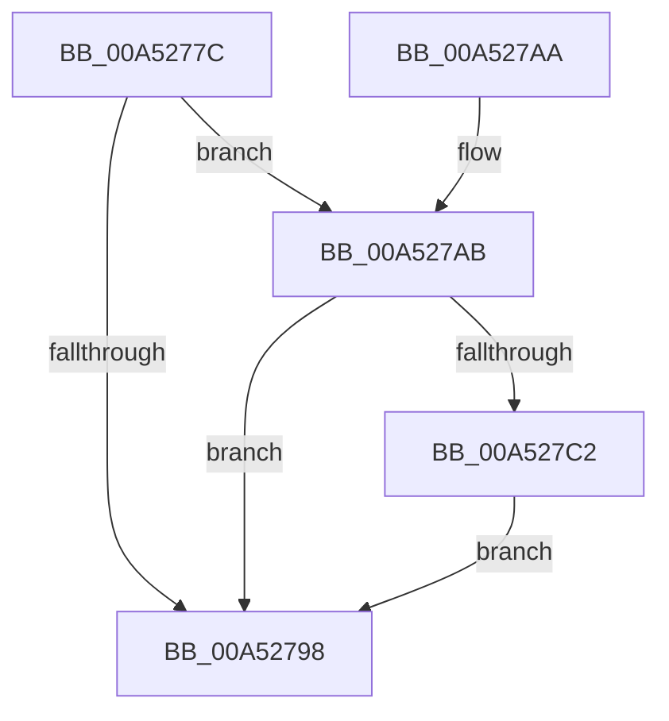

# PpmEventTracePpmProfileStatusRundown

- RVA: `0x00A5277C`–`0x00A52803` (길이 `135` bytes)
- VA: `0x0000000140A5277C`
- 실행 섹션: `PAGE`
- PDB 이름 있음: `예`; PDB Function 태그: `아니요`
- unwind 정보 RVA: `0x000ADEA0`
- 디코드: `29`개 명령, `135/135` bytes 표시
- 미해석 바이트: `0` (있으면 어셈블리에 `.byte`로 보존)

> 이 문서는 커널 이미지의 기계어와 PDB 기호를 분석해 생성했습니다. 4번과 5번은 함수 원형과 자료형을 바이너리 사용 방식에서 추정한 C 해석이며 원본 소스 복구 결과는 아닙니다.

## 1. Dependencies

- 직접 호출 지점: **3**; 고유 호출 대상: **3**
- 직접 호출자로 확인된 함수: **1**
- RIP 상대 이미지 참조: **5**

### Outgoing calls
- `0x00A527A0` → [_security_check_cookie](../../text/6A/_security_check_cookie_function_006AC640.md) (function, `0x006AC640`)
- `0x00A527B9` → [EtwEventEnabled](../../text/39/EtwEventEnabled_function_00392450.md) (function, `0x00392450`)
- `0x00A527FC` → [EtwWrite](../../text/41/EtwWrite_function_0041C720.md) (function, `0x0041C720`)

### Direct callers
- [PpmEventTraceControlCallback](PpmEventTraceControlCallback_function_00A51F60.md) at `0x00A52265`

### Static image references
- `0x00A52780` → RVA `0x00E0A740` (`.data`; read)
- `0x00A5278F` → RVA `0x00E67A39` (`.data`; read)
- `0x00A527AB` → RVA `0x00F083E8` (`.data`; read)
- `0x00A527B2` → RVA `0x0001A6B8` (`.rdata`; read)
- `0x00A527C7` → RVA `0x00F077A8` (`.data`; read)

## 2. Other-region calls and transfers

- 다른 실행 섹션으로 향하는 call: **3**
  - `0x00A527A0` → [_security_check_cookie](../../text/6A/_security_check_cookie_function_006AC640.md) (`PAGE` → `.text`)
  - `0x00A527B9` → [EtwEventEnabled](../../text/39/EtwEventEnabled_function_00392450.md) (`PAGE` → `.text`)
  - `0x00A527FC` → [EtwWrite](../../text/41/EtwWrite_function_0041C720.md) (`PAGE` → `.text`)
- 별도 외부 분기/꼬리 이동을 확인하지 못했습니다.

## 3. Assembly (complete function range)

```asm
00A5277C  48 83 EC 58                     sub rsp, 0x58
00A52780  48 8B 05 B9 7F 3B 00            mov rax, qword ptr [rip + 0x3b7fb9]
00A52787  48 33 C4                        xor rax, rsp
00A5278A  48 89 44 24 40                  mov qword ptr [rsp + 0x40], rax
00A5278F  80 3D A3 52 41 00 00            cmp byte ptr [rip + 0x4152a3], 0
00A52796  75 13                           jne 0x140a527ab
00A52798  48 8B 4C 24 40                  mov rcx, qword ptr [rsp + 0x40]
00A5279D  48 33 CC                        xor rcx, rsp
00A527A0  E8 9B 9E C5 FF                  call 0x1406ac640
00A527A5  48 83 C4 58                     add rsp, 0x58
00A527A9  C3                              ret
00A527AA  CC                              int3
00A527AB  48 8B 0D 36 5C 4B 00            mov rcx, qword ptr [rip + 0x4b5c36]
00A527B2  48 8D 15 FF 7E 5C FF            lea rdx, [rip - 0xa38101]
00A527B9  E8 92 FC 93 FF                  call 0x140392450
00A527BE  84 C0                           test al, al
00A527C0  74 D6                           je 0x140a52798
00A527C2  83 64 24 3C 00                  and dword ptr [rsp + 0x3c], 0
00A527C7  48 8D 05 DA 4F 4B 00            lea rax, [rip + 0x4b4fda]
00A527CE  48 8B 0D 13 5C 4B 00            mov rcx, qword ptr [rip + 0x4b5c13]
00A527D5  48 8D 15 DC 7E 5C FF            lea rdx, [rip - 0xa38124]
00A527DC  48 89 44 24 30                  mov qword ptr [rsp + 0x30], rax
00A527E1  41 B9 01 00 00 00               mov r9d, 1
00A527E7  48 8D 44 24 30                  lea rax, [rsp + 0x30]
00A527EC  C7 44 24 38 04 00 00 00         mov dword ptr [rsp + 0x38], 4
00A527F4  45 33 C0                        xor r8d, r8d
00A527F7  48 89 44 24 20                  mov qword ptr [rsp + 0x20], rax
00A527FC  E8 1F 9F 9C FF                  call 0x14041c720
00A52801  EB 95                           jmp 0x140a52798
```

## 4. C-style interpretation (structured pseudocode)

```c
__int64 __fastcall PpmEventTracePpmProfileStatusRundown(__int64 a1, __int64 a2, int a3)
{
    __int64 result;
    __int64 v_rsp;
    unsigned __int64 v_stack_m18;
    unsigned __int64 v_stack_p20;
    unsigned __int64 v_stack_p30;
    unsigned int v_stack_p38;
    unsigned int v_stack_p3C;

    v_rsp = (v_rsp) - (88);
    result = (*(unsigned __int64 *)(v_rip + 3899321)) ^ (v_rsp);
    v_stack_m18 = result;
    if ((*(unsigned __int8 *)(v_rip + 4280995)) != 0) goto loc_00A527AB;
loc_00A52798:
    a1 = (v_stack_m18) ^ (v_rsp);
    result = _security_check_cookie(a1, a2, a3, a4);
    v_rsp = (v_rsp) + (88);
    return result;
loc_00A527AB:
    result = EtwEventEnabled(*(unsigned __int64 *)(v_rip + 4938806), v_rip - 10715393, a3, a4);
    if ((unsigned __int8)(result) == 0) goto loc_00A52798;
    v_stack_p30 = v_rip + 4935642;
    v_stack_p38 = 4;
    a3 = 0;
    v_stack_p20 = v_stack_p30;
    result = EtwWrite(*(unsigned __int64 *)(v_rip + 4938771), v_rip - 10715428, a3, 1);
    goto loc_00A52798;
}
```

## 5. (Beta) C Style

```c
int64_t PpmEventTracePpmProfileStatusRundown(int64_t Arg1, int64_t Arg2, int32_t Arg3)
{
    int64_t result;
    int64_t local_rsp;
    uint64_t v_stack_m18;
    uint64_t v_stack_p20;
    uint64_t v_stack_p30;
    uint32_t v_stack_p38;
    uint32_t v_stack_p3C;

    local_rsp = (local_rsp) - (88);
    result = (*(uint64_t *)(v_rip + 0x3B7FB9)) ^ (local_rsp);
    v_stack_m18 = result;
    if ((*(uint8_t *)(v_rip + 0x4152A3)) != 0) goto loc_00A527AB;
loc_00A52798:
    Arg1 = (v_stack_m18) ^ (local_rsp);
    result = _security_check_cookie(Arg1, Arg2, Arg3, a4);
    local_rsp = (local_rsp) + (88);
    return result;
loc_00A527AB:
    result = EtwEventEnabled(*(uint64_t *)(v_rip + 0x4B5C36), v_rip - 10715393, Arg3, a4);
    if ((uint8_t)(result) == 0) goto loc_00A52798;
    v_stack_p30 = v_rip + 4935642;
    v_stack_p38 = 4;
    Arg3 = 0;
    v_stack_p20 = v_stack_p30;
    result = EtwWrite(*(uint64_t *)(v_rip + 0x4B5C13), v_rip - 10715428, Arg3, 1);
    goto loc_00A52798;
}
```

## 6. Execution-region graph

[열기: 2D/3D 그래프와 함수 탐색 컨트롤 패널](../../../control-panel.html?section=page&rva=0x00A5277C&view=graph)

- 2D 그래프는 위에서 아래로 흐르고, 3D 그래프는 빈 공간을 드래그해 회전합니다. Shift+드래그는 이동, 휠은 확대·축소, 함수 노드 선택은 대상 보고서 이동입니다.

### Static fallback


