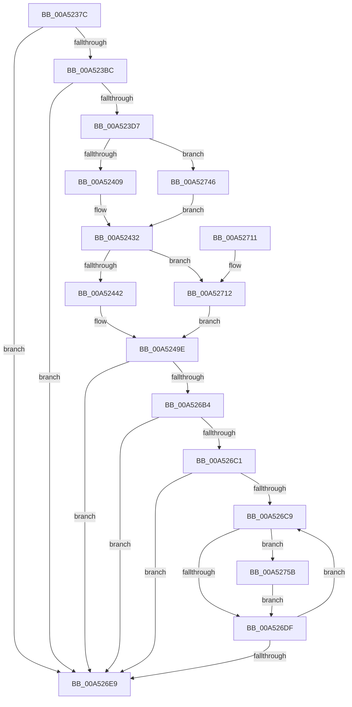

# PpmEventTraceProcessorPerformance

- RVA: `0x00A5237C`–`0x00A52773` (길이 `1,015` bytes)
- VA: `0x0000000140A5237C`
- 실행 섹션: `PAGE`
- PDB 이름 있음: `예`; PDB Function 태그: `아니요`
- unwind 정보 RVA: `0x000B0D10`
- 디코드: `200`개 명령, `1,015/1,015` bytes 표시
- 미해석 바이트: `0` (있으면 어셈블리에 `.byte`로 보존)

> 이 문서는 커널 이미지의 기계어와 PDB 기호를 분석해 생성했습니다. 4번과 5번은 함수 원형과 자료형을 바이너리 사용 방식에서 추정한 C 해석이며 원본 소스 복구 결과는 아닙니다.

## 1. Dependencies

- 직접 호출 지점: **4**; 고유 호출 대상: **4**
- 직접 호출자로 확인된 함수: **1**
- RIP 상대 이미지 참조: **4**

### Outgoing calls
- `0x00A523CA` → [EtwEventEnabled](../../text/39/EtwEventEnabled_function_00392450.md) (function, `0x00392450`)
- `0x00A526AA` → [EtwWrite](../../text/41/EtwWrite_function_0041C720.md) (function, `0x0041C720`)
- `0x00A526F3` → [_security_check_cookie](../../text/6A/_security_check_cookie_function_006AC640.md) (function, `0x006AC640`)
- `0x00A52769` → [PpmEventHiddenProcessorPerformance](../76/PpmEventHiddenProcessorPerformance_function_0076A424.md) (function, `0x0076A424`)

### Direct callers
- [PpmEventTraceControlCallback](PpmEventTraceControlCallback_function_00A51F60.md) at `0x00A5204A`

### Static image references
- `0x00A5239A` → RVA `0x00E0A740` (`.data`; read)
- `0x00A523B0` → RVA `0x00E67A39` (`.data`; read)
- `0x00A523BC` → RVA `0x00F083E8` (`.data`; read)
- `0x00A523C3` → RVA `0x0001A6A8` (`.rdata`; read)

## 2. Other-region calls and transfers

- 다른 실행 섹션으로 향하는 call: **3**
  - `0x00A523CA` → [EtwEventEnabled](../../text/39/EtwEventEnabled_function_00392450.md) (`PAGE` → `.text`)
  - `0x00A526AA` → [EtwWrite](../../text/41/EtwWrite_function_0041C720.md) (`PAGE` → `.text`)
  - `0x00A526F3` → [_security_check_cookie](../../text/6A/_security_check_cookie_function_006AC640.md) (`PAGE` → `.text`)
- 별도 외부 분기/꼬리 이동을 확인하지 못했습니다.

## 3. Assembly (complete function range)

```asm
00A5237C  48 8B C4                        mov rax, rsp
00A5237F  48 89 58 10                     mov qword ptr [rax + 0x10], rbx
00A52383  48 89 70 18                     mov qword ptr [rax + 0x18], rsi
00A52387  48 89 78 20                     mov qword ptr [rax + 0x20], rdi
00A5238B  55                              push rbp
00A5238C  48 8D A8 F8 FE FF FF            lea rbp, [rax - 0x108]
00A52393  48 81 EC 00 02 00 00            sub rsp, 0x200
00A5239A  48 8B 05 9F 83 3B 00            mov rax, qword ptr [rip + 0x3b839f]
00A523A1  48 33 C4                        xor rax, rsp
00A523A4  48 89 85 F0 00 00 00            mov qword ptr [rbp + 0xf0], rax
00A523AB  33 DB                           xor ebx, ebx
00A523AD  48 8B F1                        mov rsi, rcx
00A523B0  38 1D 83 56 41 00               cmp byte ptr [rip + 0x415683], bl
00A523B6  0F 84 2D 03 00 00               je 0x140a526e9
00A523BC  48 8B 0D 25 60 4B 00            mov rcx, qword ptr [rip + 0x4b6025]
00A523C3  48 8D 15 DE 82 5C FF            lea rdx, [rip - 0xa37d22]
00A523CA  E8 81 00 94 FF                  call 0x140392450
00A523CF  84 C0                           test al, al
00A523D1  0F 84 12 03 00 00               je 0x140a526e9
00A523D7  0F B6 86 0C 8A 00 00            movzx eax, byte ptr [rsi + 0x8a0c]
00A523DE  44 8D 4B 64                     lea r9d, [rbx + 0x64]
00A523E2  48 8B BE B0 89 00 00            mov rdi, qword ptr [rsi + 0x89b0]
00A523E9  48 8B 8E B8 89 00 00            mov rcx, qword ptr [rsi + 0x89b8]
00A523F0  89 44 24 70                     mov dword ptr [rsp + 0x70], eax
00A523F4  8B 86 44 8A 00 00               mov eax, dword ptr [rsi + 0x8a44]
00A523FA  89 44 24 74                     mov dword ptr [rsp + 0x74], eax
00A523FE  8B C3                           mov eax, ebx
00A52400  48 85 FF                        test rdi, rdi
00A52403  0F 84 3D 03 00 00               je 0x140a52746
00A52409  8B 97 C0 01 00 00               mov edx, dword ptr [rdi + 0x1c0]
00A5240F  89 54 24 44                     mov dword ptr [rsp + 0x44], edx
00A52413  38 9F 08 02 00 00               cmp byte ptr [rdi + 0x208], bl
00A52419  0F 95 C0                        setne al
00A5241C  89 44 24 58                     mov dword ptr [rsp + 0x58], eax
00A52420  0F B6 87 E8 01 00 00            movzx eax, byte ptr [rdi + 0x1e8]
00A52427  89 44 24 64                     mov dword ptr [rsp + 0x64], eax
00A5242B  0F B6 87 0B 02 00 00            movzx eax, byte ptr [rdi + 0x20b]
00A52432  89 44 24 7C                     mov dword ptr [rsp + 0x7c], eax
00A52436  44 8B C2                        mov r8d, edx
00A52439  48 85 C9                        test rcx, rcx
00A5243C  0F 84 D0 02 00 00               je 0x140a52712
00A52442  8B 41 18                        mov eax, dword ptr [rcx + 0x18]
00A52445  89 44 24 38                     mov dword ptr [rsp + 0x38], eax
00A52449  8B 41 1C                        mov eax, dword ptr [rcx + 0x1c]
00A5244C  89 44 24 3C                     mov dword ptr [rsp + 0x3c], eax
00A52450  8B 41 50                        mov eax, dword ptr [rcx + 0x50]
00A52453  89 44 24 40                     mov dword ptr [rsp + 0x40], eax
00A52457  8B 41 58                        mov eax, dword ptr [rcx + 0x58]
00A5245A  89 44 24 48                     mov dword ptr [rsp + 0x48], eax
00A5245E  8B 41 5C                        mov eax, dword ptr [rcx + 0x5c]
00A52461  89 44 24 4C                     mov dword ptr [rsp + 0x4c], eax
00A52465  8B 41 60                        mov eax, dword ptr [rcx + 0x60]
00A52468  89 44 24 50                     mov dword ptr [rsp + 0x50], eax
00A5246C  8B 41 64                        mov eax, dword ptr [rcx + 0x64]
00A5246F  89 44 24 5C                     mov dword ptr [rsp + 0x5c], eax
00A52473  8B 41 68                        mov eax, dword ptr [rcx + 0x68]
00A52476  89 44 24 60                     mov dword ptr [rsp + 0x60], eax
00A5247A  8B 41 54                        mov eax, dword ptr [rcx + 0x54]
00A5247D  89 44 24 68                     mov dword ptr [rsp + 0x68], eax
00A52481  8B 81 88 00 00 00               mov eax, dword ptr [rcx + 0x88]
00A52487  89 44 24 54                     mov dword ptr [rsp + 0x54], eax
00A5248B  B8 1F 85 EB 51                  mov eax, 0x51eb851f
00A52490  44 0F AF 81 84 00 00 00         imul r8d, dword ptr [rcx + 0x84]
00A52498  41 F7 E0                        mul r8d
00A5249B  C1 EA 05                        shr edx, 5
00A5249E  0F B6 86 D0 00 00 00            movzx eax, byte ptr [rsi + 0xd0]
00A524A5  66 89 44 24 34                  mov word ptr [rsp + 0x34], ax
00A524AA  8A 86 08 8A 00 00               mov al, byte ptr [rsi + 0x8a08]
00A524B0  88 44 24 30                     mov byte ptr [rsp + 0x30], al
00A524B4  48 8D 44 24 34                  lea rax, [rsp + 0x34]
00A524B9  48 89 45 80                     mov qword ptr [rbp - 0x80], rax
00A524BD  48 8D 86 D1 00 00 00            lea rax, [rsi + 0xd1]
00A524C4  48 89 45 90                     mov qword ptr [rbp - 0x70], rax
00A524C8  48 8D 44 24 70                  lea rax, [rsp + 0x70]
00A524CD  48 89 45 A0                     mov qword ptr [rbp - 0x60], rax
00A524D1  48 8D 44 24 38                  lea rax, [rsp + 0x38]
00A524D6  48 89 45 B0                     mov qword ptr [rbp - 0x50], rax
00A524DA  48 8D 44 24 3C                  lea rax, [rsp + 0x3c]
00A524DF  48 89 45 C0                     mov qword ptr [rbp - 0x40], rax
00A524E3  48 8D 44 24 40                  lea rax, [rsp + 0x40]
00A524E8  48 89 45 D0                     mov qword ptr [rbp - 0x30], rax
00A524EC  48 8D 44 24 44                  lea rax, [rsp + 0x44]
00A524F1  48 89 45 E0                     mov qword ptr [rbp - 0x20], rax
00A524F5  48 8D 44 24 48                  lea rax, [rsp + 0x48]
00A524FA  48 89 45 F0                     mov qword ptr [rbp - 0x10], rax
00A524FE  48 8D 44 24 4C                  lea rax, [rsp + 0x4c]
00A52503  48 89 45 00                     mov qword ptr [rbp], rax
00A52507  48 8D 44 24 50                  lea rax, [rsp + 0x50]
00A5250C  48 89 45 10                     mov qword ptr [rbp + 0x10], rax
00A52510  48 8D 44 24 54                  lea rax, [rsp + 0x54]
00A52515  48 89 45 20                     mov qword ptr [rbp + 0x20], rax
00A52519  48 8D 44 24 30                  lea rax, [rsp + 0x30]
00A5251E  48 89 45 30                     mov qword ptr [rbp + 0x30], rax
00A52522  8A 86 09 8A 00 00               mov al, byte ptr [rsi + 0x8a09]
00A52528  88 44 24 31                     mov byte ptr [rsp + 0x31], al
00A5252C  48 8D 44 24 31                  lea rax, [rsp + 0x31]
00A52531  48 89 45 40                     mov qword ptr [rbp + 0x40], rax
00A52535  48 8D 44 24 58                  lea rax, [rsp + 0x58]
00A5253A  48 89 45 50                     mov qword ptr [rbp + 0x50], rax
00A5253E  48 8D 44 24 5C                  lea rax, [rsp + 0x5c]
00A52543  48 89 45 60                     mov qword ptr [rbp + 0x60], rax
00A52547  48 8D 44 24 60                  lea rax, [rsp + 0x60]
00A5254C  48 89 45 70                     mov qword ptr [rbp + 0x70], rax
00A52550  48 8D 44 24 74                  lea rax, [rsp + 0x74]
00A52555  48 89 85 80 00 00 00            mov qword ptr [rbp + 0x80], rax
00A5255C  48 8D 44 24 64                  lea rax, [rsp + 0x64]
00A52561  48 89 85 90 00 00 00            mov qword ptr [rbp + 0x90], rax
00A52568  8A 86 0A 8A 00 00               mov al, byte ptr [rsi + 0x8a0a]
00A5256E  88 44 24 32                     mov byte ptr [rsp + 0x32], al
00A52572  48 8D 44 24 32                  lea rax, [rsp + 0x32]
00A52577  48 89 85 A0 00 00 00            mov qword ptr [rbp + 0xa0], rax
00A5257E  48 8D 44 24 68                  lea rax, [rsp + 0x68]
00A52583  48 89 85 B0 00 00 00            mov qword ptr [rbp + 0xb0], rax
00A5258A  0F B6 86 0D 8A 00 00            movzx eax, byte ptr [rsi + 0x8a0d]
00A52591  89 44 24 78                     mov dword ptr [rsp + 0x78], eax
00A52595  48 8D 44 24 78                  lea rax, [rsp + 0x78]
00A5259A  48 89 85 C0 00 00 00            mov qword ptr [rbp + 0xc0], rax
00A525A1  48 8D 44 24 6C                  lea rax, [rsp + 0x6c]
00A525A6  48 89 85 D0 00 00 00            mov qword ptr [rbp + 0xd0], rax
00A525AD  48 8D 44 24 7C                  lea rax, [rsp + 0x7c]
00A525B2  48 89 85 E0 00 00 00            mov qword ptr [rbp + 0xe0], rax
00A525B9  48 8D 45 80                     lea rax, [rbp - 0x80]
00A525BD  89 54 24 6C                     mov dword ptr [rsp + 0x6c], edx
00A525C1  48 C7 45 88 02 00 00 00         mov qword ptr [rbp - 0x78], 2
00A525C9  48 C7 45 98 01 00 00 00         mov qword ptr [rbp - 0x68], 1
00A525D1  48 C7 45 A8 04 00 00 00         mov qword ptr [rbp - 0x58], 4
00A525D9  48 C7 45 B8 04 00 00 00         mov qword ptr [rbp - 0x48], 4
00A525E1  48 C7 45 C8 04 00 00 00         mov qword ptr [rbp - 0x38], 4
00A525E9  48 C7 45 D8 04 00 00 00         mov qword ptr [rbp - 0x28], 4
00A525F1  48 C7 45 E8 04 00 00 00         mov qword ptr [rbp - 0x18], 4
00A525F9  48 C7 45 F8 04 00 00 00         mov qword ptr [rbp - 8], 4
00A52601  48 C7 45 08 04 00 00 00         mov qword ptr [rbp + 8], 4
00A52609  48 C7 45 18 04 00 00 00         mov qword ptr [rbp + 0x18], 4
00A52611  48 C7 45 28 04 00 00 00         mov qword ptr [rbp + 0x28], 4
00A52619  48 C7 45 38 01 00 00 00         mov qword ptr [rbp + 0x38], 1
00A52621  48 C7 45 48 01 00 00 00         mov qword ptr [rbp + 0x48], 1
00A52629  48 C7 45 58 04 00 00 00         mov qword ptr [rbp + 0x58], 4
00A52631  48 C7 45 68 04 00 00 00         mov qword ptr [rbp + 0x68], 4
00A52639  48 C7 45 78 04 00 00 00         mov qword ptr [rbp + 0x78], 4
00A52641  48 C7 85 88 00 00 00 04 00 00 00  mov qword ptr [rbp + 0x88], 4
00A5264C  48 C7 85 98 00 00 00 04 00 00 00  mov qword ptr [rbp + 0x98], 4
00A52657  48 C7 85 A8 00 00 00 01 00 00 00  mov qword ptr [rbp + 0xa8], 1
00A52662  48 C7 85 B8 00 00 00 04 00 00 00  mov qword ptr [rbp + 0xb8], 4
00A5266D  48 C7 85 C8 00 00 00 04 00 00 00  mov qword ptr [rbp + 0xc8], 4
00A52678  48 C7 85 D8 00 00 00 04 00 00 00  mov qword ptr [rbp + 0xd8], 4
00A52683  48 C7 85 E8 00 00 00 04 00 00 00  mov qword ptr [rbp + 0xe8], 4
00A5268E  48 8B 0D 53 5D 4B 00            mov rcx, qword ptr [rip + 0x4b5d53]
00A52695  48 8D 15 0C 80 5C FF            lea rdx, [rip - 0xa37ff4]
00A5269C  41 B9 17 00 00 00               mov r9d, 0x17
00A526A2  48 89 44 24 20                  mov qword ptr [rsp + 0x20], rax
00A526A7  45 33 C0                        xor r8d, r8d
00A526AA  E8 71 A0 9C FF                  call 0x14041c720
00A526AF  48 85 FF                        test rdi, rdi
00A526B2  74 35                           je 0x140a526e9
00A526B4  48 8D 86 B0 89 00 00            lea rax, [rsi + 0x89b0]
00A526BB  48 39 47 10                     cmp qword ptr [rdi + 0x10], rax
00A526BF  75 28                           jne 0x140a526e9
00A526C1  39 9F 28 01 00 00               cmp dword ptr [rdi + 0x128], ebx
00A526C7  76 20                           jbe 0x140a526e9
00A526C9  8B C3                           mov eax, ebx
00A526CB  48 69 D0 A8 04 00 00            imul rdx, rax, 0x4a8
00A526D2  48 03 97 38 01 00 00            add rdx, qword ptr [rdi + 0x138]
00A526D9  83 7A 10 02                     cmp dword ptr [rdx + 0x10], 2
00A526DD  74 7C                           je 0x140a5275b
00A526DF  FF C3                           inc ebx
00A526E1  3B 9F 28 01 00 00               cmp ebx, dword ptr [rdi + 0x128]
00A526E7  72 E0                           jb 0x140a526c9
00A526E9  48 8B 8D F0 00 00 00            mov rcx, qword ptr [rbp + 0xf0]
00A526F0  48 33 CC                        xor rcx, rsp
00A526F3  E8 48 9F C5 FF                  call 0x1406ac640
00A526F8  4C 8D 9C 24 00 02 00 00         lea r11, [rsp + 0x200]
00A52700  49 8B 5B 18                     mov rbx, qword ptr [r11 + 0x18]
00A52704  49 8B 73 20                     mov rsi, qword ptr [r11 + 0x20]
00A52708  49 8B 7B 28                     mov rdi, qword ptr [r11 + 0x28]
00A5270C  49 8B E3                        mov rsp, r11
00A5270F  5D                              pop rbp
00A52710  C3                              ret
00A52711  CC                              int3
00A52712  44 89 4C 24 38                  mov dword ptr [rsp + 0x38], r9d
00A52717  44 89 4C 24 3C                  mov dword ptr [rsp + 0x3c], r9d
00A5271C  44 89 4C 24 40                  mov dword ptr [rsp + 0x40], r9d
00A52721  44 89 4C 24 48                  mov dword ptr [rsp + 0x48], r9d
00A52726  44 89 4C 24 4C                  mov dword ptr [rsp + 0x4c], r9d
00A5272B  44 89 4C 24 50                  mov dword ptr [rsp + 0x50], r9d
00A52730  89 5C 24 5C                     mov dword ptr [rsp + 0x5c], ebx
00A52734  89 5C 24 60                     mov dword ptr [rsp + 0x60], ebx
00A52738  89 54 24 68                     mov dword ptr [rsp + 0x68], edx
00A5273C  44 89 4C 24 54                  mov dword ptr [rsp + 0x54], r9d
00A52741  E9 58 FD FF FF                  jmp 0x140a5249e
00A52746  8B 56 44                        mov edx, dword ptr [rsi + 0x44]
00A52749  89 54 24 44                     mov dword ptr [rsp + 0x44], edx
00A5274D  89 5C 24 58                     mov dword ptr [rsp + 0x58], ebx
00A52751  44 89 4C 24 64                  mov dword ptr [rsp + 0x64], r9d
00A52756  E9 D7 FC FF FF                  jmp 0x140a52432
00A5275B  44 8B 4A 1C                     mov r9d, dword ptr [rdx + 0x1c]
00A5275F  48 8B CE                        mov rcx, rsi
00A52762  44 8B 42 18                     mov r8d, dword ptr [rdx + 0x18]
00A52766  8B 52 14                        mov edx, dword ptr [rdx + 0x14]
00A52769  E8 B6 7C D1 FF                  call 0x14076a424
00A5276E  E9 6C FF FF FF                  jmp 0x140a526df
```

## 4. C-style interpretation (structured pseudocode)

```c
__int64 __fastcall PpmEventTraceProcessorPerformance(__int64 a1)
{
    __int64 result;
    __int64 v_rbx;
    __int64 v_rsp;
    unsigned int v_stack_m18C;
    unsigned int v_stack_m190;
    unsigned int v_stack_m194;
    unsigned int v_stack_m198;
    unsigned __int64 v_stack_m19C;
    unsigned int v_stack_m1A0;
    unsigned int v_stack_m1A4;
    unsigned int v_stack_m1A8;
    unsigned int v_stack_m1AC;
    unsigned int v_stack_m1B0;
    unsigned int v_stack_m1B4;
    unsigned int v_stack_m1B8;
    unsigned int v_stack_m1BC;
    unsigned int v_stack_m1C0;
    unsigned int v_stack_m1C4;
    unsigned int v_stack_m1C8;
    unsigned int v_stack_m1CC;
    unsigned int v_stack_m1D0;
    unsigned __int16 v_stack_m1D4;
    unsigned __int8 v_stack_m1D6;
    unsigned __int8 v_stack_m1D7;
    unsigned __int8 v_stack_m1D8;
    unsigned __int64 v_stack_m1E8;
    unsigned __int64 v_stack_m8;

    *(unsigned __int64 *)(v_rsp + 16) = v_rbx;
    *(unsigned __int64 *)(v_rsp + 24) = v_rsi;
    *(unsigned __int64 *)(v_rsp + 32) = v_rdi;
    v_rsp = (v_rsp) - (512);
    result = (*(unsigned __int64 *)(v_rip + 3900319)) ^ (v_rsp);
    *(unsigned __int64 *)(v_rsp - 264 + 240) = result;
    v_rbx = 0;
    if ((*(unsigned __int8 *)(v_rip + 4281987)) == 0) goto loc_00A526E9;
    result = EtwEventEnabled(*(unsigned __int64 *)(v_rip + 4939813), v_rip - 10714402, a3, a4);
    if ((unsigned __int8)(result) == 0) goto loc_00A526E9;
    v_stack_m198 = (unsigned int)(*(unsigned __int8 *)(a1 + 35340));
    v_stack_m194 = (unsigned int)((unsigned int)(*(unsigned int *)(a1 + 35396)));
    if (*(unsigned __int64 *)(a1 + 35248) == 0) goto loc_00A52746;
    v_stack_m1C4 = (unsigned int)((unsigned int)(*(unsigned int *)(*(unsigned __int64 *)(a1 + 35248) + 448)));
    result = ((*(unsigned __int8 *)(*(unsigned __int64 *)(a1 + 35248) + 520)) != 0) ? 1 : 0;
    v_stack_m1B0 = (unsigned int)(result);
    v_stack_m1A4 = (unsigned int)(*(unsigned __int8 *)(*(unsigned __int64 *)(a1 + 35248) + 488));
loc_00A52432:
    v_stack_m18C = (unsigned int)(*(unsigned __int8 *)(*(unsigned __int64 *)(a1 + 35248) + 523));
    if (*(unsigned __int64 *)(a1 + 35256) == 0) goto loc_00A52712;
    v_stack_m1D0 = (unsigned int)((unsigned int)(*(unsigned int *)(*(unsigned __int64 *)(a1 + 35256) + 24)));
    v_stack_m1CC = (unsigned int)((unsigned int)(*(unsigned int *)(*(unsigned __int64 *)(a1 + 35256) + 28)));
    v_stack_m1C8 = (unsigned int)((unsigned int)(*(unsigned int *)(*(unsigned __int64 *)(a1 + 35256) + 80)));
    v_stack_m1C0 = (unsigned int)((unsigned int)(*(unsigned int *)(*(unsigned __int64 *)(a1 + 35256) + 88)));
    v_stack_m1BC = (unsigned int)((unsigned int)(*(unsigned int *)(*(unsigned __int64 *)(a1 + 35256) + 92)));
    v_stack_m1B8 = (unsigned int)((unsigned int)(*(unsigned int *)(*(unsigned __int64 *)(a1 + 35256) + 96)));
    v_stack_m1AC = (unsigned int)((unsigned int)(*(unsigned int *)(*(unsigned __int64 *)(a1 + 35256) + 100)));
    v_stack_m1A8 = (unsigned int)((unsigned int)(*(unsigned int *)(*(unsigned __int64 *)(a1 + 35256) + 104)));
    v_stack_m1A0 = (unsigned int)((unsigned int)(*(unsigned int *)(*(unsigned __int64 *)(a1 + 35256) + 84)));
    v_stack_m1B4 = (unsigned int)((unsigned int)(*(unsigned int *)(*(unsigned __int64 *)(a1 + 35256) + 136)));
    a3 = (unsigned int)(((unsigned int)((unsigned int)((unsigned int)(*(unsigned int *)(*(unsigned __int64 *)(a1 + 35248) + 448))))) * (*(unsigned int *)(*(unsigned __int64 *)(a1 + 35256) + 132)));
    a2 = (unsigned int)(((unsigned int)(*(unsigned int *)(*(unsigned __int64 *)(a1 + 35248) + 448))) >> (5));
loc_00A5249E:
    v_stack_m1D4 = (unsigned __int16)(*(unsigned __int8 *)(a1 + 208));
    v_stack_m1D8 = (unsigned __int8)(*(unsigned __int8 *)(a1 + 35336));
    *(unsigned __int64 *)(v_rsp - 264 - 128) = v_stack_m1D4;
    *(unsigned __int64 *)(v_rsp - 264 - 112) = a1 + 209;
    *(unsigned __int64 *)(v_rsp - 264 - 96) = v_stack_m198;
    *(unsigned __int64 *)(v_rsp - 264 - 80) = v_stack_m1D0;
    *(unsigned __int64 *)(v_rsp - 264 - 64) = v_stack_m1CC;
    *(unsigned __int64 *)(v_rsp - 264 - 48) = v_stack_m1C8;
    *(unsigned __int64 *)(v_rsp - 264 - 32) = v_stack_m1C4;
    *(unsigned __int64 *)(v_rsp - 264 - 16) = v_stack_m1C0;
    *(unsigned __int64 *)(v_rsp - 264) = v_stack_m1BC;
    *(unsigned __int64 *)(v_rsp - 264 + 16) = v_stack_m1B8;
    *(unsigned __int64 *)(v_rsp - 264 + 32) = v_stack_m1B4;
    *(unsigned __int64 *)(v_rsp - 264 + 48) = v_stack_m1D8;
    v_stack_m1D7 = (unsigned __int8)(*(unsigned __int8 *)(a1 + 35337));
    *(unsigned __int64 *)(v_rsp - 264 + 64) = v_stack_m1D7;
    *(unsigned __int64 *)(v_rsp - 264 + 80) = v_stack_m1B0;
    *(unsigned __int64 *)(v_rsp - 264 + 96) = v_stack_m1AC;
    *(unsigned __int64 *)(v_rsp - 264 + 112) = v_stack_m1A8;
    *(unsigned __int64 *)(v_rsp - 264 + 128) = v_stack_m194;
    *(unsigned __int64 *)(v_rsp - 264 + 144) = v_stack_m1A4;
    v_stack_m1D6 = (unsigned __int8)(*(unsigned __int8 *)(a1 + 35338));
    *(unsigned __int64 *)(v_rsp - 264 + 160) = v_stack_m1D6;
    *(unsigned __int64 *)(v_rsp - 264 + 176) = v_stack_m1A0;
    v_stack_m190 = (unsigned int)(*(unsigned __int8 *)(a1 + 35341));
    *(unsigned __int64 *)(v_rsp - 264 + 192) = v_stack_m190;
    *(unsigned __int64 *)(v_rsp - 264 + 208) = v_stack_m19C;
    *(unsigned __int64 *)(v_rsp - 264 + 224) = v_stack_m18C;
    v_stack_m19C = (unsigned int)(a2);
    *(unsigned __int64 *)(v_rsp - 264 - 120) = 2;
    *(unsigned __int64 *)(v_rsp - 264 - 104) = 1;
    *(unsigned __int64 *)(v_rsp - 264 - 88) = 4;
    *(unsigned __int64 *)(v_rsp - 264 - 72) = 4;
    *(unsigned __int64 *)(v_rsp - 264 - 56) = 4;
    *(unsigned __int64 *)(v_rsp - 264 - 40) = 4;
    *(unsigned __int64 *)(v_rsp - 264 - 24) = 4;
    *(unsigned __int64 *)(v_rsp - 264 - 8) = 4;
    *(unsigned __int64 *)(v_rsp - 264 + 8) = 4;
    *(unsigned __int64 *)(v_rsp - 264 + 24) = 4;
    *(unsigned __int64 *)(v_rsp - 264 + 40) = 4;
    *(unsigned __int64 *)(v_rsp - 264 + 56) = 1;
    *(unsigned __int64 *)(v_rsp - 264 + 72) = 1;
    *(unsigned __int64 *)(v_rsp - 264 + 88) = 4;
    *(unsigned __int64 *)(v_rsp - 264 + 104) = 4;
    *(unsigned __int64 *)(v_rsp - 264 + 120) = 4;
    *(unsigned __int64 *)(v_rsp - 264 + 136) = 4;
    *(unsigned __int64 *)(v_rsp - 264 + 152) = 4;
    *(unsigned __int64 *)(v_rsp - 264 + 168) = 1;
    *(unsigned __int64 *)(v_rsp - 264 + 184) = 4;
    *(unsigned __int64 *)(v_rsp - 264 + 200) = 4;
    *(unsigned __int64 *)(v_rsp - 264 + 216) = 4;
    *(unsigned __int64 *)(v_rsp - 264 + 232) = 4;
    v_stack_m1E8 = v_rsp - 264 - 128;
    a3 = 0;
    result = EtwWrite(*(unsigned __int64 *)(v_rip + 4939091), v_rip - 10715124, a3, 23);
    if (*(unsigned __int64 *)(a1 + 35248) == 0) goto loc_00A526E9;
    if ((*(unsigned __int64 *)(*(unsigned __int64 *)(a1 + 35248) + 16)) != (a1 + 35248)) goto loc_00A526E9;
    if ((*(unsigned int *)(*(unsigned __int64 *)(a1 + 35248) + 296)) <= 0) goto loc_00A526E9;
loc_00A526C9:
    a2 = (v_rip - 10715124) * (0);
    a2 = (a2) + (*(unsigned __int64 *)(*(unsigned __int64 *)(a1 + 35248) + 312));
    if ((*(unsigned int *)(a2 + 16)) == 2) goto loc_00A5275B;
loc_00A526DF:
    v_rbx = (unsigned int)((v_rbx) + 1);
    if (((unsigned int)(v_rbx)) < (*(unsigned int *)(*(unsigned __int64 *)(a1 + 35248) + 296))) goto loc_00A526C9;
loc_00A526E9:
    a1 = (*(unsigned __int64 *)(v_rsp - 264 + 240)) ^ (v_rsp);
    result = _security_check_cookie(a1, a2, a3, 23);
    return result;
loc_00A52712:
    v_stack_m1C8 = 23;
    v_stack_m1C4 = 23;
    v_stack_m1C0 = 23;
    v_stack_m1B8 = 23;
    v_stack_m1B4 = 23;
    v_stack_m1B0 = 23;
    v_stack_m1A4 = (unsigned int)(*(unsigned __int64 *)(v_stack_m8 + 24));
    v_stack_m1A0 = (unsigned int)(*(unsigned __int64 *)(v_stack_m8 + 24));
    v_stack_m198 = (unsigned int)(a2);
    v_stack_m1AC = 23;
    goto loc_00A5249E;
loc_00A52746:
    v_stack_m1BC = (unsigned int)((unsigned int)(*(unsigned int *)(*(unsigned __int64 *)(v_stack_m8 + 32) + 68)));
    v_stack_m1A8 = (unsigned int)(*(unsigned __int64 *)(v_stack_m8 + 24));
    v_stack_m19C = 23;
    goto loc_00A52432;
loc_00A5275B:
    result = PpmEventHiddenProcessorPerformance(*(unsigned __int64 *)(v_stack_m8 + 32), (unsigned int)(*(unsigned int *)((unsigned int)(*(unsigned int *)(*(unsigned __int64 *)(v_stack_m8 + 32) + 68)) + 20)), (unsigned int)(*(unsigned int *)((unsigned int)(*(unsigned int *)(*(unsigned __int64 *)(v_stack_m8 + 32) + 68)) + 24)), (unsigned int)(*(unsigned int *)((unsigned int)(*(unsigned int *)(*(unsigned __int64 *)(v_stack_m8 + 32) + 68)) + 28)));
    goto loc_00A526DF;
}
```

## 5. (Beta) C Style

```c
int64_t PpmEventTraceProcessorPerformance(void *Arg1)
{
    uint8_t *arg1 = (uint8_t *)Arg1;

    int64_t result;
    int64_t local_rbx;
    int64_t local_rsp;
    uint32_t v_stack_m18C;
    uint32_t v_stack_m190;
    uint32_t v_stack_m194;
    uint32_t v_stack_m198;
    uint64_t v_stack_m19C;
    uint32_t v_stack_m1A0;
    uint32_t v_stack_m1A4;
    uint32_t v_stack_m1A8;
    uint32_t v_stack_m1AC;
    uint32_t v_stack_m1B0;
    uint32_t v_stack_m1B4;
    uint32_t v_stack_m1B8;
    uint32_t v_stack_m1BC;
    uint32_t v_stack_m1C0;
    uint32_t v_stack_m1C4;
    uint32_t v_stack_m1C8;
    uint32_t v_stack_m1CC;
    uint32_t v_stack_m1D0;
    uint16_t v_stack_m1D4;
    uint8_t v_stack_m1D6;
    uint8_t v_stack_m1D7;
    uint8_t v_stack_m1D8;
    uint64_t v_stack_m1E8;
    uint64_t v_stack_m8;

    *(uint64_t *)(local_rsp + 0x10) = local_rbx;
    *(uint64_t *)(local_rsp + 0x18) = local_rsi;
    *(uint64_t *)(local_rsp + 0x20) = local_rdi;
    local_rsp = (local_rsp) - (512);
    result = (*(uint64_t *)(v_rip + 0x3B839F)) ^ (local_rsp);
    *(uint64_t *)(local_rsp - 0x108 + 0xF0) = result;
    local_rbx = 0;
    if ((*(uint8_t *)(v_rip + 0x415683)) == 0) goto loc_00A526E9;
    result = EtwEventEnabled(*(uint64_t *)(v_rip + 0x4B6025), v_rip - 10714402, a3, a4);
    if ((uint8_t)(result) == 0) goto loc_00A526E9;
    v_stack_m198 = (uint32_t)(*(uint8_t *)(arg1 + 0x8A0C));
    v_stack_m194 = (uint32_t)((uint32_t)(*(uint32_t *)(arg1 + 0x8A44)));
    if (*(uint64_t *)(arg1 + 0x89B0) == 0) goto loc_00A52746;
    v_stack_m1C4 = (uint32_t)((uint32_t)(*(uint32_t *)(*(uint64_t *)(arg1 + 0x89B0) + 0x1C0)));
    result = ((*(uint8_t *)(*(uint64_t *)(arg1 + 0x89B0) + 0x208)) != 0) ? 1 : 0;
    v_stack_m1B0 = (uint32_t)(result);
    v_stack_m1A4 = (uint32_t)(*(uint8_t *)(*(uint64_t *)(arg1 + 0x89B0) + 0x1E8));
loc_00A52432:
    v_stack_m18C = (uint32_t)(*(uint8_t *)(*(uint64_t *)(arg1 + 0x89B0) + 0x20B));
    if (*(uint64_t *)(arg1 + 0x89B8) == 0) goto loc_00A52712;
    v_stack_m1D0 = (uint32_t)((uint32_t)(*(uint32_t *)(*(uint64_t *)(arg1 + 0x89B8) + 0x18)));
    v_stack_m1CC = (uint32_t)((uint32_t)(*(uint32_t *)(*(uint64_t *)(arg1 + 0x89B8) + 0x1C)));
    v_stack_m1C8 = (uint32_t)((uint32_t)(*(uint32_t *)(*(uint64_t *)(arg1 + 0x89B8) + 0x50)));
    v_stack_m1C0 = (uint32_t)((uint32_t)(*(uint32_t *)(*(uint64_t *)(arg1 + 0x89B8) + 0x58)));
    v_stack_m1BC = (uint32_t)((uint32_t)(*(uint32_t *)(*(uint64_t *)(arg1 + 0x89B8) + 0x5C)));
    v_stack_m1B8 = (uint32_t)((uint32_t)(*(uint32_t *)(*(uint64_t *)(arg1 + 0x89B8) + 0x60)));
    v_stack_m1AC = (uint32_t)((uint32_t)(*(uint32_t *)(*(uint64_t *)(arg1 + 0x89B8) + 0x64)));
    v_stack_m1A8 = (uint32_t)((uint32_t)(*(uint32_t *)(*(uint64_t *)(arg1 + 0x89B8) + 0x68)));
    v_stack_m1A0 = (uint32_t)((uint32_t)(*(uint32_t *)(*(uint64_t *)(arg1 + 0x89B8) + 0x54)));
    v_stack_m1B4 = (uint32_t)((uint32_t)(*(uint32_t *)(*(uint64_t *)(arg1 + 0x89B8) + 0x88)));
    a3 = (uint32_t)(((uint32_t)((uint32_t)((uint32_t)(*(uint32_t *)(*(uint64_t *)(arg1 + 0x89B0) + 0x1C0))))) * (*(uint32_t *)(*(uint64_t *)(arg1 + 0x89B8) + 0x84)));
    a2 = (uint32_t)(((uint32_t)(*(uint32_t *)(*(uint64_t *)(arg1 + 0x89B0) + 0x1C0))) >> (5));
loc_00A5249E:
    v_stack_m1D4 = (uint16_t)(*(uint8_t *)(arg1 + 0xD0));
    v_stack_m1D8 = (uint8_t)(*(uint8_t *)(arg1 + 0x8A08));
    *(uint64_t *)(local_rsp - 0x108 - 0x80) = v_stack_m1D4;
    *(void **)(local_rsp - 0x108 - 0x70) = Arg1 + 209;
    *(uint64_t *)(local_rsp - 0x108 - 0x60) = v_stack_m198;
    *(uint64_t *)(local_rsp - 0x108 - 0x50) = v_stack_m1D0;
    *(uint64_t *)(local_rsp - 0x108 - 0x40) = v_stack_m1CC;
    *(uint64_t *)(local_rsp - 0x108 - 0x30) = v_stack_m1C8;
    *(uint64_t *)(local_rsp - 0x108 - 0x20) = v_stack_m1C4;
    *(uint64_t *)(local_rsp - 0x108 - 0x10) = v_stack_m1C0;
    *(uint64_t *)(local_rsp - 0x108) = v_stack_m1BC;
    *(uint64_t *)(local_rsp - 0x108 + 0x10) = v_stack_m1B8;
    *(uint64_t *)(local_rsp - 0x108 + 0x20) = v_stack_m1B4;
    *(uint64_t *)(local_rsp - 0x108 + 0x30) = v_stack_m1D8;
    v_stack_m1D7 = (uint8_t)(*(uint8_t *)(arg1 + 0x8A09));
    *(uint64_t *)(local_rsp - 0x108 + 0x40) = v_stack_m1D7;
    *(uint64_t *)(local_rsp - 0x108 + 0x50) = v_stack_m1B0;
    *(uint64_t *)(local_rsp - 0x108 + 0x60) = v_stack_m1AC;
    *(uint64_t *)(local_rsp - 0x108 + 0x70) = v_stack_m1A8;
    *(uint64_t *)(local_rsp - 0x108 + 0x80) = v_stack_m194;
    *(uint64_t *)(local_rsp - 0x108 + 0x90) = v_stack_m1A4;
    v_stack_m1D6 = (uint8_t)(*(uint8_t *)(arg1 + 0x8A0A));
    *(uint64_t *)(local_rsp - 0x108 + 0xA0) = v_stack_m1D6;
    *(uint64_t *)(local_rsp - 0x108 + 0xB0) = v_stack_m1A0;
    v_stack_m190 = (uint32_t)(*(uint8_t *)(arg1 + 0x8A0D));
    *(uint64_t *)(local_rsp - 0x108 + 0xC0) = v_stack_m190;
    *(uint64_t *)(local_rsp - 0x108 + 0xD0) = v_stack_m19C;
    *(uint64_t *)(local_rsp - 0x108 + 0xE0) = v_stack_m18C;
    v_stack_m19C = (uint32_t)(a2);
    *(uint64_t *)(local_rsp - 0x108 - 0x78) = 2;
    *(uint64_t *)(local_rsp - 0x108 - 0x68) = 1;
    *(uint64_t *)(local_rsp - 0x108 - 0x58) = 4;
    *(uint64_t *)(local_rsp - 0x108 - 0x48) = 4;
    *(uint64_t *)(local_rsp - 0x108 - 0x38) = 4;
    *(uint64_t *)(local_rsp - 0x108 - 0x28) = 4;
    *(uint64_t *)(local_rsp - 0x108 - 0x18) = 4;
    *(uint64_t *)(local_rsp - 0x108 - 0x8) = 4;
    *(uint64_t *)(local_rsp - 0x108 + 0x8) = 4;
    *(uint64_t *)(local_rsp - 0x108 + 0x18) = 4;
    *(uint64_t *)(local_rsp - 0x108 + 0x28) = 4;
    *(uint64_t *)(local_rsp - 0x108 + 0x38) = 1;
    *(uint64_t *)(local_rsp - 0x108 + 0x48) = 1;
    *(uint64_t *)(local_rsp - 0x108 + 0x58) = 4;
    *(uint64_t *)(local_rsp - 0x108 + 0x68) = 4;
    *(uint64_t *)(local_rsp - 0x108 + 0x78) = 4;
    *(uint64_t *)(local_rsp - 0x108 + 0x88) = 4;
    *(uint64_t *)(local_rsp - 0x108 + 0x98) = 4;
    *(uint64_t *)(local_rsp - 0x108 + 0xA8) = 1;
    *(uint64_t *)(local_rsp - 0x108 + 0xB8) = 4;
    *(uint64_t *)(local_rsp - 0x108 + 0xC8) = 4;
    *(uint64_t *)(local_rsp - 0x108 + 0xD8) = 4;
    *(uint64_t *)(local_rsp - 0x108 + 0xE8) = 4;
    v_stack_m1E8 = local_rsp - 264 - 128;
    a3 = 0;
    result = EtwWrite(*(uint64_t *)(v_rip + 0x4B5D53), v_rip - 10715124, a3, 23);
    if (*(uint64_t *)(arg1 + 0x89B0) == 0) goto loc_00A526E9;
    if ((*(uint64_t *)(*(uint64_t *)(arg1 + 0x89B0) + 0x10)) != (Arg1 + 35248)) goto loc_00A526E9;
    if ((*(uint32_t *)(*(uint64_t *)(arg1 + 0x89B0) + 0x128)) <= 0) goto loc_00A526E9;
loc_00A526C9:
    a2 = (v_rip - 10715124) * (0);
    a2 = (a2) + (*(uint64_t *)(*(uint64_t *)(arg1 + 0x89B0) + 0x138));
    if ((*(uint32_t *)(a2 + 0x10)) == 2) goto loc_00A5275B;
loc_00A526DF:
    local_rbx = (uint32_t)((local_rbx) + 1);
    if (((uint32_t)(local_rbx)) < (*(uint32_t *)(*(uint64_t *)(arg1 + 0x89B0) + 0x128))) goto loc_00A526C9;
loc_00A526E9:
    Arg1 = (*(uint64_t *)(local_rsp - 0x108 + 0xF0)) ^ (local_rsp);
    result = _security_check_cookie(Arg1, a2, a3, 23);
    return result;
loc_00A52712:
    v_stack_m1C8 = 23;
    v_stack_m1C4 = 23;
    v_stack_m1C0 = 23;
    v_stack_m1B8 = 23;
    v_stack_m1B4 = 23;
    v_stack_m1B0 = 23;
    v_stack_m1A4 = (uint32_t)(*(uint64_t *)(v_stack_m8 + 0x18));
    v_stack_m1A0 = (uint32_t)(*(uint64_t *)(v_stack_m8 + 0x18));
    v_stack_m198 = (uint32_t)(a2);
    v_stack_m1AC = 23;
    goto loc_00A5249E;
loc_00A52746:
    v_stack_m1BC = (uint32_t)((uint32_t)(*(uint32_t *)(*(uint64_t *)(v_stack_m8 + 0x20) + 0x44)));
    v_stack_m1A8 = (uint32_t)(*(uint64_t *)(v_stack_m8 + 0x18));
    v_stack_m19C = 23;
    goto loc_00A52432;
loc_00A5275B:
    result = PpmEventHiddenProcessorPerformance(*(uint64_t *)(v_stack_m8 + 0x20), (uint32_t)(*(uint32_t *)((uint32_t)(*(uint32_t *)(*(uint64_t *)(v_stack_m8 + 0x20) + 0x44)) + 0x14)), (uint32_t)(*(uint32_t *)((uint32_t)(*(uint32_t *)(*(uint64_t *)(v_stack_m8 + 0x20) + 0x44)) + 0x18)), (uint32_t)(*(uint32_t *)((uint32_t)(*(uint32_t *)(*(uint64_t *)(v_stack_m8 + 0x20) + 0x44)) + 0x1C)));
    goto loc_00A526DF;
}
```

### 관측된 메모리 오프셋

구조체 형식이 확인되지 않은 접근은 인자 기준의 오프셋으로만 기록했습니다.

| 기준 인자 | 오프셋 표현 | 폭 (bit) | 접근 |
|---|---:|---:|---|
| `Arg1` | `+ 0x44` | `32` | `R` |
| `Arg1` | `+ 0xD0` | `8` | `R` |
| `Arg1` | `+ 0xD1` | `64` | `R` |
| `Arg1` | `+ 0x89B0` | `64` | `R` |
| `Arg1` | `+ 0x89B8` | `64` | `R` |
| `Arg1` | `+ 0x8A08` | `8` | `R` |
| `Arg1` | `+ 0x8A09` | `8` | `R` |
| `Arg1` | `+ 0x8A0A` | `8` | `R` |
| `Arg1` | `+ 0x8A0C` | `8` | `R` |
| `Arg1` | `+ 0x8A0D` | `8` | `R` |
| `Arg1` | `+ 0x8A44` | `32` | `R` |

## 6. Execution-region graph

[열기: 2D/3D 그래프와 함수 탐색 컨트롤 패널](../../../control-panel.html?section=page&rva=0x00A5237C&view=graph)

- 2D 그래프는 위에서 아래로 흐르고, 3D 그래프는 빈 공간을 드래그해 회전합니다. Shift+드래그는 이동, 휠은 확대·축소, 함수 노드 선택은 대상 보고서 이동입니다.

### Static fallback


