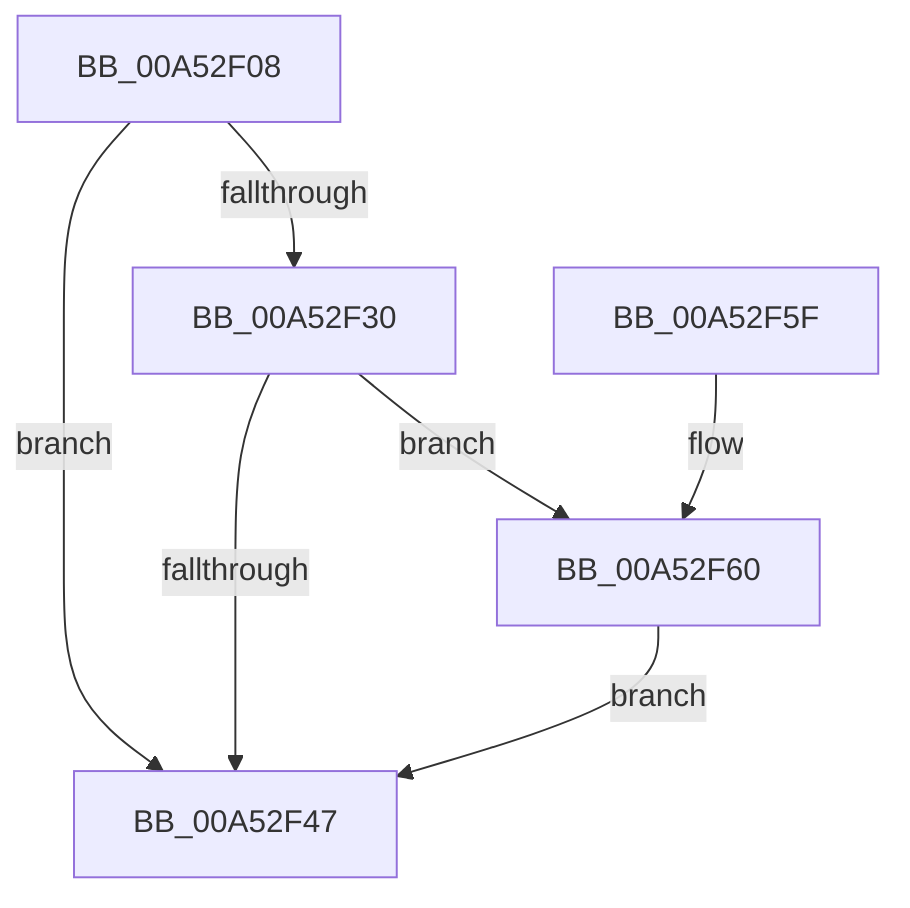

# PpmEventTraceProfileChange

- RVA: `0x00A52F08`–`0x00A52FAF` (길이 `167` bytes)
- VA: `0x0000000140A52F08`
- 실행 섹션: `PAGE`
- PDB 이름 있음: `예`; PDB Function 태그: `아니요`
- unwind 정보 RVA: `0x000B0DA4`
- 디코드: `40`개 명령, `167/167` bytes 표시
- 미해석 바이트: `0` (있으면 어셈블리에 `.byte`로 보존)

> 이 문서는 커널 이미지의 기계어와 PDB 기호를 분석해 생성했습니다. 4번과 5번은 함수 원형과 자료형을 바이너리 사용 방식에서 추정한 C 해석이며 원본 소스 복구 결과는 아닙니다.

## 1. Dependencies

- 직접 호출 지점: **3**; 고유 호출 대상: **3**
- 직접 호출자로 확인된 함수: **1**
- RIP 상대 이미지 참조: **4**

### Outgoing calls
- `0x00A52F3E` → [EtwEventEnabled](../../text/39/EtwEventEnabled_function_00392450.md) (function, `0x00392450`)
- `0x00A52F4F` → [_security_check_cookie](../../text/6A/_security_check_cookie_function_006AC640.md) (function, `0x006AC640`)
- `0x00A52FA8` → [EtwWrite](../../text/41/EtwWrite_function_0041C720.md) (function, `0x0041C720`)

### Direct callers
- [PpmApplyProfile](PpmApplyProfile_function_00A52B08.md) at `0x00A52CB2`

### Static image references
- `0x00A52F12` → RVA `0x00E0A740` (`.data`; read)
- `0x00A52F21` → RVA `0x00E67A39` (`.data`; read)
- `0x00A52F30` → RVA `0x00F083E8` (`.data`; read)
- `0x00A52F37` → RVA `0x0001A6E8` (`.rdata`; read)

## 2. Other-region calls and transfers

- 다른 실행 섹션으로 향하는 call: **3**
  - `0x00A52F3E` → [EtwEventEnabled](../../text/39/EtwEventEnabled_function_00392450.md) (`PAGE` → `.text`)
  - `0x00A52F4F` → [_security_check_cookie](../../text/6A/_security_check_cookie_function_006AC640.md) (`PAGE` → `.text`)
  - `0x00A52FA8` → [EtwWrite](../../text/41/EtwWrite_function_0041C720.md) (`PAGE` → `.text`)
- 별도 외부 분기/꼬리 이동을 확인하지 못했습니다.

## 3. Assembly (complete function range)

```asm
00A52F08  48 89 5C 24 08                  mov qword ptr [rsp + 8], rbx
00A52F0D  57                              push rdi
00A52F0E  48 83 EC 60                     sub rsp, 0x60
00A52F12  48 8B 05 27 78 3B 00            mov rax, qword ptr [rip + 0x3b7827]
00A52F19  48 33 C4                        xor rax, rsp
00A52F1C  48 89 44 24 50                  mov qword ptr [rsp + 0x50], rax
00A52F21  80 3D 11 4B 41 00 00            cmp byte ptr [rip + 0x414b11], 0
00A52F28  48 8B DA                        mov rbx, rdx
00A52F2B  48 8B F9                        mov rdi, rcx
00A52F2E  74 17                           je 0x140a52f47
00A52F30  48 8B 0D B1 54 4B 00            mov rcx, qword ptr [rip + 0x4b54b1]
00A52F37  48 8D 15 AA 77 5C FF            lea rdx, [rip - 0xa38856]
00A52F3E  E8 0D F5 93 FF                  call 0x140392450
00A52F43  84 C0                           test al, al
00A52F45  75 19                           jne 0x140a52f60
00A52F47  48 8B 4C 24 50                  mov rcx, qword ptr [rsp + 0x50]
00A52F4C  48 33 CC                        xor rcx, rsp
00A52F4F  E8 EC 96 C5 FF                  call 0x1406ac640
00A52F54  48 8B 5C 24 70                  mov rbx, qword ptr [rsp + 0x70]
00A52F59  48 83 C4 60                     add rsp, 0x60
00A52F5D  5F                              pop rdi
00A52F5E  C3                              ret
00A52F5F  CC                              int3
00A52F60  83 64 24 3C 00                  and dword ptr [rsp + 0x3c], 0
00A52F65  48 8D 47 08                     lea rax, [rdi + 8]
00A52F69  83 64 24 4C 00                  and dword ptr [rsp + 0x4c], 0
00A52F6E  48 8D 15 73 77 5C FF            lea rdx, [rip - 0xa3888d]
00A52F75  B9 01 00 00 00                  mov ecx, 1
00A52F7A  48 89 44 24 30                  mov qword ptr [rsp + 0x30], rax
00A52F7F  48 8D 43 08                     lea rax, [rbx + 8]
00A52F83  89 4C 24 38                     mov dword ptr [rsp + 0x38], ecx
00A52F87  48 89 44 24 40                  mov qword ptr [rsp + 0x40], rax
00A52F8C  45 33 C0                        xor r8d, r8d
00A52F8F  48 8D 44 24 30                  lea rax, [rsp + 0x30]
00A52F94  89 4C 24 48                     mov dword ptr [rsp + 0x48], ecx
00A52F98  44 8D 49 01                     lea r9d, [rcx + 1]
00A52F9C  48 89 44 24 20                  mov qword ptr [rsp + 0x20], rax
00A52FA1  48 8B 0D 40 54 4B 00            mov rcx, qword ptr [rip + 0x4b5440]
00A52FA8  E8 73 97 9C FF                  call 0x14041c720
00A52FAD  EB 98                           jmp 0x140a52f47
```

## 4. C-style interpretation (structured pseudocode)

```c
__int64 __fastcall PpmEventTraceProfileChange(__int64 a1, __int64 a2, int a3)
{
    __int64 result;
    __int64 v_rsp;
    unsigned __int64 v_stack_m18;
    unsigned __int64 v_stack_p20;
    unsigned __int64 v_stack_p30;
    unsigned int v_stack_p38;
    unsigned int v_stack_p3C;
    unsigned __int64 v_stack_p40;
    unsigned int v_stack_p48;
    unsigned int v_stack_p4C;
    unsigned __int64 v_stack_p8;

    v_stack_p8 = v_rbx;
    v_rsp = (v_rsp) - (96);
    result = (*(unsigned __int64 *)(v_rip + 3897383)) ^ (v_rsp);
    v_stack_m18 = result;
    if ((*(unsigned __int8 *)(v_rip + 4279057)) == 0) goto loc_00A52F47;
    result = EtwEventEnabled(*(unsigned __int64 *)(v_rip + 4936881), v_rip - 10717270, a3, a4);
    if ((unsigned __int8)(result) != 0) goto loc_00A52F60;
loc_00A52F47:
    a1 = (v_stack_m18) ^ (v_rsp);
    result = _security_check_cookie(a1, v_rip - 10717270, a3, a4);
    v_rsp = (v_rsp) + (96);
    return result;
loc_00A52F60:
    v_stack_p30 = a1 + 8;
    v_stack_p38 = 1;
    v_stack_p40 = v_stack_p8 + 8;
    a3 = 0;
    v_stack_p48 = 1;
    v_stack_p20 = v_stack_p30;
    result = EtwWrite(*(unsigned __int64 *)(v_rip + 4936768), v_rip - 10717325, a3, 1 + 1);
    goto loc_00A52F47;
}
```

## 5. (Beta) C Style

```c
int64_t PpmEventTraceProfileChange(void *Arg1, void *Arg2, int32_t Arg3)
{
    uint8_t *arg1 = (uint8_t *)Arg1;
    uint8_t *arg2 = (uint8_t *)Arg2;

    int64_t result;
    int64_t local_rsp;
    uint64_t v_stack_m18;
    uint64_t v_stack_p20;
    uint64_t v_stack_p30;
    uint32_t v_stack_p38;
    uint32_t v_stack_p3C;
    uint64_t v_stack_p40;
    uint32_t v_stack_p48;
    uint32_t v_stack_p4C;
    uint64_t v_stack_p8;

    v_stack_p8 = local_rbx;
    local_rsp = (local_rsp) - (96);
    result = (*(uint64_t *)(v_rip + 0x3B7827)) ^ (local_rsp);
    v_stack_m18 = result;
    if ((*(uint8_t *)(v_rip + 0x414B11)) == 0) goto loc_00A52F47;
    result = EtwEventEnabled(*(uint64_t *)(v_rip + 0x4B54B1), v_rip - 10717270, Arg3, a4);
    if ((uint8_t)(result) != 0) goto loc_00A52F60;
loc_00A52F47:
    Arg1 = (v_stack_m18) ^ (local_rsp);
    result = _security_check_cookie(Arg1, v_rip - 10717270, Arg3, a4);
    local_rsp = (local_rsp) + (96);
    return result;
loc_00A52F60:
    v_stack_p30 = Arg1 + 8;
    v_stack_p38 = 1;
    v_stack_p40 = v_stack_p8 + 8;
    Arg3 = 0;
    v_stack_p48 = 1;
    v_stack_p20 = v_stack_p30;
    result = EtwWrite(*(uint64_t *)(v_rip + 0x4B5440), v_rip - 10717325, Arg3, 1 + 1);
    goto loc_00A52F47;
}
```

### 관측된 메모리 오프셋

구조체 형식이 확인되지 않은 접근은 인자 기준의 오프셋으로만 기록했습니다.

| 기준 인자 | 오프셋 표현 | 폭 (bit) | 접근 |
|---|---:|---:|---|
| `Arg1` | `+ 0x8` | `64` | `R` |
| `Arg2` | `+ 0x8` | `64` | `R` |

## 6. Execution-region graph

[열기: 2D/3D 그래프와 함수 탐색 컨트롤 패널](../../../control-panel.html?section=page&rva=0x00A52F08&view=graph)

- 2D 그래프는 위에서 아래로 흐르고, 3D 그래프는 빈 공간을 드래그해 회전합니다. Shift+드래그는 이동, 휠은 확대·축소, 함수 노드 선택은 대상 보고서 이동입니다.

### Static fallback


